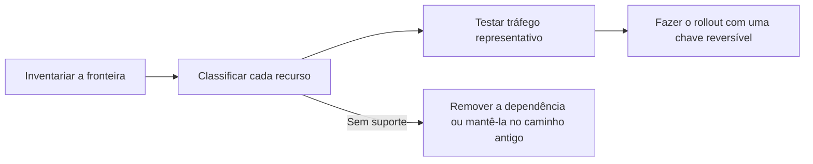

Encontre cada recurso que a integração com o seu gateway atual usa e faça o que a última coluna indica antes de mover o tráfego. Última revisão em 4 de novembro de 2026.

Siga a migração nesta ordem. Ela revela os comportamentos que podem mudar mesmo quando as duas plataformas aceitam a mesma solicitação compatível com OpenAI.

## Inventarie a fronteira da integração

Registre cada lugar em que o gateway atual aparece, para que a migração não deixe um segundo caminho de configuração escondido:

- URLs base e variáveis de ambiente de chaves de API;
- inicialização do SDK e cabeçalhos personalizados;
- IDs de modelo e modelos de fallback;
- ordem de provedores, listas de permissão e requisitos de privacidade;
- código de streaming, chamada de ferramentas e saída estruturada;
- jobs em lote, arquivos, webhooks e consulta de status assíncrono;
- atribuição de solicitações e metadados de usuário ou sessão.

## Solicitações

| Recurso | No Phaseo | Antes da virada |
| --- | --- | --- |
| Autenticação | `Authorization: Bearer $PHASEO_API_KEY` | Troque a URL base e a chave e execute uma solicitação autenticada. |
| Chat Completions | `/v1/chat/completions` | Teste solicitações normais, com streaming, com chamada de ferramentas e com saída estruturada. Campos de nível superior desconhecidos retornam `400`. |
| Responses | `/v1/responses`, sem estado armazenado | Teste formatos de entrada, eventos de streaming, ferramentas e parsing. `previous_response_id` e `conversation` retornam `400`; envie o histórico completo. |
| Anthropic Messages | `/v1/messages` no host raiz `https://api.phaseo.app` | Passe a chave como bearer token e revise cada cabeçalho `anthropic-beta`; o Phaseo não os repassa. |
| IDs de modelo | `<org>/<model>` | Confira cada ID de produção em `GET /v1/models?format=openai`. Não presuma que os aliases coincidem. |
| Embeddings, imagens, áudio, moderações | Com suporte por modelo e provedor | Confirme que o modelo oferece suporte à operação. |

## Roteamento e políticas

| Recurso | No Phaseo | Antes da virada |
| --- | --- | --- |
| Fallbacks de modelo | Array `models`, de 1 a 25 entradas | Os fallbacks são acionados em `429`, `500`, `502`, `503` e `504`, nunca em erros da solicitação. |
| Ordem de provedores | `provider.order` | Recrie apenas a ordem de que a carga de trabalho ainda precisa. |
| Listas de permissão e de exclusão de provedores | `provider.only`, `provider.ignore` | Confira os IDs dos provedores e se resta pelo menos uma rota. |
| Ordenação por preço, latência ou throughput | `provider.sort` | Depois de testar, confira o provedor selecionado nos detalhes da solicitação. |
| Retenção zero de dados | `provider.require_zero_data_retention` (alias `provider.zdr`) | Confirme que o modelo tem um provedor compatível antes de exigir isso. |
| Execução regional e residência de dados | `provider.required_execution_region`, `provider.required_data_region`, padrões de privacidade do espaço de trabalho | Teste uma rota bem-sucedida e também o erro de nenhum provedor compatível. |
| Prompts e padrões compartilhados | [Predefinições](../guides/presets) | Leve a configuração compartilhada para uma predefinição em vez de copiá-la para cada chamador. |

## Operações

| Recurso | No Phaseo | Antes da virada |
| --- | --- | --- |
| Atribuição de app | `X-App-Id`, `X-App-Name`, `HTTP-Referer`, `X-Title`, `X-App-Categories` | Mantenha os cabeçalhos que descrevem a aplicação chamadora; removê-los durante a migração dificulta comparar custo e uso. Confira o agrupamento de apps no painel. Veja [Atribuição de apps](../guides/app-attribution) para os valores de categoria. |
| Rótulos de custo | Rótulos `X-Phaseo-Metadata` | Mapeie propriedades personalizadas ou tags para rótulos. |
| Detalhes da solicitação | Logs de solicitações e `GET /v1/generations?id=<request_id>` | Compare provedor, latência, uso de tokens e preço para prompts representativos. |
| Replay | `replay_request` quando `replay_supported` é `true` | Confirme que o endpoint e o payload de uma solicitação com falha podem ser recuperados. |
| Jobs em lote e assíncronos | APIs de lote, arquivos, vídeo, webhook e WebSocket | Confira as transições de status, a cobrança final, o cancelamento e a obtenção dos resultados. `/v1/files` guarda apenas entradas de lote. |
| Limites de taxa | Cota de solicitações por minuto por usuário, a partir de 10 para um espaço de trabalho novo | Um proxy que envia o tráfego de uma equipe pela chave de um único dono pode atingi-la. Veja [Limites](../api-reference/limits). |
| Rollout gradual | Divisão de tráfego no cliente ou na infraestrutura | Mantenha o rollback como uma troca de URL base e chave até a virada ficar estável. |

## Não disponível

Estes recursos não têm equivalente no Phaseo. Mantenha-os no app ou na plataforma antiga:

- **Cache de respostas.** O Phaseo não armazena respostas em cache. O [cache de prompts](../guides/prompt-caching) ainda reduz o custo de entrada.
- **Respostas e conversas armazenadas.** Não existe `GET` nem `DELETE /v1/responses/{id}`.
- **Contagem de tokens** (`/v1/messages/count_tokens`).
- **OpenAI Assistants, Threads, vector stores, fine-tuning e o legado `/v1/completions`.**

## Classifique cada recurso

Atribua um status a cada comportamento de produção, usando as tabelas acima e o guia da sua [plataforma de origem](./index#platform-migrations):

| Status | Significado |
| --- | --- |
| Inalterado | O mesmo campo de solicitação e o mesmo comportamento de resposta foram verificados. |
| Mapeado | O Phaseo dá o mesmo resultado por meio de outro campo ou configuração. |
| Adaptado | Uma camada de compatibilidade traduz a solicitação ou a resposta. |
| Sem suporte | Remova a dependência ou mantenha essa carga de trabalho no caminho atual. |
| Não verificado | O suporte pode existir, mas ainda não há evidência parecida com produção. |

## Valide com o seu próprio tráfego

A compatibilidade da API não faz com que estes itens se comportem igual:

- seleção automática de provedores e ordem de fallback;
- afinidade do cache de prompts e preço do cache;
- campos de solicitação específicos do provedor e metadados presentes só na resposta;
- limites de taxa e tempo entre novas tentativas;
- políticas de retenção, residência e treinamento de dados;
- disponibilidade exata e preço dos modelos.

Monte um pequeno conjunto de testes a partir de padrões reais da carga de trabalho, sem copiar dados sensíveis de produção, e execute:

1. uma solicitação normal para cada endpoint em uso;
2. streaming pelo mesmo caminho de cliente da produção;
3. chamadas de ferramentas e saídas estruturadas com esquemas realistas;
4. cada restrição de provedor ou de privacidade;
5. chaves inválidas, modelos inválidos, limites de taxa e falhas de provedor indisponível;
6. jobs em lote ou assíncronos passando por sucesso, falha e cancelamento.

Compare a qualidade da saída, a latência, o uso de tokens, o provedor selecionado e o custo final. Registre o ID de cada solicitação para inspecioná-la nos logs de solicitações ou com `GET /v1/generations?id=<request_id>`.

## Faça o rollout com uma chave reversível

Comece pelo tráfego de desenvolvimento e interno. Mova uma pequena parte da produção só depois que o conjunto de testes passar, e mantenha o rollback limitado à URL base e à chave até os resultados se estabilizarem. Não combine a virada com mudanças de prompt, modelo ou roteamento; faça essas mudanças depois que a fronteira do gateway estiver verificada.
