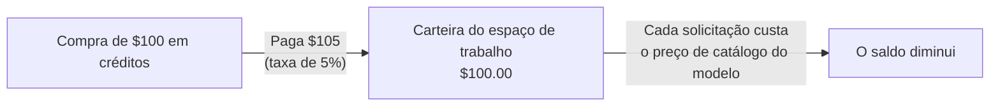

Compre créditos uma vez e gaste-os em solicitações pelo preço de catálogo de cada modelo. A única taxa do Phaseo nas solicitações gerenciadas é de 5% sobre cada compra de créditos, com mínimo de $1; as solicitações em si não têm acréscimo.

## Quanto custa uma recarga

A taxa é o maior valor entre 5% dos créditos que você compra e $1. Ela é somada ao valor que você paga.

| Créditos que você compra | Taxa | Você paga |
| ---: | ---: | ---: |
| $5.00 | $1.00 (mínimo) | $6.00 |
| $20.00 | $1.00 | $21.00 |
| $100.00 | $5.00 | $105.00 |
| $1,000.00 | $50.00 | $1,050.00 |

Visto pelo outro lado, uma cobrança de $100.00 adiciona $95.24 em créditos e uma taxa de $4.76. As recargas pelo painel começam em $5.

Compre créditos em **Configurações -> Cobrança -> Faturamento e créditos** ou, pelo terminal, com `phaseo credits add --amount <usd>` (veja o [início rápido](../quickstart#add-credits-for-paid-models)). A mesma página mostra o seu saldo, a taxa atual e os gastos recentes; **Configurações -> Cobrança -> Transações** lista cada compra.

## O que não usa créditos

| Uso | Cobrança do Phaseo |
| --- | --- |
| Modelos gratuitos (`phaseo/free` e modelos com preço $0) | Nenhuma. Solicitações a modelos gratuitos têm uma cota diária; veja [Planos](../exploring/subscription-plans). |
| Traga sua própria chave (BYOK) | Sem recarga. As primeiras 250.000 solicitações BYOK concluídas por espaço de trabalho em cada mês UTC não têm taxa de serviço; depois disso, a taxa é de 2.5% do custo equivalente no provedor. O seu provedor cobra o uso do modelo. Veja [Considerações sobre BYOK](../guides/routing-and-fallbacks#byok-considerations). |

## Enterprise

O Self Serve Enterprise é uma assinatura mensal separada para SSO, SCIM, gerenciamento de diretório, departamentos e suporte prioritário por e-mail. Começa em $29/mês para até 100 membros do espaço de trabalho e custa $79/mês com 1.000 membros. Ele não inclui créditos nem altera a taxa de 5% (mínimo de $1). [Planos](../exploring/subscription-plans#enterprise-member-pricing) traz os preços completos por membro e como os membros são contados.

Para faturamento, compras corporativas ou condições comerciais personalizadas, entre em contato pela [Central de Ajuda](https://phaseo.app/help). O uso padrão do Gateway não exige o Enterprise.
