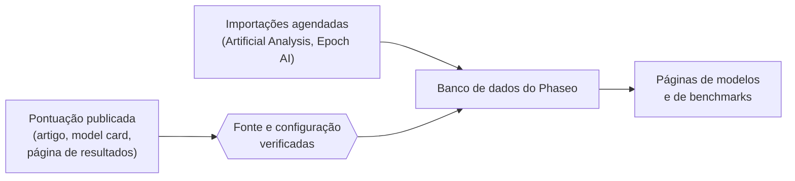

O Phaseo publica pontuações de benchmark medidas por terceiros, cada uma com um link para a origem. Ele não executa benchmarks nem os combina em uma única pontuação.

## De onde vêm as pontuações

| Fonte | Como chega |
| --- | --- |
| Artigos, model cards e anúncios dos desenvolvedores dos modelos | Adicionadas pelos mantenedores, marcadas como **autodeclaradas** |
| Páginas de resultados dos organizadores dos benchmarks | Adicionadas pelos mantenedores |
| Índices da Artificial Analysis e da Epoch AI | Importações agendadas, verificadas a cada hora |
| Relatos da comunidade | Issues no GitHub, publicadas depois que um mantenedor verifica as evidências |

Toda pontuação precisa de uma fonte pública ou de um log de avaliação reproduzível antes de ser publicada.

## O que a normalização significa

O Phaseo mantém cada benchmark na própria escala. Ele normaliza o registro em torno da pontuação, não a pontuação em si:

1. Cada resultado é mapeado para um único ID de benchmark, para que o mesmo benchmark com nomes diferentes fique agrupado.
2. A configuração é mantida como variante quando é diferente, por exemplo no número de exemplos few-shot, no harness ou no esforço de raciocínio, em vez de ser mesclada ao padrão.
3. Cada benchmark tem uma direção de ordenação. Benchmarks em que menor é melhor, como taxas de erro, classificam a menor pontuação primeiro.
4. O link da fonte e a marcação de autodeclarada ficam junto com a pontuação.

A marcação de autodeclarada é uma divulgação, não uma rejeição. Uma pontuação sem contexto suficiente pode ser armazenada com notas sobre a fonte; não a interprete como equivalente a uma linha de leaderboard totalmente verificada.

## Informe uma divergência

1. Abra uma issue com as evidências listadas em [Enviar pontuações de benchmark](./submitting-scores.mdx).
2. Responda às perguntas da revisão na issue. Os mantenedores publicam as correções verificadas pelo editor do banco de dados.
3. Para envios de pesquisa maiores, combine os detalhes no [Discord](https://discord.gg/aQyywCvgZ5).

A página pública de [normalização de benchmarks](https://phaseo.app/how-phaseo-normalises-ai-benchmarks) aborda as mesmas regras para quem lê o catálogo.
