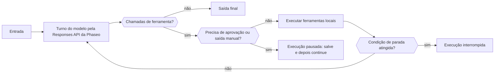

Use um Agent SDK da Phaseo quando uma única requisição não basta: o SDK executa no seu processo um loop limitado que envia cada turno à Responses API, executa as ferramentas que o modelo chama e pausa para uma pessoa quando uma ferramenta precisa de aprovação. Você guarda o estado da execução; a Phaseo não hospeda nada para o agente.

## Escolha seu pacote

| Linguagem | Pacote | Versão | Cliente principal que ele instala |
| --- | --- | --- | --- |
| TypeScript | [`@phaseo/agent-sdk`](https://www.npmjs.com/package/@phaseo/agent-sdk) | 0.3.0 | `@phaseo/sdk` |
| Python | [`phaseo-agent-sdk`](https://pypi.org/project/phaseo-agent-sdk/) (módulo `phaseo_agent`) | 0.3.0 | `phaseo` 3.x |
| Go | [`github.com/phaseoteam/Phaseo/packages/sdk/agent-sdk-go`](https://pkg.go.dev/github.com/phaseoteam/Phaseo/packages/sdk/agent-sdk-go) | v0.3.0 | `sdk-go/v3` |
| C# | [`Phaseo.AgentSdk`](https://www.nuget.org/packages/Phaseo.AgentSdk) | 0.3.0 | `Phaseo.Sdk` |
| PHP | [`phaseo/agent-sdk`](https://packagist.org/packages/phaseo/agent-sdk) | v0.3.0 | `phaseo/sdk` `^3.0.0` |
| Ruby | [`phaseo_agent_sdk`](https://rubygems.org/gems/phaseo_agent_sdk) | 0.3.0 | `phaseo_sdk` `>= 3.0.0, < 4.0.0` |
| Java | `app.phaseo:phaseo-agent-sdk` (Maven Central) | 0.3.0 | `app.phaseo:phaseo-sdk` 3.0.0 |
| Rust | [`phaseo-agent`](https://crates.io/crates/phaseo-agent) | 0.2.0 | `phaseo` 0.2 |

TypeScript é o design de referência. C++ não tem Agent SDK. [Instalação](./installation) traz os comandos de instalação e os requisitos de runtime, e [Uso](./usage) monta um primeiro agente.

<Prompt description="Peça a um agente de programação que crie um primeiro agente com o Agent SDK da Phaseo na sua linguagem." icon="bot" actions={["copy", "cursor"]}>
{`Build a small agent in this project with the Phaseo Agent SDK.

1. Install the Phaseo skills: npx skills add https://phaseo.app/docs
   For TypeScript, follow the phaseo-agent-sdk-typescript skill.
2. Read the Agent SDK pages at https://phaseo.app/docs/v1/sdk-reference/agent/overview, pick this project's language tab, and use only the APIs it documents.
3. Define one agent with at most two local tools that fit [AGENT TASK]. Keep the loop bounded with a step limit, and require approval for any tool that changes data.
4. Use a server-side PHASEO_API_KEY and check the model ID with GET /v1/models before using it.
5. Stream the agent's steps to the console so a run can be inspected.
6. Run the agent once, then report what you verified and what you could not verify.`}
</Prompt>

## Compare o que cada runtime oferece

Todo SDK executa ferramentas locais, pausa em IDs exatos de chamada de ferramenta para aprovação ou saída manual e retorna um estado de execução serializável que seu aplicativo armazena. O restante varia por linguagem:

| Recurso | TypeScript | Python | Go | C# | PHP | Ruby | Java | Rust |
| --- | --- | --- | --- | --- | --- | --- | --- | --- |
| Limite padrão de etapas | 12 | 12 | 8 | 12 | 12 | 12 | 12 | 8 |
| Limite de etapas atingido | Lança `Max steps exceeded` | Lança `RuntimeError` | Retorna um erro | Lança `InvalidOperationException` | Lança exceção | Lança exceção | Lança exceção | Retorna uma execução `stopped` (`max_steps:N`) |
| Streaming do modelo | Iterável assíncrono | Iterador (thread em segundo plano) | Channel | Enumerável assíncrono | Iterável; só avança enquanto você itera (Fiber) | Enumerator (thread de trabalho) | Listas após a execução; ao vivo por `onEvent` | Ainda não |
| Eventos de progresso de ferramentas | Gerador assíncrono | `emit_progress` ou gerador | `EmitProgress` | `EmitProgress` | `emitProgress` | `emit_progress` | `emitProgress` | Ainda não |
| Ferramentas concorrentes | Sim | Sim (threads) | Sim | Sim | Não | Sim (threads) | Sim (pool de threads) | Não |
| Timeout de ferramenta | Aborta `context.signal` | Faz a execução falhar; a thread continua rodando | Faz a chamada falhar; a goroutine continua rodando | Cancela o `CancellationToken` | Verificado depois que a ferramenta retorna | Interrompe a chamada | Interrompe a thread | Nenhum |
| Validação de schema em tempo de execução | Sim | Sim | Sim | Sim | Sim | Sim | Sim | Não; o JSON Schema só é enviado ao modelo |
| Erro de ferramenta por padrão | Faz a execução falhar | Faz a execução falhar | Faz a execução falhar | Faz a execução falhar | Faz a execução falhar | Faz a execução falhar | Faz a execução falhar | Devolvido ao modelo |
| Aprovar e rejeitar por ID de chamada | Sim | Sim | Sim | Sim | Sim | Sim | Sim | Só aprovar |
| Ferramentas interativas (com intervenção humana) | Sim | Sim | Sim | Sim | Sim | Sim | Sim | Só `human_review` no nível do agente |
| Condições de parada | Combináveis | Combináveis; verificadas só em etapas sem chamadas de ferramenta | Combináveis | Combináveis | Combináveis | Combináveis | Combináveis | Limite de etapas |
| Turnos dinâmicos | Sim | Modelo, instruções e amostragem; ferramentas por `next_turn_params` | Sim | Sim | Sim | Sim | Sim | Modelo, limite de etapas e contexto por execução |
| Itens tipados da linha do tempo | União `AgentItem` | Dicts | Mapa `Details` | Dicionário `Details` | Arrays | Hashes | Mapa `details()` | Não; leia `messages` e `steps` |
| Uso e custo | Sim | Sim | Sim | Sim | Sim | Sim | Sim | Tokens, mais custo quando a resposta tem `meta.cost` ou `cost` |
| Cancelamento | `cancel()` | `cancel()` | Context | `CancellationToken` | `cancel()` | `cancel` | `cancel()` | Ainda não |
| Captura do Devtools | Sim | Sim | Sim | Sim | Sim | Sim | Sim | Ainda não |

Rust (`phaseo-agent` 0.2) é síncrono: sem streaming, execução assíncrona, ferramentas concorrentes, validação de schema em tempo de execução nem captura do Devtools. Execute-o em uma thread de trabalho quando uma execução não deve bloquear um handler de requisição. PHP executa as ferramentas uma de cada vez, e seu stream só avança enquanto seu código itera.

## Escolha entre o Agent SDK, o cliente ou a API direta

| Uso | Escolha | O que ele controla |
| --- | --- | --- |
| Uma requisição à API ou cobertura completa dos endpoints | [SDK cliente](../client/overview) | Tipos gerados da API e transporte |
| Lógica de aplicativo com várias etapas que usa ferramentas | Agent SDK | Loop local, ferramentas, checkpoints, revisão, eventos e Devtools |
| Transporte personalizado ou uma linguagem sem suporte | API direta | Tratamento da requisição e da resposta HTTP |

O cliente de gateway de cada Agent SDK envia os turnos do modelo pelo SDK cliente daquela linguagem. A maioria aceita um mapa `requestOptions` (ou o equivalente da linguagem) para campos extras da Responses API; o agente continua definindo `model`, `input`, `instructions` e suas ferramentas de função. O adaptador Rust 0.2 envia só os campos normalizados do agente e não tem gancho para opções extras.

## Comece por uma receita

| Receita | Linguagem |
| --- | --- |
| [Crie um loop de agente durável](../../cookbook/agent-sdk-durable-loop) | TypeScript |
| [Pesquise com saída estruturada e busca na web](../../cookbook/agent-sdk-research-brief) | TypeScript |
| [Triagem de suporte com predefinições e falhas cientes de guardrails](../../cookbook/agent-sdk-support-triage) | TypeScript |
| [Execute um agente de revisão de código com ferramentas de runtime](../../cookbook/agent-sdk-coding-review) | TypeScript |
| [Distribua ferramentas locais do agente em paralelo](../../cookbook/agent-sdk-parallel-tools) | TypeScript |
| [Extraia JSON estruturado](../../cookbook/agent-sdk-python-structured-extraction) | Python |
| [Crie um agente de runbook de operações](../../cookbook/agent-sdk-go-ops-runbook) | Go |
| [Faça a triagem de tickets](../../cookbook/agent-sdk-csharp-ticket-triage) | C# |
| [Revise conteúdo de CMS](../../cookbook/agent-sdk-php-content-review) | PHP |
| [Resuma notas internas](../../cookbook/agent-sdk-ruby-rag-notes) | Ruby |

As receitas em TypeScript podem ser portadas para qualquer linguagem com as APIs destas páginas.
