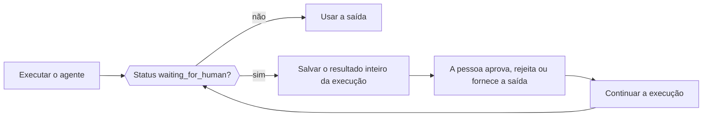

Quando um agente precisa de uma pessoa, de um job externo ou de uma ferramenta que seu aplicativo executa, a execução retorna normalmente (não como erro) com o status `waiting_for_human` e tudo o que é necessário para continuar. Salve o resultado inteiro, colete a decisão no seu aplicativo e depois passe o resultado salvo e a decisão ao método de continuação do agente.



<Note>
A Phaseo não armazena execuções do Agent SDK. Salve o estado retomável no seu próprio aplicativo quando ele precisar sobreviver ao fim de uma requisição ou à reinicialização de um processo.
</Note>

| Linguagem | Continuar | Continuar com streaming | Observações |
| --- | --- | --- | --- |
| TypeScript | `agent.continueRun()` | `agent.continueStream()` | |
| Python | `agent.continue_run()` | `agent.continue_stream()` | |
| Go | `agent.Continue(ctx, ContinueOptions)` | `agent.ContinueStream` | |
| C# | `agent.ContinueRun(ContinueOptions)` | `agent.ContinueStream` | |
| PHP | `$agent->continueRun()` | `$agent->continueStream()` | `continueRunById()` carrega a execução de um acessor de estado primeiro |
| Ruby | `agent.continue_run` | `agent.continue_stream` | |
| Java | `agent.continueRun(ContinueOptions)` | `agent.continueStream` | `ContinueOptions` é um record posicional |
| Rust | `agent.continue_run(&mut client, options)` | Nenhum | `continue_with_events` adiciona um callback de eventos; as execuções são síncronas |

## Aprove ou rejeite chamadas de ferramenta

Ferramentas com aprovação, manuais e com intervenção humana pausam a execução antes de rodar. Cada chamada pendente tem a `call` do modelo (com seu `id`) e um `kind`: `approval`, `manual` ou `hitl`. Responda a cada chamada pelo ID exato da chamada, não pelo nome da ferramenta, para que duas chamadas à mesma ferramenta fiquem separadas.

Uma chamada aprovada executa sua ferramenta. Uma chamada rejeitada envia `{"error": "<reason>"}` ao modelo como resultado da ferramenta, com o motivo padrão `Tool call rejected`.

<CodeGroup>

```typescript TypeScript
const resumed = await agent.continueRun({
  run: paused,
  client,
  approvals: [{ toolCallId: "call_deploy_42" }],
  rejections: [
    { toolCallId: "call_delete_17", reason: "Not authorized" },
  ],
});
```

```python Python
from phaseo_agent import AgentToolDecision

pending = paused.run.pause.pending_tool_calls

continued = agent.continue_run(
    run=paused,
    client=client,
    approvals=[AgentToolDecision(pending[0].call.id)],
    rejections=[AgentToolDecision(pending[1].call.id, "Not authorized")],
)
```

```go Go
var approvals, rejections []phaseoagent.ToolDecision
for _, pending := range result.Run.Pause.PendingToolCalls {
  if pending.Kind != "approval" {
    continue
  }
  if userApproved(pending.Call) {
    approvals = append(approvals, phaseoagent.ToolDecision{ToolCallID: pending.Call.ID})
  } else {
    rejections = append(rejections, phaseoagent.ToolDecision{ToolCallID: pending.Call.ID, Reason: "Not now"})
  }
}

result, err = agent.Continue(ctx, phaseoagent.ContinueOptions{
  Run: result, Client: client, Approvals: approvals, Rejections: rejections,
})
```

```csharp C#
var pending = result.Run.Pause!.PendingToolCalls!.Where(item => item.Kind == "approval");

result = await agent.ContinueRun(new ContinueOptions
{
    Run = result,
    Client = client,
    Approvals = pending.Where(item => UserApproved(item.Call)).Select(item => new ToolDecision(item.Call.Id)).ToList(),
    Rejections = pending.Where(item => !UserApproved(item.Call)).Select(item => new ToolDecision(item.Call.Id, "Not now")).ToList(),
});
```

```php PHP
use Phaseo\AgentSdk\ToolDecision;

$approvals = $rejections = [];
foreach ($result->run->pause->pendingToolCalls as $pending) {
    if ($pending->kind !== "approval") continue;
    if (userApproved($pending->call)) {
        $approvals[] = new ToolDecision($pending->call->id);
    } else {
        $rejections[] = new ToolDecision($pending->call->id, "Not now");
    }
}

$result = $agent->continueRun(run: $result, client: $client, approvals: $approvals, rejections: $rejections);
```

```ruby Ruby
pending = result.run.pause.pending_tool_calls.select { |item| item.kind == "approval" }
approved, declined = pending.partition { |item| user_approved?(item.call) }

result = agent.continue_run(
  run: result,
  client: client,
  approvals: approved.map { |item| PhaseoAgentSdk::ToolDecision.new(tool_call_id: item.call.id) },
  rejections: declined.map { |item| PhaseoAgentSdk::ToolDecision.new(tool_call_id: item.call.id, reason: "Not now") }
)
```

```java Java
var pending = result.run().pause().pendingToolCalls();
var approvals = pending.stream().filter(item -> item.kind().equals("approval") && userApproved(item.call()))
    .map(item -> new AgentSdk.ToolDecision(item.call().id())).toList();
var rejections = pending.stream().filter(item -> item.kind().equals("approval") && !userApproved(item.call()))
    .map(item -> new AgentSdk.ToolDecision(item.call().id(), "Not now")).toList();

result = agent.continueRun(new AgentSdk.ContinueOptions(
    result, client, null, null, null, null, null, null, null, null, null,
    approvals, rejections, List.of()));
```

```rust Rust
use phaseo_agent::{ContinueOptions, ToolDecision};

let approvals = paused.run.pause.as_ref().unwrap()
    .pending_tool_calls
    .iter()
    .map(|pending| ToolDecision {
        tool_call_id: pending.call.id.clone(),
        reason: Some("Approved by the release operator".to_string()),
    })
    .collect();

let mut options = ContinueOptions::new(paused);
options.approvals = approvals;

let completed = agent.continue_run(&mut client, options)?;
```

</CodeGroup>

Onde ficam as chamadas pendentes e o que acontece quando falta uma decisão:

| Linguagem | Chamadas pendentes | Decisão ausente |
| --- | --- | --- |
| TypeScript | `run.pause.pendingToolCalls` | Lança `Missing approval decision for tool call <id>` |
| Python | `run.pause.pending_tool_calls` | Lança `ValueError` |
| Go | `Run.Pause.PendingToolCalls` | Retorna `missing approval decision for tool call <id>` |
| C# | `Run.Pause.PendingToolCalls` | Lança `Missing approval decision for tool call <id>` |
| PHP | `$result->run->pause->pendingToolCalls` | Lança `Missing approval decision for tool call <id>` |
| Ruby | `result.run.pause.pending_tool_calls` | Lança `Missing approval decision for tool call <id>` |
| Java | `run().pause().pendingToolCalls()` | Lança `Missing approval decision for tool call <id>` |
| Rust | `run.pause.pending_tool_calls` (um `Option`) | Retorna um `AgentError` |

A pausa em si também tem um `kind`. Go e C# o definem como `tool_approval` em toda pausa de ferramenta. PHP, Ruby e Java definem `tool_approval` quando alguma chamada pendente precisa de aprovação; caso contrário, usam o tipo da primeira chamada. O Rust usa `tool_approval` para chamadas de aprovação, `external_output` quando todas as chamadas pendentes precisam de um resultado externo e `tool_input` para uma mistura das duas.

<Warning>
O Rust `0.2` não tem tipo de rejeição nem campo `rejections`. Deixe uma chamada não aprovada pausada ou aplique a política de rejeição do seu aplicativo antes de continuar.
</Warning>

Para exigir aprovação em toda chamada de ferramenta em vez de por ferramenta, defina `requireApproval` na definição do agente (`require_approval` no Python e no Ruby, `RequireApproval` no Go e no C#). No TypeScript, é uma função `requireApproval(call, context)`. O Rust só aceita aprovação por ferramenta, com `Tool::require_approval()`. [Ferramentas](./tools) mostra como cada tipo de ferramenta é definido.

## Forneça resultados para ferramentas manuais e com intervenção humana

Para chamadas `manual` e `hitl`, passe o resultado que seu aplicativo produziu, indexado pelo ID da chamada. No Rust, são as ferramentas criadas com `Tool::external(...)`.

<CodeGroup>

```typescript TypeScript
await agent.continueRun({
  run: paused,
  client,
  toolOutputs: [{ toolCallId: callId, output: { status: "shipped" } }],
});
```

```python Python
from phaseo_agent import AgentToolOutput

agent.continue_run(
    run=paused,
    client=client,
    tool_outputs=[AgentToolOutput(call_id, {"status": "shipped"})],
)
```

```go Go
ToolOutputs: []phaseoagent.ToolOutput{{ToolCallID: callID, Output: map[string]any{"status": "shipped"}}},
```

```csharp C#
ToolOutputs = new[] { new ToolOutput(callId, new { status = "shipped" }) },
```

```php PHP
use Phaseo\AgentSdk\ToolOutput;

toolOutputs: [new ToolOutput($callId, ["status" => "shipped"])],
```

```ruby Ruby
tool_outputs: [PhaseoAgentSdk::ToolOutput.new(tool_call_id: call_id, output: { status: "shipped" })]
```

```java Java
// O argumento toolOutputs de ContinueOptions
List.of(new AgentSdk.ToolOutput(callId, Map.of("status", "shipped")))
```

```rust Rust
use phaseo_agent::{ContinueOptions, ToolOutput};
use serde_json::json;

let mut options = ContinueOptions::new(paused);
options.tool_outputs = vec![ToolOutput {
    tool_call_id: call_id,
    output: json!({ "status": "shipped" }),
}];

let completed = agent.continue_run(&mut client, options)?;
```

</CodeGroup>

Uma saída ausente faz a continuação falhar com `Missing output for tool call <id>` (`missing` em minúsculas no Go, um `ValueError` no Python, um `AgentError` no Rust). Uma mensagem de entrada humana não substitui uma saída de ferramenta.

## Pause para revisão humana

Defina um callback de revisão humana na definição do agente para verificar cada resposta do modelo antes de a execução continuar. Retorne uma solicitação de revisão com um `reason` (e, opcionalmente, um `payload`) para pausar, ou nada para seguir em frente. O `kind` da pausa é `human_review`. O callback recebe o ID da execução, o índice da etapa, as mensagens, a resposta do modelo e a saída interpretada (no Rust: os IDs da execução e do agente, o índice da etapa, as mensagens, a resposta e o contexto do aplicativo).

<CodeGroup>

```typescript TypeScript
const agent = createAgent({
  id: "support-agent",
  humanReview: ({ response }) =>
    response.message.content.includes("needs approval")
      ? {
          reason: "approval_required",
          payload: { draft: response.message.content },
        }
      : null,
});
```

```python Python
from phaseo_agent import AgentHumanReviewRequest

def review(context):
    if "needs approval" in context.response.message.content:
        return AgentHumanReviewRequest("approval_required", {"draft": context.response.message.content})
    return None

agent = create_agent({"id": "support-agent", "human_review": review})
```

```go Go
HumanReview: func(review phaseoagent.HumanReviewContext) *phaseoagent.HumanReviewRequest {
  if strings.Contains(review.Response.Message.Content, "refund") {
    return &phaseoagent.HumanReviewRequest{Reason: "Refunds need sign-off"}
  }
  return nil
},
```

```csharp C#
HumanReview = review => Task.FromResult<HumanReviewRequest?>(
    review.Response.Message.Content.Contains("refund")
        ? new HumanReviewRequest("Refunds need sign-off")
        : null),
```

```php PHP
use Phaseo\AgentSdk\HumanReviewRequest;

humanReview: fn ($review) => str_contains($review->response->message->content, "refund")
    ? new HumanReviewRequest("Refunds need sign-off")
    : null,
```

```ruby Ruby
human_review: ->(review) {
  if review.response.message.content.include?("refund")
    PhaseoAgentSdk::HumanReviewRequest.new(reason: "Refunds need sign-off")
  end
}
```

```java Java
AgentSdk.HumanReview review = context ->
    context.response().message().content().contains("refund")
        ? new AgentSdk.HumanReviewRequest("Refunds need sign-off", null)
        : null;
```

```rust Rust
use phaseo_agent::{AgentDefinition, HumanReviewRequest};
use serde_json::json;

let definition = AgentDefinition::new("review-agent", "openai/gpt-6-astra")
    .human_review(|context| {
        if context.response.message.content.contains("needs approval") {
            Some(HumanReviewRequest {
                reason: "Review the proposed action".to_string(),
                payload: json!({ "draft": context.response.message.content }),
            })
        } else {
            None
        }
    });
```

</CodeGroup>

Continue com a entrada humana, que é adicionada à conversa como uma mensagem do usuário:

<CodeGroup>

```typescript TypeScript
const continued = await agent.continueRun({
  run: pausedResult,
  client,
  humanInput: "Approved. Continue and return the final answer.",
});
```

```python Python
continued = agent.continue_run(
    run=paused,
    client=client,
    human_input="Approved. Continue and return the final answer.",
)
```

```go Go
result, err = agent.Continue(ctx, phaseoagent.ContinueOptions{
  Run:        result,
  Client:     client,
  HumanInput: "Approved. Refund up to $50.",
})
```

```csharp C#
result = await agent.ContinueRun(new ContinueOptions
{
    Run = result,
    Client = client,
    HumanInput = "Approved. Refund up to $50.",
});
```

```php PHP
$result = $agent->continueRun(
    run: $result,
    client: $client,
    humanInput: "Approved. Refund up to $50."
);
```

```ruby Ruby
result = agent.continue_run(
  run: result,
  client: client,
  human_input: "Approved. Refund up to $50."
)
```

```java Java
result = agent.continueRun(new AgentSdk.ContinueOptions(
    result, client, null, null, null, null,
    "Approved. Refund up to $50.",          // humanInput
    null, null, null, null));
```

```rust Rust
use phaseo_agent::ContinueOptions;

let mut options = ContinueOptions::new(paused);
options.human_input = Some("Approved. Continue and return the final result.".to_string());

let completed = agent.continue_run(&mut client, options)?;
```

</CodeGroup>

Continuar uma pausa de revisão sem entrada humana falha com `Run <id> is waiting for human input` (Go: `run <id> is waiting for human input`; Java: `Run is waiting for human input`). O Rust exige um `human_input` não vazio. O TypeScript também aceita `humanMessages` estruturadas.

## Salve o estado da execução entre requisições

O resultado da execução é um dado simples: guarde-o no seu banco de dados, no armazenamento de objetos ou no registro do job, e mantenha o `context` do aplicativo serializável. Uma execução só pode ser continuada por um agente com o mesmo ID. [A receita do loop de agente durável](../../cookbook/agent-sdk-durable-loop) mostra um fluxo completo de salvar e retomar.

Para que o SDK salve e carregue as execuções por você, passe um acessor de estado com `load(runId)` e `save(result)`. O SDK então salva depois de cada execução e continuação, e você pode continuar pelo ID da execução em vez de passar o registro por todas as camadas.

| Linguagem | Acessor de estado | Continuar pelo ID |
| --- | --- | --- |
| TypeScript | `state` com `load(runId)` e `save(result)` assíncronos | `continueRun({ runId, state, client })` |
| Python | `state`, implementando `AgentStateAccessor` | `continue_run(run_id=..., state=..., client=...)` |
| Go | `State`, implementando `StateAccessor`, em `RunOptions` e `ContinueOptions` | `ContinueOptions{RunID: id, State: store}` |
| C# | `State`, implementando `IStateAccessor`, em `RunOptions` e `ContinueOptions` | `new ContinueOptions { RunId = id, State = store, Client = client }` |
| PHP | `state`, implementando `StateAccessor` | `continueRunById($runId, $state, $client, approvals: ..., rejections: ..., toolOutputs: ...)`; lança `Run <id> not found` se não existir |
| Ruby | `state:`, qualquer objeto com `load(run_id)` e `save(result)` | `continue_run(run_id: id, state: store, client: client)` |
| Java | `StateAccessor`, o último argumento de `RunOptions` | O `ContinueOptions` de 16 argumentos com `runId` e `state` por último e `run` nulo. Ele carrega a execução, mas não salva o resultado continuado, então salve-o você mesmo. |
| Rust | Nenhum | Serialize `RunResult` com Serde e passe-o a `ContinueOptions::new` |

<CodeGroup>

```go Go
type StateAccessor interface {
  Load(ctx context.Context, runID string) (*phaseoagent.RunResult, error)
  Save(ctx context.Context, result phaseoagent.RunResult) error
}
```

```csharp C#
public interface IStateAccessor
{
    Task<RunResult?> Load(string runId, CancellationToken cancellationToken = default);
    Task Save(RunResult result, CancellationToken cancellationToken = default);
}
```

```rust Rust
use phaseo_agent::RunResult;

// Salve a execução pausada
std::fs::write("paused-run.json", serde_json::to_string_pretty(&paused)?)?;

// Restaure-a depois
let paused: RunResult = serde_json::from_str(&std::fs::read_to_string("paused-run.json")?)?;
```

</CodeGroup>

No Rust, recrie a mesma definição de agente e as mesmas ferramentas antes de continuar: closures e `AgentDefinition` não fazem parte da execução serializada. O modelo efetivo e o limite de etapas ficam guardados em `RunRecord`, então as substituições por execução continuam ativas depois da continuação.

Seja o que for que você armazene, seu aplicativo é responsável pela criptografia e retenção das execuções salvas, pela autorização de aprovações e entradas humanas e pela idempotência dos efeitos colaterais que rodam de novo depois de uma retomada.
