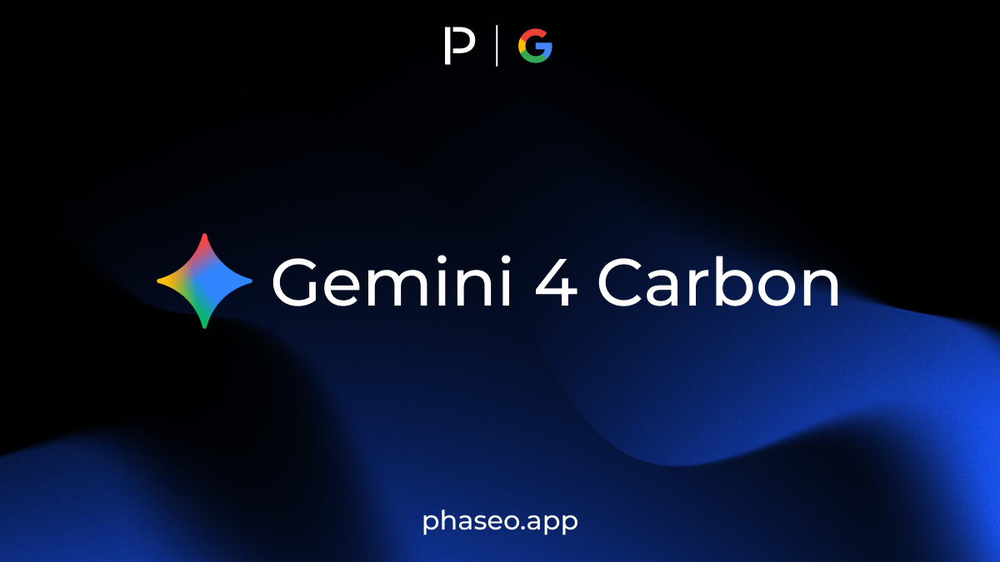
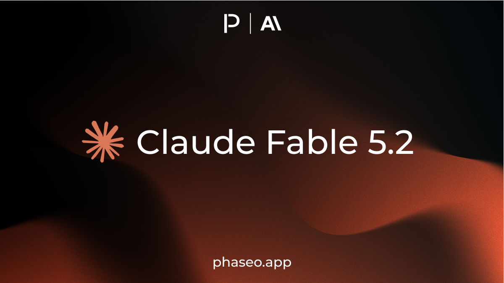
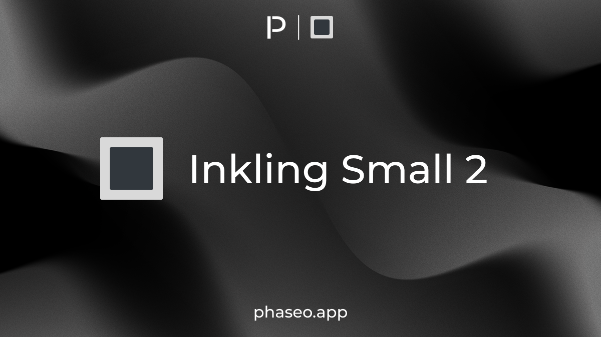
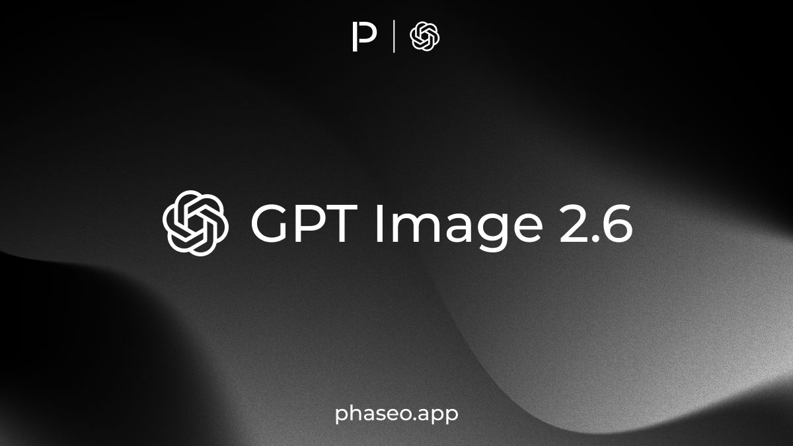
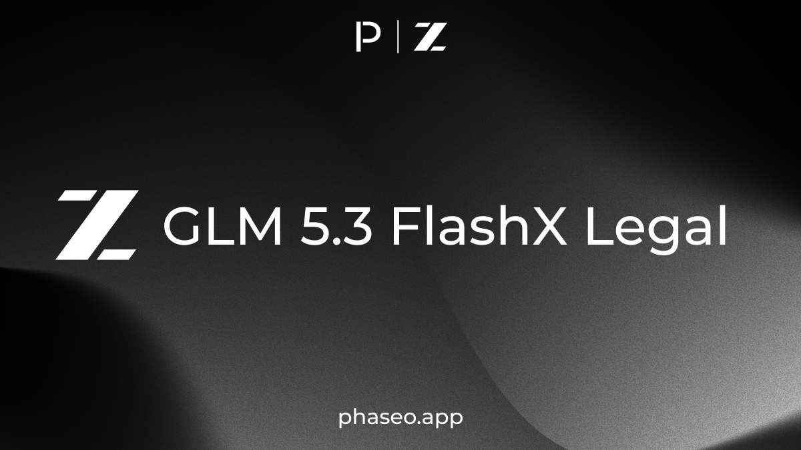

import { ChangelogFilters } from "/snippets/changelog-filters.jsx";

<ChangelogFilters labels={{"product":"Product","api":"API & SDKs","models":"Models"}} clearLabel="Clear" />

<Update label="November 11, 2026">

Product

- **Beta:** Every account can make realtime voice calls in Chat with voice models from OpenAI, Google, xAI and ElevenLabs, and see each call's cost while it runs; see [Realtime voice in Chat](https://phaseo.app/blog/realtime-voice-in-chat) ([#3675](https://github.com/phaseoteam/Phaseo/pull/3675)).

</Update>

<Update label="November 10, 2026">

Models

- [Google: Gemini 4 Carbon](https://phaseo.app/models/google/gemini-4-carbon)
- [MiniMax: MiniMax H3-Image](https://phaseo.app/models/minimax/minimax-h3-image)
- [MiniMax: MiniMax H3-Image Highspeed](https://phaseo.app/models/minimax/minimax-h3-image-highspeed)

</Update>

<Update label="November 9, 2026">

Models

- [Anthropic: Claude Fable 5.2](https://phaseo.app/models/anthropic/claude-fable-5.2)
- [Parallel: Decisions Fast](https://phaseo.app/models/parallel/decisions-fast)

</Update>

<Update label="November 5, 2026">

API & SDKs

- GPT Image 2.6 requests accept `complexity`, animated GIF output, SVG output written by the OpenAI model named in `svg.model`, and `markup`-guided edits; see [Generate an image](./api-reference/endpoint/images-generations.mdx) ([#3571](https://github.com/phaseoteam/Phaseo/pull/3571)).

Models

- [Thinking Machines: Inkling 2 Small](https://phaseo.app/models/thinking-machines/inkling-2-small)

</Update>

<Update label="November 4, 2026">

Product

- Rankings adds a [Decisions](https://phaseo.app/rankings/decisions) page that ranks decision models by token volume, and text rankings no longer count decision requests ([#3527](https://github.com/phaseoteam/Phaseo/pull/3527)).

Models

- [OpenAI: GPT Image 2.6 Flare](https://phaseo.app/models/openai/gpt-image-2.6-flare)
- [OpenAI: GPT Image 2.6 Sunburst](https://phaseo.app/models/openai/gpt-image-2.6-sunburst)
- [Ricursive Intelligence: Ripple 65B Preview](https://phaseo.app/models/ricursive/ripple-65b-preview)

</Update>

<Update label="November 3, 2026">

Product

- Model pages count tool-call and structured-output success only from replies Phaseo checked; before, failed requests counted as valid JSON and hours without data showed 100% ([#3475](https://github.com/phaseoteam/Phaseo/pull/3475)).
- Output speed on model pages leaves out hidden reasoning done before the answer and shows no value when the answer arrives in one piece; see [Measure Pricing and Performance](./exploring/pricing-performance.mdx) ([#3465](https://github.com/phaseoteam/Phaseo/pull/3465), [#3476](https://github.com/phaseoteam/Phaseo/pull/3476)).

API & SDKs

- Streamed Google AI Studio requests to Gemini 2.5, 3 and 3.1 text models, Gemini 3.5 to 3.8 Flash and Gemma 4 now arrive token by token, not all at once ([#3483](https://github.com/phaseoteam/Phaseo/pull/3483)).

</Update>

<Update label="November 2, 2026">

Models

- [z.AI: GLM 5.3 FlashX Legal](https://phaseo.app/models/z-ai/glm-5.3-flashx-legal)

</Update>
