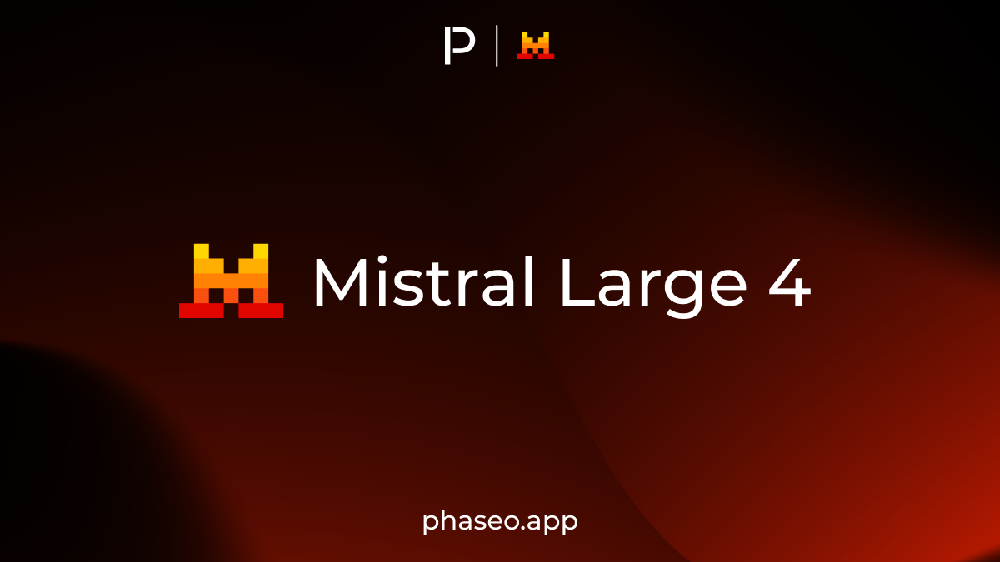
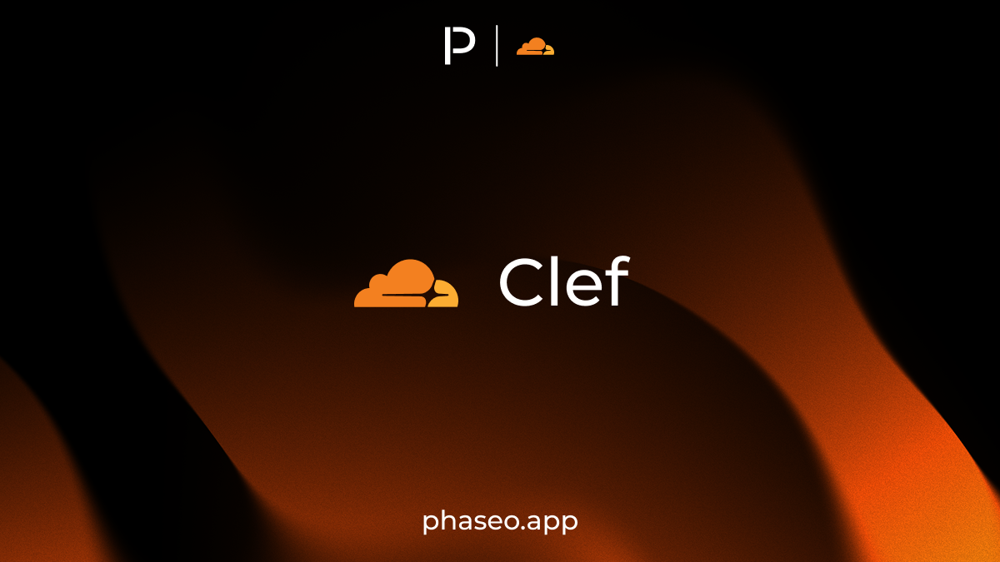

import { ChangelogFilters } from "/snippets/changelog-filters.jsx";

<ChangelogFilters labels={{"product":"Product","api":"API & SDKs","models":"Models"}} clearLabel="Clear" />

<Update label="October 28, 2026">

API & SDKs

- `/v1/embeddings` returns `400 validation_error` when a structured input field is a nested object or array; before, it returned `502` ([#3296](https://github.com/phaseoteam/Phaseo/pull/3296)).
- When every provider rejects a request with the same `400`, `413` or `422`, the gateway returns that status and the provider's message instead of `502` ([#3296](https://github.com/phaseoteam/Phaseo/pull/3296)).
- API key spend limit `429` errors show dollar amounts, such as `$0.0117 of $0.01`, and monthly limits keep their `Retry-After` header ([#3296](https://github.com/phaseoteam/Phaseo/pull/3296)).

</Update>

<Update label="October 27, 2026">

Product

- The preset editor's **Versions and labels** section points named labels at published versions, so moving a label rolls requests back in one click; see [Prompt Templates](./guides/prompt-templates.mdx) ([#3283](https://github.com/phaseoteam/Phaseo/pull/3283)).

API & SDKs

- Preset requests can pin a version or label with `prompt.version` or `model: "@slug@label"`, and an unknown one returns `404 preset_version_not_found`; see [Prompt Templates](./guides/prompt-templates.mdx) ([#3281](https://github.com/phaseoteam/Phaseo/pull/3281)).
- `GET /v1/presets/{id}/labels` lists preset labels, and `PUT` and `DELETE /v1/presets/{id}/labels/{label}` move and remove one; see [Set preset label](./api-reference/endpoint/presets-label-set.mdx) ([#3283](https://github.com/phaseoteam/Phaseo/pull/3283)).
- Streamed Chat Completions, Responses and Messages events now carry the Phaseo model ID in `model`; before, some carried the provider's own ID ([#3273](https://github.com/phaseoteam/Phaseo/pull/3273)).
- `GET /oauth/userinfo` returns `picture`, `name` and `given_name` for tokens with the `profile` scope, taken from the Phaseo profile ([#3189](https://github.com/phaseoteam/Phaseo/pull/3189)).

</Update>

<Update label="October 26, 2026">

Product

- The **Weekly tokens** column on the models page shows real totals again; before, it showed 0 for every model ([#3241](https://github.com/phaseoteam/Phaseo/pull/3241)).

</Update>

<Update label="October 24, 2026">

Product

- Every workspace can use retired model routing: owners and admins turn it on in **Settings -> Routing -> Retired model routing**, and requests go to the approved replacement; see [Model Deprecation and Retirement](./guides/model-retirement.mdx) ([#2899](https://github.com/phaseoteam/Phaseo/pull/2899), [#2896](https://github.com/phaseoteam/Phaseo/pull/2896)).
- Retired model routing uses an approved replacement only when it costs no more than the retired model, unless owners and admins allow a higher price; a replacement they choose themselves is used whatever it costs ([#2899](https://github.com/phaseoteam/Phaseo/pull/2899), [#3211](https://github.com/phaseoteam/Phaseo/pull/3211)).

API & SDKs

- Responses served by a retired model's replacement carry the `x-phaseo-model-substitution` header; see [Model Deprecation and Retirement](./guides/model-retirement.mdx) ([#2896](https://github.com/phaseoteam/Phaseo/pull/2896)).
- The Terraform provider adds `phaseo_rate_limit_policy`, `phaseo_rate_limit_assignment` and `phaseo_department_budget` resources, all importable by ID; see [Rate Limits](./api-reference/limits.mdx) ([#3216](https://github.com/phaseoteam/Phaseo/pull/3216)).

</Update>

<Update label="October 23, 2026">

Product

- Owners and admins can create rate limit policies in **Settings -> Rate limits** with requests per minute, tokens per minute, concurrent requests and **Strict mode**; see [Rate Limits](./api-reference/limits.mdx) ([#3150](https://github.com/phaseoteam/Phaseo/pull/3150), [#3213](https://github.com/phaseoteam/Phaseo/pull/3213)).
- **Settings -> Rate limits** assigns a policy to an API key, member, department, guardrail or the end-user default, and shows its throttled requests over 24 hours ([#3150](https://github.com/phaseoteam/Phaseo/pull/3150)).
- Owners and admins can add daily, weekly or monthly department budgets in **Settings -> Budgets**; they send alerts at 80% and 100% and never block requests ([#3208](https://github.com/phaseoteam/Phaseo/pull/3208)).
- **Key Security** moves to **Settings -> API Keys -> Key Security**, and the keys table adds a **Status** column and sortable columns ([#3184](https://github.com/phaseoteam/Phaseo/pull/3184)).
- Broadcast can send traces to Amazon S3 and S3-compatible storage, Cloudflare R2, Google Cloud Storage, ClickHouse, BigQuery and Snowflake; see [Broadcast](./guides/broadcast.mdx) ([#3181](https://github.com/phaseoteam/Phaseo/pull/3181), [#3182](https://github.com/phaseoteam/Phaseo/pull/3182), [#3185](https://github.com/phaseoteam/Phaseo/pull/3185)).
- New guide: [Broadcast](./guides/broadcast.mdx) lists the settings for every destination type ([#3190](https://github.com/phaseoteam/Phaseo/pull/3190)).
- The compare page adds a 30-day **Activity** chart of each model's tokens and requests through Phaseo ([#3147](https://github.com/phaseoteam/Phaseo/pull/3147)).
- The compare page shows where each model ranks on the capability indexes ([#3148](https://github.com/phaseoteam/Phaseo/pull/3148)).
- Two-model comparisons have their own pages with a summary and FAQ, such as `/compare/anthropic_claude-opus-5.5-vs-openai_gpt-6-astra` ([#3162](https://github.com/phaseoteam/Phaseo/pull/3162)).

API & SDKs

- Rate limit policies enforce `concurrent_requests`, returning `429` with reason `policy_concurrent_requests` and `Retry-After: 1` when every slot is taken; see [Rate Limits](./api-reference/limits.mdx) ([#3212](https://github.com/phaseoteam/Phaseo/pull/3212)).
- Strict rate limit policies (`fail_closed`) check their per-minute limits before the request is sent to a provider ([#3212](https://github.com/phaseoteam/Phaseo/pull/3212)).
- Requests sent through the EU and US regional gateways now reach Broadcast destinations ([#3187](https://github.com/phaseoteam/Phaseo/pull/3187)).

</Update>

<Update label="October 22, 2026">

Product

- The new **Key Security** page flags API keys with no spend limit, expiry, recent use, IP allowlist or recorded storage location, and suggests a fix ([#3159](https://github.com/phaseoteam/Phaseo/pull/3159)).
- Each API key can record where it is stored, such as Vercel, GitHub Actions or 1Password ([#3158](https://github.com/phaseoteam/Phaseo/pull/3158)).
- **Settings -> Budgets** shows each workspace budget's spend, remaining amount and reset time ([#3095](https://github.com/phaseoteam/Phaseo/pull/3095)).
- Broadcast adds 16 destinations, including Langfuse, Datadog LLM Observability, LangSmith, PostHog and Sentry, each with a test button; see [Broadcast](./guides/broadcast.mdx) ([#2962](https://github.com/phaseoteam/Phaseo/pull/2962), [#3080](https://github.com/phaseoteam/Phaseo/pull/3080), [#3083](https://github.com/phaseoteam/Phaseo/pull/3083)).
- Broadcast settings show whether each destination is delivering ([#3102](https://github.com/phaseoteam/Phaseo/pull/3102)).
- **Settings -> Notifications** can send an alert when a Broadcast destination keeps failing ([#3105](https://github.com/phaseoteam/Phaseo/pull/3105)).
- Broadcast webhook destinations accept an optional signing secret ([#3129](https://github.com/phaseoteam/Phaseo/pull/3129)).
- Request details say when zero data retention skipped storing a request's content ([#3178](https://github.com/phaseoteam/Phaseo/pull/3178)).
- The compare page lets you pick the route and service tier under each model, and its prices, cost calculator and verdicts follow that choice ([#3133](https://github.com/phaseoteam/Phaseo/pull/3133)).

API & SDKs

- `/v1/messages` accepts mid-conversation `role: "system"` messages in the positions Claude allows; see [Create a message](./api-reference/endpoint/anthropic-messages.mdx) ([#3165](https://github.com/phaseoteam/Phaseo/pull/3165)).
- The key endpoints and every SDK accept and return `storage_locations`, up to eight places where a key is kept, such as `["railway", "github"]`; see [Create API key](./api-reference/endpoint/keys-create.mdx) ([#3164](https://github.com/phaseoteam/Phaseo/pull/3164)).
- **Beta:** `/v1/department-budgets` sets daily, weekly or monthly USD budgets per department, which alert owners and admins at about 80% and 100% without blocking requests ([#3125](https://github.com/phaseoteam/Phaseo/pull/3125)).
- Zero data retention keeps a request's prompt and response content out of the response cache, data samples and Phaseo's telemetry, whether set by the workspace, a key guardrail or the request ([#3161](https://github.com/phaseoteam/Phaseo/pull/3161), [#3175](https://github.com/phaseoteam/Phaseo/pull/3175)).
- Custom webhook notification deliveries are signed with `x-phaseo-timestamp` and `x-phaseo-signature` (HMAC-SHA256); see [Workspace Notifications](./guides/workspace-notifications.mdx) ([#3089](https://github.com/phaseoteam/Phaseo/pull/3089)).
- Broadcast exports a request's `metadata` as `phaseo.metadata.<key>` span attributes ([#3127](https://github.com/phaseoteam/Phaseo/pull/3127)).
- `trace_name`, `span_name`, `generation_name` and `trace_id` in a request's `metadata` name and group its exported Broadcast traces ([#3127](https://github.com/phaseoteam/Phaseo/pull/3127)).

</Update>

<Update label="October 21, 2026">

Product

- Logged Chat Completions, Responses and Messages requests open in Chat to continue, from request details, the logs table's right-click menu or a session turn; see [Open Requests in Chat](./guides/open-requests-in-chat.mdx) ([#3084](https://github.com/phaseoteam/Phaseo/pull/3084), [#3092](https://github.com/phaseoteam/Phaseo/pull/3092)).
- Owners and admins can limit stored prompts and responses to owners and admins in **Settings -> Privacy -> Who can view contents** ([#3103](https://github.com/phaseoteam/Phaseo/pull/3103)).
- With **Require zero data retention** on, request and response payloads are never stored in request logs ([#3081](https://github.com/phaseoteam/Phaseo/pull/3081)).
- Presets can hold a prompt template with `{{variable}}` placeholders, so requests send only `prompt.id` and the variables; see [Prompt Templates](./guides/prompt-templates.mdx) ([#3085](https://github.com/phaseoteam/Phaseo/pull/3085)).
- The preset editor previews a prompt template as you edit it and has a **Run** button to test it ([#3086](https://github.com/phaseoteam/Phaseo/pull/3086), [#3122](https://github.com/phaseoteam/Phaseo/pull/3122)).
- The **Trace** tab in request details, showing routing, provider attempts, tool calls and the final response, is available to every workspace ([#3082](https://github.com/phaseoteam/Phaseo/pull/3082)).
- The compare page uses one grouped table that highlights the best value in each row, with a switch to show only the rows that differ ([#3116](https://github.com/phaseoteam/Phaseo/pull/3116)).
- `/models` and `/models/table` add a **License** filter, grouped into Permissive, Restricted and Proprietary, and a **Weights** filter for open or closed weights ([#3062](https://github.com/phaseoteam/Phaseo/pull/3062), [#3075](https://github.com/phaseoteam/Phaseo/pull/3075), [#3079](https://github.com/phaseoteam/Phaseo/pull/3079)).

API & SDKs

- **Breaking:** Error responses return `error` as an object with `code`, `message`, `type`, `param` and `metadata`; code that read `error` as a string should read the new top-level `code`; see [Errors and Debugging](./api-reference/errors.mdx) ([#3055](https://github.com/phaseoteam/Phaseo/pull/3055)).
- Chat Completions, Responses, Messages and embeddings responses include `usage.cost` in USD and a `usage.cost_details` breakdown ([#3050](https://github.com/phaseoteam/Phaseo/pull/3050)).
- `POST /v1/keys` returns the new secret at the top level as `key`; see [Create API key](./api-reference/endpoint/keys-create.mdx) ([#3050](https://github.com/phaseoteam/Phaseo/pull/3050)).
- Text endpoints accept explicit `null` for optional parameters, `service_tier: "auto"` and `"scale"`, and `prediction`, which used to return `400` ([#3049](https://github.com/phaseoteam/Phaseo/pull/3049)).
- The `web` and `web-fetch` plugins work on any model, running as Phaseo's web search and web fetch server tools; see [Web Search Server Tool](./guides/server-tools/web-search.mdx) ([#3051](https://github.com/phaseoteam/Phaseo/pull/3051)).
- Rate limit policies enforce `tokens_per_minute` and return `x-ratelimit-limit-tokens`, `x-ratelimit-remaining-tokens` and `x-ratelimit-reset-tokens` headers; see [Rate Limits](./api-reference/limits.mdx) ([#2961](https://github.com/phaseoteam/Phaseo/pull/2961)).
- Rate limit policies assigned to a department now apply to that department's requests ([#3088](https://github.com/phaseoteam/Phaseo/pull/3088)).
- Prompt cache writes bill at the documented rates: 2x input for 1-hour Claude writes and 2.5x input for 12-hour OpenAI writes; see [Prompt Caching](./guides/prompt-caching.mdx) ([#3078](https://github.com/phaseoteam/Phaseo/pull/3078), [#3076](https://github.com/phaseoteam/Phaseo/pull/3076)).
- Responses usage returns `input_tokens_details.cache_write_tokens_details` with the 30-minute and 12-hour cache write split ([#3078](https://github.com/phaseoteam/Phaseo/pull/3078)).

</Update>

<Update label="October 19, 2026">

API & SDKs

- Optional parameters the provider doesn't support, such as `top_k` or `min_p`, are dropped and listed in the `X-Phaseo-Dropped-Params` response header; see [Parameters](./api-reference/parameters.mdx) ([#2999](https://github.com/phaseoteam/Phaseo/pull/2999)).
- A provider failure mid-stream ends the stream with the endpoint's error event instead of a normal finish ([#2990](https://github.com/phaseoteam/Phaseo/pull/2990)).
- A request that every provider rejected with `429` returns `429` with the provider's `Retry-After` ([#2990](https://github.com/phaseoteam/Phaseo/pull/2990)).
- A request rejected as invalid no longer falls back to the other models in `models` ([#2990](https://github.com/phaseoteam/Phaseo/pull/2990)).

</Update>

<Update label="October 18, 2026">

API & SDKs

- The Phaseo plugin for Claude Code bundles the Phaseo MCP server, the Docs MCP server at `https://phaseo.app/docs/mcp` and Phaseo's skills; see [CLI and MCP](./developers/cli-and-mcp.mdx) ([#2949](https://github.com/phaseoteam/Phaseo/pull/2949)).
- Prompt caching is billed at each provider's documented rates; see [Prompt Caching](./guides/prompt-caching.mdx) ([#2964](https://github.com/phaseoteam/Phaseo/pull/2964)).
- Agent turns stay on the provider that holds their prompt cache ([#2969](https://github.com/phaseoteam/Phaseo/pull/2969)).
- Claude requests accept an `agent` cache scope that places cache breakpoints for multi-turn agents; see [Prompt Caching](./guides/prompt-caching.mdx) ([#2957](https://github.com/phaseoteam/Phaseo/pull/2957)).

</Update>

<Update label="October 17, 2026">

Product

- **Settings -> Notifications** adds **Rate Limit Alerts**, sent at most hourly by email, Slack, Discord, Teams or webhook; see [Workspace Notifications](./guides/workspace-notifications.mdx) ([#2946](https://github.com/phaseoteam/Phaseo/pull/2946)).

</Update>

<Update label="October 16, 2026">

Product

- The docs use phaseo.app's design, with a new theme, simpler navigation and a footer with Models, Status and Support links ([#2930](https://github.com/phaseoteam/Phaseo/pull/2930)).
- Every docs page's Markdown and `llms.txt` include instructions for AI agents on authentication, model IDs and endpoints ([#2947](https://github.com/phaseoteam/Phaseo/pull/2947)).
- Phaseo's public skills are published under `/.well-known/agent-skills/` and install with `npx skills add https://phaseo.app/docs` ([#2947](https://github.com/phaseoteam/Phaseo/pull/2947)).

API & SDKs

- The SDK docs add the Java SDK, installed from source; see [Java SDK — Installation](./sdk-reference/java/installation.mdx) ([#2904](https://github.com/phaseoteam/Phaseo/pull/2904)).

</Update>

<Update label="October 15, 2026">

Product

- Signed-in users see a notice under the site header when a model their workspace used in the last 90 days is being deprecated; see [Model Deprecation and Retirement](./guides/model-retirement.mdx) ([#2871](https://github.com/phaseoteam/Phaseo/pull/2871)).
- Model deprecation emails go to the workspace owner, and admins can be added ([#2868](https://github.com/phaseoteam/Phaseo/pull/2868)).
- Usage overview forecasts follow the selected date range ([#2921](https://github.com/phaseoteam/Phaseo/pull/2921)).
- Every figure on the usage overview comes from exact totals; before, it used a sample of recent requests ([#2927](https://github.com/phaseoteam/Phaseo/pull/2927)).

API & SDKs

- **Beta:** `/v1/rate-limits` creates and assigns rate limit policies, and the gateway enforces their `requests_per_minute` for keys, members, guardrails and end users; see [Rate Limits](./api-reference/limits.mdx) ([#2888](https://github.com/phaseoteam/Phaseo/pull/2888), [#2893](https://github.com/phaseoteam/Phaseo/pull/2893)).
- Requests over a policy's `requests_per_minute` return `429 rate_limit_exceeded` with `x-ratelimit-*` headers ([#2893](https://github.com/phaseoteam/Phaseo/pull/2893)).
- Retired models keep serving while any provider route is enabled; once none is left, requests return `410 model_retired`; see [Model Deprecation and Retirement](./guides/model-retirement.mdx) ([#2884](https://github.com/phaseoteam/Phaseo/pull/2884)).
- The Batch API runs Gemini models on Vertex AI with Phaseo-managed keys; see [Video and batch jobs](./guides/async-video-and-batch.mdx) ([#2932](https://github.com/phaseoteam/Phaseo/pull/2932), [#2935](https://github.com/phaseoteam/Phaseo/pull/2935)).
- `/v1/batches/models` lists Gemini batch offers ([#2936](https://github.com/phaseoteam/Phaseo/pull/2936)).

</Update>

<Update label="October 14, 2026">

Product

- **Settings -> Billing & Credits** shows how long your balance will last at the current pace ([#2898](https://github.com/phaseoteam/Phaseo/pull/2898)).
- API key limits show where each window is heading before it resets ([#2895](https://github.com/phaseoteam/Phaseo/pull/2895)).
- Weekly and monthly API key usage shows real amounts; before, it read as zero ([#2895](https://github.com/phaseoteam/Phaseo/pull/2895)).

API & SDKs

- `GET /v1/models` returns an `ETag` and answers `304 Not Modified` to a matching `If-None-Match`; see [List models](./api-reference/endpoint/models.mdx) ([#2916](https://github.com/phaseoteam/Phaseo/pull/2916)).
- Each provider offer in `GET /v1/models` lists the service tiers it accepts ([#2916](https://github.com/phaseoteam/Phaseo/pull/2916)).

</Update>

<Update label="October 13, 2026">

Product

- Each usage overview card shows a month-end forecast for spend, requests and tokens, or the month so far for rates such as cache hit rate ([#2900](https://github.com/phaseoteam/Phaseo/pull/2900)).

</Update>

<Update label="October 12, 2026">

Product

- The models page adds OCR, Document parsing and Translation groups ([#2867](https://github.com/phaseoteam/Phaseo/pull/2867)).
- On the models page, **Audio** opens a row of Speech, Transcription, Translation, Realtime and Music filters ([#2873](https://github.com/phaseoteam/Phaseo/pull/2873), [#2876](https://github.com/phaseoteam/Phaseo/pull/2876)).

API & SDKs

- The top-level `models` fallback list works on every inference endpoint, including `/v1/messages` and the media endpoints; see [Routing and Fallbacks](./guides/routing-and-fallbacks.mdx) ([#2858](https://github.com/phaseoteam/Phaseo/pull/2858)).
- `429` responses for API key request and spend limits include `Retry-After` with the seconds until the limit resets ([#2864](https://github.com/phaseoteam/Phaseo/pull/2864)).

</Update>

<Update label="October 11, 2026">

Product

- Model cards show the cheapest provider's standard input and output prices, with units ([#2831](https://github.com/phaseoteam/Phaseo/pull/2831), [#2832](https://github.com/phaseoteam/Phaseo/pull/2832)).
- The model card pricing hover card names the provider behind the price and lists each priced variant of image and video models ([#2845](https://github.com/phaseoteam/Phaseo/pull/2845), [#2839](https://github.com/phaseoteam/Phaseo/pull/2839)).

API & SDKs

- `GET /v1/models?format=openai` returns the model list in the OpenAI list format, with canonical model IDs; see [List models](./api-reference/endpoint/models.mdx) ([#2838](https://github.com/phaseoteam/Phaseo/pull/2838)).

</Update>

<Update label="October 9, 2026">

Product

- Chat adds an opt-in **Interactive answers** experiment, turned on beside temporary chat, that can answer with comparison cards, tables, bar charts and follow-up forms ([#2778](https://github.com/phaseoteam/Phaseo/pull/2778)).

API & SDKs

- Each workspace member has a requests-per-minute allowance shared across their API keys, rising from 10 to 120 as the workspace becomes established; see [Rate Limits](./api-reference/limits.mdx) ([#2690](https://github.com/phaseoteam/Phaseo/pull/2690), [#2800](https://github.com/phaseoteam/Phaseo/pull/2800)).
- Each user can make 1,500 free-model requests per UTC day, and requests over either limit return `429` with `Retry-After` ([#2690](https://github.com/phaseoteam/Phaseo/pull/2690), [#2787](https://github.com/phaseoteam/Phaseo/pull/2787)).
- The EU and US regional gateways return `403 model_region_unavailable` when no provider serves the model in that region; see [Route text requests by region](./guides/regional-routing.mdx) ([#2811](https://github.com/phaseoteam/Phaseo/pull/2811), [#2813](https://github.com/phaseoteam/Phaseo/pull/2813)).

</Update>

<Update label="October 7, 2026">

API & SDKs

- `/v1/decisions` accepts OpenAI-compatible input with ordered questions and answers, and existing request shapes keep working; see [Make a decision](./api-reference/endpoint/decisions.mdx) ([#2744](https://github.com/phaseoteam/Phaseo/pull/2744)).

Models

- [Anthropic: Claude Haiku 5.5](https://phaseo.app/models/anthropic/claude-haiku-5.5)

</Update>

<Update label="October 6, 2026">

Product

- Model pages show saved specifications such as total and active parameter counts, licence and training tokens ([#2728](https://github.com/phaseoteam/Phaseo/pull/2728)).

Models

- [Mistral: Mistral Large 4](https://phaseo.app/models/mistral/mistral-large-4.0)
- [Google: Nano Banana 2.1](https://phaseo.app/models/google/gemini-nano-banana-2.1)
- [Google: EmbeddingGemma 2](https://phaseo.app/models/google/embeddinggemma-2)

</Update>

<Update label="October 4, 2026">

API & SDKs

- Every request gets a server-generated `G` generation ID shared by response headers, payloads and logs, and a caller's `x-request-id` no longer replaces it; see [Get a generation](./api-reference/endpoint/generation.mdx) ([#2710](https://github.com/phaseoteam/Phaseo/pull/2710)).

</Update>

<Update label="October 3, 2026">

Product

- Owners and admins can open a workspace member's profile from their user chip, with 30 days of requests and spend, top models, keys and recent logs ([#2700](https://github.com/phaseoteam/Phaseo/pull/2700)).

</Update>

<Update label="October 2, 2026">

Product

- Each API key has its own page with usage charts, limits and settings ([#2686](https://github.com/phaseoteam/Phaseo/pull/2686)).
- API keys can be restricted to labelled IPv4 or IPv6 addresses and CIDR ranges ([#2686](https://github.com/phaseoteam/Phaseo/pull/2686)).
- The web app and docs are translated into Spanish, French, German, Brazilian Portuguese, Japanese, Simplified Chinese, Hindi and Arabic, including text that used to fall back to English ([#2681](https://github.com/phaseoteam/Phaseo/pull/2681)).
- The public Monitor page is removed, and saved Monitor landing preferences open Home ([#2683](https://github.com/phaseoteam/Phaseo/pull/2683)).

API & SDKs

- The Phaseo MCP app adds a model explorer with search, filters, comparisons of up to three models, cost estimates and code examples; see [CLI and MCP](./developers/cli-and-mcp.mdx) ([#2680](https://github.com/phaseoteam/Phaseo/pull/2680)).
- The Phaseo MCP app can run a text comparison after you review and approve its estimated cost ([#2680](https://github.com/phaseoteam/Phaseo/pull/2680)).

</Update>

<Update label="October 1, 2026">

Models

- [Cloudflare: Clef](https://phaseo.app/models/cloudflare/clef)
- [Cloudflare: Clef Flash](https://phaseo.app/models/cloudflare/clef-flash)
- [Microsoft: MAI-Voice-2.1](https://phaseo.app/models/microsoft/mai-voice-2.1)
- [Microsoft: MAI-Voice-2.1-Flash](https://phaseo.app/models/microsoft/mai-voice-2.1-flash)
- [Microsoft: MAI-Transcribe-2-Streaming](https://phaseo.app/models/microsoft/mai-transcribe-2-streaming)

</Update>
