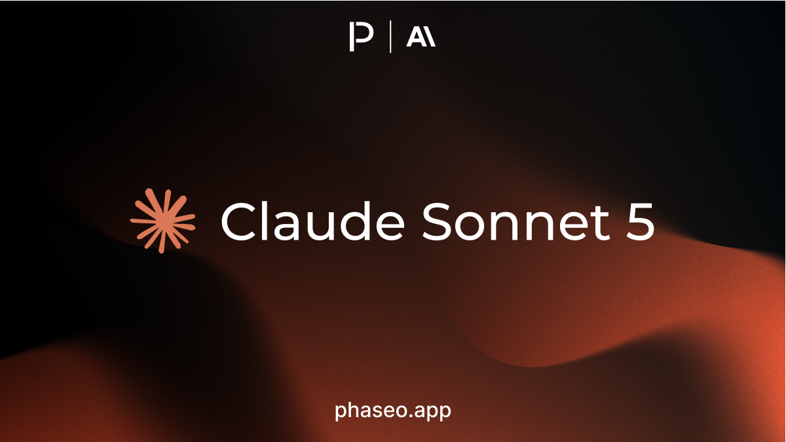
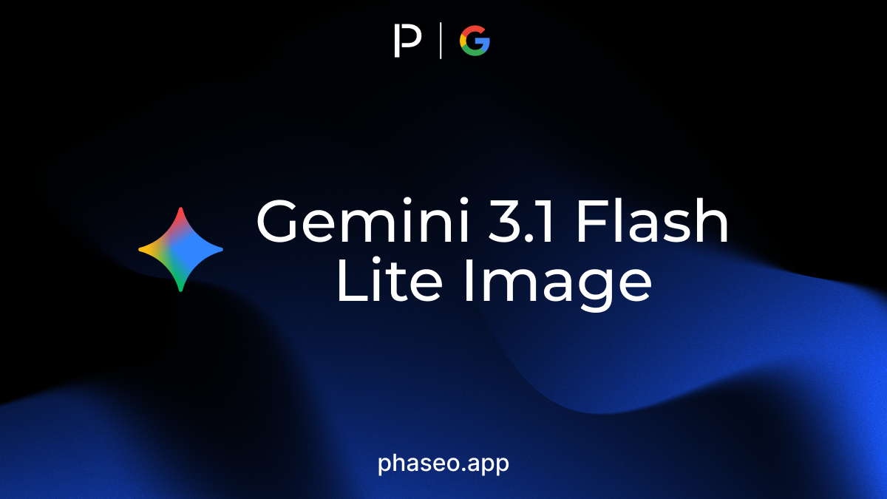
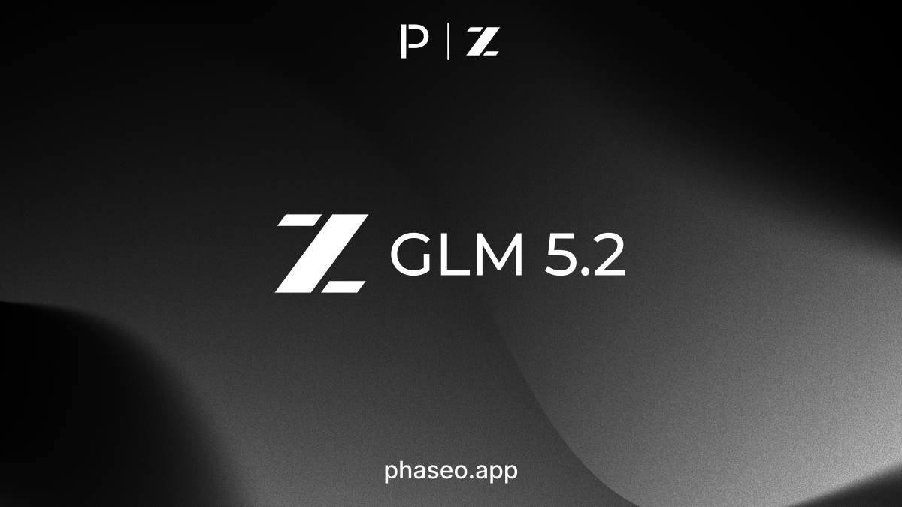
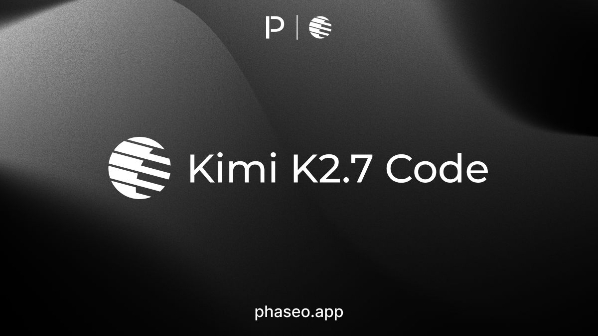
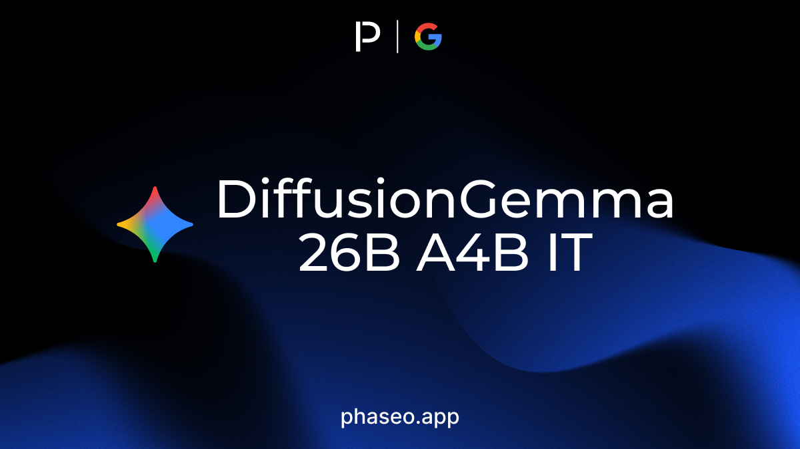
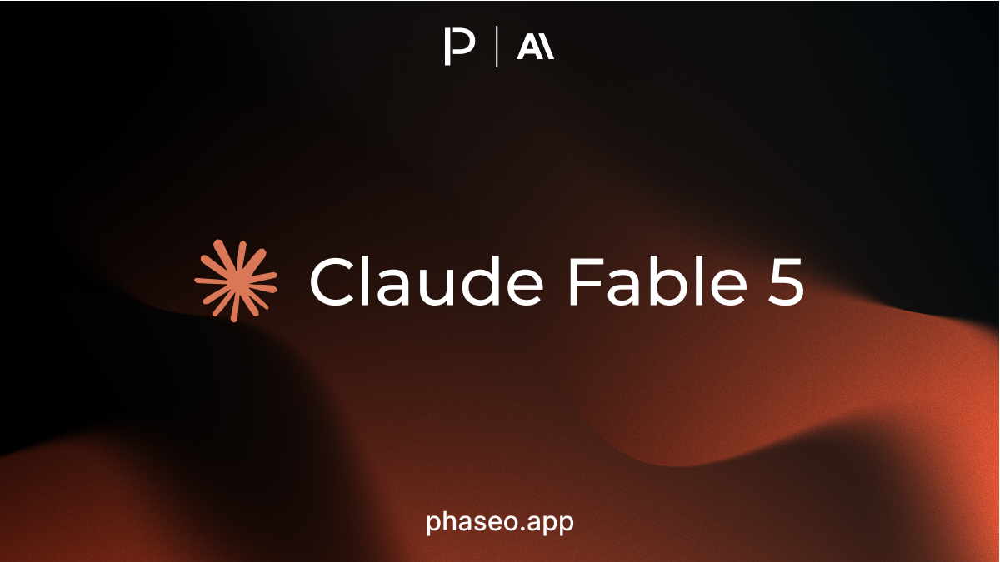
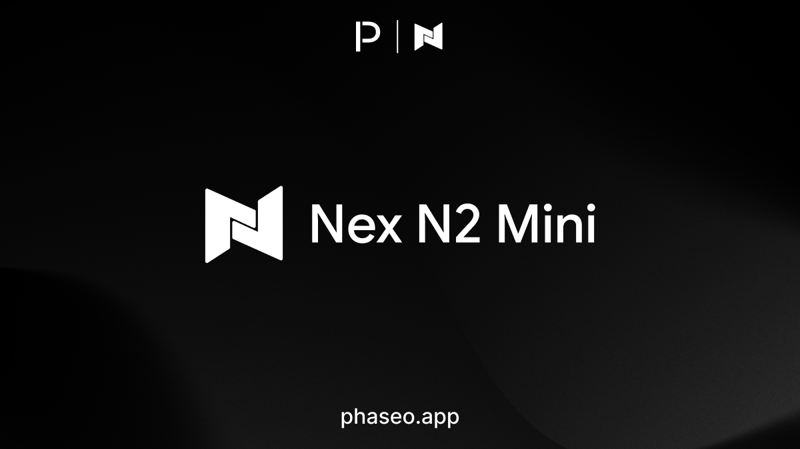
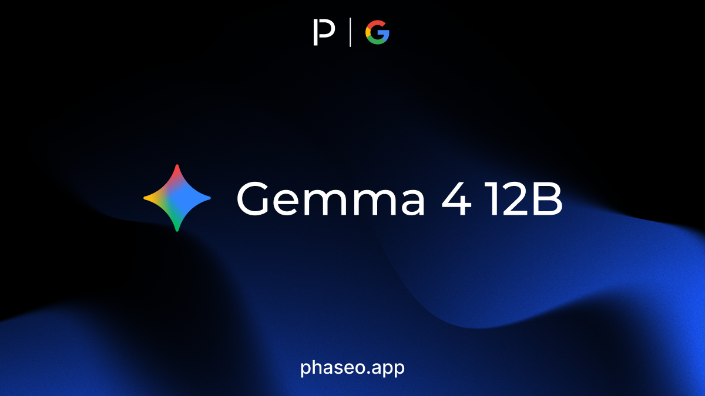
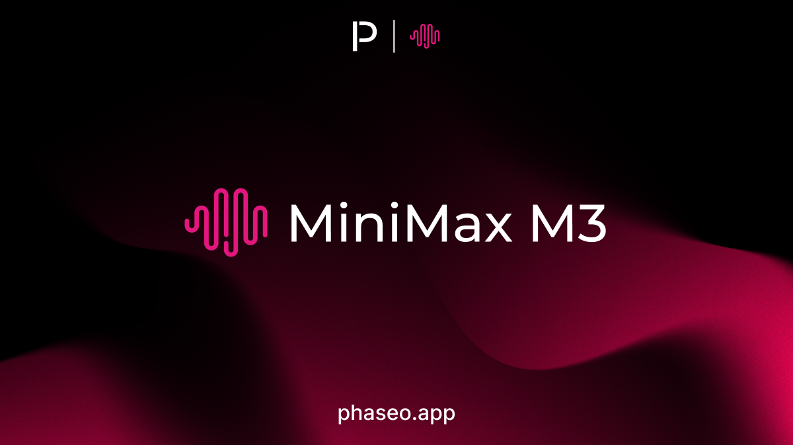

import { ChangelogFilters } from "/snippets/changelog-filters.jsx";

<ChangelogFilters labels={{"product":"Product","api":"API & SDKs","models":"Models"}} clearLabel="Clear" />

<Update label="June 30, 2026">

Models

- [Anthropic: Claude Sonnet 5](https://phaseo.app/models/anthropic/claude-sonnet-5)
- [Google: Gemini Omni Flash Preview](https://phaseo.app/models/google/gemini-omni-flash-preview)
- [Mistral: Leanstral 1.5](https://phaseo.app/models/mistral/leanstral-1.5)
- [Mistral: OCR 4](https://phaseo.app/models/mistral/ocr-4)

</Update>

<Update label="June 29, 2026">

API & SDKs

- The Phaseo Agent SDK for TypeScript `0.1.1` is the first public release, for building multi-step agent loops with tools on top of the gateway; see [Agent SDK Overview](../sdk-reference/agent-sdk/overview.mdx) ([#618](https://github.com/phaseoteam/Phaseo/pull/618), [#610](https://github.com/phaseoteam/Phaseo/pull/610)).

Models

- [Meituan: LongCat 2.0](https://phaseo.app/models/meituan/longcat-2.0)

</Update>

<Update label="June 28, 2026">

Product

- The models page lists announced models as **Coming Soon** with their catalogue prices, and shows partner-only models as **Limited Access** ([#850](https://github.com/phaseoteam/Phaseo/pull/850), [#852](https://github.com/phaseoteam/Phaseo/pull/852)).
- New guide: [OpenAI GPT-5.6](../model-migrations/openai-migrating-to-gpt-5-6.mdx) covers moving to the Sol, Terra and Luna tiers, including reasoning effort and cache pricing ([#850](https://github.com/phaseoteam/Phaseo/pull/850)).

</Update>

<Update label="June 23, 2026">

Models

- [Google: Gemini 3.1 Flash Lite image (Nano Banana 2 Lite)](https://phaseo.app/models/google/gemini-3.1-flash-lite-image)

</Update>

<Update label="June 17, 2026">

Models

- [xAI: Grok Imagine Video 1.5](https://phaseo.app/models/x-ai/grok-imagine-video-1.5)

</Update>

<Update label="June 16, 2026">

Models

- [z.AI: GLM 5.2](https://phaseo.app/models/z-ai/glm-5.2)

</Update>

<Update label="June 15, 2026">

API & SDKs

- Requests with `service_tier: "priority"` now route only to providers that support it, and xAI and Moonshot requests bill at the tier actually served; see [Service Tiers](../guides/service-tiers.mdx) ([#746](https://github.com/phaseoteam/Phaseo/pull/746), [#741](https://github.com/phaseoteam/Phaseo/pull/741), [#745](https://github.com/phaseoteam/Phaseo/pull/745)).

Models

- [ByteDance: Seedance 2.0 Mini (2026-06-15)](https://phaseo.app/models/bytedance/seedance-2.0-mini-260615)

</Update>

<Update label="June 14, 2026">

Models

- [CrofAI: Greg 2 Super](https://phaseo.app/models/crofai/greg-2-super)
- [CrofAI: Greg 2 Ultra](https://phaseo.app/models/crofai/greg-2-ultra)

</Update>

<Update label="June 12, 2026">

Product

- The **Monitor** feed shows model link changes and deprecation and retirement dates, and pricing updates with several plans get a plan toggle ([#703](https://github.com/phaseoteam/Phaseo/pull/703), [#704](https://github.com/phaseoteam/Phaseo/pull/704)).

API & SDKs

- **Beta:** The Phaseo CLI `0.1.1` is the first public release, with browser sign-in, `--json` output and commands to manage keys, workspaces, presets and credits; see [Phaseo CLI](../guides/integrations/phaseo-cli.mdx) ([#618](https://github.com/phaseoteam/Phaseo/pull/618), [#562](https://github.com/phaseoteam/Phaseo/pull/562)).

Models

- [Moonshot: Kimi K2.7 Code](https://phaseo.app/models/moonshotai/kimi-k2.7-code)

</Update>

<Update label="June 11, 2026">

Product

- Chat shows request errors inline under the failed reply, and the composer offers prompt cards that fill in common evaluation and productivity prompts ([#691](https://github.com/phaseoteam/Phaseo/pull/691)).
- Settings splits Activity and Usage into **Observability** pages for Overview, Trends, Explore, Guardrails and Logs ([#693](https://github.com/phaseoteam/Phaseo/pull/693)).

API & SDKs

- Server tools add web search, web fetch, Advisor, image generation, apply patch and datetime to Chat Completions, Responses and Messages requests, billed per use; see [Server Tools](../guides/server-tools/index.mdx) ([#690](https://github.com/phaseoteam/Phaseo/pull/690)).

Models

- [z.AI: GLM 5.2](https://phaseo.app/models/z-ai/glm-5.2)

</Update>

<Update label="June 10, 2026">

Product

- New accounts start at **Onboarding**, a three-step guide to create an API key, choose a model and preview a first request ([#689](https://github.com/phaseoteam/Phaseo/pull/689)).

API & SDKs

- **Breaking:** `GET /v1/models` is now the only model discovery endpoint; `/v1/gateway/models` and `/v1/data/models` are removed, so call `/v1/models` instead; see [List models](../api-reference/endpoint/models.mdx) ([#681](https://github.com/phaseoteam/Phaseo/pull/681)).
- The management API adds `/v1/presets`, `/v1/settings`, `/v1/guardrails` and `/v1/management-keys`, and `GET /v1/me` returns the user and workspace behind an OAuth token ([#562](https://github.com/phaseoteam/Phaseo/pull/562)).

Models

- [Google: DiffusionGemma 26B A4B IT](https://phaseo.app/models/google/diffusiongemma-26b-a4b-it)

</Update>

<Update label="June 9, 2026">

Product

- The **Monitor** page lists model additions, provider additions and provider status changes as separate events, and the footer links to it under **Explore** ([#678](https://github.com/phaseoteam/Phaseo/pull/678), [#679](https://github.com/phaseoteam/Phaseo/pull/679)).

Models

- [Anthropic: Claude Fable 5](https://phaseo.app/models/anthropic/claude-fable-5)
- [Anthropic: Claude Mythos 5](https://phaseo.app/models/anthropic/claude-mythos-5)
- [Google: Gemini 3.5 Live Translate Preview](https://phaseo.app/models/google/gemini-3.5-live-translate-preview)

</Update>

<Update label="June 8, 2026">

Product

- Model page lifecycle cards show each announcement, release, deprecation and retirement date with a relative time badge that gives the exact gap on hover ([#671](https://github.com/phaseoteam/Phaseo/pull/671)).
- New **Methodology** pages explain how Phaseo calculates model pricing, measures latency and throughput, normalises benchmarks and tracks provider availability ([#639](https://github.com/phaseoteam/Phaseo/pull/639)).

</Update>

<Update label="June 7, 2026">

Product

- Model pages now open at the top; before, opening one from far down the models list kept the list's scroll position ([#631](https://github.com/phaseoteam/Phaseo/pull/631)).
- The models list sorts by release or announcement date again; before, some older models such as Whisper 1 appeared first with a 2026 date ([#632](https://github.com/phaseoteam/Phaseo/pull/632)).
- Buying credits works again for workspaces with a missing or invalid saved Stripe customer; before, checkout could fail to start ([#633](https://github.com/phaseoteam/Phaseo/pull/633)).

</Update>

<Update label="June 6, 2026">

Product

- Model pages can show an info, warning or critical notice above the model header, for example about access limits or retirements ([#624](https://github.com/phaseoteam/Phaseo/pull/624)).

</Update>

<Update label="June 5, 2026">

Product

- The model page Quickstart has two steps, getting an API key and copying a ready request, and clicking an accepted model ID now updates the sample ([#556](https://github.com/phaseoteam/Phaseo/pull/556), [#619](https://github.com/phaseoteam/Phaseo/pull/619)).

Models

- [Nex AGI: Nex N2 Mini](https://phaseo.app/models/nex-agi/nex-n2-mini)
- [Nex AGI: Nex N2 Pro](https://phaseo.app/models/nex-agi/nex-n2-pro)

</Update>

<Update label="June 4, 2026">

Product

- Chat shows which provider answered each reply, and the model picker groups models by release month with favourites in their own section ([#610](https://github.com/phaseoteam/Phaseo/pull/610)).
- Chat warns when a saved chat uses a deprecated model and switches to its successor when the catalogue lists one ([#610](https://github.com/phaseoteam/Phaseo/pull/610)).

API & SDKs

- Text requests now reach providers that support only one of the Responses, Chat Completions or Messages endpoints, instead of failing as unsupported ([#610](https://github.com/phaseoteam/Phaseo/pull/610)).

</Update>

<Update label="June 3, 2026">

Models

- [Google: Gemma 4 12B](https://phaseo.app/models/google/gemma-4-12b)

</Update>

<Update label="June 2, 2026">

Product

- The docs changelog combines product, SDK and model release notes in a single timeline instead of separate pages ([#588](https://github.com/phaseoteam/Phaseo/pull/588)).

</Update>

<Update label="June 1, 2026">

Models

- [MiniMax: MiniMax M3](https://phaseo.app/models/minimax/minimax-m3)
- [Nvidia: Nemotron 3 Ultra](https://phaseo.app/models/nvidia/nemotron-3-ultra-550b-a55b)
- [Qwen: Qwen 3.7 Plus](https://phaseo.app/models/qwen/qwen3.7-plus)

</Update>
