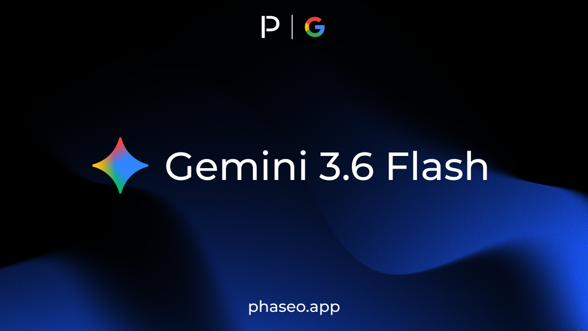
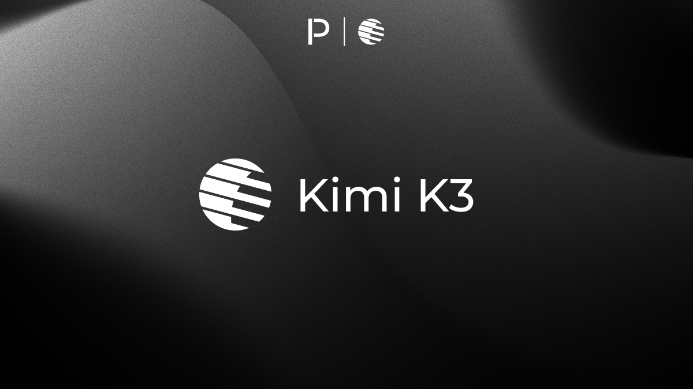
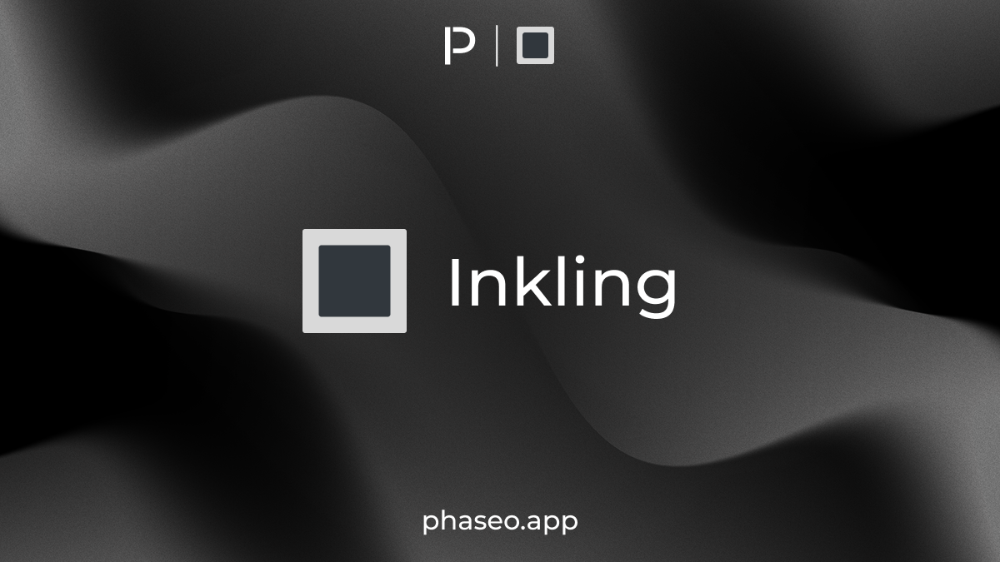
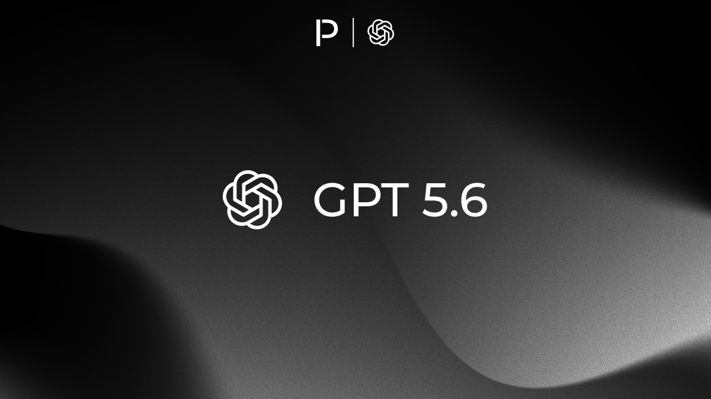
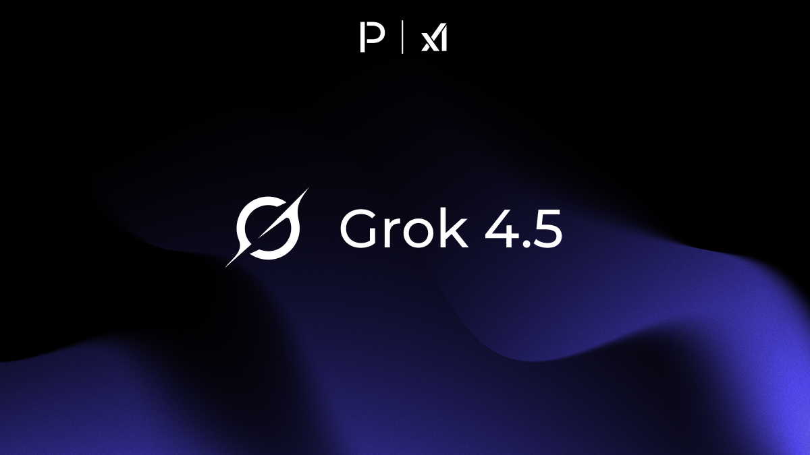
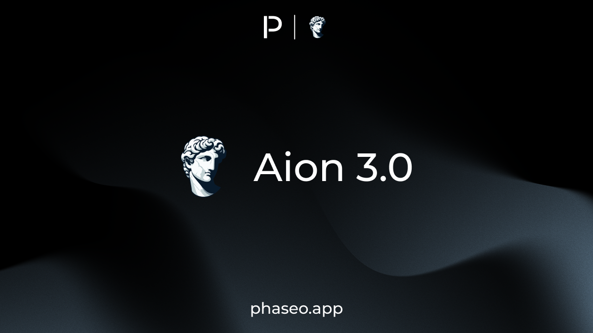
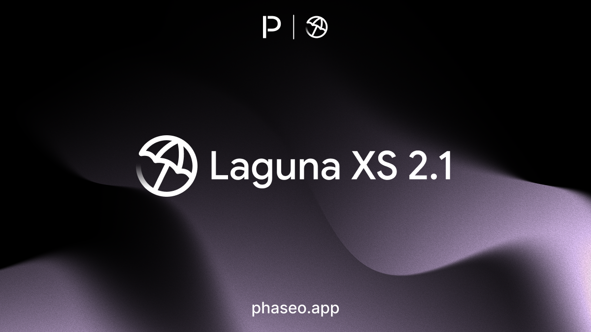

import { ChangelogFilters } from "/snippets/changelog-filters.jsx";

<ChangelogFilters labels={{"product":"Product","api":"API & SDKs","models":"Models"}} clearLabel="Clear" />

<Update label="July 31, 2026">

Product

- Workspaces can build dynamic routes in **Settings -> Routing** that branch on request fields, split traffic and set fallbacks, then attach them to API keys; see [Routing and Fallbacks](../guides/routing-and-fallbacks.mdx) ([#1314](https://github.com/phaseoteam/Phaseo/pull/1314)).
- Logs are split into **Requests**, **Upstream Requests**, **Jobs** and **Sessions**, and each row opens its details in a side sheet ([#1314](https://github.com/phaseoteam/Phaseo/pull/1314)).
- Dropdown menu actions such as Support, workspace switching and key management respond to clicks again; before, some of them did nothing ([#1378](https://github.com/phaseoteam/Phaseo/pull/1378)).

API & SDKs

- Model IDs can name a provider, as in `baseten:thinking-machines/inkling-small`, to send the request only to that provider with no fallback; see [Provider-qualified model IDs](../guides/provider-qualified-models.mdx) ([#1369](https://github.com/phaseoteam/Phaseo/pull/1369)).
- The Phaseo MCP server supports MCP protocol version `2026-07-28` and still accepts clients on earlier versions ([#1341](https://github.com/phaseoteam/Phaseo/pull/1341)).

Models

- [DeepSeek: DeepSeek V4 Flash 0731](https://phaseo.app/models/deepseek/deepseek-v4-flash-0731)
- [LG: K-EXAONE 2.0](https://phaseo.app/models/lg/k-exaone-2.0)
- [MiniMax: MiniMax H3](https://phaseo.app/models/minimax/h3)

</Update>

<Update label="July 30, 2026">

Product

- The Models page no longer shows "Something went wrong" to most visitors, and lists coming-soon and inactive models again with their status counts ([#1345](https://github.com/phaseoteam/Phaseo/pull/1345), [#1347](https://github.com/phaseoteam/Phaseo/pull/1347)).
- Chat model pickers show each model's creator, such as Moonshot AI for Kimi K3, instead of the first provider that serves it ([#1349](https://github.com/phaseoteam/Phaseo/pull/1349)).

API & SDKs

- `service_tier` accepts `"fast"` as an alias for `"priority"`, and both select the same Priority routing and pricing; see [Service Tiers](../guides/service-tiers.mdx) ([#1359](https://github.com/phaseoteam/Phaseo/pull/1359), [#1357](https://github.com/phaseoteam/Phaseo/pull/1357)).

Models

- [Google: Lyria 3.5](https://phaseo.app/models/google/lyria-3.5)
- [Google: Gemini Robotics ER 2 Preview](https://phaseo.app/models/google/gemini-robotics-er-2-preview)
- [Google: Gemini Robotics ER 2 Streaming Preview](https://phaseo.app/models/google/gemini-robotics-er-2-streaming-preview)
- [SpaceXAI: Grok Voice Think Fast 2.0](https://phaseo.app/models/spacex-ai/grok-voice-think-fast-2.0)

</Update>

<Update label="July 27, 2026">

Product

- **Beta:** Fusion is now a room in the Chat room picker, and Chat opens inside the dashboard under the main site header ([#1313](https://github.com/phaseoteam/Phaseo/pull/1313)).

API & SDKs

- `POST /v1/chat/completions` accepts the `stream_options` field instead of rejecting the request ([#1300](https://github.com/phaseoteam/Phaseo/pull/1300)).

</Update>

<Update label="July 26, 2026">

Product

- The pricing calculator compares several models side by side, including long-context rates, and keeps the selection in the page URL ([#1299](https://github.com/phaseoteam/Phaseo/pull/1299)).
- BYOK requests are free for the first 1 million each month, then carry a 2.5% service fee, as shown on the Pricing page ([#1299](https://github.com/phaseoteam/Phaseo/pull/1299)).
- Model pages link to the previous and next model in the family and to the model's licence, and family pages list releases newest first ([#1266](https://github.com/phaseoteam/Phaseo/pull/1266)).
- Model migration guides are named for the model you move to and listed newest first, with a new Claude Opus 5 guide; see [Model Migrations](../model-migrations/index.mdx) ([#1273](https://github.com/phaseoteam/Phaseo/pull/1273)).

API & SDKs

- Agent SDK packages are published for Python, Go, C#, PHP and Ruby alongside TypeScript `0.2.0`, with tool approvals, stop conditions and cancellable streaming; see [Agent SDK Overview](../sdk-reference/agent-sdk/overview.mdx) ([#1263](https://github.com/phaseoteam/Phaseo/pull/1263), [#1269](https://github.com/phaseoteam/Phaseo/pull/1269), [#1259](https://github.com/phaseoteam/Phaseo/pull/1259)).
- The `phaseo` Rust client and the synchronous `phaseo-agent` Rust Agent SDK `0.1.0` are published on crates.io; see [Rust SDK](../sdk-reference/rust/overview.mdx) ([#1287](https://github.com/phaseoteam/Phaseo/pull/1287), [#1289](https://github.com/phaseoteam/Phaseo/pull/1289)).
- `GET /v1/models` returns a `variants` object that links a model's standard and `:free` versions, and the Models page lists each version separately ([#1298](https://github.com/phaseoteam/Phaseo/pull/1298)).
- The Phaseo MCP server offers ten read-only tools for models, providers, costs, credits, usage and request health, and asks only for the seven scopes they need; see [CLI and MCP](../developers/cli-and-mcp.mdx) ([#1290](https://github.com/phaseoteam/Phaseo/pull/1290), [#1292](https://github.com/phaseoteam/Phaseo/pull/1292), [#1297](https://github.com/phaseoteam/Phaseo/pull/1297)).

</Update>

<Update label="July 25, 2026">

Product

- Links to a model, organisation, country or provider that doesn't exist yet open a not-found page instead of a server error ([#1234](https://github.com/phaseoteam/Phaseo/pull/1234), [#1240](https://github.com/phaseoteam/Phaseo/pull/1240)).
- The Web and YouTube updates pages are removed; Model Updates and the release calendar remain ([#1235](https://github.com/phaseoteam/Phaseo/pull/1235)).

API & SDKs

- Streamed OpenAI Chat Completions requests record and bill their token usage; before, many were logged with zero tokens ([#1225](https://github.com/phaseoteam/Phaseo/pull/1225)).
- Phaseo CLI analytics and pricing commands return data again, and read commands work when you are signed in with OAuth ([#1245](https://github.com/phaseoteam/Phaseo/pull/1245), [#1244](https://github.com/phaseoteam/Phaseo/pull/1244)).
- The TypeScript SDK `2.1.1` installs without an interactive postinstall step, which could make clean installs fail ([#1251](https://github.com/phaseoteam/Phaseo/pull/1251), [#1249](https://github.com/phaseoteam/Phaseo/pull/1249)).

</Update>

<Update label="July 24, 2026">

Product

- Provider tables on model pages show the rate that applies now for peak and off-peak pricing, with the other period's rate listed beneath ([#1120](https://github.com/phaseoteam/Phaseo/pull/1120)).

Models

- [Anthropic: Claude Opus 5](https://phaseo.app/models/anthropic/claude-opus-5)

</Update>

<Update label="July 23, 2026">

Product

- Model pages add provider status and privacy filters beside **Providers**, and hide external providers unless you turn them on ([#1205](https://github.com/phaseoteam/Phaseo/pull/1205)).
- Model cards on the Models page show seven-day usage again, counted in tokens, images, video hours, audio seconds or requests depending on the model ([#1210](https://github.com/phaseoteam/Phaseo/pull/1210)).

Models

- [Inclusion AI: Ling 3.0 Flash](https://phaseo.app/models/inclusionai/ling-3.0-flash)

</Update>

<Update label="July 22, 2026">

Product

- Chat shows server tool calls, such as the datetime tool, for Gemini 3.6 Flash and Gemini 3.5 Flash-Lite ([#1198](https://github.com/phaseoteam/Phaseo/pull/1198), [#1199](https://github.com/phaseoteam/Phaseo/pull/1199), [#1196](https://github.com/phaseoteam/Phaseo/pull/1196)).

</Update>

<Update label="July 21, 2026">

API & SDKs

- Requests with tools to Gemini 3.6 Flash and Gemini 3.5 Flash-Lite no longer fail with `502`, and empty Google responses fall back to another provider ([#1182](https://github.com/phaseoteam/Phaseo/pull/1182), [#1190](https://github.com/phaseoteam/Phaseo/pull/1190)).

Models

- [Google: Gemini 3.6 Flash](https://phaseo.app/models/google/gemini-3.6-flash)
- [Google: Gemini 3.5 Flash-Lite](https://phaseo.app/models/google/gemini-3.5-flash-lite)
- [Mind Lab: Macaron V1 Venti](https://phaseo.app/models/mindai/macaron-v1-venti)
- [Sakana AI: Fugu Cyber](https://phaseo.app/models/sakana/fugu-cyber)

</Update>

<Update label="July 19, 2026">

Models

- [Poolside: Laguna S 2.1](https://phaseo.app/models/poolside/laguna-s-2.1)
- [Qwen: Qwen3.8 Max Preview](https://phaseo.app/models/qwen/qwen3.8-max-preview)

</Update>

<Update label="July 17, 2026">

API & SDKs

- The Phaseo MCP server accepts OAuth sign-in, including dynamic client registration and token exchange for browser-based MCP clients; see [CLI and MCP](../developers/cli-and-mcp.mdx) ([#1123](https://github.com/phaseoteam/Phaseo/pull/1123), [#1126](https://github.com/phaseoteam/Phaseo/pull/1126), [#1128](https://github.com/phaseoteam/Phaseo/pull/1128)).

</Update>

<Update label="July 16, 2026">

Product

- Every account can add passkeys in account settings and use them to sign in; adding or removing a passkey asks you to confirm your identity again ([#1041](https://github.com/phaseoteam/Phaseo/pull/1041), [#1046](https://github.com/phaseoteam/Phaseo/pull/1046)).
- Picking a model on a new Chat page starts the chat; before, the picker stayed open and the composer stayed disabled ([#1044](https://github.com/phaseoteam/Phaseo/pull/1044)).
- Chat **Personalization** settings choose whether new chats start blank or keep your selected models ([#1047](https://github.com/phaseoteam/Phaseo/pull/1047)).
- Model pricing tables show providers' list prices when a model has no routed traffic yet, instead of blank values ([#1037](https://github.com/phaseoteam/Phaseo/pull/1037)).

Models

- [Moonshot: Kimi K3](https://phaseo.app/models/moonshotai/kimi-k3)

</Update>

<Update label="July 15, 2026">

API & SDKs

- Third-party apps can use OAuth with PKCE to get a scoped gateway key that bills the user's workspace, only after the user grants `gateway:access` ([#1028](https://github.com/phaseoteam/Phaseo/pull/1028), [#1019](https://github.com/phaseoteam/Phaseo/pull/1019), [#1032](https://github.com/phaseoteam/Phaseo/pull/1032)).

Models

- [Thinking Machines Lab: Inkling](https://phaseo.app/models/thinking-machines/inkling)
- [Thinking Machines Lab: Inkling 64K](https://phaseo.app/models/thinking-machines/inkling-64k)
- [Thinking Machines Lab: Inkling Small](https://phaseo.app/models/thinking-machines/inkling-small)

</Update>

<Update label="July 14, 2026">

API & SDKs

- Management API keys use the `phaseo_v1_mk_` prefix and need explicit scopes, with **Read**, **Write** and **All** templates; see [Management API Keys](../developers/management-api-keys.mdx) ([#969](https://github.com/phaseoteam/Phaseo/pull/969)).
- The Phaseo CLI adds `phaseo logs list` and `phaseo logs get <request-id>` to inspect redacted request records, and uses `https://api.phaseo.app` by default ([#972](https://github.com/phaseoteam/Phaseo/pull/972)).

</Update>

<Update label="July 13, 2026">

Product

- Model pages open a provider sheet that groups prices by modality, including image, video, embedding and OCR meters, and compares service tiers ([#1000](https://github.com/phaseoteam/Phaseo/pull/1000), [#1001](https://github.com/phaseoteam/Phaseo/pull/1001)).

</Update>

<Update label="July 11, 2026">

Product

- The Models page has Card and Table views with the same filters, including service tier, context length and parameters; old Collections links redirect to matching filters ([#971](https://github.com/phaseoteam/Phaseo/pull/971)).
- The Rankings page adds a sticky modality selector and a table of contents for its leaderboard sections ([#967](https://github.com/phaseoteam/Phaseo/pull/967)).
- Chat renders LaTeX math in responses, both inline and as display blocks ([#965](https://github.com/phaseoteam/Phaseo/pull/965)).

</Update>

<Update label="July 10, 2026">

Product

- Chat shows the error when a streamed response fails, instead of saving a blank reply ([#955](https://github.com/phaseoteam/Phaseo/pull/955), [#952](https://github.com/phaseoteam/Phaseo/pull/952)).
- Chat shows detailed reasoning summaries for OpenAI GPT-5.6 models ([#963](https://github.com/phaseoteam/Phaseo/pull/963)).

API & SDKs

- Responses and Chat Completions accept `reasoning.effort: "max"` and a `reasoning.mode` field, which sends GPT-5.6 `-pro` models to OpenAI in Pro mode ([#950](https://github.com/phaseoteam/Phaseo/pull/950)).
- Requests to OpenAI carry a `safety_identifier` that Phaseo sets from your workspace; any value sent in the request is ignored ([#950](https://github.com/phaseoteam/Phaseo/pull/950)).

</Update>

<Update label="July 9, 2026">

Product

- AI Stats is now Phaseo: the website, Chat, dashboard and docs use the new name at phaseo.app ([#913](https://github.com/phaseoteam/Phaseo/pull/913)).

API & SDKs

- **Breaking:** SDK packages, imports and environment variables use Phaseo names, such as `@phaseo/sdk` and `PHASEO_API_KEY`, with no AI Stats aliases; update them when you upgrade ([#913](https://github.com/phaseoteam/Phaseo/pull/913)).
- **Deprecated:** API keys in the old AI Stats format stop working on January 1, 2027; new keys use the `phaseo_` prefix, so replace old keys before then ([#913](https://github.com/phaseoteam/Phaseo/pull/913)).

Models

- [OpenAI: GPT 5.6 Sol](https://phaseo.app/models/openai/gpt-5.6-sol)
- [OpenAI: GPT 5.6 Terra](https://phaseo.app/models/openai/gpt-5.6-terra)
- [OpenAI: GPT 5.6 Luna](https://phaseo.app/models/openai/gpt-5.6-luna)
- [Meta: Muse Spark 1.1](https://phaseo.app/models/meta/muse-spark-1.1)

</Update>

<Update label="July 8, 2026">

Models

- [SpaceXAI: Grok 4.5](https://phaseo.app/models/spacex-ai/grok-4.5)
- [OpenAI: GPT Live 1](https://phaseo.app/models/openai/gpt-live-1)
- [OpenAI: GPT Live 1 Mini](https://phaseo.app/models/openai/gpt-live-1-mini)
- [KwaiKAT: Kat Coder Air V2.5](https://phaseo.app/models/kwaipilot/kat-coder-air-v2.5)
- [KwaiKAT: Kat Coder Pro V2.5](https://phaseo.app/models/kwaipilot/kat-coder-pro-v2.5)

</Update>

<Update label="July 7, 2026">

Product

- After you create or rotate an API key, you can copy it as a `.env` file or app config snippet, save it to 1Password, or send a test request ([#812](https://github.com/phaseoteam/Phaseo/pull/812)).
- The Chat composer can record audio and attach it to a message, and the account menu shows your credits balance ([#922](https://github.com/phaseoteam/Phaseo/pull/922)).

Models

- [Aion Labs: Aion 3.0](https://phaseo.app/models/aion-labs/aion-3.0)
- [Aion Labs: Aion 3.0 Mini](https://phaseo.app/models/aion-labs/aion-3.0-mini)
- [Meta: Muse Image](https://phaseo.app/models/meta/muse-image)
- [Meta: Muse Video](https://phaseo.app/models/meta/muse-video)
- [Sakana AI: Fugu](https://phaseo.app/models/sakana/fugu)
- [Sakana AI: Fugu Ultra](https://phaseo.app/models/sakana/fugu-ultra)
- [Tencent Hunyuan: Hy3](https://phaseo.app/models/tencent/hy3)

</Update>

<Update label="July 6, 2026">

Product

- The pricing calculator adds a **Pricing Time (HH:MM UTC)** field that shows the rates in effect at that time for models with peak and off-peak pricing ([#864](https://github.com/phaseoteam/Phaseo/pull/864)).

Models

- [OpenAI: GPT Realtime 2.1](https://phaseo.app/models/openai/gpt-realtime-2.1)
- [OpenAI: GPT Realtime 2.1 Mini](https://phaseo.app/models/openai/gpt-realtime-2.1-mini)
- [Tencent Hunyuan: Hy3](https://phaseo.app/models/tencent/hy3)

</Update>

<Update label="July 5, 2026">

API & SDKs

- Claude Sonnet 5 requests use Anthropic's adaptive thinking and no longer send thinking budgets or sampling parameters the model rejects ([#901](https://github.com/phaseoteam/Phaseo/pull/901)).

</Update>

<Update label="July 4, 2026">

Product

- Chat adds keyboard shortcuts with a reference dialog, a queue for prompts sent while a reply is running, and bulk editing of chats ([#896](https://github.com/phaseoteam/Phaseo/pull/896)).

</Update>

<Update label="July 3, 2026">

Product

- Chat can tag conversations again and filter the sidebar by tag; tags are stored in your browser ([#894](https://github.com/phaseoteam/Phaseo/pull/894)).
- Chat shows reasoning, tool calls and the answer in the order they happened, and each tool call's input and output can be expanded ([#895](https://github.com/phaseoteam/Phaseo/pull/895), [#919](https://github.com/phaseoteam/Phaseo/pull/919)).
- On Android, the Chat composer stays above the on-screen keyboard instead of being covered by it ([#891](https://github.com/phaseoteam/Phaseo/pull/891)).

API & SDKs

- The `phaseo:datetime` server tool can return the current time in several timezones in one call; see [Datetime Server Tool](../guides/server-tools/datetime.mdx) ([#895](https://github.com/phaseoteam/Phaseo/pull/895)).

</Update>

<Update label="July 2, 2026">

Models

- [Poolside: Laguna XS 2.1](https://phaseo.app/models/poolside/laguna-xs-2.1)

</Update>

<Update label="July 1, 2026">

Models

- [Anthropic: Claude Fable 5](https://phaseo.app/models/anthropic/claude-fable-5)

</Update>
