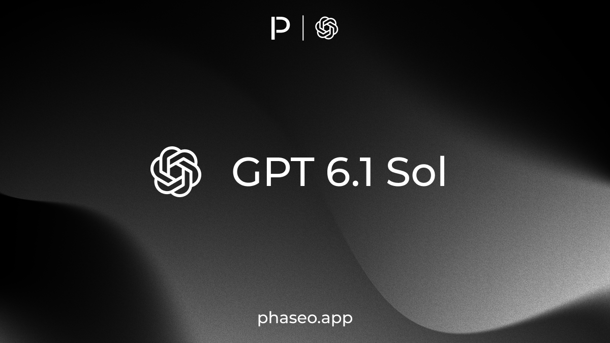
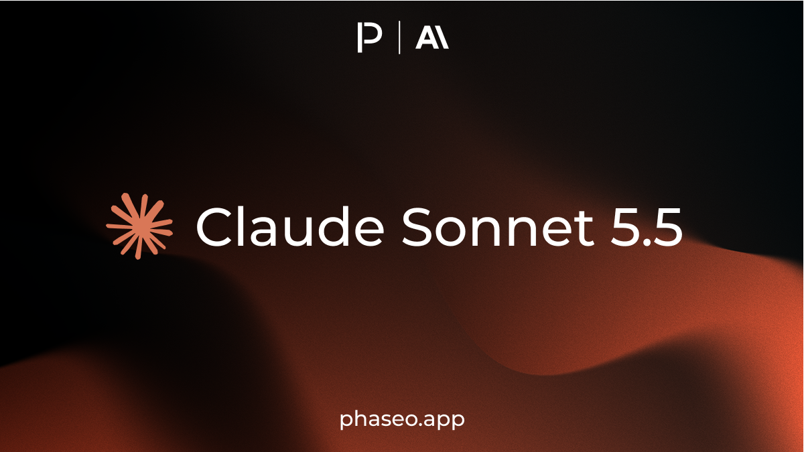
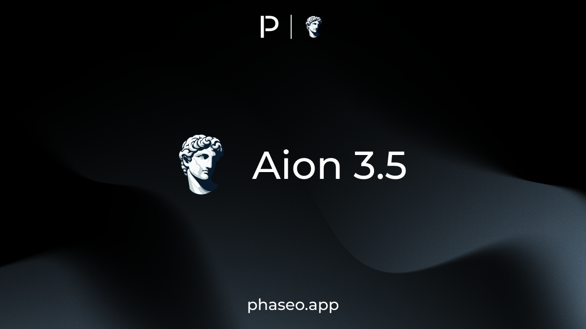
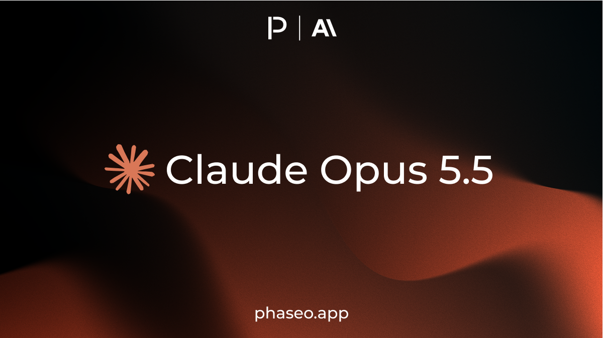
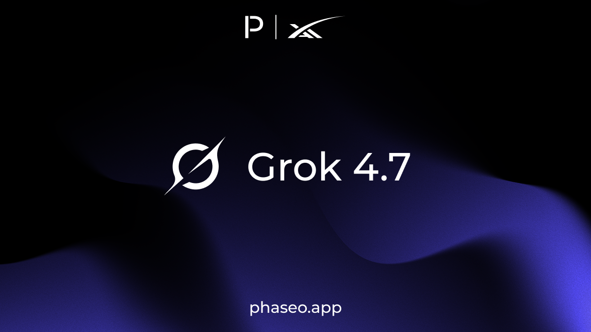
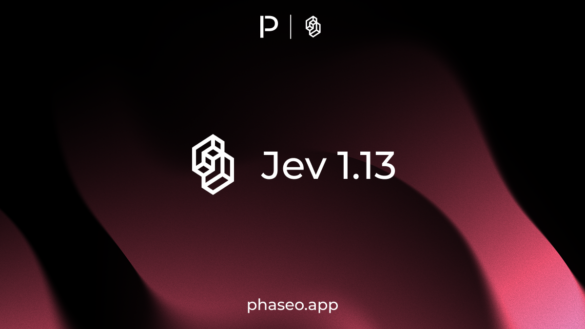
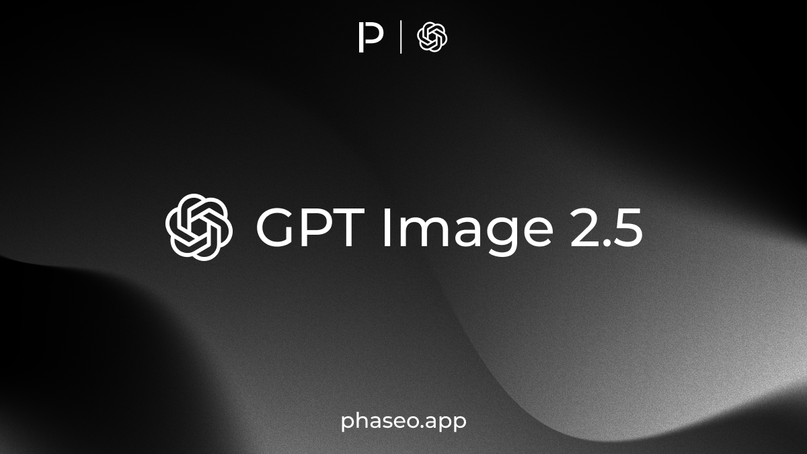
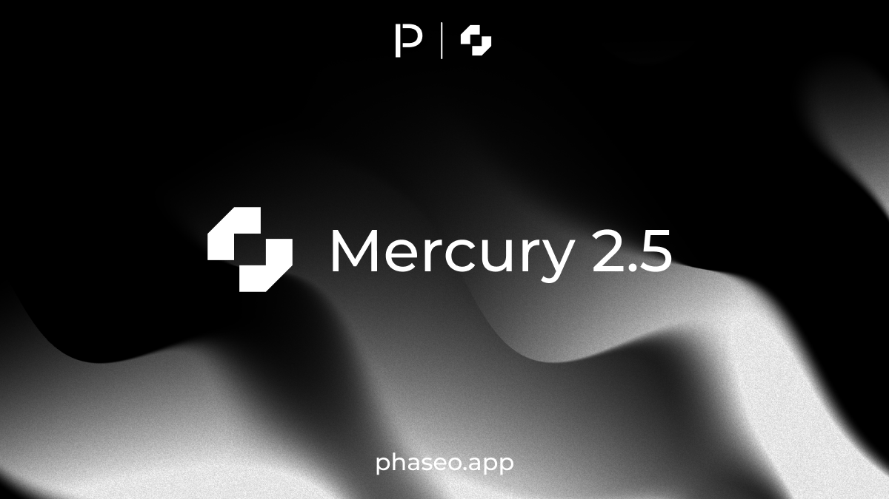
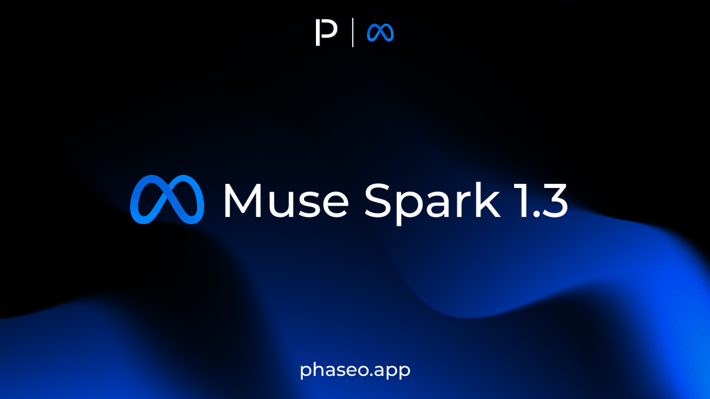
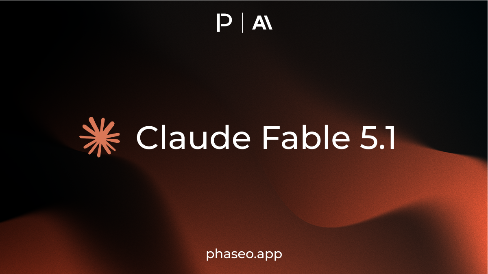

import { ChangelogFilters } from "/snippets/changelog-filters.jsx";

<ChangelogFilters labels={{"product":"Product","api":"API & SDKs","models":"Models"}} clearLabel="Clear" />

<Update label="September 30, 2026">

Models

- [Voyage: Rerank 3](https://phaseo.app/models/voyage/rerank-3)
- [Voyage: Rerank 3 Lite](https://phaseo.app/models/voyage/rerank-3-lite)
- [Cohere: Embed 5 Pro](https://phaseo.app/models/cohere/embed-v5.0-pro)
- [Cohere: Embed 5 Fast](https://phaseo.app/models/cohere/embed-v5.0-fast)

</Update>

<Update label="September 29, 2026">

API & SDKs

- `service_tier: "ultrafast"` routes only to Ultrafast offers, starting with GPT-6 Astra, and fails instead of falling back to another tier; see [Service Tiers](../guides/service-tiers.mdx) ([#2624](https://github.com/phaseoteam/Phaseo/pull/2624), [#2663](https://github.com/phaseoteam/Phaseo/pull/2663)).

Models

- [OpenAI: GPT-6.1 Sol Pro](https://phaseo.app/models/openai/gpt-6.1-sol-pro)
- [OpenAI: GPT-6.1 Sol](https://phaseo.app/models/openai/gpt-6.1-sol)
- [Liquid AI: D1 (Free)](https://phaseo.app/models/liquid-ai/d1:free)
- [Inclusion AI: Ling 3.1 Flash (Free)](https://phaseo.app/models/inclusionai/ling-3.1-flash:free)
- [Inclusion AI: Ling 3.1 Flash](https://phaseo.app/models/inclusionai/ling-3.1-flash)

</Update>

<Update label="September 28, 2026">

API & SDKs

- Text requests need at least $0.10 in available credits instead of $1, while video and batch submissions still need $1 ([#2643](https://github.com/phaseoteam/Phaseo/pull/2643)).

Models

- [ElevenLabs: Eleven v4](https://phaseo.app/models/eleven-labs/eleven-v4)
- [ElevenLabs: Eleven v4 Turbo](https://phaseo.app/models/eleven-labs/eleven-v4-turbo)
- [Anthropic: Claude Sonnet 5.5](https://phaseo.app/models/anthropic/claude-sonnet-5.5) added with Anthropic, Claude Platform on AWS, Amazon Bedrock, and Google Vertex routes. Anthropic lists standard pricing at $2 per million input tokens and $10 per million output tokens.

</Update>

<Update label="September 24, 2026">

Product

- Global search tolerates typos and lists recent items, and the workspace switcher searches all your workspaces, showing the 50 most recently used first ([#2572](https://github.com/phaseoteam/Phaseo/pull/2572)).

</Update>

<Update label="September 23, 2026">

Product

- Global search finds documentation pages by title, description and heading and opens them directly ([#2526](https://github.com/phaseoteam/Phaseo/pull/2526)).

Models

- [Fireworks: Ember-1](https://phaseo.app/models/fireworks/ember-1)
- [Together: Tev1 4B Experimental](https://phaseo.app/models/together/tev1-4b-experimental)
- [Google: Gemini 3.8 Flash Lite TTS](https://phaseo.app/models/google/gemini-3.8-flash-lite-tts)
- [Google: Gemini 3.8 Flash TTS](https://phaseo.app/models/google/gemini-3.8-flash-tts)
- [Stealth: Space Bunny Alpha](https://phaseo.app/models/stealth/space-bunny-alpha)
- [Aion Labs: Aion 3.5](https://phaseo.app/models/aion-labs/aion-3.5)
- [Aion Labs: Aion 3.5 Mini](https://phaseo.app/models/aion-labs/aion-3.5-mini)

</Update>

<Update label="September 22, 2026">

Product

- Chat's reasoning menu lists only the effort levels the selected model and provider support, and replaces a saved effort that no longer applies ([#2496](https://github.com/phaseoteam/Phaseo/pull/2496), [#2503](https://github.com/phaseoteam/Phaseo/pull/2503)).

API & SDKs

- The Responses API accepts `reasoning.effort: "instant"` for models that support it ([#2503](https://github.com/phaseoteam/Phaseo/pull/2503)).

Models

- [OpenAI: GPT-6 Sol Pro](https://phaseo.app/models/openai/gpt-6-sol-pro)
- [OpenAI: GPT-6 Luna Pro](https://phaseo.app/models/openai/gpt-6-luna-pro)
- [OpenAI: GPT-6 Sol](https://phaseo.app/models/openai/gpt-6-sol)
- [OpenAI: GPT-6 Luna](https://phaseo.app/models/openai/gpt-6-luna)
- [Anthropic: Claude Opus 5.5](https://phaseo.app/models/anthropic/claude-opus-5.5)
- [Upstage: Solar Mini 4](https://phaseo.app/models/upstage/solar-mini-4)
- [Tencent Hunyuan: Hy Image 3.5 Preview](https://phaseo.app/models/tencent/hy-image-v3.5-preview)
- [Tencent Hunyuan: Hy Image 3.5 Preview (Free)](https://phaseo.app/models/tencent/hy-image-v3.5-preview:free)
- [Upstage: Solar Decide](https://phaseo.app/models/upstage/solar-decide)

</Update>

<Update label="September 21, 2026">

Product

- **Settings -> Preferences** sets locale, date and time formats, time zone, number format, density, landing page and data masking, plus custom light and dark themes ([#2452](https://github.com/phaseoteam/Phaseo/pull/2452)).
- The Models and API Providers tables save column visibility, order, pinning and density, and show each model's providers in one row ([#2473](https://github.com/phaseoteam/Phaseo/pull/2473)).
- Chat's code samples add cURL, all nine SDK languages and Agent SDK starters, and can switch text requests between Responses, Chat Completions and Messages ([#2468](https://github.com/phaseoteam/Phaseo/pull/2468), [#2469](https://github.com/phaseoteam/Phaseo/pull/2469), [#2487](https://github.com/phaseoteam/Phaseo/pull/2487)).

Models

- [Xiaomi: MiMo V2.6 Flash](https://phaseo.app/models/xiaomi/mimo-v2.6-flash)
- [Xiaomi: MiMo V2.6 Pro](https://phaseo.app/models/xiaomi/mimo-v2.6-pro)
- [Jared Palmer: Kev-4B](https://phaseo.app/models/jaredpalmer/kev-4b)
- [SpaceXAI: Grok 4.7](https://phaseo.app/models/spacex-ai/grok-4.7)

</Update>

<Update label="September 20, 2026">

Product

- Each Chat room has a **Code** button that turns the last request into TypeScript or Python, and each reply's details link to its request log ([#2443](https://github.com/phaseoteam/Phaseo/pull/2443), [#2453](https://github.com/phaseoteam/Phaseo/pull/2453)).
- Model links shared in Discord show a card with the model's name, lab and context window, and buttons to open, chat, compare or use the API ([#2428](https://github.com/phaseoteam/Phaseo/pull/2428), [#2446](https://github.com/phaseoteam/Phaseo/pull/2446)).
- Model provider tables show tier badges, group regional and specialised routes under **Additional Routing Options**, and hide external listings unless turned on in **Filters** ([#2447](https://github.com/phaseoteam/Phaseo/pull/2447), [#2449](https://github.com/phaseoteam/Phaseo/pull/2449)).

Models

- [StepFun: Step 5 Preview](https://phaseo.app/models/stepfun/step-5-preview)
- [Qwen: Qwen 3.8 Omni Flash](https://phaseo.app/models/qwen/qwen3.8-omni-flash)
- [Qwen: Qwen Image 2.1](https://phaseo.app/models/qwen/qwen-image-2.1)

</Update>

<Update label="September 19, 2026">

Product

- Chat adds OCR and Rerank rooms, and the Video and Realtime rooms are now open to everyone ([#2440](https://github.com/phaseoteam/Phaseo/pull/2440), [#2242](https://github.com/phaseoteam/Phaseo/pull/2242)).
- Chat adds a Decisions room where you pick the question type for each message and see answers with probabilities and scores ([#2429](https://github.com/phaseoteam/Phaseo/pull/2429)).
- Rankings show usage in all eight modality tabs, and **Weekly Return Rate** loads again instead of failing ([#2439](https://github.com/phaseoteam/Phaseo/pull/2439)).

API & SDKs

- Responses that contain only reasoning now return `200` with their `length` or `stop` finish reason and usage, instead of a `502` error ([#2432](https://github.com/phaseoteam/Phaseo/pull/2432), [#2435](https://github.com/phaseoteam/Phaseo/pull/2435)).

</Update>

<Update label="September 18, 2026">

API & SDKs

- **Beta:** `POST /v1/decisions` answers typed `noul`, `choice` and `score` questions about application state, starting with TypeSafe Jev; see [Make a decision](../api-reference/endpoint/decisions.mdx) ([#2425](https://github.com/phaseoteam/Phaseo/pull/2425)).

Models

- [SpaceXAI: Grok Voice Transcribe 2.0](https://phaseo.app/models/spacex-ai/grok-voice-transcribe-2.0)

</Update>

<Update label="September 17, 2026">

Product

- Logs tables save column visibility, order, pinning and density, and request details show how long Phaseo took before sending the request to the provider ([#2415](https://github.com/phaseoteam/Phaseo/pull/2415)).

API & SDKs

- **Breaking:** The TypeScript, Python, Go, C#, Java, PHP and Ruby SDKs `3.0.0` return the Phaseo model catalogue format from the models endpoint; update code that reads model fields ([#1280](https://github.com/phaseoteam/Phaseo/pull/1280)).
- The SDKs `3.0.0` add management methods for API and management keys, guardrails, budgets, presets, members, SSO and SCIM, notifications and Private Models ([#1280](https://github.com/phaseoteam/Phaseo/pull/1280), [#2422](https://github.com/phaseoteam/Phaseo/pull/2422)).
- Phaseo CLI `0.3.0` sets up coding agents such as OpenCode, and runs Cline, Kilo Code, oh-my-pi, Muse Code and MiniMax Code through Phaseo; see [Phaseo CLI](../guides/integrations/phaseo-cli.mdx) ([#2325](https://github.com/phaseoteam/Phaseo/pull/2325), [#2336](https://github.com/phaseoteam/Phaseo/pull/2336), [#1280](https://github.com/phaseoteam/Phaseo/pull/1280)).

Models

- [Unbiased: Pareto 26.9](https://phaseo.app/models/unbiased/pareto)
- [Google: Antigravity Preview (September 2026)](https://phaseo.app/models/google/antigravity-preview-09-2026)

</Update>

<Update label="September 16, 2026">

Product

- Model pages and a new benchmark page show Epoch AI's Capabilities Index score, rank, confidence interval and progress over time ([#2408](https://github.com/phaseoteam/Phaseo/pull/2408)).

Models

- [Stealth: Union Alpha](https://phaseo.app/models/stealth/union-alpha) (now retired).

</Update>

<Update label="September 15, 2026">

Product

- Chat, model and provider privacy rules now come only from the active workspace, including personal workspaces, and workspace privacy settings save again ([#2400](https://github.com/phaseoteam/Phaseo/pull/2400), [#2403](https://github.com/phaseoteam/Phaseo/pull/2403)).
- Turning on Auto Top-Up without two-factor authentication requires a typed confirmation, and existing setups without it show a warning ([#2401](https://github.com/phaseoteam/Phaseo/pull/2401)).
- Buying credits through Stripe checkout works again; before, checkout failed before reaching Stripe ([#2405](https://github.com/phaseoteam/Phaseo/pull/2405)).

API & SDKs

- The Terraform provider `0.1.0` manages API keys, guardrails, provider credentials, SCIM group mappings and observability destinations, and reads models, providers and credits ([#2164](https://github.com/phaseoteam/Phaseo/pull/2164), [#2396](https://github.com/phaseoteam/Phaseo/pull/2396)).
- API key and management key limits are counted separately, and only active, unexpired keys count toward them ([#2399](https://github.com/phaseoteam/Phaseo/pull/2399)).

Models

- [Google: Gemini 3.8 Live](https://phaseo.app/models/google/gemini-3.8-live)
- [Google: Gemini 3.8 Live Extended Thinking](https://phaseo.app/models/google/gemini-3.8-live-extended-thinking)

</Update>

<Update label="September 14, 2026">

Product

- Chat adds a navigation rail with a marker for each turn, so you can jump through long conversations ([#2385](https://github.com/phaseoteam/Phaseo/pull/2385)).
- The Chat model picker disables models your guardrails block, adds a **Hide Unavailable** filter, and Ctrl- or ⌘-click adds models to a comparison ([#2389](https://github.com/phaseoteam/Phaseo/pull/2389)).
- Changing your account country saves again; before, the change failed ([#2392](https://github.com/phaseoteam/Phaseo/pull/2392)).

</Update>

<Update label="September 13, 2026">

Product

- Chat lets you choose Standard, Priority or Flex for each model and sends Priority and Flex as `service_tier` ([#2357](https://github.com/phaseoteam/Phaseo/pull/2357)).
- Provider cards on model pages chart uptime, latency and throughput hour by hour for the last 60 hours, marking hours with no data ([#2361](https://github.com/phaseoteam/Phaseo/pull/2361)).
- Chat shows reasoning as it streams, and each reply's details show the gateway-measured throughput, output tokens and service tier ([#2359](https://github.com/phaseoteam/Phaseo/pull/2359), [#2367](https://github.com/phaseoteam/Phaseo/pull/2367)).
- Model deprecation alerts reach the workspace's notification destinations, and deprecation warnings recommend a replacement model; see [Model Deprecation and Retirement](../guides/model-retirement.mdx) ([#2136](https://github.com/phaseoteam/Phaseo/pull/2136)).

API & SDKs

- Requests without `service_tier`, or with `service_tier: "default"`, use Standard routes, and Flex-only offers serve only requests that ask for `flex`; see [Service Tiers](../guides/service-tiers.mdx) ([#2356](https://github.com/phaseoteam/Phaseo/pull/2356), [#2354](https://github.com/phaseoteam/Phaseo/pull/2354)).
- Requests that use gateway-managed tools stream each model turn's text and tool calls as they arrive instead of all at once at the end ([#2360](https://github.com/phaseoteam/Phaseo/pull/2360), [#2363](https://github.com/phaseoteam/Phaseo/pull/2363)).

</Update>

<Update label="September 11, 2026">

Product

- **Settings -> API Keys** can search by key name or by a pasted full key, which stays masked ([#2344](https://github.com/phaseoteam/Phaseo/pull/2344)).
- Model pages show provider latency, throughput and uptime from a provider's first request instead of after 20 requests, and chart cache rate per provider ([#2339](https://github.com/phaseoteam/Phaseo/pull/2339), [#2341](https://github.com/phaseoteam/Phaseo/pull/2341)).

Models

- [Sakana AI: Fugu Max](https://phaseo.app/models/sakana/fugu-max)
- [Sakana AI: Fugu Ultra V2](https://phaseo.app/models/sakana/fugu-ultra-v2)

</Update>

<Update label="September 10, 2026">

Product

- Model benchmark sections add Artificial Analysis charts for Intelligence, Coding, Agentic and evaluation cost, with model search and the other models dimmed ([#2321](https://github.com/phaseoteam/Phaseo/pull/2321), [#2326](https://github.com/phaseoteam/Phaseo/pull/2326)).
- Pricing history charts use each provider's colour and draw service tiers as solid, dotted, dashed or dash-dot lines, matching the provider table ([#2323](https://github.com/phaseoteam/Phaseo/pull/2323)).

Models

- [TypeSafe: Jev 1.13](https://phaseo.app/models/typesafe/jev-1.13.0)
- [DeepSeek: DeepSeek V4.1 Flash](https://phaseo.app/models/deepseek/deepseek-v4.1-flash)

</Update>

<Update label="September 9, 2026">

Product

- Model pages mark providers that need your own provider key, and **Use This Model** asks you to add one first when every route requires it ([#2303](https://github.com/phaseoteam/Phaseo/pull/2303)).

Models

- [Suno: Suno V6 Wild](https://phaseo.app/models/suno/suno-v6-wild)
- [Suno: Suno V6 Mini](https://phaseo.app/models/suno/suno-v6-mini)
- [Suno: Suno V6](https://phaseo.app/models/suno/suno-v6)

</Update>

<Update label="September 8, 2026">

Product

- Model pages, benchmark pages and rankings lead with the Artificial Analysis Intelligence, Coding and Agentic indexes and evaluation cost, showing the tested configuration ([#2264](https://github.com/phaseoteam/Phaseo/pull/2264)).

Models

- [Nex AGI: Nex N2.5 Max](https://phaseo.app/models/nex-agi/nex-n2.5-max)

- [DeepSeek: DeepSeek V4.1 Flash Preview](https://phaseo.app/models/deepseek/deepseek-v4.1-flash-preview)
- [OpenAI: GPT Image 2.5 Flare](https://phaseo.app/models/openai/gpt-image-2.5-flare)
- [Nex AGI: Nex N2.5 Mini](https://phaseo.app/models/nex-agi/nex-n2.5-mini)
- [Nex AGI: Nex N2.5 Pro](https://phaseo.app/models/nex-agi/nex-n2.5-pro)
- [OpenAI: GPT Image 2.5 Sunburst](https://phaseo.app/models/openai/gpt-image-2.5-sunburst)

</Update>

<Update label="September 7, 2026">

Product

- **Settings -> Billing & Credits** shows an active Enterprise subscription beside usage credits and manages it through the Stripe portal ([#2252](https://github.com/phaseoteam/Phaseo/pull/2252)).
- Credit purchases link to their Stripe receipt instead of an invoice ([#2256](https://github.com/phaseoteam/Phaseo/pull/2256)).
- The API keys list hides expired keys by default, sorts enabled keys first, adds status filters and moves bulk actions to a floating bar ([#2261](https://github.com/phaseoteam/Phaseo/pull/2261)).
- Testing a key in Settings accepts current `phaseo_v1_sk_` keys; before, newly created keys failed the test ([#2251](https://github.com/phaseoteam/Phaseo/pull/2251)).
- The settings sidebar has a filter that searches every Account and Workspace page, and global search suggests pages related to the one you're on ([#2259](https://github.com/phaseoteam/Phaseo/pull/2259)).
- Model pages opened through an alias, such as `openai/gpt-astra-latest`, show that alias with an **Alias** label beside the default ID ([#2226](https://github.com/phaseoteam/Phaseo/pull/2226)).

API & SDKs

- SCIM provisioning from Okta works; Phaseo accepts the `password`, `groups`, `id` and `meta` attributes Okta sends and does not store them ([#2240](https://github.com/phaseoteam/Phaseo/pull/2240)).

Models

- [Inception: Mercury 2.5](https://phaseo.app/models/inception/mercury-2.5)

</Update>

<Update label="September 4, 2026">

Product

- Workspaces can add a dedicated or self-hosted OpenAI-compatible endpoint as a Private Model that only members see and call by its model ID; see [Connect Dedicated Model Deployments](../guides/private-models.mdx) ([#2201](https://github.com/phaseoteam/Phaseo/pull/2201)).
- Model pricing tables fold each provider's service tiers under one row, and sorting a column lists every tier as its own row ([#2198](https://github.com/phaseoteam/Phaseo/pull/2198)).

Models

- [Microsoft: MAI-Image-2.6-Flash](https://phaseo.app/models/microsoft/mai-image-2.6-flash)
- [Microsoft: MAI-Image-2.6](https://phaseo.app/models/microsoft/mai-image-2.6)

</Update>

<Update label="September 3, 2026">

API & SDKs

- The regional endpoints `eu.api.phaseo.app` and `us.api.phaseo.app` keep Chat Completions, Responses and Messages requests on EU or US provider routes; see [Route text requests by region](../guides/regional-routing.mdx) ([#2165](https://github.com/phaseoteam/Phaseo/pull/2165), [#2171](https://github.com/phaseoteam/Phaseo/pull/2171)).
- Function and custom tools accept `async: true` in Chat Completions, Responses and Messages; Phaseo sends it to OpenAI and drops it for other providers ([#2193](https://github.com/phaseoteam/Phaseo/pull/2193), [#2194](https://github.com/phaseoteam/Phaseo/pull/2194)).

Models

- [Inclusion AI: Ling 3.0 Flash Sante](https://phaseo.app/models/inclusionai/ling-3.0-flash-sante)
- [Inclusion AI: Ling 3.0 Flash VL](https://phaseo.app/models/inclusionai/ling-3.0-flash-vl)
- [Microsoft: MAI-Transcribe-2](https://phaseo.app/models/microsoft/mai-transcribe-2)
- [OpenAI: GPT-6 Astra Pro](https://phaseo.app/models/openai/gpt-6-astra-pro)
- [OpenAI: GPT-6 Astra](https://phaseo.app/models/openai/gpt-6-astra)

</Update>

<Update label="September 2, 2026">

Models

- [Meta: Muse Spark 1.3 Contributor](https://phaseo.app/models/meta/muse-spark-1.3-contributor)
- [Google: Gemini 3.8 Flash](https://phaseo.app/models/google/gemini-3.8-flash)
- [Meta: Muse Spark 1.3](https://phaseo.app/models/meta/muse-spark-1.3)
- [Qwen: Qwen 3.8 Max 0902](https://phaseo.app/models/qwen/qwen3.8-max-0902)

</Update>

<Update label="September 1, 2026">

API & SDKs

- `phaseo:web_search` accepts `engine: "tinyfish"` to search with TinyFish, with language hints, result pages and the shared domain filters; see [Web Search Server Tool](../guides/server-tools/web-search.mdx) ([#2124](https://github.com/phaseoteam/Phaseo/pull/2124)).
- OAuth sign-in from native apps that use a loopback callback on a random port, such as coding agents connecting to the MCP server, no longer fails with `invalid_client` ([#2129](https://github.com/phaseoteam/Phaseo/pull/2129)).

Models

- [Meta: Muse Voice Transcribe 1.0](https://phaseo.app/models/meta/muse-voice-transcribe-1.0)
- [Anthropic: Claude Fable 5.1](https://phaseo.app/models/anthropic/claude-fable-5.1)

</Update>
