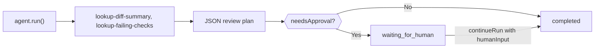

Build a TypeScript agent that inspects a pull request with local tools, returns a strict JSON review plan, and pauses for a person when the plan says it needs approval. When you're done you have one script that prints a validated `CodeReviewPlan` and stops at `waiting_for_human` until someone approves it.

The tools return fixed sample data, so the script is illustrative; replace them with calls to your code host and CI. A packaged version is in `packages/sdk/agent-sdk-ts/examples/coding-review-agent.ts`.



## Build it

<Steps>
<Step title="Install">

```bash
npm install @phaseo/agent-sdk zod
export PHASEO_API_KEY="phaseo_v1_sk_..."
```

</Step>
<Step title="Write the agent">

```ts review-agent.ts
import { z } from "zod";
import { createAgent, createGatewayAgentClient, defineTool } from "@phaseo/agent-sdk";

const CodeReviewPlan = z
  .object({
    risk: z.enum(["low", "medium", "high"]),
    summary: z.string().min(1),
    recommendedActions: z.array(z.string()).min(1),
    needsApproval: z.boolean(),
  })
  .strict();
type CodeReviewPlan = z.infer<typeof CodeReviewPlan>;

const PullRequestInput = z.object({ pullRequestId: z.string().regex(/^pr_\d+$/) }).strict();
const pullRequestParameters = {
  type: "object",
  properties: { pullRequestId: { type: "string", pattern: "^pr_\\d+$" } },
  required: ["pullRequestId"],
  additionalProperties: false,
};

// Read-only, deterministic tools: safe to rerun if a worker resumes the run.
const lookupDiffSummary = defineTool({
  id: "lookup-diff-summary",
  description: "Return a short summary of the changed files in one pull request.",
  parameters: pullRequestParameters,
  inputSchema: PullRequestInput,
  async execute({ pullRequestId }) {
    return {
      pullRequestId,
      files: ["apps/api/src/pipeline/before/index.ts"],
      summary: "Changes touch request validation.",
    };
  },
});

const lookupFailingChecks = defineTool({
  id: "lookup-failing-checks",
  description: "Return the failing CI checks for one pull request.",
  parameters: pullRequestParameters,
  inputSchema: PullRequestInput,
  async execute({ pullRequestId }) {
    return { pullRequestId, failingChecks: ["web-typecheck"] };
  },
});

const codingReviewAgent = createAgent<string, CodeReviewPlan>({
  id: "coding-review-agent",
  model: "openai/gpt-6-astra",
  instructions:
    "Use the available tools to inspect the coding task, then return a strict JSON review plan.",
  tools: [lookupDiffSummary, lookupFailingChecks],
  maxSteps: 6,
  parseOutput: (text) => JSON.parse(text),
  outputSchema: CodeReviewPlan,
  humanReview: ({ parsedOutput }) =>
    parsedOutput?.needsApproval
      ? { reason: "coding_review_approval_required", payload: parsedOutput }
      : null,
});

// Ask the Gateway for this exact JSON shape, and repair near-valid JSON.
const client = createGatewayAgentClient({
  clientOptions: { apiKey: process.env.PHASEO_API_KEY! },
  responseFormat: {
    type: "json_schema",
    name: "code_review_plan",
    schema: {
      type: "object",
      properties: {
        risk: { type: "string", enum: ["low", "medium", "high"] },
        summary: { type: "string" },
        recommendedActions: { type: "array", items: { type: "string" }, minItems: 1 },
        needsApproval: { type: "boolean" },
      },
      required: ["risk", "summary", "recommendedActions", "needsApproval"],
      additionalProperties: false,
    },
  },
  plugins: [{ id: "response-healing", mode: "strict" }],
});

const result = await codingReviewAgent.run({
  input: "Review pull request pr_482 and produce a remediation plan.",
  client,
  onEvent(event) {
    console.log(event.type, event.runId);
  },
});

if (result.run.status === "waiting_for_human") {
  console.log("Needs approval:", result.run.pause?.payload);

  // In a real app, store `result` and continue when a reviewer approves.
  if (process.env.APPROVE === "yes") {
    const continued = await codingReviewAgent.continueRun({
      run: result,
      client,
      humanInput: "Approved. Finalize the plan.",
    });
    console.log(continued.output);
  }
} else {
  console.log(result.output);
}
```

`responseFormat` makes the Gateway request this schema, and `outputSchema` checks the parsed result again in your process. The strict [response healing](./response-healing-for-structured-json) mode only unwraps JSON that's already valid.

</Step>
<Step title="Run it">

```bash
npx tsx review-agent.ts
APPROVE=yes npx tsx review-agent.ts
```

</Step>
</Steps>

## Check it worked

- The event log shows `tool.started` and `tool.completed` for both tools, then `checkpoint.saved` after the tool step.
- A plan with `needsApproval: true` ends the first run at `waiting_for_human` with the plan in `result.run.pause.payload`; with `APPROVE=yes` it continues to `completed`.
- In **Settings → Usage → Logs**, each model turn shows the tool calls, and the request's plugin record shows whether healing ran.
- A plan that breaks the schema fails the run with an `AgentSchemaValidationError` instead of returning bad data.

## Make it safe for real repositories

Keep review tools read-only. If you add a tool that comments, pushes or merges, set `requireApproval: true` on it so the run pauses before it runs, and approve it with `continueRun({ run, client, approvals: [toolCallId] })`. Treat diff content as untrusted input: code comments can contain instructions aimed at the model. To survive restarts while a review waits, save the run with a `state` accessor as in the [durable loop](./agent-sdk-durable-loop). [State and approval](../sdk-reference/agent/state-and-approval) covers approvals and rejections.
