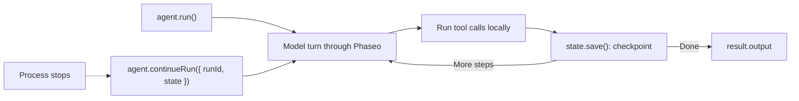

Run a tool-using agent with the TypeScript Agent SDK and save its state after every step, so a crashed or restarted process picks up where it stopped. When you're done you have one script that answers a docs question with a lookup tool, writes each run to `.agent-runs/<run id>.json`, and resumes a run when you pass its ID.

The script is illustrative: the file store suits one machine. In production, keep the same `load`/`save` pair but back it with your database. Phaseo doesn't store Agent SDK runs for you.



## Build it

<Steps>
<Step title="Install">

<CodeGroup>
```bash npm
npm install @phaseo/agent-sdk zod
```

```bash pnpm
pnpm add @phaseo/agent-sdk zod
```

```bash yarn
yarn add @phaseo/agent-sdk zod
```

```bash bun
bun add @phaseo/agent-sdk zod
```
</CodeGroup>

`@phaseo/agent-sdk` installs `@phaseo/sdk` with it. Set your key:

```bash
export PHASEO_API_KEY="phaseo_v1_sk_..."
```

</Step>
<Step title="Write the agent">

```ts agent.ts
import { mkdir, readFile, writeFile } from "node:fs/promises";
import { z } from "zod";
import {
  createAgent,
  createGatewayAgentClient,
  defineTool,
  type AgentStateAccessor,
} from "@phaseo/agent-sdk";

const DOC_SLUGS = ["guides/presets", "guides/routing-and-fallbacks", "guides/streaming"] as const;

// The model only sees `parameters`; `inputSchema` rejects anything else before execute runs.
const lookupDocs = defineTool({
  id: "lookup-docs",
  description: "Return the URL of one Phaseo docs page by slug.",
  parameters: {
    type: "object",
    properties: { slug: { type: "string", enum: [...DOC_SLUGS] } },
    required: ["slug"],
    additionalProperties: false,
  },
  inputSchema: z.object({ slug: z.enum(DOC_SLUGS) }).strict(),
  async execute({ slug }) {
    return { slug, url: `https://phaseo.app/docs/v1/${slug}` };
  },
});

const agent = createAgent<string, string>({
  id: "support-docs-agent",
  model: "openai/gpt-6-astra",
  instructions: "Use tools when helpful and finish with a concise answer that includes the docs URL.",
  tools: [lookupDocs],
  maxSteps: 6,
});

// Save the whole run after every step. Swap these two functions for your database.
const RUNS_DIR = ".agent-runs";
const state: AgentStateAccessor<string, unknown, string> = {
  async load(runId) {
    try {
      return JSON.parse(await readFile(`${RUNS_DIR}/${runId}.json`, "utf8"));
    } catch {
      return null;
    }
  },
  async save(result) {
    await mkdir(RUNS_DIR, { recursive: true });
    await writeFile(`${RUNS_DIR}/${result.run.id}.json`, JSON.stringify(result));
  },
};

const client = createGatewayAgentClient({
  clientOptions: { apiKey: process.env.PHASEO_API_KEY! },
});

const onEvent = (event: { type: string; runId: string }) => {
  if (event.type === "checkpoint.saved") console.log("checkpoint", event.runId);
};

const resumeId = process.argv[2];
let result;

if (resumeId) {
  const saved = await state.load(resumeId);
  if (!saved) throw new Error(`No saved run ${resumeId}`);
  result = saved.run.status === "completed"
    ? saved
    : await agent.continueRun({ run: saved, client, state, onEvent });
} else {
  result = await agent.run({
    input: "Find the docs page for presets and explain when to use them.",
    client,
    state,
    onEvent,
  });
}

console.log(result.run.id, result.run.status);
console.log(result.output);
```

</Step>
<Step title="Run it">

```bash
npx tsx agent.ts
```

To test a resume, stop the script with `Ctrl+C` after the first `checkpoint` line, then pass the run ID it printed (a UUID):

```bash
npx tsx agent.ts 3f6c1d2e-...
```

</Step>
</Steps>

## Check it worked

- The script prints `checkpoint` once per step, then the run ID, `completed`, and an answer with a `phaseo.app/docs` URL.
- `.agent-runs/<run id>.json` holds the run ID, status, message history, each step's tool calls and results, and the final output.
- After an interrupted run, the resume command finishes the same run ID instead of starting a new one.
- Each model turn appears in **Settings → Usage → Logs**. Log the run ID next to each request ID so you can match them.

## What the saved state holds

Each saved result is the full `AgentRunResult`: `run` (ID, status, messages, usage, any pause), `steps` with their gateway request IDs and tool calls, and `output` once the run completes. `continueRun()` accepts it directly, or a `runId` plus `state` and it calls `load()` itself.

A tool call that was running when the process stopped may already have had its effect, so keep tools idempotent. The SDK repairs the history of a call that never got a result before it continues. [State and approval](../sdk-reference/agent/state-and-approval) covers pauses and approvals.

## Grow it carefully

Keep one agent per workflow, a short tool list, and one log line per run with the run ID and request IDs. When you need approval pauses or several agents sharing tools, keep this gateway client and state pair and build around them: [Code review agent](./agent-sdk-coding-review) adds an approval pause, and [Parallel tools](./agent-sdk-parallel-tools) runs tools side by side. For shared request defaults, call a [preset](../guides/presets) instead of a fixed model.
