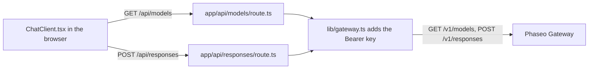

Run a small Next.js chat app whose browser code only talks to your own server routes, so your Phaseo API key never reaches the browser. When you're done you have a local chat page with a model picker filled from `GET /v1/models` and answers from `POST /v1/responses`.

The sample is illustrative: its routes have no sign-in or rate limit, so anyone who can reach them spends your key. Add the checks in [Before you deploy it](#before-you-deploy-it) first.

To have a coding agent build the same app from scratch, paste this prompt:

<Prompt
  description="Build a **Next.js web chat app** on top of Phaseo Gateway."
  icon="message-square"
  actions={["copy", "cursor"]}
>
{`You are building a small production-style chat app with Phaseo Gateway.

Create a Next.js app with:
- a chat UI
- a model picker backed by GET https://api.phaseo.app/v1/models
- a server-side route that calls POST https://api.phaseo.app/v1/responses
- server-side API key handling using PHASEO_API_KEY (Authorization: Bearer)
- loading, success, and error states

Keep the app intentionally small and easy to inspect.

Implementation requirements:
- Use one local API route for model discovery.
- Use one local API route for responses generation.
- Keep secrets server-side only.
- Send the whole conversation in input on every turn. The gateway rejects previous_response_id.
- Only accept model IDs from an allowlist on the server, and cap the input length.
- Show the request/response flow clearly in code.
- Add a short README with setup and run steps.

Verification:
- Run the app if possible.
- Verify two successful chat turns in a row.
- Report the exact files changed, what you verified, and any remaining assumptions.`}
</Prompt>

## How the sample is built



The sample lives in [examples/web-chat-nextjs](https://github.com/phaseoteam/Phaseo/tree/main/examples/web-chat-nextjs):

| File | Does |
| --- | --- |
| `app/components/ChatClient.tsx` | Input, loading and error state, rendered messages, model picker |
| `app/api/models/route.ts` | Returns the model IDs from `GET /v1/models` |
| `app/api/responses/route.ts` | Checks `model` and `input` are non-empty strings (`400 missing_model`, `400 missing_input`), then calls `POST /v1/responses` |
| `lib/gateway.ts` | Builds the URL and headers: `Authorization: Bearer $PHASEO_API_KEY`, `x-title`, and `http-referer` when set |

## Run it

You need Node.js and a Phaseo API key.

<Steps>
<Step title="Install">

```bash
cd examples/web-chat-nextjs
npm install
```

The sample ships a `package-lock.json`, so `npm` installs the tested versions.

</Step>
<Step title="Create .env.local">

The sample has no `.env.example`. Create `.env.local` yourself:

```bash .env.local
PHASEO_API_KEY=phaseo_v1_sk_...
# Optional. Defaults to https://api.phaseo.app; /v1 is added for you.
NEXT_PUBLIC_GATEWAY_URL=https://api.phaseo.app
# Optional app attribution headers.
GATEWAY_APP_TITLE=My chat app
GATEWAY_HTTP_REFERER=https://myapp.example
```

`NEXT_PUBLIC_GATEWAY_URL` is only read on the server here, but the `NEXT_PUBLIC_` prefix would expose it to browser code, so never put a key in it. [App attribution](../guides/app-attribution) explains the two optional headers.

</Step>
<Step title="Fix the second chat turn">

`ChatClient.tsx` sends the previous answer's `id` as `previous_response_id`. The Gateway doesn't store responses, so it rejects that field with `400 validation_error` (keyword `unsupported_param`) and the second message fails. In `app/api/responses/route.ts`, delete the block that copies `previous_response_id` into the payload:

```ts app/api/responses/route.ts
  // Delete these lines:
  if (typeof body.previous_response_id === 'string' && body.previous_response_id.trim()) {
    payload.previous_response_id = body.previous_response_id.trim();
  }
```

Each turn is then answered on its own. To keep context, send the earlier turns as an array of messages in `input`.

</Step>
<Step title="Start the dev server">

```bash
npm run dev
```

Open `http://localhost:3000`.

</Step>
</Steps>

## Check it worked

- The model picker fills with model IDs.
- Two messages in a row each get an answer.
- In the browser's network panel, requests go to `/api/models` and `/api/responses` only, and no request carries `PHASEO_API_KEY`.
- A bad model ID shows the Gateway's error message instead of a blank answer.
- The requests appear in **Settings → Usage → Logs** with the app title you set.

## Before you deploy it

- **Authenticate the routes.** Require a signed-in user on `/api/responses` and `/api/models`, or use the [OAuth workbench](./build-an-oauth-nextjs-workbench) so each user spends their own credits.
- **Allowlist models.** The route forwards any `model` string from the browser. Check it against a fixed list on the server.
- **Cap input and rate.** Limit input length and requests per user, and set a [spend limit on the key](../api-reference/limits#key-limits-and-budgets).
- **Stream if you need it.** Set `stream: true` and forward the events; [Streaming](../guides/streaming) shows which event ends a Responses stream.

For a backend script instead of a UI, start from the [Node REST smoke app](./build-a-node-rest-smoke-app) or the [Python gateway CLI](./build-a-python-gateway-cli).
