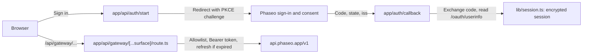

Let people sign in with Phaseo and spend their own credits in your app: OAuth 2.1 with PKCE gives your server an access token, and one server-side proxy attaches it to every gateway call. When you're done you have a local app with sign-in, session-backed tokens that refresh, model discovery, a chat flow over `/responses`, and a tester for other endpoints.

The sample discovers Phaseo's OAuth endpoints, checks `state` and `iss` on the way back, refreshes tokens safely and revokes the key when the person signs out.

To have a coding agent build the same app from scratch, paste this prompt:

<Prompt
  description="Build a **signed-in Next.js workbench** with OAuth and a unified Phaseo proxy."
  icon="shield-user"
  actions={["copy", "cursor"]}
>
{`You are building a signed-in Next.js app on top of Phaseo Gateway.

Create a workbench-style app with:
- OAuth 2.1 + PKCE sign-in against https://api.phaseo.app/oauth/authorize and https://api.phaseo.app/oauth/token (discover them from https://api.phaseo.app/.well-known/oauth-authorization-server), requesting the gateway:access scope
- session-backed token storage in an encrypted, httpOnly cookie
- one unified gateway proxy route on the server that calls https://api.phaseo.app/v1
- model discovery
- one chat flow using the Responses API, sending the whole conversation in input on every turn
- one generic endpoint tester for additional Phaseo endpoints

Requirements:
- Keep gateway credentials and access tokens server-side.
- Use a proxy allowlist of exact paths for safety.
- Support token refresh. Store the new refresh token from every refresh and drop the old one.
- Sign out by sending the refresh token to https://api.phaseo.app/oauth/revoke.
- Keep the workbench understandable rather than over-engineered.
- Add a short README with setup, env vars, and run steps.

Verification:
- run the app if possible
- verify sign-in flow as far as local setup allows
- verify at least one proxied gateway request path
- report exactly what you verified and what remains dependent on external OAuth configuration.`}
</Prompt>

## How the sample is built



The sample lives in [examples/oauth-client-nextjs](https://github.com/phaseoteam/Phaseo/tree/main/examples/oauth-client-nextjs):

| File | Does |
| --- | --- |
| `app/page.tsx` | Sign-in entry page; shows sign-in errors |
| `app/api/auth/start/route.ts` | Builds the authorize URL and stores the PKCE verifier and state |
| `app/auth/callback/route.ts` | Checks `state` and `iss`, exchanges the code, reads `/oauth/userinfo` |
| `app/api/auth/signout/route.ts` | Revokes the refresh token, then clears the session |
| `app/dashboard/page.tsx` | Protected shell |
| `app/dashboard/GatewayWorkbench.tsx` | Shows gateway status, lists model IDs, runs chat over `POST /responses`, and tests other endpoints |
| `app/api/gateway/[...surface]/route.ts` | Catch-all proxy: checks the allowlist, adds the Bearer token, refreshes it when it has expired, forwards the body and status |
| `lib/oauth.ts` | Discovery, PKCE, code exchange, refresh, revoke and userinfo |
| `lib/session.ts` | Encrypted session storage |

Keeping sign-in separate from gateway calls means a sign-in problem never looks like a model problem, and every endpoint shares one place that handles tokens.

## Run it

You need Node.js, an OAuth app with `http://localhost:3000/auth/callback` (or your own callback) as a redirect URI, and a long random session secret. Create the OAuth app in **Settings → OAuth Apps** or with the [OAuth clients API](../api-reference/endpoint/oauth-clients-create).

<Steps>
<Step title="Install">

```bash
cd examples/oauth-client-nextjs
npm install
```

</Step>
<Step title="Create .env.local">

```bash
cp .env.example .env.local
```

Fill in the values:

| Variable | Required | Value |
| --- | --- | --- |
| `PHASEO_OAUTH_CLIENT_ID` | Yes | The OAuth app's client ID |
| `PHASEO_OAUTH_CLIENT_SECRET` | Confidential apps | The OAuth app's client secret. Leave it empty for a public app. |
| `PHASEO_OAUTH_REDIRECT_URI` | Yes | `http://localhost:3000/auth/callback`, exactly as registered |
| `SESSION_SECRET` | Yes | A random string of at least 32 characters |
| `PHASEO_API_URL` | No | Defaults to `https://api.phaseo.app` |

The sample reads all of them on the server only. Never put the client secret or session secret in a `NEXT_PUBLIC_` variable.

The sample finds the authorize, token, revoke and userinfo endpoints from `https://api.phaseo.app/.well-known/oauth-authorization-server`, and asks for `openid email profile gateway:access`. `gateway:access` lets the token call the Gateway.

</Step>
<Step title="Start the dev server">

```bash
npm run dev
```

Open `http://localhost:3000`, sign in, and open the dashboard.

</Step>
</Steps>

## Check it worked

- Sign-in returns to your callback URL and creates a session.
- The dashboard lists models through `/api/gateway/models`.
- A chat turn through `/api/gateway/responses` gets an answer, and no browser request carries the access token.
- A path outside the proxy allowlist is rejected.

## Token lifetimes

The token endpoint returns two tokens:

| Token | Lasts | Use |
| --- | --- | --- |
| `access_token` | 7 days (`expires_in`) | Send it as `Authorization: Bearer` on gateway requests. It spends credits in the workspace the person chose. |
| `refresh_token` | 90 days from its last use | Send it with `grant_type=refresh_token` to get a new pair. |

- **Rotate on every refresh.** Each refresh returns a new access token and a new refresh token. Store both and drop the old ones: the old access token stops working at once, and the old refresh token can't be used again.
- **Refresh after expiry.** You can refresh after the access token has expired, as long as the refresh token hasn't.
- **Never reuse a refresh token.** Using one a second time ends the sign-in. Phaseo treats it as a leaked token and revokes the access token and every refresh token from that sign-in, so the person has to sign in again.
- **Scopes only shrink.** A refresh never adds scopes. It keeps the scopes the person approved, minus any they have since removed.
- **When refresh fails.** Refreshing fails once the person revokes your app, revokes or turns off its key, removes a scope the key needs (such as `gateway:access`), or leaves the workspace. Removing `gateway:access` also revokes the key, so its access token stops working at once. Granting the scope again doesn't bring the refresh token back. Send them through sign-in again.
- **Signing in again renews the key.** It renews the same key instead of adding one, whether or not you send `resource=https://api.phaseo.app/v1`. You get a new access token and refresh token, the previous ones stop working, and the key keeps this month's spending. Its monthly spending limit becomes the one the person just approved. An earlier sign-in's refresh token is just refused, and sending it to the token or revoke endpoint doesn't end the new sign-in.
- **A paused key blocks sign-in.** If any of your app's keys for that person and workspace is paused, whatever its resource, the token endpoint returns `invalid_grant` until someone turns the key back on in **Settings → API Keys**. Renewal only works while the key isn't revoked: after a sign-out or any other revocation, signing in issues a new key, and its limits and spending start fresh.
- **Sign out with revoke.** Send the refresh token to `https://api.phaseo.app/oauth/revoke`. That revokes the key and every refresh token from the sign-in, including one a refresh issued a moment earlier.

## Spending limits

On the consent screen the person sets a monthly spending limit for your app: $20.00 by default, another amount, or no limit. Once the key has spent it in a calendar month, gateway requests return `429` with `key_limit_exceeded` until the next month or until the person raises the limit in **Settings → API Keys**.

Whatever scopes it holds, your app can't lift that limit or get around it through the API. It can only rename or delete API keys. It can't create or rotate keys, change a key's limits, status or expiry, create management keys or trusted workloads, add members, change budgets, guardrails, rate limits or spend rules, or change the workspace's price limits for routing or its BYOK fallback to credits.

## Before you ship it

- **Trim the allowlist.** `lib/gateway.ts` allows the paths the workbench calls, plus job status under `videos/` and `music/generate/`. Keep only the paths your product calls.
- **Share refreshes across instances.** `lib/oauth.ts` shares one refresh between parallel requests in memory. If you run more than one server instance, move that to shared storage, or two instances can refresh with the same token and end the sign-in.
- **Send the whole conversation.** The Gateway doesn't store responses and rejects `previous_response_id`, so resend earlier turns in `input`.
- **Replace the tester.** Keep the workbench for internal QA and build purpose-made flows for end users.

For an API-key app without sign-in, start from the [Next.js web chat app](./build-a-nextjs-web-chat-app).
