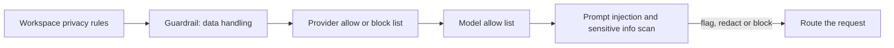

Create one guardrail in **Settings → Guardrails**, attach it to a low-risk API key, and widen it only after the logs show it behaving. When you're done that key can only reach the providers and models you allow, and its prompts are scanned for prompt injection and sensitive data before they reach a model.

This is a dashboard procedure; the same policy can be scripted with the [guardrails API](../api-reference/endpoint/guardrails-create).

Workspace privacy rules apply first; a guardrail can only narrow them. Guardrails don't cap spend: set a limit on the key or a [workspace budget](../api-reference/limits#key-limits-and-budgets) instead.

## Roll it out

<Steps>
<Step title="Create the guardrail">

Open **Settings → Guardrails → New Guardrail**. Name it after what it enforces, such as `eu-models-pii-redact`, not after a team, so it can be reused across keys.

Set route access before content checks:

| Setting | Choices |
| --- | --- |
| **Provider mode** | Allow all providers, Only allow selected providers, or Allow all except selected providers |
| **Model mode** | Allow all models, or Only allow selected models (applied after provider filtering) |
| **Data handling** | ZDR only, and whether free or paid endpoints that may train on inputs stay eligible |

A common first policy blocks low-trust providers and allows only the exact production models the key should reach. Use the preview to check which providers and models stay routable, and whether **Only allow** is narrower than you meant.

</Step>
<Step title="Add content checks">

**Prompt injection** scans user-supplied content for common injection patterns. **Sensitive info** detects data before the request leaves Phaseo:

| Detector | Redacted as | Adds latency |
| --- | --- | --- |
| Email address | `[EMAIL]` | No |
| Phone number | `[PHONE]` | No |
| US Social Security number | `[SSN]` | No |
| Credit card number | `[CREDIT_CARD]` | No |
| IP address (IPv4) | `[IP_ADDRESS]` | No |
| Person name | `[PERSON_NAME]` | Yes |
| Physical address | `[ADDRESS]` | Yes |

Each check has an action: **Flag**, **Redact** or **Block**. Start prompt injection on **Flag** or **Redact**, and move to **Block** only after you've reviewed the false positives. Use the fast detectors first. Add custom patterns as explicit regex rules.

</Step>
<Step title="Test it in the preview">

Before saving, run three inputs through the preview: one harmless, one that should clearly be stopped, and one realistic production prompt. Check the redaction text, the block or allow result, and that nothing unrelated matches.

</Step>
<Step title="Attach it to one key">

Under **Apply to keys**, pick a staging or low-risk key. You can attach the guardrail while you create it. **Apply to members** enforces it on the API keys those members create instead. Members can't edit or remove a guardrail that a workspace owner or admin assigned.

</Step>
<Step title="Check enforcement">

Send real requests through the key, then check:

- **Settings → Usage → Guardrails** for blocked, redacted and flagged counts.
- The **Guardrail enforcement** section of a request in **Settings → Usage → Logs**, for the guardrail and detector that fired.
- The **Guardrails** column in **Settings → API Keys**, to confirm which keys it's attached to.

</Step>
<Step title="Widen the rollout">

Attach the same guardrail to more keys, tighten actions from **Flag** to **Redact** or **Block**, and add the person-name and address detectors only where their latency is acceptable.

</Step>
</Steps>

A turned-off guardrail keeps its configuration but isn't enforced. To share routing rules between callers rather than enforce them on keys, use a [preset](../guides/presets).
