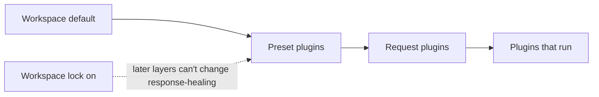

Turn on [response healing](./response-healing-for-structured-json) once for the whole workspace or one preset, instead of in every request. When you're done every structured-output caller gets the same healing policy, and you can lock it so no preset or request turns it off.

This is a dashboard procedure; the request example at the end is production-ready.

## How the layers combine

Phaseo builds each request's plugin list from three layers. A later layer replaces an earlier layer's settings for the same plugin, unless the earlier one is locked:



| Layer | Set in | Overrides |
| --- | --- | --- |
| Workspace | **Settings → Routing → Response Healing** | Nothing |
| Preset | **Settings → Presets → (preset) → Response Healing** | The workspace, unless it's locked |
| Request | `plugins` in the body | The preset and the workspace, unless the workspace is locked |

## Set it up

<Steps>
<Step title="Turn on the workspace default">

In **Settings → Routing → Response Healing**, turn on **Enable by Default** and pick a **Healing Mode**: `safe` for bounded syntax repair, `strict` to only unwrap JSON that was already valid. Use this for broad defaults that every API key in the workspace shares.

</Step>
<Step title="Lock it if it's not negotiable">

Turn on **Lock Workspace Policy**. Presets and requests can then neither turn healing off nor change its mode. Logs still show whether it applied or skipped.

</Step>
<Step title="Set preset defaults for one workflow">

In the preset editor, turn on **Response Healing** and pick its mode when one family of requests should carry both a structured output format and healing. Callers of that preset then send only their input.

</Step>
</Steps>

## Override it for one request

When the workspace isn't locked, a request can set the plugin itself. `"enabled": false` turns it off for that request:

```json
{
  "model": "openai/gpt-6-astra",
  "input": "Return the summary as JSON.",
  "text": {
    "format": {
      "type": "json_schema",
      "name": "answer",
      "schema": {
        "type": "object",
        "properties": { "summary": { "type": "string" } },
        "required": ["summary"],
        "additionalProperties": false
      }
    }
  },
  "plugins": [{ "id": "response-healing", "enabled": true, "mode": "strict" }],
  "meta": true
}
```

## Check the policy that ran

Open the request in **Settings → Usage → Logs**, or read `meta.plugin_executions` when you sent `meta: true`. It shows the status (`applied`, `skipped` or `failed`), the mode that actually ran, and any `validation_errors` when a healed candidate didn't match the schema.

If two services behave differently, compare the workspace setting and its lock, the preset's plugins, and each request's `plugins` before you treat it as a model problem.
