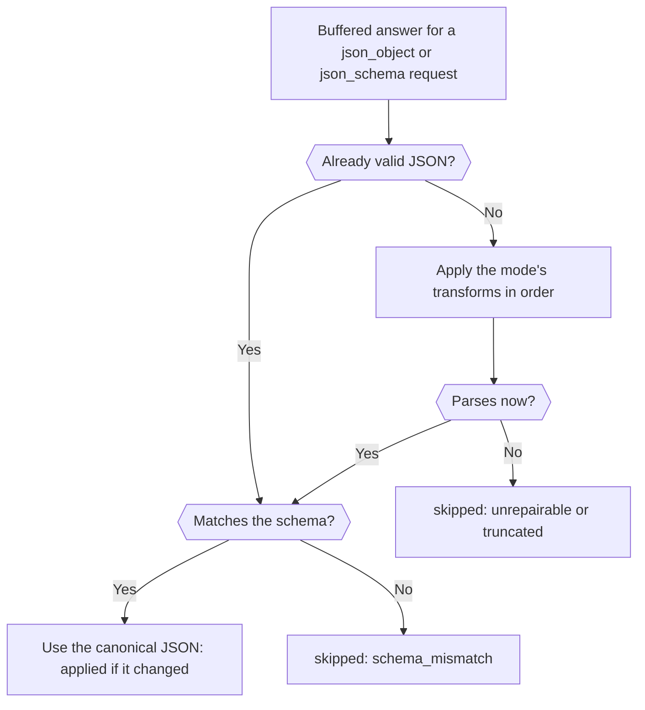

Add the `response-healing` plugin to a structured-output request and Phaseo repairs JSON that is almost valid, such as JSON in a Markdown fence or with a trailing comma, before it reaches your parser. When you're done you have one request that asks for a JSON Schema, heals the answer when it needs to, and tells you in the response whether it did.

The request is production-ready. Healing only fixes syntax, so your code still validates the result, as in [Validate the result](../guides/structured-outputs#validate-the-result).



## Send a healed request

<CodeGroup>
```bash cURL
curl https://api.phaseo.app/v1/responses \
  -H "Authorization: Bearer $PHASEO_API_KEY" \
  -H "Content-Type: application/json" \
  -d '{
    "model": "openai/gpt-6-astra",
    "input": "Summarize this release in one sentence: dark mode and faster search.",
    "text": {
      "format": {
        "type": "json_schema",
        "name": "answer",
        "strict": true,
        "schema": {
          "type": "object",
          "properties": { "summary": { "type": "string" } },
          "required": ["summary"],
          "additionalProperties": false
        }
      }
    },
    "plugins": [{ "id": "response-healing", "mode": "safe" }],
    "meta": true
  }'
```

```typescript TypeScript
import Phaseo from "@phaseo/sdk";

const client = new Phaseo({ apiKey: process.env.PHASEO_API_KEY! });

const response = await client.generateResponse({
  model: "openai/gpt-6-astra",
  input: "Summarize this release in one sentence: dark mode and faster search.",
  text: {
    format: {
      type: "json_schema",
      name: "answer",
      strict: true,
      schema: {
        type: "object",
        properties: { summary: { type: "string" } },
        required: ["summary"],
        additionalProperties: false,
      },
    },
  },
  plugins: [{ id: "response-healing", mode: "safe" }],
  meta: true,
});

console.log(response.meta?.plugin_executions);
```

```python Python
import os

from phaseo import Phaseo

client = Phaseo(api_key=os.environ["PHASEO_API_KEY"])

response = client.generate_response(
    {
        "model": "openai/gpt-6-astra",
        "input": "Summarize this release in one sentence: dark mode and faster search.",
        "text": {
            "format": {
                "type": "json_schema",
                "name": "answer",
                "strict": True,
                "schema": {
                    "type": "object",
                    "properties": {"summary": {"type": "string"}},
                    "required": ["summary"],
                    "additionalProperties": False,
                },
            }
        },
        "plugins": [{"id": "response-healing", "mode": "safe"}],
        "meta": True,
    }
)

print(response["meta"].get("plugin_executions"))
```
</CodeGroup>

On Chat Completions, send the same schema in `response_format` instead of `text.format`. Healing runs only when the request asks for `json_object` or `json_schema`, and never on streams: a streamed request skips it with `streaming_unsupported`.

## Check that it ran

With `meta: true`, `meta.plugin_executions` lists the plugin when it ran:

```json
{
  "id": "response-healing",
  "stage": "response.post_provider",
  "status": "applied",
  "changed": true,
  "metadata": {
    "attempted": true,
    "healed": true,
    "mode": "safe",
    "transforms_applied": ["strip_markdown_fence"]
  }
}
```

| `status` | Means |
| --- | --- |
| `applied` | The answer was rewritten to valid JSON. |
| `skipped` | The answer was left as it was. With `attempted: false` the request wasn't eligible; otherwise the JSON was already valid or couldn't be fixed. `metadata.failure_reason` says why: `streaming_unsupported`, `not_json` (no structured output requested, or no text), `unrepairable`, `truncated` (the answer stopped at the token limit), or `schema_mismatch` with `validation_errors`. |
| `failed` | The plugin itself errored (`reason: plugin_error`); the answer is unchanged. |

The same record appears on the request in **Settings → Usage → Logs**. If the plugin never appears, check that the request, its preset or the workspace actually turned it on; [Set plugin defaults](./plugin-defaults-and-response-healing) shows where.

## Choose a mode

| Mode | Transforms, in order |
| --- | --- |
| `safe` (default) | Strip a Markdown fence, cut to the outermost `{…}` or `[…]`, remove trailing commas, quote bare keys, and add missing closing brackets (not when the answer hit the token limit) |
| `strict` | Strip a Markdown fence and cut to the outermost `{…}` or `[…]` only, so it accepts only JSON that was already valid inside its wrapper |

With a JSON Schema, the healed result is checked before it replaces the answer: required keys, types, `enum` and `const`, array bounds and `uniqueItems`, string length, `pattern` and the `email`, `uri`, `uuid` and `date-time` formats, number bounds and `multipleOf`, property counts and `additionalProperties: false`.

## Know when it won't help

Healing never invents missing fields, guesses values or turns prose into data. Tell these failures apart before you reach for it:

| Failure | Fix |
| --- | --- |
| JSON that is structurally close | Response healing |
| Valid JSON with wrong fields | Tighten the schema and prompt |
| Prose instead of JSON | Request `json_schema`, not just a prompt instruction |
| Cut off at the token limit | Raise `max_output_tokens` |

Healing works best on one object with explicit required keys, a low temperature, and no request for text outside the JSON. Turn it on for one preset first, watch `plugin_executions` in the logs, and widen it once the healed payloads match your schema.
