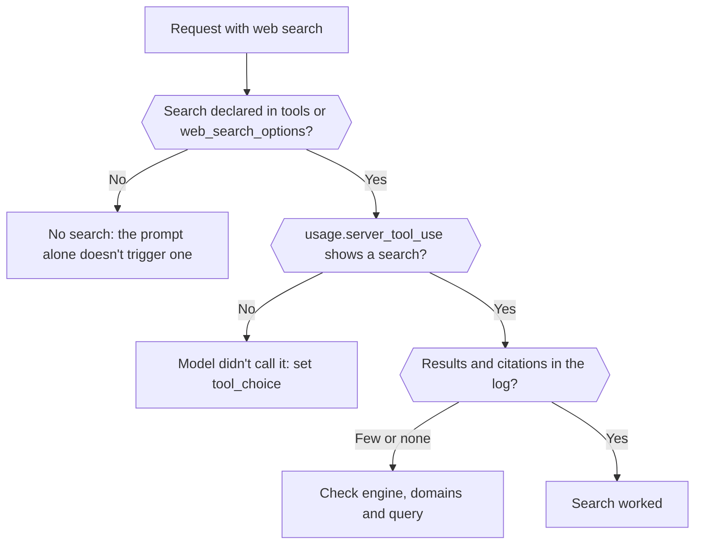

Find out whether a web search actually ran, which engine ran it, and what it returned, from the response and the request log. When you're done you can tell a search that never happened from one that ran and found little.



## Declare the search in the request

Asking for "the latest news" in the prompt doesn't run a search. Add it explicitly:

```json
{
  "model": "openai/gpt-6-astra",
  "input": "What changed in the Phaseo changelog this week?",
  "tools": [{ "type": "phaseo:web_search", "parameters": { "max_results": 5 } }],
  "tool_choice": "phaseo:web_search"
}
```

`phaseo:web_search` works on Chat Completions, Responses and Messages. `web_search_options` works where the endpoint supports it. `tool_choice` forces the call; without it the model may answer from memory. The [web search guide](../guides/server-tools/web-search) lists every parameter.

## Check that it ran

| Look at | Shows |
| --- | --- |
| `usage.server_tool_use.web_search_requests` in the response | How many managed searches ran |
| **Web search observability** on the request in **Settings → Usage → Logs** | Managed searches, native searches, the result count and the citation count, with the extracted result and citation records |
| **Routing observability** on the same request | Which providers were considered, and any that were removed because they didn't support the request |

## Tell the failure cases apart

| What you see | Cause | Fix |
| --- | --- | --- |
| No search counters at all | The search wasn't declared, or the model chose not to call it | Add the tool and set `tool_choice` |
| The tool returns `search_not_configured` to the model | The managed engine you chose isn't enabled | Use the default engine or another one |
| The tool returns `unsupported_search_engine` | The model asked for `engine: "native"` inside a call | Set `native` in the tool definition only |
| `400 not_supported`, reason `regional_hosted_tool_not_supported` | Sent to `eu.api.phaseo.app` or `us.api.phaseo.app`, which reject server tools | Use `api.phaseo.app` |
| Searches ran but citations are sparse | The query or sources were weak | Tune `max_results`, `allowed_domains` or `engine` |

With `engine: "native"`, the request goes only to providers that run web search themselves. If none serve the model, Phaseo runs its default engine instead and bills it as managed search, so a native request can show managed counters.

## Compare requests

When results differ between runs, compare the model ID, the provider that was selected, the search parameters, and the result and citation counts. The counts are normalised across providers, so differences in search quality show up without reading raw payloads. For a full grounded workflow, see [Managed web search in TypeScript](./sdk-typescript-managed-search); for a known URL, use [web fetch](./tool-grounding-with-web-fetch) instead.
