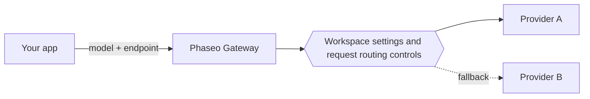

Send a model ID to one Phaseo endpoint, and Phaseo routes the request to a provider that hosts that model. Your application chooses the model and endpoint; your workspace settings and the request's routing controls decide which providers may serve it.

## Models and providers

A model is the system that generates the output. A provider hosts the model and sets its availability, supported parameters, pricing and performance. One model can have several provider offers.

The public catalog also lists models that aren't available through the Gateway yet. Check [model availability](../exploring/models.mdx) before using an ID in a request.

## Requests and routing

Use [Responses, Chat Completions or Messages](../api-reference/introduction.mdx), whichever matches your application's protocol. A shared endpoint doesn't mean every model supports every parameter; provider capabilities still vary.

[Routing controls](../guides/routing-and-fallbacks.mdx) restrict which providers can serve a request and how they are ranked. Fallbacks stay within those restrictions and depend on available capacity, so they don't guarantee success.

## Billing and access

Managed requests use your Phaseo workspace balance, and `:free` models run without deposited credits. With your own provider credentials (BYOK), the provider's billing and account limits apply. Review [pricing and billing](../pricing/tiers.mdx) before rollout.

[Video and batch jobs](../guides/async-video-and-batch.mdx) return a job before processing finishes; preview access to them is managed per workspace. Poll for status or receive a webhook, then download the result.

## Next steps

Make your first request with the [Quickstart](../quickstart.mdx), then [integrate the Gateway](./integrating-with-the-gateway.mdx) into your application with the key kept on your backend. When something fails, [Reliability and status](./reliability-and-status.mdx) shows how to investigate, and [request logs](../guides/integrations/observability.mdx) show usage, latency, cost and errors for each request.
