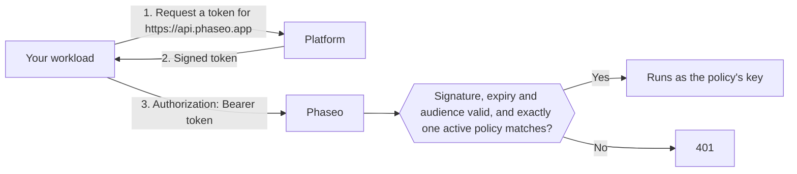

<Note>
Trusted workloads is in beta and is rolling out to workspaces gradually. If **Settings → API Keys → Trusted workloads** doesn't appear in your dashboard, your workspace doesn't have it yet.
</Note>

Send your platform's short-lived OIDC token as the bearer token instead of a Phaseo API key, and nothing long-lived has to sit in your project settings or CI secrets. Platforms give each deployment, job or workload a signed token that says who it is, such as "the `website` project's production deployment" or "a job in GitLab project `4815162`", and the token expires within hours. You tell Phaseo which workloads to trust.

Phaseo trusts tokens from Vercel, GitHub Actions, GitLab, Google Cloud, Buildkite, CircleCI and AWS, and from an OIDC issuer you run yourself, such as a Kubernetes cluster, Bitbucket Pipelines or self-managed GitLab. Keep using API keys for everything else, such as local scripts and mobile apps.

## How it works



A workspace owner or admin creates a **trust policy** that names the platform, the owner it trusts (such as a GitHub owner, GitLab project or AWS role) and optional conditions, such as a project, repository, branch or environment. A request that matches runs as the policy's key, with the same rate limits, budgets, logs and billing as a request made with an API key.

Tokens must be issued for the audience `https://api.phaseo.app`; Phaseo refuses any other audience. Most platforms default to an audience shared by every service your workload calls, and accepting those would let a token you sent to another service be replayed against Phaseo.

## Create a trust policy

<Steps>
<Step title="Open Trusted workloads">
Go to **Settings → API Keys → Trusted workloads** and select **New policy**. Only workspace owners and admins can manage policies.
</Step>
<Step title="Choose the platform and fill in the IDs">
Each platform pins the policy to one ID that can't be renamed or taken over by someone else. Names can change hands, so Phaseo never trusts a name on its own.

<Tabs>
<Tab title="Vercel">
- **Team slug**: the team's slug, as in `vercel.com/<team-slug>`. Leave it empty if your project uses Vercel's global issuer mode (issuer `https://oidc.vercel.com` instead of `https://oidc.vercel.com/<team-slug>`).
- **Team ID**: starts with `team_`. Find it in your Vercel team settings.
- **Project ID** (recommended): starts with `prj_`. Find it in your Vercel project settings. Without it, every project in the team is trusted.
- **Environment**: production, preview or development. Leave all unticked to accept any environment.
</Tab>
<Tab title="GitHub Actions">
- **Owner ID**: the numeric ID of the user or organisation that owns the repository.
- **Repository ID** (recommended): the numeric repository ID. Without it, every repository the owner has is trusted.
- **Branch or tag** and **Environment** (optional): for example `refs/heads/main` or `production`.

Get both IDs with the GitHub CLI:

```bash
gh api repos/OWNER/REPO --jq '.id, .owner.id'
```
</Tab>
<Tab title="GitLab">
For projects on GitLab.com. For self-managed GitLab, use **Custom OIDC issuer**.

- **Project ID**: the numeric ID on the project's overview page. It stays the same when the project is renamed or moved to another group, which is why Phaseo pins it rather than the group.
- **Branch or tag** (optional): the branch or tag name, such as `main`.
- **Environment** (optional): the job's environment, such as `production`.

Leave both conditions empty to accept every job in the project.
</Tab>
<Tab title="Google Cloud">
For tokens from the metadata server on Cloud Run, Compute Engine, GKE, Cloud Run functions, App Engine and Cloud Build.

- **Service account unique ID**: the numeric unique ID on the service account's details page in the Google Cloud console. Every Google account shares the same issuer, so this ID is what tells your workload apart. Don't use the email instead: if the service account is deleted, someone can create a new one with the same email.
- **Service account email** (optional): an extra check. Tokens only include the email when the workload requests them with `format=full`.
</Tab>
<Tab title="Buildkite">
- **Organisation ID**: the organisation's UUID. Every Buildkite token carries it in its `organization_id` claim, so you can read it from a token one of your pipelines requests. Unlike the organisation slug, it never changes.
- **Pipeline slug** (optional): without it, every pipeline in the organisation is trusted.
</Tab>
<Tab title="CircleCI">
- **Organisation ID**: find it under **Organization Settings → Overview**. Each CircleCI organisation has its own issuer, `https://oidc.circleci.com/org/<organisation ID>`, and Phaseo builds it from this ID.
- **Project ID** (optional): find it under **Project Settings → Overview**. Without it, every project in the organisation is trusted.
</Tab>
<Tab title="AWS">
For tokens from IAM outbound identity federation, which gives an IAM role a signed token for an outside service.

- **Issuer URL**: each AWS account has its own issuer, ending in `.tokens.sts.global.api.aws`. Run `aws iam get-outbound-web-identity-federation-info` and copy `IssuerIdentifier`. If it fails, turn the feature on first with `aws iam enable-outbound-web-identity-federation`.
- **IAM role ARN**: only tokens for this role are accepted, such as `arn:aws:iam::123456789012:role/evals`. The issuer already identifies your account, so the role ARN identifies the workload.
</Tab>
<Tab title="Custom OIDC issuer">
Use this for any other OIDC issuer that meets all of these:

- Its issuer URL is a public `https://` URL, with no port, query or fragment, and not on a host that belongs to one of the platforms above.
- It serves a discovery document at `<issuer>/.well-known/openid-configuration`.
- Its signing keys (`jwks_uri`) are on the same host as the issuer.
- It signs tokens with RS256, ES256 or ES384, and can issue them for the audience `https://api.phaseo.app`.

Fill in:

- **Issuer URL**: copy it exactly as it appears in the token's `iss` claim, including any trailing slash.
- **Owner claim** and **Owner value**: the claim every token must carry, and the exact value it must have. Choose a claim that nobody else can reuse, such as a numeric ID, rather than a name that can be renamed or re-registered.
- **Extra claim** and **Required value** (optional): one more claim the token must match.

Conditions match top-level claims only. Nested claims, such as Kubernetes' `kubernetes.io` object, can't be used.

**Kubernetes (EKS, GKE, AKS)**: each cluster has its own issuer. On EKS, run `aws eks describe-cluster --name <cluster> --query cluster.identity.oidc.issuer`. On AKS, turn on the OIDC issuer and run `az aks show -n <cluster> -g <resource-group> --query oidcIssuerProfile.issuerUrl`. On GKE, the issuer is `https://container.googleapis.com/v1/projects/<project>/locations/<location>/clusters/<cluster>`. Use `sub` as the owner claim, with the value `system:serviceaccount:<namespace>:<service-account>`.

Self-managed Kubernetes clusters whose discovery endpoint isn't public won't work. Phaseo has to fetch the discovery document and keys from the internet without credentials, and most clusters don't allow that by default.

**Bitbucket Pipelines**: the issuer is `https://api.bitbucket.org/2.0/workspaces/<workspace>/pipelines-config/identity/oidc`. Use `workspaceUuid` as the owner claim, with the value including its braces, such as `{a1b2c3d4-...}`. Ask for the Phaseo audience in the step:

```yaml
- step:
    oidc:
      audiences:
        - https://api.phaseo.app
```

**Self-managed GitLab**: the issuer is your GitLab URL, such as `https://gitlab.example.com`. Use `project_id` as the owner claim, with the project's numeric ID. Your instance must be reachable from the internet.
</Tab>
</Tabs>
</Step>
<Step title="Set the longest token accepted">
In **Longest token accepted (hours)**, set the longest lifetime you accept. Tokens issued to last longer are refused. The maximum, and the default, is 12 hours, which covers Vercel development tokens.
</Step>
</Steps>

Policies take effect within about a minute. Turning a policy off or deleting it stops its tokens working within the same time.

## Manage policies with Terraform or the API

Manage policies as code with a [management key](./management-api-keys.mdx) that has the `keys:read`, `keys:write` and `keys:delete` capabilities. Only workspaces with trusted workloads can use these routes.

With Terraform, use the `phaseo_trusted_workload` resource:

```hcl
resource "phaseo_trusted_workload" "deploy" {
  name     = "GitHub deploy (main)"
  platform = "github_actions"
  owner_id = "123456"

  claim_conditions = {
    repository_id = ["987654321"]
    ref           = ["refs/heads/main"]
  }
}
```

`owner_id` is the value of the platform's owner claim. Set `issuer` where the platform needs one:

| `platform` | `issuer` | Owner claim |
| --- | --- | --- |
| `vercel` | Required: `https://oidc.vercel.com/<team-slug>`, or `https://oidc.vercel.com` for global issuer mode | `owner_id` (team ID) |
| `github_actions` | Defaults to `https://token.actions.githubusercontent.com` | `repository_owner_id` |
| `gitlab` | Defaults to `https://gitlab.com` | `project_id` |
| `google_cloud` | Defaults to `https://accounts.google.com` | `sub` (service account unique ID) |
| `buildkite` | Defaults to `https://agent.buildkite.com` | `organization_id` |
| `circleci` | Required: `https://oidc.circleci.com/org/<organisation ID>` | `oidc.circleci.com/org-id` |
| `aws` | Required: your account's issuer | `sub` (IAM role ARN) |
| `custom` | Required: your issuer URL | The claim you set in `owner_claim` |

For a custom issuer, also set `owner_claim`:

```hcl
resource "phaseo_trusted_workload" "cluster" {
  name        = "Production cluster"
  platform    = "custom"
  issuer      = "https://oidc.eks.us-east-1.amazonaws.com/id/EXAMPLED539D4633E53DE1B71EXAMPLE"
  owner_claim = "sub"
  owner_id    = "system:serviceaccount:prod:api"
}
```

Other fields:

| Field | Values |
| --- | --- |
| `claim_conditions` | Claim name to allowed values; every claim must match one of its values. Up to 15 claims besides the owner claim, and 20 values per claim. `iss`, `aud`, `exp`, `iat`, `nbf`, `jti` and the owner claim can't be used. |
| `max_token_lifetime_seconds` | Longest token lifetime accepted, `60` to `43200` (12 hours). Defaults to `43200`. |
| `enabled` (Terraform) or `status` (API: `active` or `disabled`) | Whether matching tokens are accepted. |

Changing the platform, issuer, owner claim or owner replaces the policy. A policy has no secret, so nothing sensitive is stored in Terraform state.

With the API, send the same fields to `/v1/workload-identity/policies`. The API calls the platform `provider`:

```bash
curl https://api.phaseo.app/v1/workload-identity/policies \
  -H "Authorization: Bearer $PHASEO_MANAGEMENT_KEY" \
  -H "Content-Type: application/json" \
  -d '{"name":"GitHub deploy (main)","provider":"github_actions","owner_id":"123456","claim_conditions":{"repository_id":["987654321"],"ref":["refs/heads/main"]}}'
```

For a custom issuer:

```bash
curl https://api.phaseo.app/v1/workload-identity/policies \
  -H "Authorization: Bearer $PHASEO_MANAGEMENT_KEY" \
  -H "Content-Type: application/json" \
  -d '{"name":"Production cluster","provider":"custom","issuer":"https://oidc.eks.us-east-1.amazonaws.com/id/EXAMPLED539D4633E53DE1B71EXAMPLE","owner_claim":"sub","owner_id":"system:serviceaccount:prod:api"}'
```

The [API reference](../api-reference/endpoint/trusted-workloads-create.mdx) lists every field and response.

## Call Phaseo with a token

Every Phaseo SDK accepts a function in place of the API key and calls it before each request and retry, so each request uses a current token. Each SDK except C++ includes a helper for GitHub Actions and Vercel. It fetches a token issued for `https://api.phaseo.app` and reuses it until a minute before it expires:

| SDK | GitHub Actions | Vercel |
| --- | --- | --- |
| TypeScript | `githubActionsToken()` | `vercelToken()` |
| Python | `github_actions_token()` | `vercel_token()` |
| Go | `phaseo.GitHubActionsToken()` | `phaseo.VercelToken()` |
| Java | `WorkloadTokens.gitHubActions()` | `WorkloadTokens.vercel()` |
| C# | `WorkloadTokens.GitHubActions()` | `WorkloadTokens.Vercel()` |
| PHP | `WorkloadTokens::githubActions()` | `WorkloadTokens::vercel()` |
| Ruby | `PhaseoSdk::WorkloadTokens.github_actions` | `PhaseoSdk::WorkloadTokens.vercel` |
| Rust | `phaseo::auth::github_actions_token()` | `phaseo::auth::vercel_token()` |
| C++ | Pass your own function to `set_api_key_provider` | Pass your own function to `set_api_key_provider` |

The helpers need the next release of each SDK. On Vercel, the helper exchanges the deployment's token from `VERCEL_OIDC_TOKEN_FILE` or `VERCEL_OIDC_TOKEN`. In Vercel Functions the token arrives on each request as the `x-vercel-oidc-token` header; pass it to the helper as its token source.

On other platforms, pass your own function that returns the token, such as one that reads the GitLab job's variable or calls the Google Cloud metadata server:

```ts
import Phaseo from "@phaseo/sdk";

const client = new Phaseo({
	apiKey: async () => {
		const response = await fetch(
			"http://metadata.google.internal/computeMetadata/v1/instance/service-accounts/default/identity?audience=https://api.phaseo.app",
			{ headers: { "Metadata-Flavor": "Google" } },
		);
		return response.text();
	},
});
```

<Tabs>
<Tab title="Vercel">
Use `getVercelOidcToken` from the server entry of `@vercel/oidc` 4.x. Passing `audience` exchanges the deployment's token for one issued to Phaseo.

With the [TypeScript SDK](../sdk-reference/client/overview.mdx), pass it as the `apiKey` function:

```ts
import Phaseo from "@phaseo/sdk";
import { getVercelOidcToken } from "@vercel/oidc";

const client = new Phaseo({
	apiKey: () => getVercelOidcToken({ audience: "https://api.phaseo.app" }),
});

const response = await client.responses.create({
	model: "openai/gpt-6-astra",
	input: "Hello from a trusted workload",
});
```

Passing a function as `apiKey` needs a version of `@phaseo/sdk` newer than 3.0.0.

With any HTTP client, request a token per request and send it as a bearer token:

```ts
import { getVercelOidcToken } from "@vercel/oidc";

const token = await getVercelOidcToken({ audience: "https://api.phaseo.app" });

const response = await fetch("https://api.phaseo.app/v1/chat/completions", {
	method: "POST",
	headers: {
		Authorization: `Bearer ${token}`,
		"Content-Type": "application/json",
	},
	body: JSON.stringify({
		model: "openai/gpt-6-astra",
		messages: [{ role: "user", content: "Hello from a trusted workload" }],
	}),
});
```

Don't store the token in a module-level variable: Vercel can change it between requests.
</Tab>
<Tab title="GitHub Actions">
The job needs the `id-token: write` permission to request a token.

```yaml
permissions:
  id-token: write
  contents: read

jobs:
  evals:
    runs-on: ubuntu-latest
    steps:
      - uses: actions/github-script@v7
        with:
          script: |
            const token = await core.getIDToken("https://api.phaseo.app");
            const response = await fetch("https://api.phaseo.app/v1/chat/completions", {
              method: "POST",
              headers: {
                Authorization: `Bearer ${token}`,
                "Content-Type": "application/json",
              },
              body: JSON.stringify({
                model: "openai/gpt-6-astra",
                messages: [{ role: "user", content: "Hello from GitHub Actions" }],
              }),
            });
            core.info(String(response.status));
```

From a shell step, request the token with `curl`:

```bash
TOKEN=$(curl -sS -H "Authorization: bearer $ACTIONS_ID_TOKEN_REQUEST_TOKEN" \
  "$ACTIONS_ID_TOKEN_REQUEST_URL&audience=https://api.phaseo.app" | jq -r .value)

curl https://api.phaseo.app/v1/chat/completions \
  -H "Authorization: Bearer $TOKEN" \
  -H "Content-Type: application/json" \
  -d '{"model":"openai/gpt-6-astra","messages":[{"role":"user","content":"Hello"}]}'
```

GitHub Actions tokens are short-lived, so request a new one for long jobs.
</Tab>
<Tab title="GitLab">
Add an `id_tokens` entry to the job in `.gitlab-ci.yml`. GitLab puts the token in the variable you name:

```yaml
evals:
  id_tokens:
    PHASEO_TOKEN:
      aud: https://api.phaseo.app
  script:
    - >
      curl https://api.phaseo.app/v1/chat/completions
      -H "Authorization: Bearer $PHASEO_TOKEN"
      -H "Content-Type: application/json"
      -d '{"model":"openai/gpt-6-astra","messages":[{"role":"user","content":"Hello from GitLab"}]}'
```

The token lasts as long as the job's timeout.
</Tab>
<Tab title="Google Cloud">
Request the token from the metadata server. This works on Cloud Run, Compute Engine, GKE, Cloud Run functions, App Engine and Cloud Build:

```bash
TOKEN=$(curl -sS -H "Metadata-Flavor: Google" \
  "http://metadata.google.internal/computeMetadata/v1/instance/service-accounts/default/identity?audience=https://api.phaseo.app")

curl https://api.phaseo.app/v1/chat/completions \
  -H "Authorization: Bearer $TOKEN" \
  -H "Content-Type: application/json" \
  -d '{"model":"openai/gpt-6-astra","messages":[{"role":"user","content":"Hello from Google Cloud"}]}'
```

Add `&format=full` to the URL if your policy checks the service account email. Tokens last 1 hour.
</Tab>
<Tab title="Buildkite">
Request the token with the agent in a step's command:

```bash
TOKEN=$(buildkite-agent oidc request-token --audience https://api.phaseo.app)

curl https://api.phaseo.app/v1/chat/completions \
  -H "Authorization: Bearer $TOKEN" \
  -H "Content-Type: application/json" \
  -d '{"model":"openai/gpt-6-astra","messages":[{"role":"user","content":"Hello from Buildkite"}]}'
```

Tokens last 5 minutes by default. For longer steps, request a new one or pass `--lifetime` in seconds.
</Tab>
<Tab title="CircleCI">
Request the token with the CircleCI CLI in a job step:

```bash
TOKEN=$(circleci run oidc get --claims '{"aud":"https://api.phaseo.app"}')

curl https://api.phaseo.app/v1/chat/completions \
  -H "Authorization: Bearer $TOKEN" \
  -H "Content-Type: application/json" \
  -d '{"model":"openai/gpt-6-astra","messages":[{"role":"user","content":"Hello from CircleCI"}]}'
```

Tokens last 1 hour.
</Tab>
<Tab title="AWS">
Turn on outbound identity federation once per AWS account, then request a token as the IAM role. The role needs permission for `sts:GetWebIdentityToken`.

```bash
# Once per account
aws iam enable-outbound-web-identity-federation

# In the workload
TOKEN=$(aws sts get-web-identity-token --audience https://api.phaseo.app \
  --signing-algorithm ES384 --query WebIdentityToken --output text)

curl https://api.phaseo.app/v1/chat/completions \
  -H "Authorization: Bearer $TOKEN" \
  -H "Content-Type: application/json" \
  -d '{"model":"openai/gpt-6-astra","messages":[{"role":"user","content":"Hello from AWS"}]}'
```

Phaseo accepts `ES384` and `RS256`. Tokens last 5 minutes by default; pass `--duration-seconds` for up to 1 hour.
</Tab>
<Tab title="Custom OIDC issuer">
On Kubernetes, mount a projected service account token issued for the Phaseo audience:

```yaml
spec:
  serviceAccountName: api
  containers:
    - name: app
      volumeMounts:
        - name: phaseo-token
          mountPath: /var/run/secrets/phaseo
  volumes:
    - name: phaseo-token
      projected:
        sources:
          - serviceAccountToken:
              audience: https://api.phaseo.app
              expirationSeconds: 3600
              path: token
```

Read `/var/run/secrets/phaseo/token` before each request and send its contents as the bearer token. Kubernetes refreshes the file before the token expires, so don't keep the value in memory.

In Bitbucket Pipelines, a step with `oidc` audiences set gets the token in `BITBUCKET_STEP_OIDC_TOKEN`.
</Tab>
</Tabs>

## Behaviour and limits

- **Same controls as a key.** Requests run as the policy's key, so key rate limits, budgets, department links, IP allowlists, logging settings and billing apply as usual.
- **Model calls only.** Workload tokens work where a gateway API key works. Management APIs refuse them.
- **One matching policy.** A token that matches more than one active policy is refused. If the policies are in different workspaces, send the workspace ID in the `x-phaseo-workspace` header to choose one. If they are in the same workspace, narrow their conditions so only one matches.
- **Token lifetime.** Tokens issued to last longer than the policy's **Longest token accepted** are refused, and Phaseo never accepts tokens issued for more than 12 hours. Buildkite and AWS tokens last 5 minutes by default; Google Cloud and CircleCI tokens last 1 hour. GitLab tokens last as long as the job's timeout, so a job with a timeout over 12 hours gets a token Phaseo refuses. AKS can issue tokens for up to 24 hours, so set a shorter `expirationSeconds`.
- **Azure isn't supported yet.** Azure managed identities can't request tokens for the Phaseo audience. Pods on AKS can still use a Kubernetes service account token through a custom issuer.
- **API keys are unaffected.** Trusted workloads add a second way to authenticate; they don't change or disable API keys.

## Fix a refused token

A refused token returns `401` with the error code `unauthorised` and one of these `reason` values:

| `reason` | What it means | What to do |
| --- | --- | --- |
| `workload_token_wrong_audience` | The token wasn't issued for `https://api.phaseo.app`. | Request the token with that audience. |
| `workload_token_malformed` | The token isn't a well-formed OIDC token: it has no key ID, issuer or valid time claims. | Send the token unchanged, exactly as the platform issued it. |
| `workload_issuer_not_trusted` | No active policy uses this token's issuer. | Check that the policy is on, and that its issuer matches the token's `iss` claim exactly, including the Vercel team slug or issuer mode and any trailing slash on a custom issuer. |
| `workload_identity_no_matching_policy` | The token is valid, but no active policy matches it. | Check the owner ID, the project, repository, pipeline, branch, tag or environment conditions, and that the token doesn't outlive the policy's **Longest token accepted**. |
| `workload_identity_ambiguous` | More than one active policy matches this token. | Across workspaces, send `x-phaseo-workspace: <workspace id>`. In one workspace, narrow the policies' conditions. |
| `workload_identity_not_enabled` | Trusted workloads isn't available for this workspace yet. | Use an API key for now. |
| `workload_token_expired` | The token has expired. | Request a new token for each request or job step. |
| `workload_token_not_yet_valid` | The token's `nbf` time is more than a minute in the future. | Check the clock on the machine that issues tokens. |
| `workload_token_lifetime_too_long` | The token was issued to last longer than 12 hours, the most Phaseo accepts. | Request a shorter-lived token, such as a shorter `expirationSeconds` on Kubernetes or a shorter job timeout on GitLab. |
| `workload_token_too_many_claims` | A custom issuer's token has more than 100 distinct top-level claim values. | Configure the issuer to send fewer claims, or move extra values into a nested object. |
| `workload_token_unsupported_alg` | The token isn't signed with RS256, ES256 or ES384. | Configure the issuer to use one of these. |
| `workload_token_invalid_signature` | The token's signature doesn't match the platform's keys. | Send the token unchanged, exactly as the platform issued it. |
| `workload_token_key_not_found` | The issuer's published keys don't include the key that signed the token. | Retry after a short wait. For a custom issuer, check that its `jwks_uri` serves the current signing key. |
| `key_ip_not_allowed` | The policy's key has an IP allowlist that doesn't include the caller. | Add the workload's IP addresses to the key's allowlist. |
| `workload_jwks_unavailable` | Phaseo couldn't fetch the platform's signing keys. | Retry after a short wait. For a custom issuer, check that `<issuer>/.well-known/openid-configuration` loads from the public internet without credentials and that its `jwks_uri` is on the same host. |
