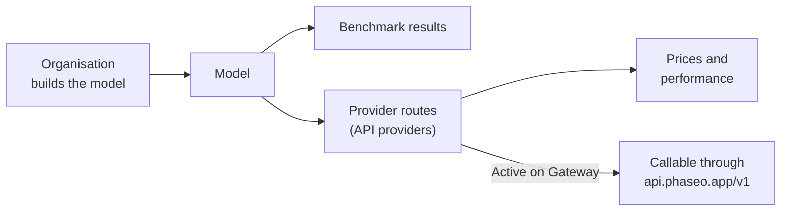

Look up any model on [phaseo.app](https://phaseo.app/models) to see who built it, which providers serve it, what it costs, and how it scores, then call it through the Gateway when it has an active route.

## What the catalog holds

| Record | What it is | Where to look |
| --- | --- | --- |
| [Organisations](./organisations.mdx) | Companies and research labs that build and publish models. | [Organisations](https://phaseo.app/organisations) |
| [Models](./models.mdx) | Each released model, grouped into families of related models. | [Models](https://phaseo.app/models) |
| [Benchmarks](./benchmarks.mdx) | Evaluations and the scores models get on them. | [Benchmarks](https://phaseo.app/benchmarks) |
| [API providers](./api-providers.mdx) | Platforms that serve models through an API. | [API providers](https://phaseo.app/api-providers) |
| [Pricing and performance](./pricing-performance.mdx) | Each provider's price per token, image, second or request, and measured Gateway speed. | Model pages, [Compare](https://phaseo.app/compare) |
| [Subscription plans](./subscription-plans.mdx) | Phaseo plans, and subscriptions sold by providers. | [Subscription plans](https://phaseo.app/subscription-plans) |

A catalog record doesn't mean you can call the model. Only models marked **Active on Gateway** have a route; `GET /v1/models` returns just those.

## How to read the data

- **Prices** are in USD, per 1 million tokens for text, or in the provider's own unit (per image, per second, per request) for media.
- **Dates** are UTC days, shown as `01 Jan 2026` in English.
- **Benchmark scores** keep the benchmark's own scale and direction. Phaseo doesn't convert them to one common score; see [Benchmarks](./benchmarks.mdx).
- **Families** group related models, such as the sizes and versions of one model line.

## How the data is kept current

Provider sync jobs propose new prices, which an admin reviews before publication. Benchmark imports and model lifecycle jobs update the database on a schedule. Anyone can report a correction or a missing record through a GitHub issue; maintainers review the evidence and apply approved changes. See [Contributing](../contributing/overview.mdx).

## Example questions

| Goal | Where to answer it |
| --- | --- |
| Compare two models on a benchmark | [Compare](https://phaseo.app/compare) or the benchmark's page |
| Find the cheapest model for a task | The [Models](https://phaseo.app/models) list sorted by price, then the [pricing calculator](https://phaseo.app/tools/pricing-calculator) |
| See how a benchmark has moved over time | The benchmark's **Progress** chart |
| Find providers that support a feature | Model page **Providers** section, or `GET /v1/models/{author}/{slug}/endpoints` |
| Find records to contribute | Model pages with missing benchmarks or metadata; see [Contributing](../contributing/overview.mdx) |
