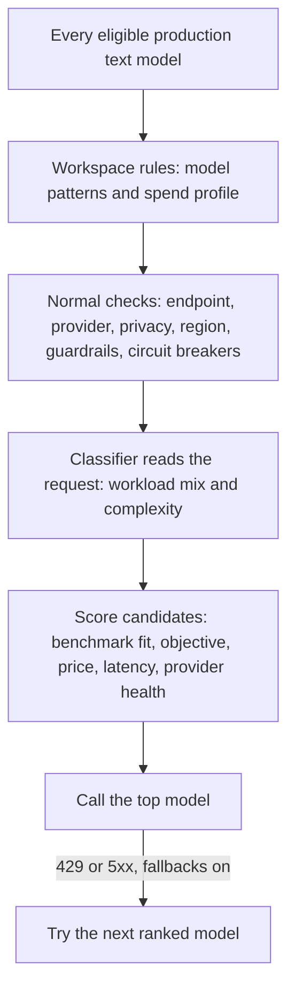

Send `"model": "phaseo/auto"` and Phaseo picks a model for each request from the workload, your workspace's objective, and its price limits. Auto Routing is an Alpha available to selected workspaces.

```json
{
  "model": "phaseo/auto",
  "input": "Review this TypeScript function for correctness."
}
```

The response `model` field shows which model answered.

## How a model is picked



1. **Candidates.** Phaseo starts from every production text model with known standard pricing, then keeps only those that match your model patterns and spend profile.
2. **Checks.** Each candidate must pass the same endpoint, workspace model, provider, privacy, guardrail and circuit-breaker checks as a fixed model request.
3. **Classifier.** A pinned low-cost model reads the request and returns a workload mix (code, reasoning, tool use, and so on), a complexity score and a confidence. It never picks the model itself. Tools and structured output in the request are passed to it as trusted facts.
4. **Scoring.** Complexity sets the least capable model likely to give an acceptable answer, plus a margin. Phaseo then combines non-self-reported catalogue benchmarks with your objective and each candidate's current price, latency, health and reliability. Missing data counts as neutral; it never widens the shortlist.

The request can't change the workspace's objective, spend profile or patterns. A request with a fixed model skips Auto Routing entirely.

## Configure it

<Steps>
<Step title="Open Auto Routing">

Go to **Dashboard -> Settings -> Routing -> Auto Routing**.

</Step>
<Step title="Choose an objective">

| Objective | Weighs most |
| --- | --- |
| `balanced` | A practical mix of quality, price, latency and reliability. |
| `quality` | Benchmark results relevant to the workload. |
| `cost` | Lower input and output token price. |
| `latency` | Lower recent provider latency. |

</Step>
<Step title="Choose a spend profile">

Each profile is a hard ceiling on standard-tier text prices, in USD per million tokens. Models above it are never considered.

| Spend profile | Max input | Max output |
| --- | ---: | ---: |
| Economy | $0.10 | $0.50 |
| Standard | $0.30 | $1.50 |
| Premium | $1 | $5 |
| Any price | None | None |

**Custom** sets both ceilings yourself.

</Step>
<Step title="Narrow the models (optional)">

Add patterns such as `anthropic/*`, `openai/gpt-5.*` or an exact model ID.

</Step>
<Step title="Allow fallbacks and save">

With fallbacks on, Phaseo tries the next ranked model after a `429`, `500`, `502`, `503` or `504`. Each fallback goes through every check again. Client errors don't switch models.

</Step>
</Steps>

From the CLI: `phaseo routing auto update --objective <o> --spend-profile <p> --allowed-patterns <list> --allow-fallbacks`, and `phaseo routing auto get` to read it back. The API is `PATCH /v1/routing/auto`.

<Warning>
  Spend profiles and patterns decide which models are eligible. They don't guarantee quality, so check the resulting model mix against your own workloads.
</Warning>

## The classifier request

Each `phaseo/auto` request creates a separate child request to the classifier model, under the same workspace and billing identity. It appears on its own in request logs with `purpose=auto_routing_classifier` and the parent request ID, and it's metered on its own.

If the classifier fails, times out or returns invalid data, Phaseo uses a local rule-based classifier instead (code, reasoning, tool use, structured output, translation, summarization or general), so the main request still runs.

## Privacy and region limits

Data limits on the request apply to Auto Routing too:

- With `provider.require_zero_data_retention: true`, or a workspace or key guardrail that allows only zero-retention providers, only models with such a provider are shortlisted.
- Required regions are checked against each candidate's providers.
- The classifier request carries the same limits, plus the `only` and `ignore` provider lists. If its model can't meet them, Phaseo uses the local classifier.

If residency requirements alone leave no model, the request fails with `403 model_region_unavailable` and `unmet_requirements`, as a fixed model would. If models were also ruled out for other reasons, it fails with `400 unsupported_model_or_endpoint`.

## Inspect a decision

Request details show the workload, objective, selected model, fallback order, each candidate's scores and factor scores, benchmark IDs, exclusions and the algorithm version. Traces contain no prompt or response content.

## Combine with other routing

- **Dynamic routes.** A fixed model chosen by an attached [dynamic route](./routing-and-fallbacks#attach-routing-rules-to-api-keys) wins. The override is recorded and Auto Routing's fallbacks are off for that request.
- **Request fallbacks.** `phaseo/auto` manages its own ranked fallbacks, so it can't be combined with a [`models` list](./routing-and-fallbacks#request-level-model-fallbacks) or appear in one.
