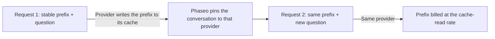

Keep the start of your prompt the same across requests and the provider reads it from its cache instead of processing it again: those tokens are billed at the cache-read rate and the first token arrives sooner. Most providers cache repeated prefixes on their own. Claude caches only what you mark with `cache_control`.



Prompt caching still runs inference on every request. It doesn't return an earlier answer to an identical request.

## Cache a prompt

Mark the last block of the stable part. Everything up to and including that block is cached.

<CodeGroup>
```bash Chat Completions
curl https://api.phaseo.app/v1/chat/completions \
  -H "Authorization: Bearer $PHASEO_API_KEY" \
  -H "Content-Type: application/json" \
  -d '{
    "model": "anthropic/claude-sonnet-5.5",
    "messages": [
      {
        "role": "system",
        "content": [
          {
            "type": "text",
            "text": "You are a support assistant. Follow the company policy exactly.",
            "cache_control": { "type": "ephemeral", "ttl": "1h" }
          }
        ]
      },
      { "role": "user", "content": "Summarise the latest ticket." }
    ]
  }'
```

```bash Responses
curl https://api.phaseo.app/v1/responses \
  -H "Authorization: Bearer $PHASEO_API_KEY" \
  -H "Content-Type: application/json" \
  -d '{
    "model": "anthropic/claude-sonnet-5.5",
    "input": [
      {
        "role": "user",
        "content": [
          {
            "type": "input_text",
            "text": "Reference document: Refunds are available for 30 days when...",
            "cache_control": { "type": "ephemeral", "ttl": "5m" }
          },
          {
            "type": "input_text",
            "text": "Answer this customer: Can I return an item after 20 days?"
          }
        ]
      }
    ]
  }'
```

```bash Anthropic Messages
curl https://api.phaseo.app/v1/messages \
  -H "Authorization: Bearer $PHASEO_API_KEY" \
  -H "Content-Type: application/json" \
  -d '{
    "model": "anthropic/claude-sonnet-5.5",
    "max_tokens": 512,
    "system": [
      {
        "type": "text",
        "text": "You are a careful support assistant. Use the policy below.",
        "cache_control": { "type": "ephemeral", "ttl": "1h" }
      }
    ],
    "messages": [
      {
        "role": "user",
        "content": [
          {
            "type": "text",
            "text": "Policy: refunds are available for 30 days when...",
            "cache_control": { "type": "ephemeral", "ttl": "5m" }
          },
          { "type": "text", "text": "Can this customer return an item after 20 days?" }
        ]
      }
    ],
    "tools": [
      {
        "name": "lookup_order",
        "description": "Look up order status.",
        "input_schema": {
          "type": "object",
          "properties": { "order_id": { "type": "string" } },
          "required": ["order_id"]
        },
        "cache_control": { "type": "ephemeral", "ttl": "5m" }
      }
    ]
  }'
```
</CodeGroup>

Then check that it worked:

1. Send the request once to write the cache.
2. Send it again with the same cacheable content.
3. Check `cached_tokens` and `cache_write_tokens` in the response usage (see [Usage and pricing fields](#usage-and-pricing-fields)), and the cache meters in the request details.
4. Compare latency and cost over several calls, not only the first.

Cache content that stays the same across requests: long system instructions, reused documents, few-shot examples, tool definitions, and large tool results that the next turn sends again. Don't mark content that changes every request, short one-off input, or data your policy doesn't allow the provider to store.

<Note>
Phaseo sends each provider only the cache controls it documents and removes the rest. Cache controls never exclude a provider from routing. Each model page lists its cache read and write prices.
</Note>

## Which providers cache automatically

| Provider | Caching | What Phaseo sends |
| --- | --- | --- |
| [OpenAI](https://developers.openai.com/api/docs/guides/prompt-caching), [Azure OpenAI](https://learn.microsoft.com/en-us/azure/foundry/openai/how-to/prompt-caching) | Automatic for prompts of 1,024 tokens or more | `prompt_cache_key`; breakpoints and `prompt_cache_options` on GPT-5.6 and later; `prompt_cache_retention` on earlier models |
| [Anthropic Claude](https://platform.claude.com/docs/en/build-with-claude/prompt-caching) on Anthropic, Claude on AWS, Amazon Bedrock, and Google Vertex AI | Opt-in | `cache_control` breakpoints, at most four per request |
| [Google Gemini](https://ai.google.dev/gemini-api/docs/caching) on Google AI Studio and [Vertex AI](https://docs.cloud.google.com/vertex-ai/generative-ai/docs/context-cache/context-cache-overview) | Automatic on Gemini 2.5 and later | `cached_content` for an explicit cache you created |
| [xAI](https://docs.x.ai/developers/advanced-api-usage/prompt-caching/maximizing-cache-hits) | Automatic | `prompt_cache_key` and the `x-grok-conv-id` header |
| [DeepSeek](https://api-docs.deepseek.com/guides/kv_cache) | Automatic | Nothing extra |
| [Moonshot AI](https://platform.kimi.ai/docs/guide/context-caching) | Automatic, with a 5-minute TTL; a 1-hour TTL is opt-in on Kimi K3 | `prompt_cache_key` and `prompt_cache_options` |
| [Groq](https://console.groq.com/docs/prompt-caching) | Automatic on the models Groq lists | Nothing extra |
| [Fireworks](https://docs.fireworks.ai/guides/prompt-caching) | Automatic | `prompt_cache_key`, plus the `x-session-affinity` header and `user` |
| [Cerebras](https://inference-docs.cerebras.ai/capabilities/prompt-caching) | Automatic | `prompt_cache_key` |
| [Cloudflare Workers AI](https://developers.cloudflare.com/workers-ai/features/prompt-caching) | Automatic on selected models | The `x-session-affinity` header |
| [Together AI](https://docs.together.ai/docs/inference/chat/prompt-caching), [Mistral](https://docs.mistral.ai/studio-api/conversations/advanced/prompt-caching) | Automatic; `prompt_cache_key` improves the hit rate | `prompt_cache_key` |
| [Alibaba Model Studio](https://www.alibabacloud.com/help/en/model-studio/context-cache) | Automatic (implicit); explicit caches are opt-in | Block `cache_control` |
| [Venice](https://docs.venice.ai/overview/guides/prompt-caching) | Automatic; Venice adds Claude breakpoints itself | Block `cache_control` |
| [DeepInfra](https://docs.deepinfra.com/chat/prompt-cache-retention) | Automatic; a retention window is opt-in | `prompt_cache_key`, `prompt_cache_breakpoint`, and `prompt_cache_options` |
| [Inference.net](https://inference.net/models/claude-opus-5/) | Automatic; explicit caching on Claude and Gemini 2.5 models | Block `cache_control` on Claude and Gemini 2.5 models, without a `ttl` |
| [Baseten](https://docs.baseten.co/inference/model-apis/pricing-and-limits) | Automatic | `prompt_cache_key` and the `x-session-affinity` header |
| [Morph](https://docs.morphllm.com/sdk/components/caching) | Automatic | `prompt_cache_key` and the `x-session-id` header |

Other OpenAI-compatible providers receive `prompt_cache_key` when their API accepts it, and no other cache controls. Phaseo always sends a hash of your workspace and key rather than the key itself; see [Provider affinity](#provider-affinity).

## Cache controls

### Let Phaseo place Claude breakpoints

A top-level `cache_control` on Chat Completions, Responses, or Anthropic Messages turns on caching for Claude routes, and Phaseo places the breakpoints for you. Other providers ignore it.

```json
{
  "cache_control": { "type": "ephemeral", "ttl": "5m" }
}
```

Use `ttl: "5m"` (the default) for short-lived shared context, and `ttl: "1h"` when the model supports longer-lived cache entries. A top-level `cache_control` also keeps the conversation on one provider; see [Provider affinity](#provider-affinity).

`provider_options.anthropic.cache_control` is the same setting, and it also takes a `scope`. When a request sends both, the `provider_options` value wins:

```json
{
  "provider_options": {
    "anthropic": {
      "cache_control": { "type": "ephemeral", "ttl": "5m", "scope": "agent" }
    }
  }
}
```

| `scope` | Where Phaseo places breakpoints |
| --- | --- |
| `all_text` (default) | The system text and the three most recent user messages that contain text or images. |
| `last_user_message` | Only the latest user message. |
| `agent` | For tool loops: the last tool definition, the system text, the final message (including tool results), and the message from the previous step. `conversation` is an alias. |
| `none` | Nowhere. |

Use `agent` for multi-step tool loops. `all_text` and `last_user_message` don't mark messages that contain only tool results, so the cached prefix stops growing. Unrecognised `scope` values are treated as `agent`.

Breakpoints you set on blocks yourself win over the default policy, and count towards Anthropic's limit of four per request: the default policy stops adding marks at four. If your own blocks carry more than four marks, Phaseo keeps the first and the latest three and removes the others, so the request isn't rejected.

### Cache breakpoints on blocks

A cache mark on a content block caches everything up to and including that block. Phaseo accepts two spellings:

- `cache_control`: `{"type": "ephemeral"}`, with an optional `ttl` of `5m` or `1h`.
- `prompt_cache_breakpoint`: OpenAI's `{"mode": "explicit"}`, with an optional `ttl` of `30m` or `12h` (see [12-hour cache on OpenAI](#12-hour-cache-on-openai)). When a block carries both, `prompt_cache_breakpoint` wins.

On Chat Completions and Responses, marks are accepted on text and image parts, on function tool definitions, and on tool results whose content is an array of text parts. Anthropic Messages accepts `cache_control` wherever Anthropic does: `system` text blocks, message text and image blocks, tool result blocks, and tool definitions. When one request has several TTLs, Anthropic requires the `1h` breakpoints to come before the `5m` ones.

Each provider receives the mark in its own form:

| Provider | Block `cache_control` | `prompt_cache_breakpoint` |
| --- | --- | --- |
| Claude on Anthropic, Claude on AWS, Amazon Bedrock, and Google Vertex AI | Sent as `{"type": "ephemeral"}` with your `ttl` | Sent as `cache_control: {"type": "ephemeral"}` |
| OpenAI, GPT-5.6 and later | Sent as `prompt_cache_breakpoint: {"mode": "explicit"}`; the `ttl` is dropped | Sent, with its `ttl` |
| Azure OpenAI, GPT-5.6 and later | Sent as `prompt_cache_breakpoint: {"mode": "explicit"}`; the `ttl` is dropped | Sent without a `ttl` |
| OpenAI and Azure OpenAI, earlier models | Removed | Removed |
| DeepInfra | Removed | Sent without a `ttl` |
| Alibaba Model Studio and Venice | Sent | Removed |
| Inference.net, Claude and Gemini 2.5 models | Sent without a `ttl` | Removed |
| Other providers | Removed | Removed |

Marks on tool definitions reach only Claude routes, Alibaba Model Studio, Venice, and Inference.net's Claude and Gemini 2.5 models; OpenAI doesn't accept breakpoints on tools. Removing a mark leaves the rest of the prompt unchanged, so the cached prefix matches an unmarked request.

Amazon Bedrock and Google Vertex AI cache Claude 3.7 Sonnet, 3.5 Sonnet, and 3 Opus for 5 minutes only, and Bedrock can reject a `ttl` on those models. On those routes Phaseo sends your breakpoints without a `ttl`, so they cache for 5 minutes, and reports a removed `1h` as `cache_control.ttl` in the `X-Phaseo-Dropped-Params` header and `meta.routing.dropped_params`. Inference.net documents breakpoints without a `ttl`, so Phaseo removes and reports a `ttl` there in the same way, and the writes are billed as 5-minute writes.

### OpenAI retention and options

OpenAI's cache controls depend on the model generation. Phaseo sends each one only where it's accepted:

| Field | Values | Sent to |
| --- | --- | --- |
| `prompt_cache_options` | `mode`: `implicit` or `explicit`; `ttl`: `30m` (default) or `12h` | OpenAI GPT-5.6 and later |
| `prompt_cache_options` | `mode`: `implicit` or `explicit`; `ttl`: `30m` | Azure OpenAI GPT-5.6 and later |
| `prompt_cache_options` | `mode`: `explicit`; `ttl`: `5m` or `1h` | DeepInfra |
| `prompt_cache_options` | `mode`: `implicit`; `ttl`: `5m` (default), or `1h` on Kimi K3 | Moonshot AI |
| `prompt_cache_retention` | `in_memory` or `24h` | OpenAI and Azure OpenAI models before GPT-5.6 |

`explicit` mode caches only the breakpoints you place. DeepInfra also needs `prompt_cache_key` on every request in the session. Phaseo sends a Moonshot AI `1h` only to Kimi K3 routes that have a 1-hour write price, so those writes are billed at that price; elsewhere it removes the `ttl` and reports it as `prompt_cache_options.ttl` in the `X-Phaseo-Dropped-Params` header. Other providers receive neither field.

Send either field at the top level or under `provider_options.openai`. When both are present, the top-level value wins:

```json
{
  "prompt_cache_retention": "24h",
  "provider_options": {
    "openai": { "prompt_cache_retention": "in_memory" }
  }
}
```

Here the request uses `24h`.

### 12-hour cache on OpenAI

On GPT-5.6 and later, OpenAI keeps a cache entry for at least 12 hours when you set `ttl: "12h"`, either for the whole request in `prompt_cache_options` or for one breakpoint in `prompt_cache_breakpoint`. A breakpoint without its own `ttl` uses the request's. OpenAI bills a 12-hour write at 2.5× the input rate and a 30-minute write at 1.25×; cache reads cost the same for both.

```json
{
  "model": "openai/gpt-5.6-sol",
  "prompt_cache_options": { "ttl": "30m" },
  "input": [
    {
      "role": "developer",
      "content": [
        {
          "type": "input_text",
          "text": "Shared tool manual...",
          "prompt_cache_breakpoint": { "mode": "explicit", "ttl": "12h" }
        }
      ]
    },
    { "role": "user", "content": "Find the failing test." }
  ]
}
```

- OpenAI documents the 12-hour lifetime on its Responses API only. A Chat Completions request that asks for it runs on OpenAI's Responses API, and the response keeps the Chat Completions format.
- Routes that take a 12-hour cache are tried first: OpenAI's own API (`openai` and `openai-eu`), on a GPT-5.6 or later model whose price card has a 12-hour write price. Any other route, such as Azure OpenAI, another provider, or a model before GPT-5.6, gets the request without it, so the 30-minute default applies. The request still runs, and the removed field is reported as `prompt_cache_options.ttl` or `prompt_cache_breakpoint.ttl` in the `X-Phaseo-Dropped-Params` header and `meta.routing.dropped_params`.

### Use an explicit Gemini cache

Gemini 2.5 and later cache implicitly, with nothing to send. To use an explicit cache you created with Google's caching API, pass its name in `provider_options.google.cached_content`:

```json
{
  "provider_options": {
    "google": { "cached_content": "cachedContents/abc123" }
  }
}
```

- On Google AI Studio, `cached_content` works only with your own Google API key (BYOK). With Phaseo's key the request returns `400`, because the cache belongs to the account that created it.
- On Vertex AI, `cached_content` works only with your own Vertex AI credential; with Phaseo's credential the request returns `400`. Send the cache's full name, `projects/{project}/locations/{location}/cachedContents/{id}`, and Phaseo sends the request to that project and location. A short name such as `cachedContents/abc123` uses the `project_id` and `region` in your service-account JSON, and returns `400` if either is missing.
- Google doesn't support explicit caches on Gemini 4 Argon and later.

`provider_options.google.cache_control` and `provider_options.google.cache_ttl` are accepted but not sent to Google.

### Responses: send the whole conversation

Phaseo doesn't store responses. Requests that set `previous_response_id` or `conversation` return `400` `unsupported_param`, so send the whole conversation in `input` on every step. Its stable opening is the prefix that gets cached. In tool loops, send `reasoning` output items back too; see [Reasoning in tool loops](../api-reference/endpoint/responses.mdx#reasoning-in-tool-loops).

## Usage and pricing fields

Every text endpoint reports cache reads and writes. Chat Completions and Responses follow OpenAI's semantics: the input count includes cache reads and writes. Anthropic Messages follows Anthropic's: `input_tokens` excludes them.

| Endpoint | Total input | Cache reads | Cache writes |
| --- | --- | --- | --- |
| Chat Completions | `prompt_tokens`, including reads and writes | `prompt_tokens_details.cached_tokens` | `prompt_tokens_details.cache_write_tokens` |
| Responses | `input_tokens`, including reads and writes | `input_tokens_details.cached_tokens` | `input_tokens_details.cache_write_tokens`, split by lifetime on OpenAI GPT-5.6 and later in `input_tokens_details.cache_write_tokens_details.ttl_30m_tokens` and `ttl_12h_tokens` |
| Anthropic Messages | `input_tokens` + `cache_read_input_tokens` + `cache_creation_input_tokens` | `cache_read_input_tokens` | `cache_creation_input_tokens`, split by TTL in `cache_creation.ephemeral_5m_input_tokens` and `cache_creation.ephemeral_1h_input_tokens` |

On Chat Completions and Responses, uncached input is the total input minus cache reads minus cache writes. Streamed Anthropic Messages responses carry the cache fields on `message_delta`. Chat Completions usage has no split by lifetime, because OpenAI documents none there; the request details still record it.

<Note>
Earlier responses reported cache writes as `output_tokens_details.cached_tokens` (`completion_tokens_details.cached_tokens` on Chat Completions), and Claude routes left cache reads and writes out of `input_tokens` on Chat Completions and Responses. Neither applies any more: read writes from `cache_write_tokens`. Non-streamed Anthropic Messages responses used to return `cache_creation_input_tokens: null`; they now return the real counts.
</Note>

Request details and pricing breakdowns use these meters:

| Meter | Counts |
| --- | --- |
| `cached_read_text_tokens` | Cache reads. |
| `cached_write_text_tokens` | Cache writes, when the provider has one cache-write price. |
| `cached_write_text_tokens_5m`, `cached_write_text_tokens_1h` | Claude cache writes with a 5-minute or 1-hour TTL, when the provider reports them separately. |
| `cached_write_text_tokens_30m`, `cached_write_text_tokens_12h` | OpenAI cache writes with a 30-minute or 12-hour lifetime. |

### How cached tokens are priced

Phaseo bills each input token once, at one rate: uncached input at the input rate, cache reads at the cache-read rate, and cache writes at the cache-write rate, or at the 5-minute and 1-hour rates (Claude) or the 30-minute and 12-hour rates (OpenAI) when the provider prices them separately. Some providers count cache writes inside the input total and others report them on top of it; either way, a written token is never also billed as ordinary input.

For example, at illustrative rates of $5.00 per 1M input tokens, $0.50 for cache reads, $6.25 for 30-minute cache writes and $30.00 for output, a request with 53,100 input tokens, of which 48,000 are cache reads and 3,000 are cache writes, plus 850 output tokens, costs:

| Tokens | Rate per 1M | Cost |
| --- | ---: | ---: |
| 2,100 uncached input | $5.00 | $0.01050 |
| 48,000 cache reads | $0.50 | $0.02400 |
| 3,000 cache writes | $6.25 | $0.01875 |
| 850 output | $30.00 | $0.02550 |
| Total | | $0.07875 |

If 2,000 of those writes had a 12-hour lifetime, they would cost $12.50 per 1M instead of $6.25, and the request would cost $0.09125.

Some providers don't discount cached tokens on some models. Their model pages show the same price for input and cache reads.

### When a route has no cache price yet

If a provider reports cached tokens on a route that has no cache price in the catalogue yet, the request doesn't fail:

- Cache reads are billed at the route's input rate.
- Cache writes are billed at the input rate times the provider's documented write multiplier.
- The pricing line is marked `pricing_fallback: "input_rate"`.

| Writes | Multiplier of the input rate |
| --- | --- |
| Claude, any platform | 1.25× for 5-minute writes, 2× for 1-hour writes |
| OpenAI 30-minute writes, any route | 1.25× |
| OpenAI 12-hour writes, any route | 2.5× |
| OpenAI, Azure OpenAI and Alibaba, other writes | 1.25× |
| Moonshot AI and Kimi K3 | 1× for 5-minute writes, 2× for 1-hour writes |
| Other providers | 1× |

On a Claude route whose catalogue has one cache-write price, that price is the 5-minute rate. Writes the provider reports as 1-hour writes are billed at 2× the input rate, on a `cached_write_text_tokens_1h` line marked `pricing_fallback: "input_rate"`.

The final `message_delta` of a streamed Claude response reports the total cache writes without the TTL split. Writes beyond the split are billed as 5-minute writes, because server-tool writes can use 5 minutes even when the request asks for 1 hour.

## Provider affinity

A prompt cache lives with one provider, and often with one region or deployment of that provider. Phaseo keeps related requests on the provider and route that served them, so an agent loop doesn't pay to rebuild its cache somewhere else.

Send `prompt_cache_key` or `session_id`, or opt into caching with `cache_control` (top-level, `provider_options.anthropic.cache_control`, or a `cache_control` or `prompt_cache_breakpoint` mark on a message block or tool), to pin a conversation. Phaseo pins it to the provider and route that served the first successful request, and later requests with the same key go there too. Pins are kept per workspace, endpoint, and model.

How long a pin lasts depends on the provider's cache retention:

| Request | Pin lasts |
| --- | --- |
| `session_id` | 24 hours, refreshed while the session is active |
| Anthropic `cache_control` with `ttl: "1h"` | 90 minutes |
| OpenAI or Azure OpenAI with `prompt_cache_retention: "24h"` | 24 hours |
| OpenAI or Azure OpenAI with in-memory retention (the default) | 90 minutes |
| OpenAI with `ttl: "12h"` in `prompt_cache_options` or on a breakpoint, or a reported 12-hour write | 18 hours |
| OpenAI or Azure OpenAI with `prompt_cache_options.ttl: "30m"` | 45 minutes |
| Anything else | 15 minutes |

A pin moves only when its provider fails (an open circuit breaker or a high recent error rate), when Phaseo's managed quota on that provider is used up, or when the active route, preset, guardrail, or request policy no longer allows it. The request then fails over, and the pin moves to the provider that served it. Request details record this as `sticky_routing.demotionReason` in the routing diagnostics. Pinned requests aren't used to probe recovering providers.

Without a key, `session_id` or cache mark, Phaseo still pins the opening context for 15 minutes to a provider that reported a cache read or a cache write for it, as long as that provider's cached input is cheaper than its standard input.

Phaseo sends providers a hash of your workspace and `prompt_cache_key`, never the raw key, so the same key in two workspaces never shares a provider cache. With only a `session_id`, Phaseo derives that hash from the session for OpenAI, xAI, Fireworks and Cerebras. Fireworks, Cloudflare Workers AI and Baseten also receive it in the `x-session-affinity` header, Morph in the `x-session-id` header, and xAI as `x-grok-conv-id` unless you set `provider_options.xai.conversation_id`. Responses still echo your own `prompt_cache_key`.

Set `provider.cache_aware_routing` to `false` to opt out for one request. Set `routing.session_affinity` to `false` when the request carries a `session_id` but should use only normal context-based routing; Phaseo then also stops deriving a provider cache key from the session. For how affinity fits with provider order and fallbacks, see [Routing and fallbacks](./routing-and-fallbacks.mdx). Every cache field is also listed in the [parameter reference](../api-reference/parameters.mdx).
