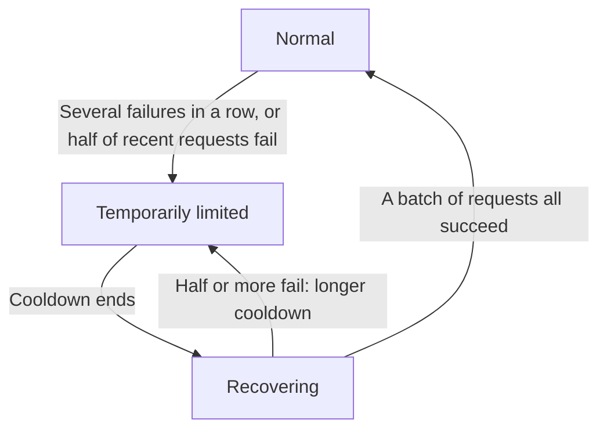

import { ProviderStatusExplorer } from "/snippets/provider-status.jsx";

A provider/model offer has separate upstream and Phaseo statuses. This matters
when a provider has released a model but Phaseo has not yet implemented or
enabled the corresponding endpoint.

You will see these fields on model pages, provider pricing cards, and related
availability UI.

## Provider availability

Provider availability describes the upstream offer.

| Status | Meaning |
| --- | --- |
| `Available` | The provider currently accepts requests for the offer. |
| `Preview` | The provider exposes the offer as a preview. |
| `Limited Access` | The offer exists, but access is restricted by account, region, allowlist, or capacity. |
| `Coming Soon` | The provider has announced or listed the offer, but it cannot be used yet. |
| `Deprecated` | The offer remains available while the provider recommends migration. |
| `Removed` | The provider no longer exposes the offer. |
| `Unknown` | Phaseo has not verified the upstream availability. |

Provider availability never means that Phaseo can route the request.

## Phaseo integration status

Phaseo status describes our implementation and rollout.

| Status | Meaning | Phaseo routing |
| --- | --- | --- |
| `Unsupported` | Phaseo has no compatible integration for the offer. | Not routable. |
| `Planned` | Integration work is accepted but has not started. | Not routable. |
| `Implementing` | Integration work is in progress. | Not routable. |
| `Testing` | Implemented and under contract, staging, or canary testing. | Not publicly routable. |
| `Enabled` | Supported and enabled for production use. | Eligible, subject to routing switches and health. |
| `Disabled` | Phaseo has intentionally switched the integration off. | Not routable. |
| `Blocked` | An external or unresolved dependency prevents rollout. | Not routable. |

Only `Enabled` integrations can have public routing enabled.

## Internal access

Access scope is separate from Phaseo integration status:

| Scope | Meaning |
| --- | --- |
| `Public` | Ordinary customer requests may use the route when every routing gate passes. |
| `Internal` | Only authenticated Phaseo testing traffic may use the route. |

An internal route requires the high-entropy internal token and an explicit
testing-mode request. A customer cannot enable it with the testing header alone.
Ordinary requests do not perform an internal-route database lookup; they use
the existing default context cache. Internal testing uses a separate cache
segment and only considers explicitly internal routes whose upstream offer is
usable and whose Phaseo status is `Testing` or `Enabled`.

## Routing health

Routing health is a third, operational signal. It answers how an enabled route
should be selected right now.

| Icon | Status | Meaning | Routing behaviour |
| --- | --- | --- | --- |
| <Icon icon="circle-check" color="#16a34a" /> | `Active` | The route is healthy enough to select normally. | Routable now. |
| <Icon icon="triangle-alert" color="#f59e0b" /> | `Deranked L1` | Mildly deprioritised by recent health. | Routable now. |
| <Icon icon="triangle-alert" color="#d97706" /> | `Deranked L2` | Clearly deprioritised by recent health. | Routable now, behind healthier routes. |
| <Icon icon="triangle-alert" color="#ef4444" /> | `Deranked L3` | Heavily deprioritised by recent health. | Routable now, strongly deprioritised. |
| <Icon icon="ban" color="#dc2626" /> | `Disabled` | The routing switch is off. | Not routed. |

Deranking does not change the provider's availability or Phaseo's integration
lifecycle. Live health observations also do not rewrite either lifecycle field.

On model pages, a deranked route shows the amber or red warning icon with the
label `Lower priority`. Phaseo sets these levels by hand, and they stay until
Phaseo changes them.

## Live routing

Live routing is separate from the statuses above. The gateway sets it
automatically for each provider, model and endpoint, based on the requests it is
serving now.

| Icon | State | Meaning | Routing behaviour |
| --- | --- | --- | --- |
| <Icon icon="zap-off" color="#ea580c" /> Orange lightning bolt, crossed out | `Temporarily limited` | Requests failed several times in a row, or at least half of recent requests failed. | Routable, but other providers are tried first. |
| <Icon icon="refresh-cw" color="#0ea5e9" /> Blue refresh arrows | `Recovering` | After a cooldown, Phaseo lets a few requests through to check the provider. | If a batch of them all succeed, routing returns to normal. If half or more fail, the route is limited again with a longer cooldown. |

On model pages the live routing icon appears after the status icon, only while
one of these states applies. A route can be `Lower priority` and
`Temporarily limited` at the same time; both icons then show. Hover over an
icon for details.

<ProviderStatusExplorer />

Live routing never changes the provider's availability, Phaseo's integration
status or the hand-set routing health.

## Examples

A newly released provider offer can be:

- provider availability: `Available`
- Phaseo status: `Implementing`
- routing health: not applicable because routing is off

A mature route that Phaseo has deprioritised by hand can be:

- provider availability: `Available`
- Phaseo status: `Enabled`
- routing health: `Deranked L2`

A route whose provider is failing right now can be:

- provider availability: `Available`
- Phaseo status: `Enabled`
- routing health: `Active`
- live routing: `Temporarily limited`

A provider announcement can be:

- provider availability: `Coming Soon`
- Phaseo status: `Planned`
- routing health: not applicable

## Compatibility

Existing API fields such as `availability_status`, `routing_status`,
`is_active_gateway`, and `routable` remain available during the additive
rollout. New integrations should use the explicit provider and Phaseo fields.

## Related pages

- [Routing and Fallbacks](./routing-and-fallbacks.mdx)
- [Service Tiers](./service-tiers.mdx)
- [Models API reference](../api-reference/endpoint/models.mdx)
