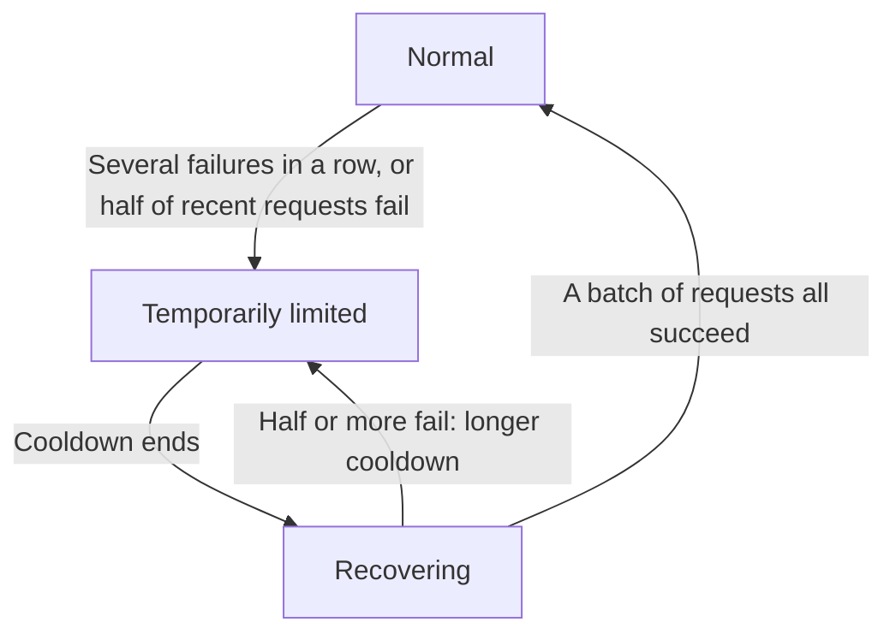

import { ProviderStatusExplorer } from "/snippets/provider-status.jsx";

A model page shows up to two icons after each provider's name: a **status icon** that Phaseo sets, and a **live routing icon** that appears only while the gateway is steering traffic away from a failing provider.

<ProviderStatusExplorer />

## Status icon

Phaseo sets this status by hand, and it stays until Phaseo changes it. Model pages label all three deranked levels `Lower priority`.

| Icon | Status | Routing |
| --- | --- | --- |
| <Icon icon="circle-check" color="#16a34a" /> | `Active` | Routed normally. |
| <Icon icon="triangle-alert" color="#f59e0b" /> | `Deranked L1` | Routable, just behind other providers. |
| <Icon icon="triangle-alert" color="#d97706" /> | `Deranked L2` | Routable, behind healthier providers. |
| <Icon icon="triangle-alert" color="#ef4444" /> | `Deranked L3` | Routable, well behind other providers. |
| <Icon icon="ban" color="#dc2626" /> | `Disabled` | Not routed. |

## Live routing

The gateway sets this automatically for each provider, model and endpoint, from the requests it is serving now. A limited or recovering route stays routable, but other providers are tried first.

## Availability and integration

The status hover card also shows whether the provider offers the model and whether Phaseo has enabled it. A route is public only when both allow it. For example, a provider can offer a new model (`Available`) while Phaseo is still building support for it (`Implementing`).

### Provider availability

| Status | Meaning |
| --- | --- |
| `Available` | The provider currently accepts requests for the offer. |
| `Preview` | The provider exposes the offer as a preview. |
| `Limited Access` | The offer exists, but access is restricted by account, region, allowlist, or capacity. |
| `Coming Soon` | The provider has announced or listed the offer, but it cannot be used yet. |
| `Deprecated` | The offer remains available while the provider recommends migration. |
| `Removed` | The provider no longer exposes the offer. |
| `Unknown` | Phaseo has not verified the upstream availability. |

### Phaseo integration

| Status | Meaning | Phaseo routing |
| --- | --- | --- |
| `Unsupported` | Phaseo has no compatible integration for the offer. | Not routable. |
| `Planned` | Integration work is accepted but has not started. | Not routable. |
| `Implementing` | Integration work is in progress. | Not routable. |
| `Testing` | Implemented and under contract, staging, or canary testing. | Not publicly routable. |
| `Enabled` | Supported and enabled for production use. | Eligible, subject to routing switches and health. |
| `Disabled` | Phaseo has intentionally switched the integration off. | Not routable. |
| `Blocked` | An external or unresolved dependency prevents rollout. | Not routable. |

Only `Enabled` routes can be public. `Internal` routes serve only Phaseo's own test traffic.

## Compatibility

`availability_status`, `routing_status`, `is_active_gateway` and `routable` remain in the API for existing integrations. New integrations should read the separate provider and Phaseo fields.

## Related pages

- [Routing and Fallbacks](./routing-and-fallbacks.mdx)
- [Service Tiers](./service-tiers.mdx)
- [Models API reference](../api-reference/endpoint/models.mdx)
