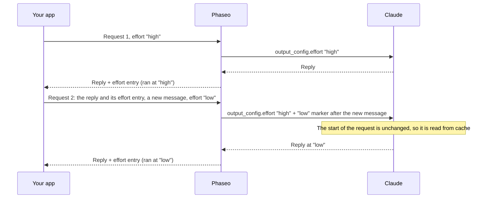

import { EffortCacheExplorer } from "/snippets/effort-cache.jsx";

Send a different `reasoning_effort` (Chat Completions) or `reasoning.effort` (Responses) on any request, and Phaseo changes Claude's effort without restarting its prompt cache. You don't change anything else in your code, as long as you send Claude's reasoning back unchanged on every request.

<EffortCacheExplorer />

Phaseo keeps sending Claude the effort of your conversation's first request and adds each change as an effort marker after your new message. Everything before the marker stays the same, so Claude reads it from cache. If you drop the reasoning, Phaseo changes the top-level effort instead, and Claude processes everything from its first reply onward again instead of reading it from cache.

## How Phaseo keeps the cache

Claude reads a cached conversation only when the start of the request is byte-for-byte the same, and the top-level effort is part of that start. Anthropic's [per-message effort](https://platform.claude.com/docs/en/build-with-claude/effort-per-message) changes the level inside `messages` instead, with a `system` message that has empty `content` and an `output_config.effort`. Phaseo writes those markers for you:



Phaseo stores nothing between requests. Each Claude reply ends with one reasoning entry that records the level it ran at, and Phaseo rebuilds every earlier marker, in the same place, from the entries you send back:

| Request | You send | Phaseo sends Claude |
| --- | --- | --- |
| 1 | `"high"` | `output_config.effort: "high"` |
| 2 | `"low"` | `"high"`, plus a `low` marker after your new message |
| 3 | `"low"` | `"high"`, plus the same marker in the same place |
| 4 | `"high"` | `"high"`, the earlier marker, and a `high` marker after your new message |

Messages you send back are never changed. The markers exist only in the request Phaseo sends Claude.

## Send reasoning back unchanged

<Warning>
Send every reasoning entry back exactly as you received it, on every request: Chat `reasoning_details`, Responses `reasoning` items and Anthropic `thinking` blocks, encrypted or not. Don't drop, edit, reorder or summarise them. Without them, an effort change restarts Claude's cache, and Claude loses its reasoning between tool-loop steps.
</Warning>

The effort entry has no text. On Chat Completions it is the last `reasoning.encrypted` entry in `reasoning_details`:

```json
{
  "role": "assistant",
  "content": "1. Export the data. 2. Create the schema. 3. Import and verify.",
  "reasoning_details": [
    { "type": "reasoning.text", "text": "…", "signature": "phx1.…", "format": "anthropic-claude-v1" },
    { "type": "reasoning.encrypted", "data": "phx1.…", "format": "anthropic-claude-v1" }
  ]
}
```

On Responses it is the last `reasoning` item in `output`, with an `id` that starts with `rs_effort_`:

```json
{ "type": "reasoning", "id": "rs_effort_req_123", "summary": [], "content": [], "encrypted_content": "phx1.…" }
```

The value is opaque, and Phaseo removes it before the conversation reaches any provider.

## Change effort in your code

Append Claude's whole reply to your conversation, then set the effort you want on the next request. The top-level `cache_control` turns on caching for Claude routes; see [Prompt Caching](./prompt-caching.mdx#which-providers-cache-automatically).

### Chat Completions

<CodeGroup>
```ts TypeScript
import OpenAI from "openai";

const client = new OpenAI({
	apiKey: process.env.PHASEO_API_KEY,
	baseURL: "https://api.phaseo.app/v1",
});

const messages: OpenAI.ChatCompletionMessageParam[] = [
	{ role: "user", content: "Plan a migration from SQLite to PostgreSQL." },
];

async function ask(effort: "low" | "medium" | "high") {
	const response = await client.chat.completions.create({
		model: "anthropic/claude-opus-5.5",
		reasoning_effort: effort,
		messages,
		// @ts-expect-error Phaseo field: cache the conversation on Claude routes
		cache_control: { type: "ephemeral" },
	});
	const message = response.choices[0].message;
	messages.push(message); // the whole message, reasoning_details included
	return message.content;
}

await ask("high");
messages.push({ role: "user", content: "Summarise the plan in one sentence." });
await ask("low"); // Claude reads request 1 from cache
```

```python Python
import os
from openai import OpenAI

client = OpenAI(
    api_key=os.environ["PHASEO_API_KEY"],
    base_url="https://api.phaseo.app/v1",
)

messages = [{"role": "user", "content": "Plan a migration from SQLite to PostgreSQL."}]

def ask(effort: str) -> str | None:
    response = client.chat.completions.create(
        model="anthropic/claude-opus-5.5",
        reasoning_effort=effort,
        messages=messages,
        extra_body={"cache_control": {"type": "ephemeral"}},
    )
    message = response.choices[0].message
    # The whole message, reasoning_details included
    messages.append(message.model_dump(exclude_none=True))
    return message.content

ask("high")
messages.append({"role": "user", "content": "Summarise the plan in one sentence."})
ask("low")  # Claude reads request 1 from cache
```
</CodeGroup>

### Responses

Phaseo doesn't store responses, so send the whole conversation in `input`, including every `output` item.

<CodeGroup>
```ts TypeScript
import OpenAI from "openai";

const client = new OpenAI({
	apiKey: process.env.PHASEO_API_KEY,
	baseURL: "https://api.phaseo.app/v1",
});

const input: OpenAI.Responses.ResponseInput = [
	{ role: "user", content: "Plan a migration from SQLite to PostgreSQL." },
];

async function ask(effort: "low" | "medium" | "high") {
	const response = await client.responses.create({
		model: "anthropic/claude-opus-5.5",
		reasoning: { effort },
		input,
		// @ts-expect-error Phaseo field: cache the conversation on Claude routes
		cache_control: { type: "ephemeral" },
	});
	input.push(...response.output); // every item, reasoning items included
	return response.output_text;
}

await ask("high");
input.push({ role: "user", content: "Summarise the plan in one sentence." });
await ask("low"); // Claude reads request 1 from cache
```

```python Python
import os
from openai import OpenAI

client = OpenAI(
    api_key=os.environ["PHASEO_API_KEY"],
    base_url="https://api.phaseo.app/v1",
)

conversation = [{"role": "user", "content": "Plan a migration from SQLite to PostgreSQL."}]

def ask(effort: str) -> str:
    response = client.responses.create(
        model="anthropic/claude-opus-5.5",
        reasoning={"effort": effort},
        input=conversation,
        extra_body={"cache_control": {"type": "ephemeral"}},
    )
    # Every item, reasoning items included
    conversation.extend(item.model_dump(exclude_none=True) for item in response.output)
    return response.output_text

ask("high")
conversation.append({"role": "user", "content": "Summarise the plan in one sentence."})
ask("low")  # Claude reads request 1 from cache
```
</CodeGroup>

### Anthropic Messages

On `/v1/messages`, send the marker yourself: a `system` message with empty `content` and `output_config.effort`. Keep the top-level `output_config.effort` the same on every request, and keep each marker in place on later requests. Phaseo adds the `mid-conversation-output-config-2026-07-01` beta header, so you don't send it.

```bash cURL
curl https://api.phaseo.app/v1/messages \
  -H "x-api-key: $PHASEO_API_KEY" \
  -H "anthropic-version: 2023-06-01" \
  -H "Content-Type: application/json" \
  -d '{
    "model": "anthropic/claude-opus-5.5",
    "max_tokens": 4096,
    "cache_control": { "type": "ephemeral" },
    "output_config": { "effort": "high" },
    "messages": [
      { "role": "user", "content": "Plan a migration from SQLite to PostgreSQL." },
      { "role": "assistant", "content": "1. Export the data. 2. Create the schema. 3. Import and verify." },
      { "role": "system", "content": [], "output_config": { "effort": "low" } },
      { "role": "user", "content": "Summarise the plan in one sentence." }
    ]
  }'
```

Where the marker sits decides when the new level starts:

- **Directly after a user message:** Claude's reply to that message uses the new level.
- **Anywhere else**, such as between Claude's reply and your next message as above: the new level starts at your next message.

A user message that holds only tool results doesn't count as a new message. On routes without per-message effort, Phaseo removes the markers and sends the level in force as the top-level effort.

## When the change restarts the cache

Phaseo changes the top-level effort, as it does for other providers, when:

- **The reasoning is missing.** Your latest Claude reply has no effort entry, because your client dropped `reasoning_details` or `reasoning` items.
- **The change comes between tool-loop steps.** Your latest message holds only tool results, so a marker would apply only from your next message. Phaseo changes the top-level effort so this step runs at the level you asked for, and later changes use markers again.
- **The request sets no effort, or turns reasoning off.** Send `reasoning_effort` or `reasoning.effort` on every request. `"none"` and `reasoning.enabled: false` turn reasoning off.
- **The route doesn't support it.** See [Supported models](#supported-models).

A top-level change keeps the part of the conversation before Claude's first reply in the cache. Claude processes everything from that reply onward again, and bills it as new input.

## Supported models

| Route | Models |
| --- | --- |
| Anthropic, Google Vertex AI | Claude Fable 5.2 and 5.1, Mythos 5.2 and 5.1, Opus 5.5 and 5, Sonnet 5.5, Haiku 5.5 |
| Claude on AWS | The same models except Mythos |
| Amazon Bedrock | Claude Fable 5.1 and Opus 5.5 |

On every other route, including Claude on Azure, an effort change goes to the top level.

## Check that the cache held

Read the cache counts on the request after a change: `usage.prompt_tokens_details.cached_tokens` on Chat Completions, `usage.input_tokens_details.cached_tokens` on Responses and `usage.cache_read_input_tokens` on Anthropic Messages. [Usage and pricing fields](./prompt-caching.mdx#usage-and-pricing-fields) lists every field.

We measured the same five-request Chat Completions conversation on `anthropic/claude-haiku-5.5` on 11 November 2026, once with the effort entries sent back and once without them. Effort was `high`, `high`, `low`, `low`, `high`, and a 3,400-token document arrived in the second message:

| Request 3 (effort `high` to `low`) | Effort entries dropped | Effort entries sent back |
| --- | --- | --- |
| Tokens read from cache | 0 | 3,575 |
| Tokens processed again and written to cache | 3,499 | 75 |
