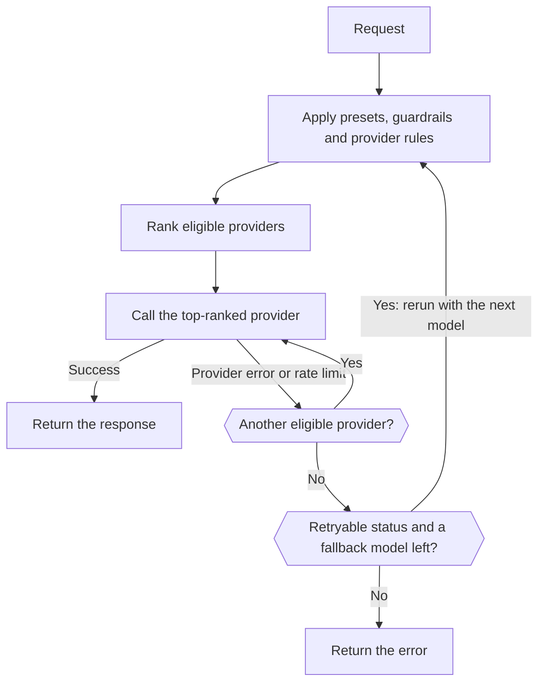

import { RoutingCostExplainer } from "/snippets/routing-cost.jsx";
import { FallbackChainExplorer } from "/snippets/fallback-chain.jsx";

Most models are served by several providers. For each request the Gateway keeps the providers your rules allow, ranks them, and calls the best one. If that provider fails, it tries the next; if every provider fails with a retryable error, it can move on to a fallback model.



Your client should still retry `429` and `5xx` responses with exponential backoff.

## Choose how providers are ranked

| Mode | Ranks by | Use it when |
| --- | --- | --- |
| `balanced` (default) | Cost per successful answer | You want the best mix of price, speed and reliability. |
| `price` | Price | Cost matters more than response time. |
| `latency` | Time to first token | Responses must start fast. |
| `throughput` | Output speed | Long outputs must finish fast. |

Set the workspace default in **Dashboard -> Settings -> Routing**, with `phaseo settings update --routing-mode <mode>`, or with `routing_mode` on `PATCH /v1/settings`. For one request, send `provider.sort` or `routing.mode`, or add a suffix to the model ID:

| Suffix | Mode | Example |
| --- | --- | --- |
| `:nitro` | `throughput` | `openai/gpt-6-astra:nitro` |
| `:cheap` | `price` | `openai/gpt-6-astra:cheap` |
| `:fast` | `latency` | `openai/gpt-6-astra:fast` |

A suffix overrides `routing.mode`, `provider.sort`, and preset and workspace modes. Allow lists, regions, guardrails and price ceilings still apply.

The Routing settings page also has beta and alpha channel toggles, so preview providers only get traffic when you opt in.

## How balanced mode ranks providers

For text requests (Chat Completions, Responses and Messages), `balanced` estimates each provider's **cost per successful answer**:

- **Tokens:** what a typical request for this model costs on the provider, using the model's measured prompt and output sizes and the provider's measured cache-hit rate.
- **Waiting:** the time to first token and to the full response, converted to dollars at the model's typical price per second.
- **Failures:** the total divided by the provider's recent success rate, plus a penalty for provider errors and a smaller one for rate limits.

Providers close to the lowest cost share most of the traffic. Every provider keeps a small share, so a recovery is noticed. Pick a scenario to see how it plays out (the providers are examples):

<RoutingCostExplainer />

Other endpoints are scored on reliability, latency, tail latency, throughput, price and token fit. If you're a provider, [How Providers Earn Traffic](./how-providers-earn-traffic) shows how to win a larger share.

## Request-level model fallbacks

List fallback models in `models`. Phaseo tries `model` first, then each entry in order:

```json
{
  "model": "openai/gpt-6-astra",
  "models": ["anthropic/claude-sonnet-5.5", "google/gemini-4-argon"],
  "input": "Summarize this incident report."
}
```

Choose what each model returns to see when Phaseo moves on:

<FallbackChainExplorer />

**What moves to the next model.** A model is tried only after the previous one, with all its provider retries, ends in `429`, `500`, `502`, `503` or `504`. A `429` from a Phaseo budget or free-model quota also moves on, since another model may fit the remaining limit. So does a model that no provider serves any more, for example a [retired](#retired-models) one.

**What doesn't.** Client errors such as `400`, `401`, `402`, `403`, `404`, `408`, `413` and `422` return immediately. So do failures before the first model runs, such as authentication or API key rate limits.

**Rules for the list:**

- `model` is required; sending `models` alone returns `400`.
- `models` takes 1 to 25 entries. Duplicates and copies of `model` are ignored.
- Entries can be model IDs, [provider-qualified IDs](./provider-qualified-models) or presets such as `@support`.
- Each attempt is validated as its own request (endpoint, parameters, workspace models, guardrails, presets, pricing, BYOK). A fallback that can't serve the request is skipped and logged; it never replaces the error you'd otherwise get. An attempt identical to one already made is skipped too.

**Logs and billing.** Each attempt is a separate request with its own usage record, billed as if fallbacks didn't exist. The response `model` field names the model that answered, and its routing trace lists the primary request ID, the fallback order and each earlier attempt.

**Streaming, video and music.** A stream falls back only before its first byte; after that, errors arrive in the stream. Video and music fall back only while the job is being submitted.

**With other routing controls.** Fallbacks on an attached dynamic route take precedence over `models`, and a fixed model chosen by the route still applies to each attempt. A preset applies its own constraints to each attempt it's used in. [`phaseo/auto`](./auto-routing) manages its own fallbacks and can't be combined with `models`.

| Endpoint | `models` |
| --- | --- |
| Chat Completions, Responses, Messages | Supported, including streams before the first byte |
| Embeddings, Moderations, Rerank | Supported |
| Image generation and edits | Supported, including multipart uploads |
| Speech, transcription and translation | Supported, including multipart uploads |
| OCR, Parse, Decisions | Supported |
| Video and music generation | Supported at job submission |
| Batches | `400`: each batch row targets one model |
| Realtime and live sessions | `400`: a session binds one model |
| Council runs | `400`: models come from the run configuration |

Multipart endpoints accept repeated `models` fields, `models[]` fields, or one JSON array string. See also [Rate limits](../api-reference/limits.mdx) and [Errors](../api-reference/errors.mdx).

## Pin one provider

Put the provider in front of the model ID to use exactly that provider:

```json
{
  "model": "baseten:thinking-machines/inkling-small",
  "input": "Hello"
}
```

This turns off cross-provider fallback for the request. Suffixes stay part of the model ID, as in `baseten:google/gemma-4-26b-a4b:free`. [Provider-qualified model IDs](./provider-qualified-models) covers the full syntax and errors.

## Limit which providers are used

| Control | Where | What it does |
| --- | --- | --- |
| [Presets](./presets) | **Settings -> Presets** | Allowed models and provider allow or ignore lists, applied before ranking, so they also limit fallbacks. |
| [Regional routing](./regional-routing) | Request or workspace | Keeps execution or data in a region. |
| Dynamic routes | **Settings -> Routing** | Per-key rules: see below. |
| BYOK fallback | **Settings -> BYOK** | Whether a failed BYOK request may retry on Phaseo credits. |

### Attach routing rules to API keys

A dynamic route is a flow of rules attached to one or more inference API keys. It can:

- branch on request-body fields, headers, custom `metadata`, endpoint, model or session ID
- split traffic by percentage for A/B tests and rollouts
- cap daily, weekly or monthly requests or cost per key
- switch model, routing mode, provider preference and fallback models (up to eight)
- turn on cache-aware and session-aware provider affinity

Conditions have true and false outputs; rate and budget nodes have within and exceeded outputs. Percentage splits are deterministic per session or prompt-cache key, so a cached conversation doesn't move between branches.

Saving creates an immutable draft version. Deploying copies that version to the Gateway and clears policy caches for its keys; earlier versions stay available for rollback. Provider-health recommendations appear under **Insights**. From a script, use the `/v1/routing/dynamic-routes` API with a management key.

Custom metadata goes in the request body on the OpenAI-compatible text endpoints:

```json
{
  "model": "openai/gpt-6-astra",
  "metadata": { "customer_plan": "pro", "workspace": "acme" }
}
```

## Keep a conversation on one provider

Cache-aware routing is on by default for text generation. A request that sends `prompt_cache_key` or `session_id`, or opts into caching with `cache_control` (top-level, in `provider_options.anthropic`, or as a `cache_control` or `prompt_cache_breakpoint` mark on a message block or tool), is pinned to the provider and route that served its first successful request. Other requests are pinned for 15 minutes once a provider reports a cache read or write for the same opening context, if that provider's cached input is cheaper than its standard input.

| | |
| --- | --- |
| Pin lifetime | 15 minutes to 24 hours, following the provider's cache retention. With `session_id`, up to 24 hours of session activity. |
| Scope | Per workspace. With `session_id`, keyed to the session instead of the opening context. |
| A pin moves when | The provider's circuit breaker opens, its error rate is high, Phaseo's managed quota on it runs out, or your rules no longer allow it. |

Turn it off for one request with `provider.cache_aware_routing: false`, or keep cache affinity but ignore the session with `routing.session_affinity: false`:

```json
{
  "model": "openai/gpt-6-astra",
  "session_id": "support-session-42",
  "routing": { "session_affinity": false }
}
```

[Provider affinity](./prompt-caching.mdx#provider-affinity) lists the hints Phaseo sends to each provider.

## Explain a routing decision

Open **Dashboard -> Settings -> Usage -> Request logs**, select a request, and expand **Routing observability** under **Provider Responses**. It shows:

- every ranked provider with its final score, and which were selected and attempted
- providers excluded before ranking, with the reason
- providers deranked by their rollout or routing status
- each score's inputs, weights, contributions and multipliers

Score factors change the score; recorded context explains the decision without necessarily affecting it. Traces hold numbers and statuses only, never prompts or output. Requests made before routing observability was enabled may show a partial trace or none.

### What counts against a provider's uptime

| Lowers uptime | Doesn't |
| --- | --- |
| `401` authentication failures | `400` bad requests |
| `402` payment failures | `403` geographic restrictions |
| `404` model not found | `413` oversized payloads |
| `500` and above | `429` rate limits |
| Errors after a stream starts | |
| A `200` that finishes with an error reason | |

Geographic restrictions and rate limits are tracked separately, because they don't mean the provider is down. For production, log request IDs, status codes and model IDs so you can match failures to these traces.

## Retired models

A retired model keeps working while any provider still serves it. After that, requests fail with `410 model_retired`, unless the workspace sends them to a replacement with retired model routing. Your own `models` list is always tried first. See [Model Deprecation and Retirement](./model-retirement.mdx).

## BYOK considerations

With <Tooltip tip="Bring your own key: Phaseo routes the request with your own provider API key, and your provider bills the model usage directly.">BYOK</Tooltip>, Phaseo routes and logs the request while your provider bills the model usage.

| | |
| --- | --- |
| Service fee | None for the first 250,000 completed BYOK requests each UTC month, then 2.5% of provider-equivalent cost. |
| Phaseo credit | Keep at least $1 available, for managed fallback and fees after the allowance. |
| Provider rules | Your provider's quotas, data policy, model access and account limits still apply. |
| Storage | Keys are encrypted with AES-256-GCM, bound to their workspace and provider. |

Scope each key to the models and API keys that need it. To stop a failed BYOK request from retrying on Phaseo credits, turn off fallback in **Dashboard -> Settings -> BYOK**, or set `byok_fallback_enabled` on `PATCH /v1/settings` with a management key. Add keys in the same place, or with `POST /v1/byok` and a management key.
