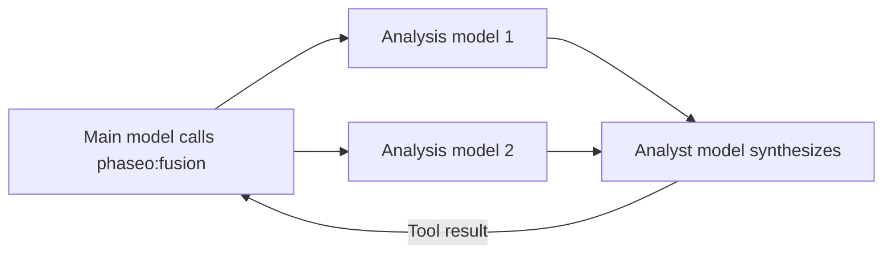

Add `phaseo:fusion` when an answer benefits from several independent opinions, such as a planning decision, a research synthesis, or a design review. When the main model calls it, Phaseo sends the question to every analysis model in parallel, asks an analyst model to merge their findings, and returns that synthesis. It adds latency, so use a single [Advisor](./advisor) when one review pass is enough.



```json
{
  "tools": [
    {
      "type": "phaseo:fusion",
      "parameters": {
        "analysis_models": ["anthropic/claude-opus-5", "openai/gpt-5"],
        "model": "google/gemini-pro-latest",
        "instructions": "Reconcile disagreements and return concise synthesis guidance.",
        "max_uses": 1,
        "max_completion_tokens": 1400
      }
    }
  ]
}
```

In the Playground, the server-tools menu sets the same things: the analysis models, an optional judge (analyst) model, and a call limit.

## Parameters

| Parameter | Type | Default | Description |
| --- | --- | --- | --- |
| `analysis_models` | string[] | Required | At least 2 models. Fewer rejects the request. |
| `model` | string | The request's model | The analyst model that writes the synthesis. |
| `instructions` | string | None | Instructions for both the analysis and analyst calls. |
| `max_uses` | integer | `1` | Fusion calls per request, up to `4`. |
| `max_completion_tokens` | integer | `1400` | Output tokens for each analysis and the synthesis, up to `32000`. |

## What the model sends

A `prompt`: the question that needs several perspectives.

## What the tool returns

```json
{
  "status": "ok",
  "analyses": 2,
  "analysis": "Both reviewers flag the cutover order..."
}
```

`analyses` counts the analysis models that answered. If some fail, the synthesis uses the rest. Error results are `fusion_invalid_request` (no prompt), `fusion_max_uses_exceeded`, `fusion_panel_failed` (every analysis model failed), and `fusion_request_failed` (the analyst failed).

## Usage and pricing

Each call adds 1 to `usage.server_tool_use.fusion_requests` and can be billed with `server_tool_fusion_requests`. Every analysis and analyst call's tokens are added to the request's usage and priced at that model's rates.
