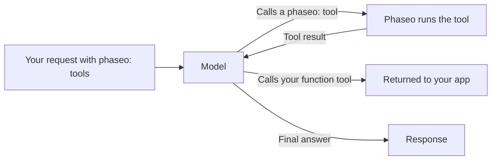

Add a `phaseo:` tool to `tools` and Phaseo runs it for you when the model calls it: the model asks for the current time, a web search, or a second model's opinion, Phaseo executes the call, feeds the result back, and the model finishes its answer. You don't write a tool executor.



<Note>
Server tools are in beta. Request shapes and result payloads may change as provider support changes.
</Note>

## Available tools

| Tool | Type | Use it for | Endpoints |
| --- | --- | --- | --- |
| [Datetime](./datetime) | `phaseo:datetime` | Current date and time in up to 5 timezones | All three |
| [Web Search](./web-search) | `phaseo:web_search` | Searching the web for current or sourced information | All three |
| [Web Fetch](./web-fetch) | `phaseo:web_fetch` | Reading the text of a specific URL | All three |
| [Advisor](./advisor) | `phaseo:advisor` | Asking another model for a review or plan | All three |
| [Subagent](./subagent) | `phaseo:subagent` | Handing a self-contained task to a worker model | All three |
| [Fusion](./fusion) | `phaseo:fusion` | Getting several models' analysis, then one synthesis | All three |
| [Search Models](./search-models) | `phaseo:search_models` | Finding a model in the live Phaseo catalogue | All three |
| [Image Generation](./image-generation) | `phaseo:image_generation` | Creating an image while answering | All three |
| [Apply Patch](./apply-patch) | `phaseo:apply_patch` | Returning validated file patches | `/v1/responses` only |

"All three" means `/v1/chat/completions`, `/v1/responses`, and `/v1/messages`.

## Send a request

```bash
curl https://api.phaseo.app/v1/chat/completions \
  -H "Authorization: Bearer $PHASEO_API_KEY" \
  -H "Content-Type: application/json" \
  -d '{
    "model": "openai/gpt-6-astra",
    "messages": [
      { "role": "user", "content": "What are the latest AI policy updates this week?" }
    ],
    "tools": [
      { "type": "phaseo:web_search" },
      { "type": "phaseo:datetime", "parameters": { "timezones": ["Europe/London", "UTC"] } }
    ]
  }'
```

Each tool takes an optional `parameters` object, described on its page. `stream: true` works too: Phaseo runs the tool turns itself and streams the final answer to you.

## Mix server tools with your own functions

Phaseo runs only the `phaseo:` tools. A regular `function` tool in the same request is returned to your app as usual, and you send its result back in a follow-up request, as in [Tool Calling](../tool-calling).

```json
{
  "model": "openai/gpt-6-astra",
  "messages": [
    { "role": "user", "content": "Find recent funding news and save the best item." }
  ],
  "tools": [
    { "type": "phaseo:web_search", "parameters": { "max_results": 3 } },
    {
      "type": "function",
      "function": {
        "name": "save_research_item",
        "description": "Save a selected research item",
        "parameters": {
          "type": "object",
          "properties": {
            "title": { "type": "string" },
            "url": { "type": "string" }
          },
          "required": ["title", "url"]
        }
      }
    }
  ]
}
```

## Limits on the tool loop

| Limit | Value | When it's hit |
| --- | --- | --- |
| Server tool calls per request | `max_tool_calls` in the request, default `30`, maximum `100` | `400 gateway_server_tool_limit` |
| Follow-up turns | `8` | `502 gateway_server_tool_error` |
| Calls to one tool | That tool's `max_uses` | The tool returns an error result to the model, which can carry on without it |

## Usage and pricing

Each server tool adds a counter to `usage.server_tool_use`, and a model's price card can bill the matching meter. Tokens used by a second model (Advisor, Subagent, Fusion, Image Generation) are added to the request's usage and priced at that model's rates.

```json
{
  "usage": {
    "input_tokens": 105,
    "output_tokens": 250,
    "server_tool_use": {
      "datetime_requests": 1,
      "web_search_requests": 2,
      "web_search_results": 8
    }
  }
}
```

| Tool | Usage counter | Price meter |
| --- | --- | --- |
| Datetime | `datetime_requests` | None |
| Web Search | `web_search_requests`, `web_search_results`, `web_search_extra_results` | `server_tool_web_search_requests`, `server_tool_web_search_extra_results` |
| Web Fetch | `web_fetch_requests` | `server_tool_web_fetch_requests` |
| Advisor | `advisor_requests` | `server_tool_advisor_requests` |
| Subagent | `subagent_requests` | `server_tool_subagent_requests` |
| Fusion | `fusion_requests` | `server_tool_fusion_requests` |
| Search Models | `search_models_requests` | `server_tool_search_models_requests` |
| Image Generation | `image_generation_requests` | `server_tool_image_generation_requests` |
| Apply Patch | `apply_patch_requests` | `server_tool_apply_patch_requests` |

When Web Search or Web Fetch runs as the provider's own tool (`engine: "native"`), it's billed with `native_web_search_requests` or `native_web_fetch_requests` instead.
