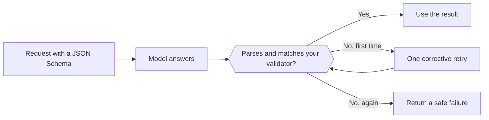

Send a JSON Schema with the request and the model returns JSON in that shape instead of free text. Your code still parses and validates it before using it.



## Choose a format

| `type` | What you get |
| --- | --- |
| `json_schema` | JSON that follows the schema you send. Use this by default. |
| `json_object` | Some valid JSON object, with no shape enforced. |
| `text` | Plain text (the default). |

Where the format goes depends on the endpoint:

| Endpoint | Field |
| --- | --- |
| `/v1/chat/completions` | `response_format` |
| `/v1/responses` | `text.format` |
| `/v1/messages` | Not supported. Ask for JSON in the prompt and validate it the same way. |

## Send a schema

<CodeGroup>
```bash Chat Completions
curl https://api.phaseo.app/v1/chat/completions \
  -H "Authorization: Bearer $PHASEO_API_KEY" \
  -H "Content-Type: application/json" \
  -d '{
    "model": "openai/gpt-6-astra",
    "messages": [
      { "role": "user", "content": "Return the city and weather for London." }
    ],
    "response_format": {
      "type": "json_schema",
      "json_schema": {
        "name": "weather",
        "strict": true,
        "schema": {
          "type": "object",
          "properties": {
            "city": { "type": "string" },
            "weather": { "type": "string" }
          },
          "required": ["city", "weather"],
          "additionalProperties": false
        }
      }
    }
  }'
```

```bash Responses
curl https://api.phaseo.app/v1/responses \
  -H "Authorization: Bearer $PHASEO_API_KEY" \
  -H "Content-Type: application/json" \
  -d '{
    "model": "openai/gpt-6-astra",
    "input": "Return the city and weather for London.",
    "text": {
      "format": {
        "type": "json_schema",
        "name": "weather",
        "strict": true,
        "schema": {
          "type": "object",
          "properties": {
            "city": { "type": "string" },
            "weather": { "type": "string" }
          },
          "required": ["city", "weather"],
          "additionalProperties": false
        }
      }
    }
  }'
```
</CodeGroup>

The JSON comes back as a string in the message content:

```json
{
  "choices": [
    {
      "finish_reason": "stop",
      "message": {
        "role": "assistant",
        "content": "{\"city\":\"London\",\"weather\":\"Cloudy\"}"
      }
    }
  ]
}
```

## Design the schema

Start with a small object. List every field in `required`, use `enum` for known categories, and set `additionalProperties: false` when extra keys must be rejected. Version the schema together with your server-side validator so they never drift apart.

## Validate the result

Check for a refusal, missing content, or a truncated answer (`finish_reason` other than `stop`) before you parse. Then validate the parsed object. This Zod validator matches the schema above:

```typescript
import { z } from "zod";

const Weather = z.object({
  city: z.string(),
  weather: z.string(),
}).strict();

function parseWeather(content: string) {
  return Weather.parse(JSON.parse(content));
}
```

If validation fails, retry once with the error in the prompt, then return a safe failure. Each retry is charged. Valid JSON still isn't proof that the values are correct or that an action is authorised.

Track validation failures per model and schema version, and rerun your evaluation cases when either changes. To repair malformed JSON automatically, see [response healing](../cookbook/response-healing-for-structured-json.mdx).
