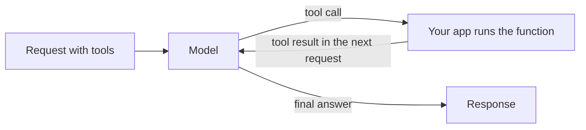

Describe your functions in `tools`, and the model answers with a call to one of them, such as a database lookup or weather check, instead of guessing. Your app runs the function and sends the result back; the model then writes the final answer.



Tool calling works on all three text endpoints, each in its own format:

| Endpoint | Model's call | Your result |
| --- | --- | --- |
| `/v1/chat/completions` | `tool_calls` on the assistant message, `finish_reason: "tool_calls"` | A `role: "tool"` message |
| `/v1/responses` | A `function_call` output item | A `function_call_output` input item |
| `/v1/messages` | A `tool_use` content block | A `tool_result` content block |

## Send a request with tools

```bash
curl https://api.phaseo.app/v1/chat/completions \
  -H "Authorization: Bearer $PHASEO_API_KEY" \
  -H "Content-Type: application/json" \
  -d '{
    "model": "openai/gpt-6-astra",
    "messages": [
      { "role": "user", "content": "What is the weather in London?" }
    ],
    "tools": [
      {
        "type": "function",
        "function": {
          "name": "get_weather",
          "description": "Get current weather by city",
          "parameters": {
            "type": "object",
            "properties": {
              "city": { "type": "string" }
            },
            "required": ["city"]
          }
        }
      }
    ],
    "tool_choice": {
      "type": "function",
      "function": { "name": "get_weather" }
    }
  }'
```

`tool_choice` here forces the call. Leave it out, or set `"auto"`, to let the model decide.

The model replies with a call instead of text:

```json
{
  "id": "chatcmpl_...",
  "object": "chat.completion",
  "choices": [
    {
      "index": 0,
      "finish_reason": "tool_calls",
      "message": {
        "role": "assistant",
        "content": null,
        "tool_calls": [
          {
            "id": "call_123",
            "type": "function",
            "function": {
              "name": "get_weather",
              "arguments": "{\"city\":\"London\"}"
            }
          }
        ]
      }
    }
  ]
}
```

Parse and check `arguments` before you run anything; see [Tool Calling Safety](./tool-calling-safety). Then send the assistant message and your result back in the next request. [Tool Calling Patterns](./tool-calling-patterns) shows that follow-up request for Chat Completions and Responses.

## Let Phaseo run the tool

Tools whose type starts with `phaseo:` run on Phaseo's side: the model calls them, Phaseo executes them and continues the loop, and you get the final answer without writing an executor. You can mix them with your own functions in one request.

| Tool | Type |
| --- | --- |
| [Datetime](./server-tools/datetime) | `phaseo:datetime` |
| [Web Search](./server-tools/web-search) | `phaseo:web_search` |
| [Web Fetch](./server-tools/web-fetch) | `phaseo:web_fetch` |
| [Advisor](./server-tools/advisor) | `phaseo:advisor` |
| [Subagent](./server-tools/subagent) | `phaseo:subagent` |
| [Fusion](./server-tools/fusion) | `phaseo:fusion` |
| [Search Models](./server-tools/search-models) | `phaseo:search_models` |
| [Image Generation](./server-tools/image-generation) | `phaseo:image_generation` |
| [Apply Patch](./server-tools/apply-patch) | `phaseo:apply_patch` (Responses only) |

```json
{
  "tools": [
    { "type": "phaseo:datetime", "parameters": { "timezones": ["Europe/London", "UTC"] } }
  ],
  "tool_choice": "auto"
}
```

See [Server Tools](./server-tools) for limits, usage counters, and pricing.

## Stream tool calls

Tool-calling requests accept `stream: true`. Function-call arguments arrive in pieces; collect them all before you parse the call. When a server tool runs, Phaseo finishes that tool turn, runs the tool, continues the model, and streams the rest of the answer to you, so your client still reads one stream. See [Streaming](./streaming).

For answers that must match a schema rather than call a function, use [Structured Outputs](./structured-outputs).
