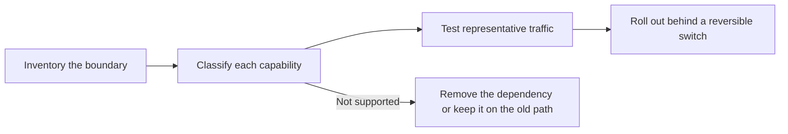

Find each capability your current gateway integration uses, then do what the last column says before moving traffic. Last reviewed November 4, 2026.

Work through the migration in this order. It finds the behaviors that can change even when both platforms accept the same OpenAI-compatible request.

## Inventory the integration boundary

Record every place the current gateway appears, so the migration doesn't leave a second, hidden configuration path:

- base URLs and API key environment variables;
- SDK initialization and custom headers;
- model IDs and fallback models;
- provider ordering, allow lists, and privacy requirements;
- streaming, tool-calling, and structured-output code;
- batch jobs, files, webhooks, and async status polling;
- request attribution and user or session metadata.

## Requests

| Capability | On Phaseo | Before cutover |
| --- | --- | --- |
| Authentication | `Authorization: Bearer $PHASEO_API_KEY` | Change the base URL and key, then run one authenticated request. |
| Chat Completions | `/v1/chat/completions` | Test normal, streaming, tool-calling, and structured-output requests. Unknown top-level fields return `400`. |
| Responses | `/v1/responses`, without stored state | Test input formats, streaming events, tools, and parsing. `previous_response_id` and `conversation` return `400`; send the full history. |
| Anthropic Messages | `/v1/messages` at the root host `https://api.phaseo.app` | Pass the key as a bearer token, and review each `anthropic-beta` header; Phaseo doesn't forward them. |
| Model IDs | `<org>/<model>` | Check every production ID in `GET /v1/models?format=openai`. Don't assume aliases match. |
| Embeddings, images, audio, moderations | Supported per model and provider | Confirm the model supports the operation. |

## Routing and policy

| Capability | On Phaseo | Before cutover |
| --- | --- | --- |
| Model fallbacks | `models` array, 1 to 25 entries | Fallbacks run on `429`, `500`, `502`, `503` and `504`, never on request errors. |
| Provider order | `provider.order` | Recreate only the ordering the workload still needs. |
| Provider allow and ignore lists | `provider.only`, `provider.ignore` | Check provider IDs and that at least one route remains. |
| Price, latency, or throughput sorting | `provider.sort` | After testing, check the selected provider in request details. |
| Zero data retention | `provider.require_zero_data_retention` (alias `provider.zdr`) | Confirm the model has a matching provider before enforcing it. |
| Regional execution and data residency | `provider.required_execution_region`, `provider.required_data_region`, workspace privacy defaults | Test both a successful route and the no-matching-provider error. |
| Shared prompts and defaults | [Presets](../guides/presets) | Move shared configuration into a preset instead of copying it to each caller. |

## Operations

| Capability | On Phaseo | Before cutover |
| --- | --- | --- |
| App attribution | `X-App-Id`, `X-App-Name`, `HTTP-Referer`, `X-Title`, `X-App-Categories` | Keep the headers that describe the calling application; dropping them during the migration makes cost and usage comparisons harder. Check app grouping in the dashboard. See [App Attribution](../guides/app-attribution) for category values. |
| Cost labels | `X-Phaseo-Metadata` labels | Map custom properties or tags to labels. |
| Request details | Request logs and `GET /v1/generations?id=<request_id>` | Compare provider, latency, token usage, and price for representative prompts. |
| Replay | `replay_request` when `replay_supported` is `true` | Confirm a failed request's endpoint and payload can be recovered. |
| Batch and async jobs | Batch, file, video, webhook, and WebSocket APIs | Check status transitions, terminal billing, cancellation, and result retrieval. `/v1/files` holds batch input only. |
| Rate limits | Per-user requests-per-minute allowance, from 10 for a new workspace | A proxy that sends a team's traffic through one key owner can hit it. See [Limits](../api-reference/limits). |
| Gradual rollout | Client or infrastructure traffic splitting | Keep rollback a base URL and key change until the cutover is stable. |

## Not available

These have no Phaseo equivalent. Keep them in the app or on the old platform:

- **Response caching.** Phaseo doesn't cache responses. [Prompt caching](../guides/prompt-caching) still cuts input cost.
- **Stored responses and conversations.** There's no `GET` or `DELETE /v1/responses/{id}`.
- **Token counting** (`/v1/messages/count_tokens`).
- **OpenAI Assistants, Threads, vector stores, fine-tuning, and legacy `/v1/completions`.**

## Classify each capability

Give each production behavior one status, using the tables above and the guide for your [source platform](./index#platform-migrations):

| Status | Meaning |
| --- | --- |
| Unchanged | The same request field and response behavior have been verified. |
| Mapped | Phaseo gives the same result through a different field or setting. |
| Adapted | A compatibility layer translates the request or response. |
| Not supported | Remove the dependency or keep that workload on its current path. |
| Not verified | Support may exist, but there's no production-like evidence yet. |

## Validate on your own traffic

API compatibility doesn't make these behave the same:

- automatic provider selection and fallback order;
- prompt-cache affinity and cache pricing;
- provider-specific request fields and response-only metadata;
- rate limits and retry timing;
- data retention, residency, and training policies;
- exact model availability and price.

Build a small test set from real workload patterns, without copying sensitive production data, and run:

1. one normal request for every endpoint in use;
2. streaming through the same client path as production;
3. tool calls and structured outputs with realistic schemas;
4. every provider or privacy constraint;
5. invalid keys, invalid models, rate limits, and unavailable-provider failures;
6. batch or async jobs through success, failure, and cancellation.

Compare output quality, latency, token usage, selected provider, and final cost. Record each request ID so you can inspect it in request logs or with `GET /v1/generations?id=<request_id>`.

## Roll out with a reversible switch

Start with development and internal traffic. Move a small production share only after the test set passes, and keep rollback limited to the base URL and key until results are stable. Don't combine the cutover with prompt, model, or routing changes; make those after the gateway boundary is verified.
