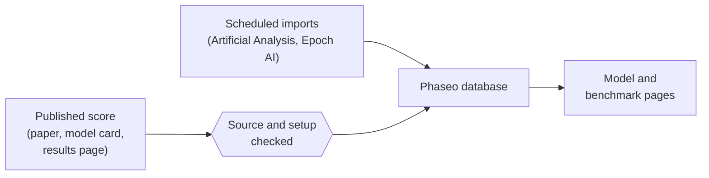

Phaseo publishes benchmark scores that others have measured, each with a link to where it came from. It doesn't run benchmarks or merge them into one score.

## Where scores come from

| Source | How it arrives |
| --- | --- |
| Model developers' papers, model cards and announcements | Added by maintainers, marked **self-reported** |
| Benchmark organisers' results pages | Added by maintainers |
| Artificial Analysis and Epoch AI indexes | Scheduled imports, checked every hour |
| Community reports | GitHub issues, published after a maintainer checks the evidence |

Every score needs a public source or a reproducible evaluation log before it is published.

## What normalisation means

Phaseo keeps each benchmark on its own scale. It normalises the record around the score, not the score itself:

1. Each result is mapped to one benchmark ID, so the same benchmark under different names is grouped together.
2. The setup is kept as a variant when it differs, such as few-shot count, harness or reasoning effort, instead of being merged into the default.
3. Each benchmark has a sort direction. Lower-is-better benchmarks, such as error rates, rank the lowest score first.
4. The source link and the self-reported flag stay with the score.

A self-reported flag is a disclosure, not a rejection. A score without enough context may be stored with source notes; don't read it as equal to a fully verified leaderboard row.

## Report a discrepancy

1. Open an issue with the evidence listed in [Submit benchmark scores](./submitting-scores.mdx).
2. Answer review questions in the issue. Maintainers publish verified corrections through the database editor.
3. For larger research submissions, coordinate in [Discord](https://discord.gg/aQyywCvgZ5).

The public [benchmark normalisation](https://phaseo.app/how-phaseo-normalises-ai-benchmarks) page covers the same rules for catalog readers.
