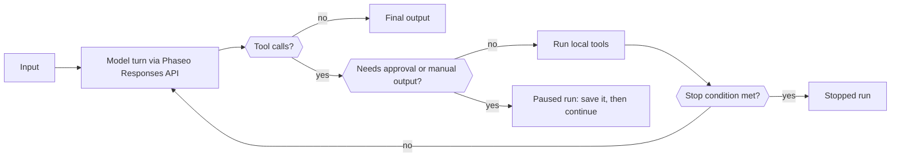

Use a Phaseo Agent SDK when one request isn't enough: the SDK runs a bounded loop in your process that sends each turn to the Responses API, runs the tools the model calls, and pauses for a person when a tool needs approval. You keep the run state; Phaseo hosts nothing for the agent.

## Pick your package

| Language | Package | Version | Core client it installs |
| --- | --- | --- | --- |
| TypeScript | [`@phaseo/agent-sdk`](https://www.npmjs.com/package/@phaseo/agent-sdk) | 0.3.0 | `@phaseo/sdk` |
| Python | [`phaseo-agent-sdk`](https://pypi.org/project/phaseo-agent-sdk/) (module `phaseo_agent`) | 0.3.0 | `phaseo` 3.x |
| Go | [`github.com/phaseoteam/Phaseo/packages/sdk/agent-sdk-go`](https://pkg.go.dev/github.com/phaseoteam/Phaseo/packages/sdk/agent-sdk-go) | v0.3.0 | `sdk-go/v3` |
| C# | [`Phaseo.AgentSdk`](https://www.nuget.org/packages/Phaseo.AgentSdk) | 0.3.0 | `Phaseo.Sdk` |
| PHP | [`phaseo/agent-sdk`](https://packagist.org/packages/phaseo/agent-sdk) | v0.3.0 | `phaseo/sdk` `^3.0.0` |
| Ruby | [`phaseo_agent_sdk`](https://rubygems.org/gems/phaseo_agent_sdk) | 0.3.0 | `phaseo_sdk` `>= 3.0.0, < 4.0.0` |
| Java | `app.phaseo:phaseo-agent-sdk` (Maven Central) | 0.3.0 | `app.phaseo:phaseo-sdk` 3.0.0 |
| Rust | [`phaseo-agent`](https://crates.io/crates/phaseo-agent) | 0.2.0 | `phaseo` 0.2 |

TypeScript is the reference design. C++ has no Agent SDK. [Installation](./installation) has the install commands and runtime requirements, and [Usage](./usage) builds a first agent.

<Prompt description="Ask a coding agent to build a first agent with the Phaseo Agent SDK in your language." icon="bot" actions={["copy", "cursor"]}>
{`Build a small agent in this project with the Phaseo Agent SDK.

1. Install the Phaseo skills: npx skills add https://phaseo.app/docs
   For TypeScript, follow the phaseo-agent-sdk-typescript skill.
2. Read the Agent SDK pages at https://phaseo.app/docs/v1/sdk-reference/agent/overview, pick this project's language tab, and use only the APIs it documents.
3. Define one agent with at most two local tools that fit [AGENT TASK]. Keep the loop bounded with a step limit, and require approval for any tool that changes data.
4. Use a server-side PHASEO_API_KEY and check the model ID with GET /v1/models before using it.
5. Stream the agent's steps to the console so a run can be inspected.
6. Run the agent once, then report what you verified and what you could not verify.`}
</Prompt>

## Compare what each runtime supports

Every SDK runs local tools, pauses on exact tool-call IDs for approval or manual output, and returns serializable run state your application stores. The rest differs by language:

| Capability | TypeScript | Python | Go | C# | PHP | Ruby | Java | Rust |
| --- | --- | --- | --- | --- | --- | --- | --- | --- |
| Default step limit | 12 | 12 | 8 | 12 | 12 | 12 | 12 | 8 |
| Step limit reached | Throws `Max steps exceeded` | Raises `RuntimeError` | Returns an error | Throws `InvalidOperationException` | Throws | Raises | Throws | Returns a `stopped` run (`max_steps:N`) |
| Model streaming | Async iterable | Iterator (background thread) | Channel | Async enumerable | Iterable; runs only while you iterate (Fiber) | Enumerator (worker thread) | Lists after the run; live through `onEvent` | Not yet |
| Tool progress events | Async generator | `emit_progress` or generator | `EmitProgress` | `EmitProgress` | `emitProgress` | `emit_progress` | `emitProgress` | Not yet |
| Concurrent tools | Yes | Yes (threads) | Yes | Yes | No | Yes (threads) | Yes (thread pool) | No |
| Tool timeout | Aborts `context.signal` | Fails the run; thread keeps running | Fails the call; goroutine keeps running | Cancels `CancellationToken` | Checked after the tool returns | Interrupts the call | Interrupts the thread | None |
| Runtime schema validation | Yes | Yes | Yes | Yes | Yes | Yes | Yes | No; JSON Schema is only sent to the model |
| Tool error by default | Fails the run | Fails the run | Fails the run | Fails the run | Fails the run | Fails the run | Fails the run | Returned to the model |
| Approve and reject by call ID | Yes | Yes | Yes | Yes | Yes | Yes | Yes | Approve only |
| Interactive (human-in-the-loop) tools | Yes | Yes | Yes | Yes | Yes | Yes | Yes | Agent-level `human_review` only |
| Stop conditions | Composable | Composable; checked only on steps without tool calls | Composable | Composable | Composable | Composable | Composable | Step limit |
| Dynamic turns | Yes | Model, instructions, and sampling; tools through `next_turn_params` | Yes | Yes | Yes | Yes | Yes | Per-run model, step limit, and context |
| Typed timeline items | `AgentItem` union | Dicts | `Details` map | `Details` dictionary | Arrays | Hashes | `details()` map | No; read `messages` and `steps` |
| Usage and cost | Yes | Yes | Yes | Yes | Yes | Yes | Yes | Tokens, plus cost when the response has `meta.cost` or `cost` |
| Cancellation | `cancel()` | `cancel()` | Context | `CancellationToken` | `cancel()` | `cancel` | `cancel()` | Not yet |
| Devtools capture | Yes | Yes | Yes | Yes | Yes | Yes | Yes | Not yet |

Rust (`phaseo-agent` 0.2) is synchronous: no streaming, async execution, concurrent tools, runtime schema validation, or Devtools capture. Run it on a worker thread when a run shouldn't block a request handler. PHP runs tools one at a time, and its stream only advances while your code iterates.

## Choose the Agent SDK, the client, or the raw API

| Use | Choose | What it owns |
| --- | --- | --- |
| One API request or full endpoint coverage | [Client SDK](../client/overview) | Generated API types and transport |
| Tool-using, multi-step application logic | Agent SDK | Local loop, tools, checkpoints, review, events, and Devtools |
| Custom transport or an unsupported language | Raw API | HTTP request and response handling |

Each Agent SDK's gateway client sends model turns through that language's client SDK. Most accept a `requestOptions` map (or the language's equivalent) for extra Responses API fields; the agent still sets `model`, `input`, `instructions`, and its function tools. The Rust 0.2 adapter sends only the normalized agent fields and has no extra-options hook.

## Start from a recipe

| Recipe | Language |
| --- | --- |
| [Build a durable agent loop](../../cookbook/agent-sdk-durable-loop) | TypeScript |
| [Research with structured output and web search](../../cookbook/agent-sdk-research-brief) | TypeScript |
| [Support triage with presets and guardrail-aware failures](../../cookbook/agent-sdk-support-triage) | TypeScript |
| [Run a coding-review agent with runtime tools](../../cookbook/agent-sdk-coding-review) | TypeScript |
| [Fan out local agent tools concurrently](../../cookbook/agent-sdk-parallel-tools) | TypeScript |
| [Extract structured JSON](../../cookbook/agent-sdk-python-structured-extraction) | Python |
| [Build an ops runbook agent](../../cookbook/agent-sdk-go-ops-runbook) | Go |
| [Triage tickets](../../cookbook/agent-sdk-csharp-ticket-triage) | C# |
| [Review CMS content](../../cookbook/agent-sdk-php-content-review) | PHP |
| [Summarize internal notes](../../cookbook/agent-sdk-ruby-rag-notes) | Ruby |

The TypeScript recipes port to any language with the APIs on these pages.
