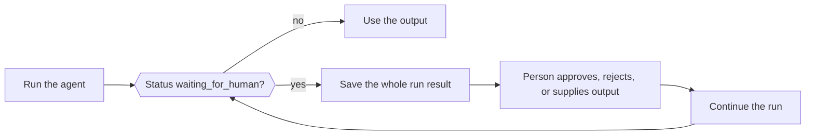

When an agent needs a person, an external job, or a tool your application runs, the run returns normally (not as an error) with status `waiting_for_human` and everything needed to continue. Save the whole result, collect the decision in your application, then pass the saved result and the decision to the agent's continue method.



<Note>
Phaseo doesn't store Agent SDK runs. Save resumable state in your own application when it must survive a request or process restart.
</Note>

| Language | Continue | Continue with streaming | Notes |
| --- | --- | --- | --- |
| TypeScript | `agent.continueRun()` | `agent.continueStream()` | |
| Python | `agent.continue_run()` | `agent.continue_stream()` | |
| Go | `agent.Continue(ctx, ContinueOptions)` | `agent.ContinueStream` | |
| C# | `agent.ContinueRun(ContinueOptions)` | `agent.ContinueStream` | |
| PHP | `$agent->continueRun()` | `$agent->continueStream()` | `continueRunById()` loads the run from a state accessor first |
| Ruby | `agent.continue_run` | `agent.continue_stream` | |
| Java | `agent.continueRun(ContinueOptions)` | `agent.continueStream` | `ContinueOptions` is a positional record |
| Rust | `agent.continue_run(&mut client, options)` | None | `continue_with_events` adds an event callback; runs are synchronous |

## Approve or reject tool calls

Approval-gated, manual and human-in-the-loop tools pause the run before they execute. Each pending call has the model's `call` (with its `id`) and a `kind`: `approval`, `manual` or `hitl`. Answer every call by its exact call ID, not its tool name, so two calls to the same tool stay separate.

An approved call runs its tool. A rejected call sends `{"error": "<reason>"}` to the model as the tool result, with the default reason `Tool call rejected`.

<CodeGroup>

```typescript TypeScript
const resumed = await agent.continueRun({
  run: paused,
  client,
  approvals: [{ toolCallId: "call_deploy_42" }],
  rejections: [
    { toolCallId: "call_delete_17", reason: "Not authorized" },
  ],
});
```

```python Python
from phaseo_agent import AgentToolDecision

pending = paused.run.pause.pending_tool_calls

continued = agent.continue_run(
    run=paused,
    client=client,
    approvals=[AgentToolDecision(pending[0].call.id)],
    rejections=[AgentToolDecision(pending[1].call.id, "Not authorized")],
)
```

```go Go
var approvals, rejections []phaseoagent.ToolDecision
for _, pending := range result.Run.Pause.PendingToolCalls {
  if pending.Kind != "approval" {
    continue
  }
  if userApproved(pending.Call) {
    approvals = append(approvals, phaseoagent.ToolDecision{ToolCallID: pending.Call.ID})
  } else {
    rejections = append(rejections, phaseoagent.ToolDecision{ToolCallID: pending.Call.ID, Reason: "Not now"})
  }
}

result, err = agent.Continue(ctx, phaseoagent.ContinueOptions{
  Run: result, Client: client, Approvals: approvals, Rejections: rejections,
})
```

```csharp C#
var pending = result.Run.Pause!.PendingToolCalls!.Where(item => item.Kind == "approval");

result = await agent.ContinueRun(new ContinueOptions
{
    Run = result,
    Client = client,
    Approvals = pending.Where(item => UserApproved(item.Call)).Select(item => new ToolDecision(item.Call.Id)).ToList(),
    Rejections = pending.Where(item => !UserApproved(item.Call)).Select(item => new ToolDecision(item.Call.Id, "Not now")).ToList(),
});
```

```php PHP
use Phaseo\AgentSdk\ToolDecision;

$approvals = $rejections = [];
foreach ($result->run->pause->pendingToolCalls as $pending) {
    if ($pending->kind !== "approval") continue;
    if (userApproved($pending->call)) {
        $approvals[] = new ToolDecision($pending->call->id);
    } else {
        $rejections[] = new ToolDecision($pending->call->id, "Not now");
    }
}

$result = $agent->continueRun(run: $result, client: $client, approvals: $approvals, rejections: $rejections);
```

```ruby Ruby
pending = result.run.pause.pending_tool_calls.select { |item| item.kind == "approval" }
approved, declined = pending.partition { |item| user_approved?(item.call) }

result = agent.continue_run(
  run: result,
  client: client,
  approvals: approved.map { |item| PhaseoAgentSdk::ToolDecision.new(tool_call_id: item.call.id) },
  rejections: declined.map { |item| PhaseoAgentSdk::ToolDecision.new(tool_call_id: item.call.id, reason: "Not now") }
)
```

```java Java
var pending = result.run().pause().pendingToolCalls();
var approvals = pending.stream().filter(item -> item.kind().equals("approval") && userApproved(item.call()))
    .map(item -> new AgentSdk.ToolDecision(item.call().id())).toList();
var rejections = pending.stream().filter(item -> item.kind().equals("approval") && !userApproved(item.call()))
    .map(item -> new AgentSdk.ToolDecision(item.call().id(), "Not now")).toList();

result = agent.continueRun(new AgentSdk.ContinueOptions(
    result, client, null, null, null, null, null, null, null, null, null,
    approvals, rejections, List.of()));
```

```rust Rust
use phaseo_agent::{ContinueOptions, ToolDecision};

let approvals = paused.run.pause.as_ref().unwrap()
    .pending_tool_calls
    .iter()
    .map(|pending| ToolDecision {
        tool_call_id: pending.call.id.clone(),
        reason: Some("Approved by the release operator".to_string()),
    })
    .collect();

let mut options = ContinueOptions::new(paused);
options.approvals = approvals;

let completed = agent.continue_run(&mut client, options)?;
```

</CodeGroup>

Where the pending calls are, and what happens when a decision is missing:

| Language | Pending calls | Missing decision |
| --- | --- | --- |
| TypeScript | `run.pause.pendingToolCalls` | Throws `Missing approval decision for tool call <id>` |
| Python | `run.pause.pending_tool_calls` | Raises `ValueError` |
| Go | `Run.Pause.PendingToolCalls` | Returns `missing approval decision for tool call <id>` |
| C# | `Run.Pause.PendingToolCalls` | Throws `Missing approval decision for tool call <id>` |
| PHP | `$result->run->pause->pendingToolCalls` | Throws `Missing approval decision for tool call <id>` |
| Ruby | `result.run.pause.pending_tool_calls` | Raises `Missing approval decision for tool call <id>` |
| Java | `run().pause().pendingToolCalls()` | Throws `Missing approval decision for tool call <id>` |
| Rust | `run.pause.pending_tool_calls` (an `Option`) | Returns an `AgentError` |

The pause itself also has a `kind`. Go and C# set it to `tool_approval` for every tool pause. PHP, Ruby and Java set `tool_approval` when any pending call needs approval, otherwise the first call's kind. Rust uses `tool_approval` for approval calls, `external_output` when every pending call needs an external result, and `tool_input` for a mix of the two.

<Warning>
Rust `0.2` has no rejection type and no `rejections` field. Leave an unapproved call paused, or apply your application's rejection policy before you continue.
</Warning>

To require approval for every tool call instead of per tool, set `requireApproval` on the agent definition (`require_approval` in Python and Ruby, `RequireApproval` in Go and C#). In TypeScript it's a function `requireApproval(call, context)`. Rust only supports approval per tool, with `Tool::require_approval()`. [Tools](./tools) shows how each kind of tool is defined.

## Supply results for manual and human-in-the-loop tools

For `manual` and `hitl` calls, pass the result your application produced, keyed by call ID. In Rust, these are tools built with `Tool::external(...)`.

<CodeGroup>

```typescript TypeScript
await agent.continueRun({
  run: paused,
  client,
  toolOutputs: [{ toolCallId: callId, output: { status: "shipped" } }],
});
```

```python Python
from phaseo_agent import AgentToolOutput

agent.continue_run(
    run=paused,
    client=client,
    tool_outputs=[AgentToolOutput(call_id, {"status": "shipped"})],
)
```

```go Go
ToolOutputs: []phaseoagent.ToolOutput{{ToolCallID: callID, Output: map[string]any{"status": "shipped"}}},
```

```csharp C#
ToolOutputs = new[] { new ToolOutput(callId, new { status = "shipped" }) },
```

```php PHP
use Phaseo\AgentSdk\ToolOutput;

toolOutputs: [new ToolOutput($callId, ["status" => "shipped"])],
```

```ruby Ruby
tool_outputs: [PhaseoAgentSdk::ToolOutput.new(tool_call_id: call_id, output: { status: "shipped" })]
```

```java Java
// The toolOutputs argument of ContinueOptions
List.of(new AgentSdk.ToolOutput(callId, Map.of("status", "shipped")))
```

```rust Rust
use phaseo_agent::{ContinueOptions, ToolOutput};
use serde_json::json;

let mut options = ContinueOptions::new(paused);
options.tool_outputs = vec![ToolOutput {
    tool_call_id: call_id,
    output: json!({ "status": "shipped" }),
}];

let completed = agent.continue_run(&mut client, options)?;
```

</CodeGroup>

A missing output fails the continuation with `Missing output for tool call <id>` (lowercase `missing` in Go, a `ValueError` in Python, an `AgentError` in Rust). A human input message is not a substitute for a tool output.

## Pause for human review

Set a human review callback on the agent definition to check each model response before the run continues. Return a review request with a `reason` (and optionally a `payload`) to pause, or nothing to carry on. The pause `kind` is `human_review`. The callback receives the run ID, step index, messages, model response and parsed output (Rust: the run and agent IDs, step index, messages, response and application context).

<CodeGroup>

```typescript TypeScript
const agent = createAgent({
  id: "support-agent",
  humanReview: ({ response }) =>
    response.message.content.includes("needs approval")
      ? {
          reason: "approval_required",
          payload: { draft: response.message.content },
        }
      : null,
});
```

```python Python
from phaseo_agent import AgentHumanReviewRequest

def review(context):
    if "needs approval" in context.response.message.content:
        return AgentHumanReviewRequest("approval_required", {"draft": context.response.message.content})
    return None

agent = create_agent({"id": "support-agent", "human_review": review})
```

```go Go
HumanReview: func(review phaseoagent.HumanReviewContext) *phaseoagent.HumanReviewRequest {
  if strings.Contains(review.Response.Message.Content, "refund") {
    return &phaseoagent.HumanReviewRequest{Reason: "Refunds need sign-off"}
  }
  return nil
},
```

```csharp C#
HumanReview = review => Task.FromResult<HumanReviewRequest?>(
    review.Response.Message.Content.Contains("refund")
        ? new HumanReviewRequest("Refunds need sign-off")
        : null),
```

```php PHP
use Phaseo\AgentSdk\HumanReviewRequest;

humanReview: fn ($review) => str_contains($review->response->message->content, "refund")
    ? new HumanReviewRequest("Refunds need sign-off")
    : null,
```

```ruby Ruby
human_review: ->(review) {
  if review.response.message.content.include?("refund")
    PhaseoAgentSdk::HumanReviewRequest.new(reason: "Refunds need sign-off")
  end
}
```

```java Java
AgentSdk.HumanReview review = context ->
    context.response().message().content().contains("refund")
        ? new AgentSdk.HumanReviewRequest("Refunds need sign-off", null)
        : null;
```

```rust Rust
use phaseo_agent::{AgentDefinition, HumanReviewRequest};
use serde_json::json;

let definition = AgentDefinition::new("review-agent", "openai/gpt-6-astra")
    .human_review(|context| {
        if context.response.message.content.contains("needs approval") {
            Some(HumanReviewRequest {
                reason: "Review the proposed action".to_string(),
                payload: json!({ "draft": context.response.message.content }),
            })
        } else {
            None
        }
    });
```

</CodeGroup>

Continue with human input, which is added to the conversation as a user message:

<CodeGroup>

```typescript TypeScript
const continued = await agent.continueRun({
  run: pausedResult,
  client,
  humanInput: "Approved. Continue and return the final answer.",
});
```

```python Python
continued = agent.continue_run(
    run=paused,
    client=client,
    human_input="Approved. Continue and return the final answer.",
)
```

```go Go
result, err = agent.Continue(ctx, phaseoagent.ContinueOptions{
  Run:        result,
  Client:     client,
  HumanInput: "Approved. Refund up to $50.",
})
```

```csharp C#
result = await agent.ContinueRun(new ContinueOptions
{
    Run = result,
    Client = client,
    HumanInput = "Approved. Refund up to $50.",
});
```

```php PHP
$result = $agent->continueRun(
    run: $result,
    client: $client,
    humanInput: "Approved. Refund up to $50."
);
```

```ruby Ruby
result = agent.continue_run(
  run: result,
  client: client,
  human_input: "Approved. Refund up to $50."
)
```

```java Java
result = agent.continueRun(new AgentSdk.ContinueOptions(
    result, client, null, null, null, null,
    "Approved. Refund up to $50.",          // humanInput
    null, null, null, null));
```

```rust Rust
use phaseo_agent::ContinueOptions;

let mut options = ContinueOptions::new(paused);
options.human_input = Some("Approved. Continue and return the final result.".to_string());

let completed = agent.continue_run(&mut client, options)?;
```

</CodeGroup>

Continuing a review pause without human input fails with `Run <id> is waiting for human input` (Go: `run <id> is waiting for human input`; Java: `Run is waiting for human input`). Rust requires a non-empty `human_input`. TypeScript also accepts structured `humanMessages`.

## Save run state between requests

The run result is plain data: store it in your database, object store or job record, and keep application `context` serializable. A run can only be continued by an agent with the same ID. [The durable agent loop cookbook](../../cookbook/agent-sdk-durable-loop) shows a complete save-and-resume flow.

To let the SDK save and load runs for you, pass a state accessor with `load(runId)` and `save(result)`. The SDK then saves after each run and continuation, and you can continue by run ID instead of passing the record through every layer.

| Language | State accessor | Continue by ID |
| --- | --- | --- |
| TypeScript | `state` with async `load(runId)` and `save(result)` | `continueRun({ runId, state, client })` |
| Python | `state`, implementing `AgentStateAccessor` | `continue_run(run_id=..., state=..., client=...)` |
| Go | `State`, implementing `StateAccessor`, on `RunOptions` and `ContinueOptions` | `ContinueOptions{RunID: id, State: store}` |
| C# | `State`, implementing `IStateAccessor`, on `RunOptions` and `ContinueOptions` | `new ContinueOptions { RunId = id, State = store, Client = client }` |
| PHP | `state`, implementing `StateAccessor` | `continueRunById($runId, $state, $client, approvals: ..., rejections: ..., toolOutputs: ...)`; throws `Run <id> not found` if missing |
| Ruby | `state:`, any object with `load(run_id)` and `save(result)` | `continue_run(run_id: id, state: store, client: client)` |
| Java | `StateAccessor`, the last `RunOptions` argument | The 16-argument `ContinueOptions` with `runId` and `state` last and `run` null. It loads the run but doesn't save the continued result, so save it yourself. |
| Rust | None | Serialize `RunResult` with Serde and pass it to `ContinueOptions::new` |

<CodeGroup>

```go Go
type StateAccessor interface {
  Load(ctx context.Context, runID string) (*phaseoagent.RunResult, error)
  Save(ctx context.Context, result phaseoagent.RunResult) error
}
```

```csharp C#
public interface IStateAccessor
{
    Task<RunResult?> Load(string runId, CancellationToken cancellationToken = default);
    Task Save(RunResult result, CancellationToken cancellationToken = default);
}
```

```rust Rust
use phaseo_agent::RunResult;

// Save the paused run
std::fs::write("paused-run.json", serde_json::to_string_pretty(&paused)?)?;

// Restore it later
let paused: RunResult = serde_json::from_str(&std::fs::read_to_string("paused-run.json")?)?;
```

</CodeGroup>

In Rust, recreate the same agent definition and tools before continuing: closures and `AgentDefinition` aren't part of the serialized run. The effective model and step limit are stored in `RunRecord`, so per-run overrides stay active after continuation.

Whatever you store, your application owns encryption and retention of saved runs, authorization for approvals and human input, and idempotency around side effects that run again after a resume.
