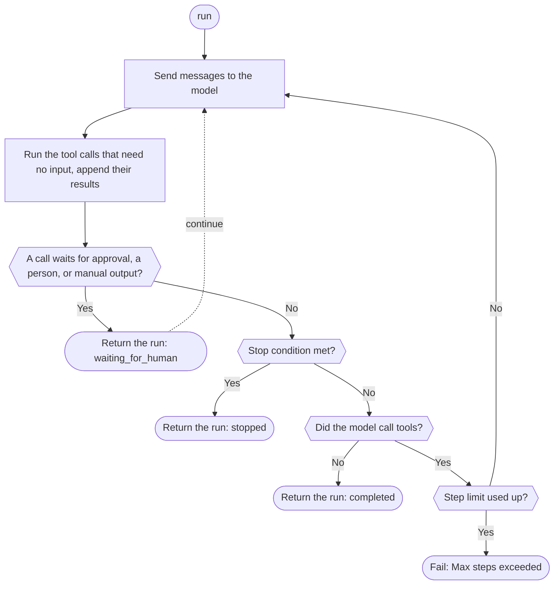

Define a tool, create an agent, and run it with a gateway client. The model calls your tool, the SDK runs it and sends the result back, and the run returns when the model answers without calling a tool, pauses for a person, or meets a [stop condition](./stop-conditions). If the run reaches its step limit first, the SDK throws an error; only Rust returns the run with status `stopped`. Phaseo doesn't host the agent or store its runs; your application does.

## Build a first agent

<CodeGroup>

```typescript TypeScript
import {
  createAgent,
  createGatewayAgentClient,
  defineTool,
} from "@phaseo/agent-sdk";

const lookupDocs = defineTool({
  id: "lookup-docs",
  description: "Look up an internal docs page by slug.",
  parameters: {
    type: "object",
    properties: {
      slug: { type: "string" },
    },
    required: ["slug"],
    additionalProperties: false,
  },
  async execute(input: { slug: string }) {
    return {
      slug: input.slug,
      url: `https://phaseo.app/docs/v1/${input.slug}`,
    };
  },
});

const agent = createAgent({
  id: "support-docs-agent",
  model: "openai/gpt-6-astra",
  instructions: "Use tools when helpful and finish with a concise answer.",
  tools: [lookupDocs],
});

const result = await agent.run({
  input: "Find the docs page for presets and explain when to use them.",
  client: createGatewayAgentClient({
    clientOptions: {
      apiKey: process.env.PHASEO_API_KEY!,
    },
  }),
});

console.log(result.output);
```

```python Python
import os
from phaseo_agent import AgentTool, create_agent, create_gateway_agent_client, define_tool

lookup_docs = define_tool(AgentTool(
    id="lookup-docs",
    description="Look up an internal docs page by slug.",
    parameters={
        "type": "object",
        "properties": {"slug": {"type": "string"}},
        "required": ["slug"],
        "additionalProperties": False,
    },
    execute=lambda tool_input, runtime: {
        "slug": tool_input["slug"],
        "url": f"https://phaseo.app/docs/v1/{tool_input['slug']}",
    },
))

agent = create_agent({
    "id": "support-docs-agent",
    "model": "openai/gpt-6-astra",
    "instructions": "Use tools when helpful and finish with a concise answer.",
    "tools": [lookup_docs],
})

result = agent.run(
    input="Find the docs page for presets and explain when to use them.",
    client=create_gateway_agent_client(client_options={"api_key": os.environ["PHASEO_API_KEY"]}),
)

print(result.output)
```

```go Go
package main

import (
  "context"
  "fmt"

  phaseoagent "github.com/phaseoteam/Phaseo/packages/sdk/agent-sdk-go"
)

func main() {
  client, err := phaseoagent.CreateGatewayAgentClient(phaseoagent.GatewayAgentClientOptions{})
  if err != nil {
    panic(err) // PHASEO_API_KEY is required
  }

  lookup := phaseoagent.DefineTool(phaseoagent.Tool{
    ID:          "lookup_docs",
    Description: "Look up a Phaseo documentation topic",
    Parameters: map[string]any{
      "type":       "object",
      "properties": map[string]any{"topic": map[string]any{"type": "string"}},
      "required":   []string{"topic"},
    },
    Execute: func(input any, runtime phaseoagent.RuntimeContext) (any, error) {
      args, _ := input.(map[string]any)
      return map[string]any{"topic": args["topic"], "found": true}, nil
    },
  })

  agent := phaseoagent.CreateAgent(phaseoagent.AgentDefinition{
    ID:           "docs-agent",
    Model:        "openai/gpt-6-astra",
    Instructions: "Use tools when helpful and finish with a concise answer.",
    Tools:        []phaseoagent.Tool{lookup},
    MaxSteps:     6,
  })

  result, err := agent.Run(context.Background(), phaseoagent.RunOptions{
    Input:  "Explain when to use routing presets.",
    Client: client,
  })
  if err != nil {
    panic(err)
  }

  fmt.Println(result.Output)
  fmt.Println(result.Run.Status, result.Usage.TotalTokens)
}
```

```csharp C#
using System.Text.Json;
using PhaseoAgentSdk;

var lookup = AgentSdk.DefineTool(new Tool(
    "lookup_docs",
    async (input, runtime) =>
    {
        var topic = ((JsonElement)input!).GetProperty("topic").GetString();
        return new { topic, found = true };
    },
    "Look up a Phaseo documentation topic",
    new Dictionary<string, object?>
    {
        ["type"] = "object",
        ["properties"] = new Dictionary<string, object?> { ["topic"] = new { type = "string" } },
        ["required"] = new[] { "topic" },
    }));

var agent = AgentSdk.CreateAgent(new AgentDefinition
{
    Id = "docs-agent",
    Model = "openai/gpt-6-astra",
    Instructions = "Use tools when helpful and finish with a concise answer.",
    Tools = new[] { lookup },
    MaxSteps = 6,
});

var result = await agent.Run(new RunOptions
{
    Input = "Explain when to use routing presets.",
    Client = AgentSdk.CreateGatewayAgentClient(), // throws if PHASEO_API_KEY is missing
});

Console.WriteLine(result.Output);
Console.WriteLine($"{result.Run.Status} {result.Usage.TotalTokens}");
```

```php PHP
<?php
require "vendor/autoload.php";

use Phaseo\AgentSdk\AgentDefinition;
use Phaseo\AgentSdk\AgentSdk;
use Phaseo\AgentSdk\Tool;

$lookup = AgentSdk::defineTool(new Tool(
    id: "lookup_docs",
    execute: fn (array $input, $runtime) => ["topic" => $input["topic"], "found" => true],
    description: "Look up a Phaseo documentation topic",
    parameters: [
        "type" => "object",
        "properties" => ["topic" => ["type" => "string"]],
        "required" => ["topic"],
    ],
));

$agent = AgentSdk::createAgent(new AgentDefinition(
    id: "docs-agent",
    model: "openai/gpt-6-astra",
    instructions: "Use tools when helpful and finish with a concise answer.",
    tools: [$lookup],
    maxSteps: 6,
));

$result = $agent->run(
    input: "Explain when to use routing presets.",
    client: AgentSdk::createGatewayAgentClient() // throws if PHASEO_API_KEY is missing
);

echo $result->output . PHP_EOL;
echo $result->run->status . " " . $result->usage["total_tokens"] . PHP_EOL;
```

```ruby Ruby
require "phaseo_agent_sdk"

lookup = PhaseoAgentSdk.define_tool(
  PhaseoAgentSdk::Tool.new(
    id: "lookup_docs",
    description: "Look up a Phaseo documentation topic",
    parameters: {
      type: "object",
      properties: { topic: { type: "string" } },
      required: ["topic"]
    },
    execute: ->(input, runtime) { { topic: input["topic"], found: true } }
  )
)

agent = PhaseoAgentSdk.create_agent(
  id: "docs-agent",
  model: "openai/gpt-6-astra",
  instructions: "Use tools when helpful and finish with a concise answer.",
  tools: [lookup],
  max_steps: 6
)

result = agent.run(
  input: "Explain when to use routing presets.",
  client: PhaseoAgentSdk.create_gateway_agent_client # raises if PHASEO_API_KEY is missing
)

puts result.output
puts "#{result.run.status} #{result.usage[:total_tokens]}"
```

```java Java
import app.phaseo.agent.AgentSdk;
import java.time.Duration;
import java.util.List;
import java.util.Map;

var lookup = AgentSdk.defineTool(new AgentSdk.Tool(
    "lookup_docs",
    (input, context) -> Map.of("topic", ((Map<?, ?>) input).get("topic"), "found", true),
    "Look up a Phaseo documentation topic",
    Map.of(
        "type", "object",
        "properties", Map.of("topic", Map.of("type", "string")),
        "required", List.of("topic")),
    Duration.ofSeconds(10)
));

var agent = AgentSdk.createAgent(new AgentSdk.AgentDefinition(
    "docs-agent",                       // id
    "openai/gpt-6-astra",               // model
    null,                               // preset
    "Use tools when helpful and finish with a concise answer.", // instructions
    List.of(lookup),                    // tools
    6,                                  // maxSteps
    null, null, null, null              // parseOutput, humanReview, modelRetry, toolExecution
));

var result = agent.run(new AgentSdk.RunOptions(
    "Explain when to use routing presets.",  // input
    AgentSdk.createGatewayAgentClient(),     // throws if PHASEO_API_KEY is missing
    null, null, null, null, null, null, null, null
));

System.out.println(result.output());
System.out.println(result.run().status() + " " + result.usage().totalTokens());
```

```rust Rust
use phaseo_agent::{
    create_agent, create_gateway_agent_client, define_tool, AgentDefinition,
    RunOptions, Tool,
};
use serde_json::json;

fn main() -> Result<(), Box<dyn std::error::Error>> {
    let lookup = define_tool(Tool::new(
        "lookup_docs",
        "Look up a Phaseo documentation topic",
        json!({
            "type": "object",
            "properties": {
                "topic": { "type": "string" }
            },
            "required": ["topic"]
        }),
        |input, context| {
            Ok(json!({
                "topic": input["topic"],
                "run_id": context.run_id,
                "found": true
            }))
        },
    ));

    let agent = create_agent(
        AgentDefinition::new("docs-agent", "openai/gpt-6-astra")
            .instructions("Use lookup_docs when helpful. Answer concisely.")
            .max_steps(6)
            .tool(lookup),
    );

    let mut client = create_gateway_agent_client("openai/gpt-6-astra")?;
    let result = agent.run(
        &mut client,
        RunOptions::new("Explain when to use routing presets."),
    )?;

    println!("{}", result.output);
    println!("steps: {}", result.run.step_count);
    println!("tokens: {}", result.usage.total_tokens);
    Ok(())
}
```

</CodeGroup>

The tool's ID is the function name the model sees, and its parameters are the JSON Schema the model fills in. The arguments reach your code in each language's native shape:

| Language | Tool receives | Notes |
| --- | --- | --- |
| TypeScript | Typed object | `execute(input, context)` |
| Python | `dict` | `execute(tool_input, runtime)` |
| Go | `any` (decoded JSON, usually `map[string]any`) | `Execute(input, runtime) (any, error)` |
| C# | `JsonElement` | `Execute(input, runtime)`, awaited |
| PHP | Associative array | `execute(array $input, $runtime)` |
| Ruby | Hash with string keys | Build tools with `PhaseoAgentSdk::Tool.new`; `define_tool` returns what you pass it, so a plain Hash won't work |
| Java | `Map` | Records are positional; pass `null` for anything you don't set |
| Rust | `serde_json::Value` | The closure runs locally; `RuntimeContext` has the run ID, agent ID, step index, application context, and tool call |

If the agent, the run, and the client set no model or preset, the gateway client sends `phaseo/free`. Rust's `create_gateway_agent_client` takes the model as an argument.

## How a run works



Each step is checkpointed in the returned run result. To resume across requests or restarts, save that result in your own store and pass it to the continue method, or give the agent a state accessor; see [State and approval](./state-and-approval). The step limit and what happens when it runs out differ by language:

<Tabs>
<Tab title="TypeScript">

Each `run()` or `continueRun()` call takes up to 12 steps unless you set `maxSteps`; past that it throws `Max steps exceeded`. Use [stop conditions](./stop-conditions) to end a run cleanly.

</Tab>
<Tab title="Python">

A run takes up to 12 steps unless you set `max_steps`; past that it raises `RuntimeError`. Stop conditions are checked only on a step where the model makes no tool calls, so the order differs from the diagram: a tool loop runs until it pauses, answers, or uses up `max_steps`.

</Tab>
<Tab title="Go">

A run that needs more than `MaxSteps` model turns (default 8) fails with `Max steps exceeded (N)`.

</Tab>
<Tab title="C#">

A run that needs more than `MaxSteps` model turns (default 12) throws `InvalidOperationException("Max steps exceeded (N)")`.

</Tab>
<Tab title="PHP">

A run that needs more than `maxSteps` model turns (default 12) throws `Max steps exceeded (N)`.

</Tab>
<Tab title="Ruby">

A run that needs more than `max_steps` model turns (default 12) raises `Max steps exceeded (N)`.

</Tab>
<Tab title="Java">

A run that needs more than `maxSteps` model turns (default 12) throws `Max steps exceeded (N)`.

</Tab>
<Tab title="Rust">

A run takes up to 8 model turns unless you call `.max_steps(n)` or set `RunOptions.max_steps`. Reaching the limit doesn't fail: the run returns with `run.status` `stopped` and `run.stop_reason` `max_steps:<limit>`. Runs are synchronous and local tools execute one at a time, so use a worker thread or task boundary when a run shouldn't block a request handler.

</Tab>
</Tabs>

## Read the run result

Every run returns the same parts. Field names follow each language's casing (`output`, `Output`, `output()`):

| Part | Contents |
| --- | --- |
| `run` | Status, IDs, effective model, step limit, context, pause state, and stop reason |
| `steps` | One record per model turn: request ID, provider, model, finish reason, warnings, tool calls, and usage |
| `messages` | The whole conversation, including tool results |
| `output` | The final output |
| `usage` | Input, output, cached, and total tokens, and cost |

Rust's `usage.cost` comes only from a numeric `meta.cost` or `cost` on the response; it doesn't map `cost_nanos` or `cost_cents`. Use the Gateway response or generation record for Rust spend reporting.

## Find the right feature

| To… | Page |
| --- | --- |
| Give the model local, manual, or progress-reporting tools | [Tools](./tools) |
| Pause for approval or a person, then resume | [State and approval](./state-and-approval) |
| Show text and tool activity as it happens | [Streaming](./streaming) |
| Render a timeline of messages, reasoning, and tool calls | [Items](./items) |
| Bound steps, tokens, cost, or time | [Stop conditions](./stop-conditions) |
| Change the model or tools between turns | [Dynamic turns](./dynamic-turns) |
| Get typed output, retry model calls, use a preset | [Outputs and retries](./run-controls) |
| Log or audit each step | [Lifecycle hooks](./lifecycle-hooks) |
| Record usage, cost, and request IDs for a run | [Observability](./observability) |
| Handle gateway, schema, and step-limit errors | [Events and errors](./events-and-errors) |
| Inspect runs locally | [DevTools](./devtools) |

Every export is listed in the [API reference](./api-reference), and complete agents are in [Examples](./examples).
