import { ChangelogFilters } from "/snippets/changelog-filters.jsx";

<ChangelogFilters labels={{"product":"产品","api":"API 与 SDK","models":"模型"}} clearLabel="清除" />

<Update label="2026年4月30日">

模型

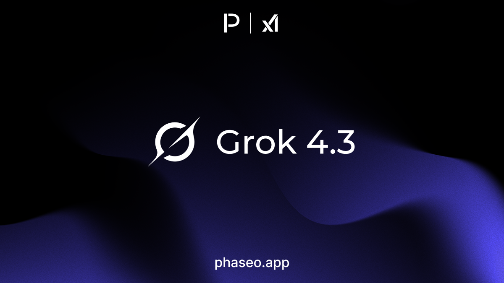

- [xAI: Grok 4.3](https://phaseo.app/models/x-ai/grok-4.3)

</Update>

<Update label="2026年4月29日">

产品

- 模型页、供应商页和模型列表将音频模型标为 **Speech**、**Transcription** 和 **Music**，不再使用 TTS 和 STT ([#417](https://github.com/phaseoteam/Phaseo/pull/417))。
- 模型卡片会显示 Grok Imagine Image 等图像模型的价格；此前其中一些显示为免费 ([#418](https://github.com/phaseoteam/Phaseo/pull/418))。

模型

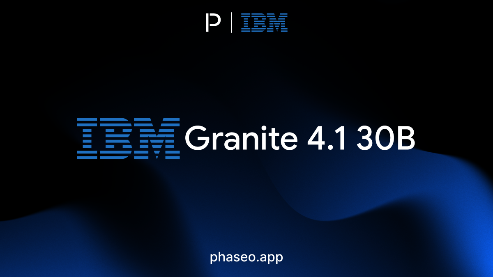

- [IBM: Granite 4.1 30B](https://phaseo.app/models/ibm/granite-4.1-30b)
- [IBM: Granite 4.1 3B](https://phaseo.app/models/ibm/granite-4.1-3b)
- [IBM: Granite 4.1 8B](https://phaseo.app/models/ibm/granite-4.1-8b)
- [Mistral: Mistral Medium 3.5](https://phaseo.app/models/mistral/mistral-medium-3.5)

</Update>

<Update label="2026年4月28日">

模型

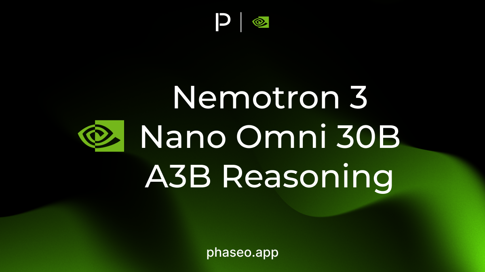

- [Nvidia: Nemotron 3 Nano Omni 30B A3B Reasoning](https://phaseo.app/models/nvidia/nemotron-3-nano-omni-30b-a3b-reasoning)
- [ByteDance: Seed 2.0 Lite (2026-04-28)](https://phaseo.app/models/bytedance/seed-2.0-lite-2026-04-28)
- [ByteDance: Seed 2.0 Mini (2026-04-28)](https://phaseo.app/models/bytedance/seed-2.0-mini-2026-04-28)
- [Poolside: Laguna XS.2](https://phaseo.app/models/poolside/laguna-xs.2)

</Update>

<Update label="2026年4月27日">

API 与 SDK

- TypeScript、Python、Go、C#、Java、PHP 和 Ruby SDK `2.0.1` 接受任意模型 ID 字符串，新模型无需等待 SDK 新版本即可使用 ([#367](https://github.com/phaseoteam/Phaseo/pull/367), [#393](https://github.com/phaseoteam/Phaseo/pull/393))。
- SDK 生成的模型常量现在只包含网关可以调用的模型，而不是目录中的所有条目 ([#367](https://github.com/phaseoteam/Phaseo/pull/367))。

</Update>

<Update label="2026年4月25日">

产品

- 当工作区余额低于 **Settings -> Credits -> Low balance email alert** 中设置的阈值时，会发送余额不足邮件 ([#370](https://github.com/phaseoteam/Phaseo/pull/370), [#371](https://github.com/phaseoteam/Phaseo/pull/371))。
- 模型页在折叠列表前显示六个供应商，并在目录中的模型尚无 API 供应商时给出提示 ([#372](https://github.com/phaseoteam/Phaseo/pull/372))。

API 与 SDK

- 使用 `priority` 等非标准价格方案的请求，对该方案未定价的用量按标准价格计费；此前这部分用量不会计费 ([#374](https://github.com/phaseoteam/Phaseo/pull/374))。

模型

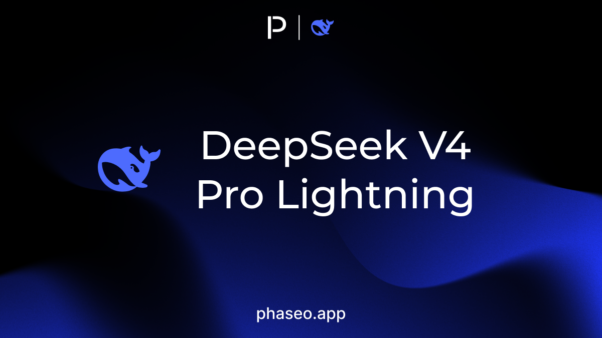

- [DeepSeek: DeepSeek V4 Pro Lightning](https://phaseo.app/models/deepseek/deepseek-v4-pro-lightning)

</Update>

<Update label="2026年4月24日">

API 与 SDK

- 网关响应将 `latency_ms` 报告为到首帧的时间，与 `generation_ms` 分开，非流式请求也是如此 ([#360](https://github.com/phaseoteam/Phaseo/pull/360))。

模型

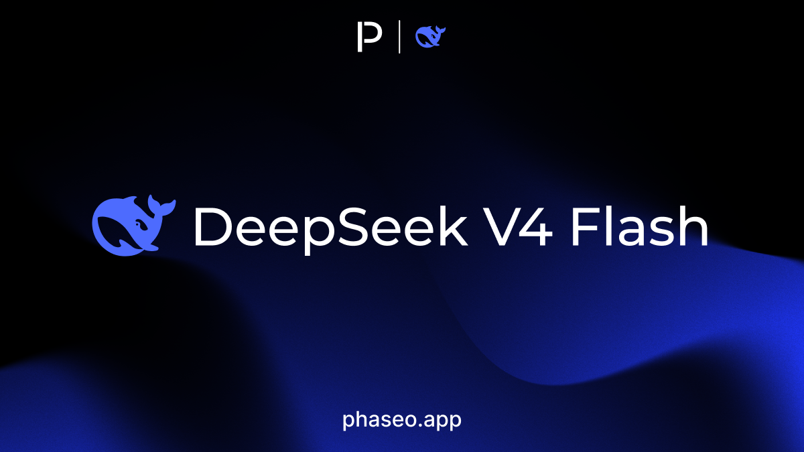

- [DeepSeek: DeepSeek V4 Flash](https://phaseo.app/models/deepseek/deepseek-v4-flash)
- [DeepSeek: DeepSeek V4 Pro](https://phaseo.app/models/deepseek/deepseek-v4-pro)

</Update>

<Update label="2026年4月23日">

产品

- 额度改为单一的 Standard 方案，充值手续费统一为 5%，取代 Basic 和 Enterprise 等级；请参阅[价格等级](../pricing/tiers.mdx) ([#351](https://github.com/phaseoteam/Phaseo/pull/351))。
- 每个账户首次登录时都会获得一个个人工作区，付费账户可以创建更多工作区，新的 API 密钥会归入页眉中选定的工作区；请参阅[工作区](../guides/workspaces.mdx) ([#352](https://github.com/phaseoteam/Phaseo/pull/352), [#351](https://github.com/phaseoteam/Phaseo/pull/351))。
- 模型页的 Playground 在轮换 API 密钥后不再因 `invalid_secret` 而失败 ([#355](https://github.com/phaseoteam/Phaseo/pull/355))。

API 与 SDK

- 发往 `openai/gpt-image-2` 的图像请求在价格存在时不再因缺少价格而失败 ([#355](https://github.com/phaseoteam/Phaseo/pull/355))。

模型

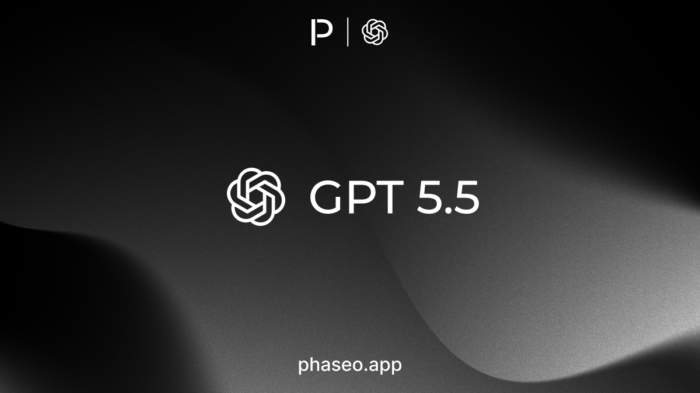

- [OpenAI: GPT 5.5](https://phaseo.app/models/openai/gpt-5.5)
- [OpenAI: GPT 5.5 Pro](https://phaseo.app/models/openai/gpt-5.5-pro)
- [Tencent Hunyuan: Hy3 Preview](https://phaseo.app/models/tencent/hy3-preview)

</Update>

<Update label="2026年4月22日">

产品

- 模型页的 Playground 为生成语音或音乐的模型新增 **TTS** 和 **Music** 模式 ([#348](https://github.com/phaseoteam/Phaseo/pull/348))。

API 与 SDK

- **破坏性变更：** SDK `2.0.0` 移除了模型 ID `qwen/qwen3-tts-tokenizer-12hz`；请更新引用它的代码 ([#337](https://github.com/phaseoteam/Phaseo/pull/337))。

模型

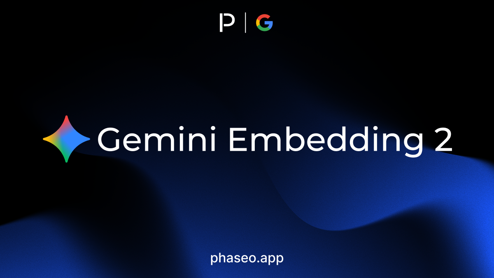

- [Google: Gemini Embedding 2](https://phaseo.app/models/google/gemini-embedding-2)
- [Qwen: Qwen 3.6 27B](https://phaseo.app/models/qwen/qwen3.6-27b)
- [Xiaomi: MiMo V2.5](https://phaseo.app/models/xiaomi/mimo-v2.5)
- [Xiaomi: MiMo V2.5 Pro](https://phaseo.app/models/xiaomi/mimo-v2.5-pro)
- [Xiaomi: MiMo V2.5 TTS](https://phaseo.app/models/xiaomi/mimo-v2.5-tts)

</Update>

<Update label="2026年4月21日">

产品

- 团队现在称为工作区，成员、邀请、加入请求和角色在 **Settings -> Workspaces** 中管理；请参阅[工作区](../guides/workspaces.mdx) ([#336](https://github.com/phaseoteam/Phaseo/pull/336), [#345](https://github.com/phaseoteam/Phaseo/pull/345))。
- 新的公告页面汇集 Phaseo 的公告，首页显示最新的三条 ([#335](https://github.com/phaseoteam/Phaseo/pull/335), [#339](https://github.com/phaseoteam/Phaseo/pull/339))。

模型

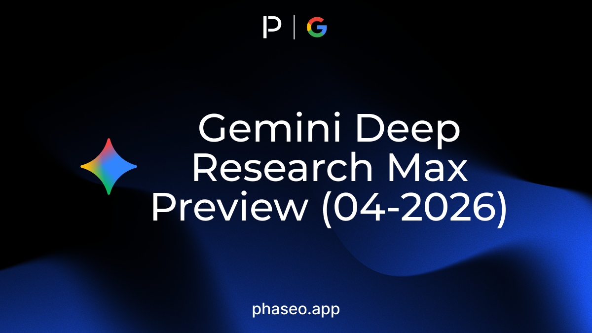

- [Google: Gemini Deep Research Max Preview (04-2026)](https://phaseo.app/models/google/deep-research-max-preview-04-2026)
- [Google: Gemini Deep Research Preview (04-2026)](https://phaseo.app/models/google/deep-research-preview-04-2026)
- [OpenAI: GPT Image 2](https://phaseo.app/models/openai/gpt-image-2)

</Update>

<Update label="2026年4月20日">

模型

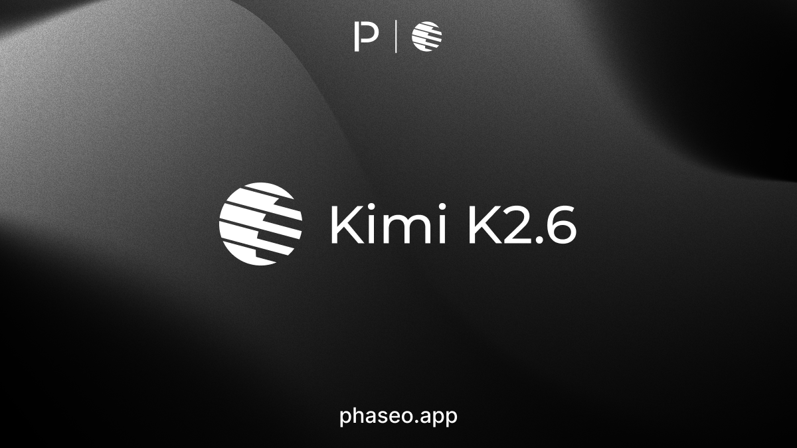

- [Moonshot: Kimi K2.6](https://phaseo.app/models/moonshotai/kimi-k2.6)
- [Qwen: Qwen 3.5 Plus (2026-04-20)](https://phaseo.app/models/qwen/qwen3.5-plus-2026-04-20)

</Update>

<Update label="2026年4月18日">

API 与 SDK

- SDK `1.2.0` 新增模型 ID `x-ai/grok-4.3` ([#314](https://github.com/phaseoteam/Phaseo/pull/314))。

</Update>

<Update label="2026年4月17日">

产品

- 手动充值额度的最低金额现为 $5，自动充值仍从 $1 起 ([#315](https://github.com/phaseoteam/Phaseo/pull/315))。

模型

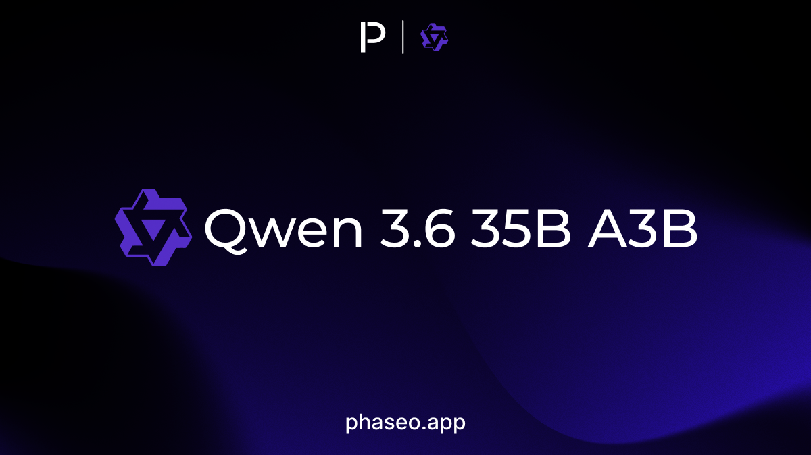

- [Qwen: Qwen 3.6 35B A3B](https://phaseo.app/models/qwen/qwen3.6-35b-a3b)
- [xAI: Grok TTS](https://phaseo.app/models/x-ai/grok-tts)

</Update>

<Update label="2026年4月16日">

产品

- 模型页新增 **Pricing** 标签页，显示过去一小时按流量加权的有效价格以及各供应商的价格历史 ([#305](https://github.com/phaseoteam/Phaseo/pull/305), [#307](https://github.com/phaseoteam/Phaseo/pull/307))。
- 模型页的 Playground 新增图像、视频、音频、嵌入和审核模式 ([#307](https://github.com/phaseoteam/Phaseo/pull/307))。
- 模型页的 **Apps** 部分列出在网关流量中出现的公开应用，并显示其请求数和 token 数 ([#302](https://github.com/phaseoteam/Phaseo/pull/302))。

API 与 SDK

- 通过 Anthropic、Google Vertex 和 Amazon Bedrock 发出的 Claude Opus 4.7 请求支持 `xhigh` 推理强度，网关会去掉 `temperature`、`top_p` 和 `top_k`；请参阅[Anthropic Claude Opus 4.7](../model-migrations/anthropic-claude-opus-4-6-to-4-7.mdx) ([#308](https://github.com/phaseoteam/Phaseo/pull/308))。

模型

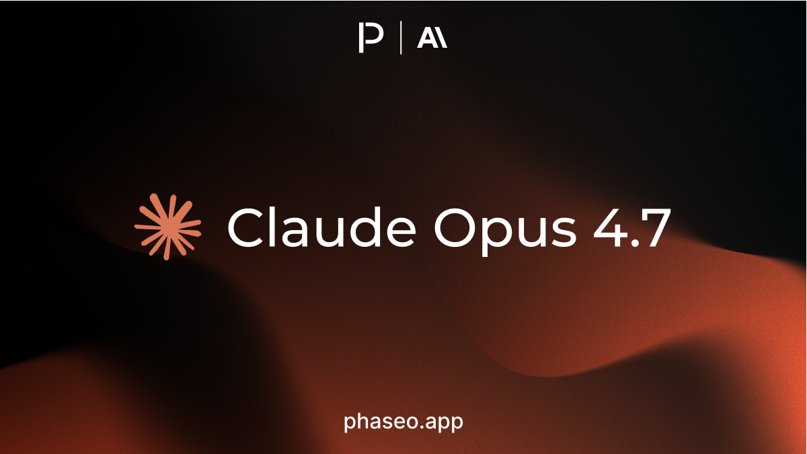

- [Anthropic: Claude Opus 4.7](https://phaseo.app/models/anthropic/claude-opus-4.7)

</Update>

<Update label="2026年4月15日">

产品

- 发布日历为每个组织提供一个页面，可查看其在今天这个星期几的发布或全部发布，并且现在涵盖所有历史发布 ([#300](https://github.com/phaseoteam/Phaseo/pull/300))。

API 与 SDK

- 发往免费模型（例如 `:free` ID）的请求无需额度即可使用；付费请求仍需至少 $1 额度 ([#293](https://github.com/phaseoteam/Phaseo/pull/293), [#294](https://github.com/phaseoteam/Phaseo/pull/294))。
- 未配置价格的供应商会被跳过，没有任何已定价供应商的请求会返回 `unsupported_model_or_endpoint`，原因为 `pricing_not_configured` ([#293](https://github.com/phaseoteam/Phaseo/pull/293))。
- **破坏性变更：** 发往已公布、暂不公开或已退役模型，或已过弃用日期模型的请求现在会被拒绝，SDK 的 `validateModel` 返回 `ok: false`；请改用可用的模型 ([#298](https://github.com/phaseoteam/Phaseo/pull/298))。

模型

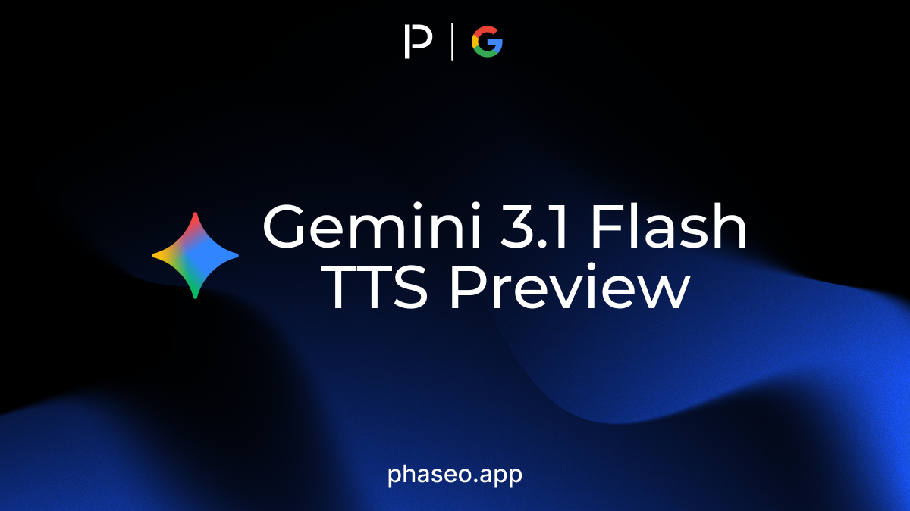

- [Google: Gemini 3.1 Flash TTS Preview](https://phaseo.app/models/google/gemini-3.1-flash-tts-preview)

</Update>

<Update label="2026年4月14日">

模型

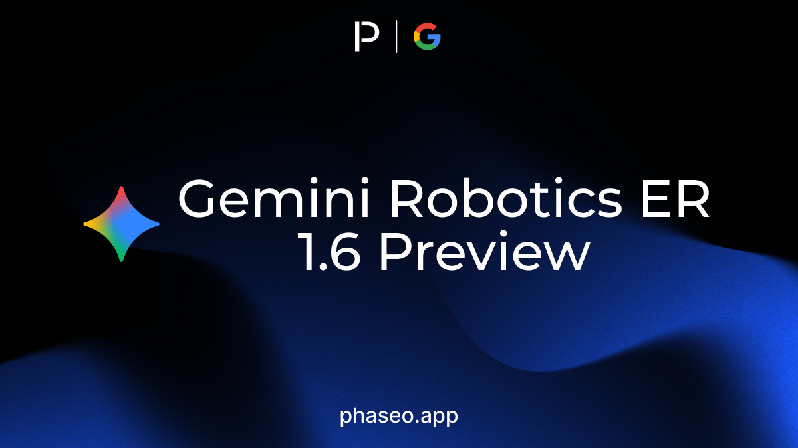

- [Google: Gemini Robotics ER 1.6 Preview](https://phaseo.app/models/google/gemini-robotics-er-1.6-preview)

</Update>

<Update label="2026年4月13日">

产品

- Chat 的音频房间可以根据提示词和歌词生成音乐，并将生成的曲目保存在浏览器中 ([#277](https://github.com/phaseoteam/Phaseo/pull/277))。
- Usage 和 Logs 显示每个模型带组织前缀的 Phaseo 名称，而不是供应商的名称 ([#277](https://github.com/phaseoteam/Phaseo/pull/277))。
- 模型卡片和模型表格以 **组织: 模型** 的形式显示名称，例如 **Moonshot: Kimi K2.6** ([#278](https://github.com/phaseoteam/Phaseo/pull/278))。

模型

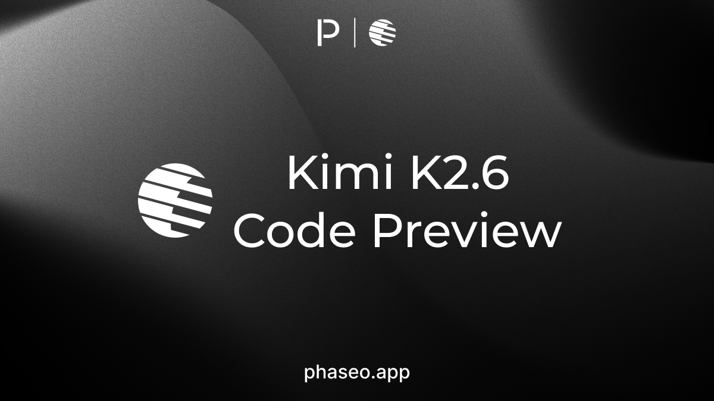

- [Moonshot: Kimi K2.6 Code Preview](https://phaseo.app/models/moonshotai/kimi-k2.6-code-preview)

</Update>

<Update label="2026年4月11日">

模型

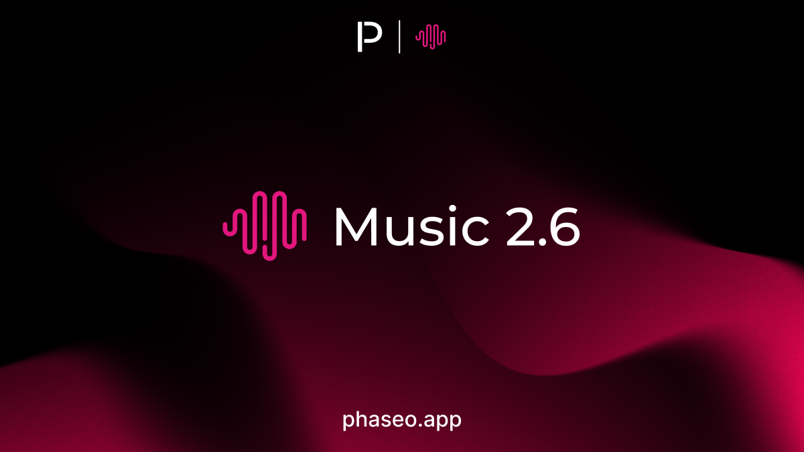

- [MiniMax: Music 2.6](https://phaseo.app/models/minimax/music-2.6)

</Update>

<Update label="2026年4月10日">

产品

- 对比页面显示每个模型在网关中的用量，并以统一格式显示所有基准分数 ([#244](https://github.com/phaseoteam/Phaseo/pull/244))。
- 供应商页面显示其提供的每个模型的用量趋势以及应用用量随时间的变化 ([#247](https://github.com/phaseoteam/Phaseo/pull/247))。
- `/updates/calendar` 的发布日历显示每个组织通常在星期几发布，以及今天发布的概率 ([#264](https://github.com/phaseoteam/Phaseo/pull/264))。

</Update>

<Update label="2026年4月9日">

产品

- 模型页会标出已公布或暂不公开的模型，并隐藏不适用的供应商、应用和性能部分 ([#245](https://github.com/phaseoteam/Phaseo/pull/245), [#259](https://github.com/phaseoteam/Phaseo/pull/259))。
- 网站在 `/migrate` 新增从其他 AI 网关迁移的分步指南 ([#248](https://github.com/phaseoteam/Phaseo/pull/248))。

API 与 SDK

- `POST /v1/rerank` 按与查询的相关度对文档排序，TypeScript 和 Python SDK 均已支持；请参阅[重新排序文档](../api-reference/endpoint/rerank.mdx) ([#242](https://github.com/phaseoteam/Phaseo/pull/242))。

</Update>

<Update label="2026年4月8日">

模型

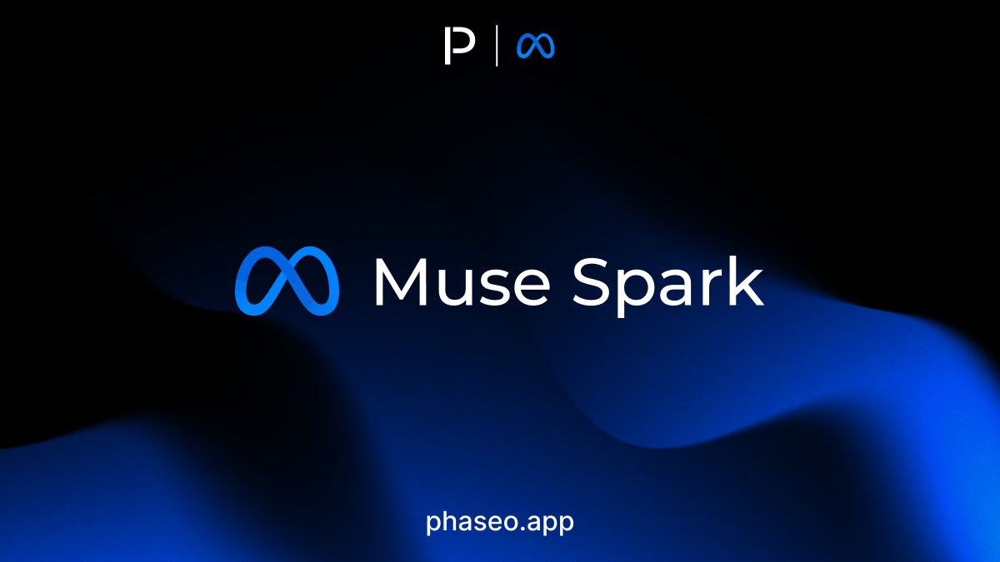

- [Meta: Muse Spark](https://phaseo.app/models/meta/muse-spark)
- [Meta: Muse Spark Contemplating](https://phaseo.app/models/meta/muse-spark-contemplating)

</Update>

<Update label="2026年4月7日">

模型

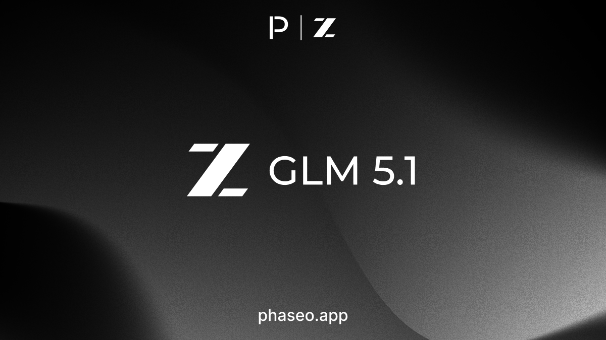

- [z.AI: GLM 5.1](https://phaseo.app/models/z-ai/glm-5.1)

</Update>

<Update label="2026年4月5日">

产品

- Pay As You Go 充值手续费从 7% 降至 5%，$1 的最低手续费不变 ([#225](https://github.com/phaseoteam/Phaseo/pull/225))。
- 图像、视频和音频模型的卡片以各模型自身的计价单位显示 **From:** 价格，而不是按 token 计价 ([#225](https://github.com/phaseoteam/Phaseo/pull/225))。
- phaseo.app 上的分析和会话录制仅在你接受分析 Cookie 后才会运行 ([#226](https://github.com/phaseoteam/Phaseo/pull/226))。

API 与 SDK

- 对于以 `input_tokens` 和 `output_tokens`（而非 `prompt_tokens` 和 `completion_tokens`）报告用量的供应商，Chat Completions 响应现在也包含其 token 用量 ([#227](https://github.com/phaseoteam/Phaseo/pull/227))。

</Update>

<Update label="2026年4月4日">

产品

- 在手机上，模型页将价格分两列显示，**Other models** 一行也不会超出屏幕 ([#223](https://github.com/phaseoteam/Phaseo/pull/223))。
- 免费提供某个模型的供应商显示在 **Free** 价格等级下，而不是 **Standard** ([#223](https://github.com/phaseoteam/Phaseo/pull/223))。

</Update>

<Update label="2026年4月3日">

模型

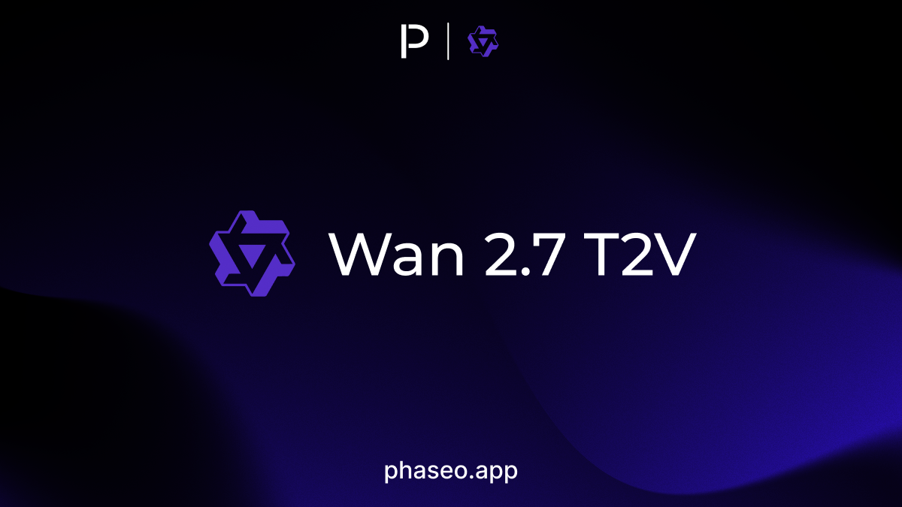

- [Qwen: Wan 2.7 T2V](https://phaseo.app/models/qwen/wan2.7-t2v)

</Update>

<Update label="2026年4月2日">

模型

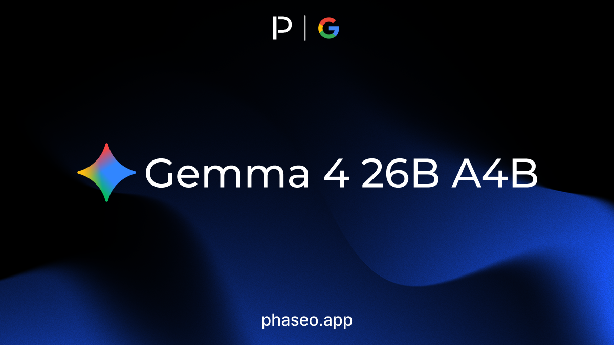

- [Google: Gemma 4 26B A4B](https://phaseo.app/models/google/gemma-4-26b-a4b)
- [Google: Gemma 4 31B](https://phaseo.app/models/google/gemma-4-31b)

</Update>

<Update label="2026年4月1日">

模型

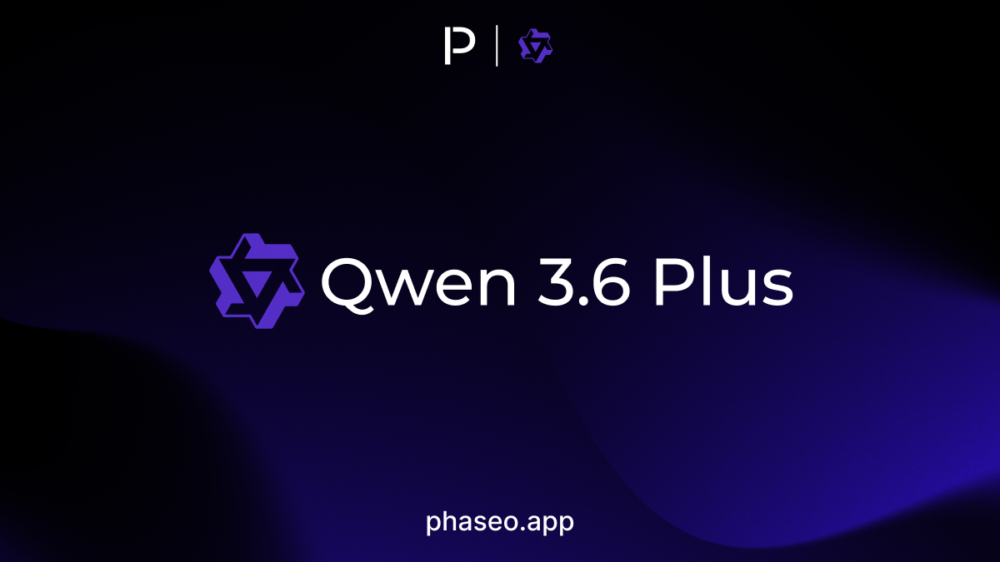

- [Qwen: Qwen 3.6 Plus](https://phaseo.app/models/qwen/qwen3.6-plus)
- [Arcee AI: Trinity Large Thinking](https://phaseo.app/models/arcee-ai/trinity-large-thinking)
- [z.AI: GLM 5V Turbo](https://phaseo.app/models/z-ai/glm-5v-turbo)

</Update>
