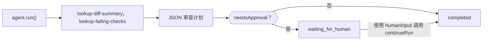

构建一个 TypeScript 智能体：它用本地工具检查拉取请求，返回严格的 JSON 审查计划，并在计划表明需要审批时暂停等待人工处理。完成后，你会得到一个脚本，它打印经过验证的 `CodeReviewPlan`，并停在 `waiting_for_human`，直到有人批准。

这些工具返回固定的示例数据，因此该脚本仅作演示；请将它们替换为对你的代码托管平台和 CI 的调用。打包好的版本位于 `packages/sdk/agent-sdk-ts/examples/coding-review-agent.ts`。



## 构建

<Steps>
<Step title="安装">

```bash
npm install @phaseo/agent-sdk zod
export PHASEO_API_KEY="phaseo_v1_sk_..."
```

</Step>
<Step title="编写智能体">

```ts review-agent.ts
import { z } from "zod";
import { createAgent, createGatewayAgentClient, defineTool } from "@phaseo/agent-sdk";

const CodeReviewPlan = z
  .object({
    risk: z.enum(["low", "medium", "high"]),
    summary: z.string().min(1),
    recommendedActions: z.array(z.string()).min(1),
    needsApproval: z.boolean(),
  })
  .strict();
type CodeReviewPlan = z.infer<typeof CodeReviewPlan>;

const PullRequestInput = z.object({ pullRequestId: z.string().regex(/^pr_\d+$/) }).strict();
const pullRequestParameters = {
  type: "object",
  properties: { pullRequestId: { type: "string", pattern: "^pr_\\d+$" } },
  required: ["pullRequestId"],
  additionalProperties: false,
};

// 只读、确定性的工具：如果 worker 恢复运行，可以安全地重新执行。
const lookupDiffSummary = defineTool({
  id: "lookup-diff-summary",
  description: "Return a short summary of the changed files in one pull request.",
  parameters: pullRequestParameters,
  inputSchema: PullRequestInput,
  async execute({ pullRequestId }) {
    return {
      pullRequestId,
      files: ["apps/api/src/pipeline/before/index.ts"],
      summary: "Changes touch request validation.",
    };
  },
});

const lookupFailingChecks = defineTool({
  id: "lookup-failing-checks",
  description: "Return the failing CI checks for one pull request.",
  parameters: pullRequestParameters,
  inputSchema: PullRequestInput,
  async execute({ pullRequestId }) {
    return { pullRequestId, failingChecks: ["web-typecheck"] };
  },
});

const codingReviewAgent = createAgent<string, CodeReviewPlan>({
  id: "coding-review-agent",
  model: "openai/gpt-6-astra",
  instructions:
    "Use the available tools to inspect the coding task, then return a strict JSON review plan.",
  tools: [lookupDiffSummary, lookupFailingChecks],
  maxSteps: 6,
  parseOutput: (text) => JSON.parse(text),
  outputSchema: CodeReviewPlan,
  humanReview: ({ parsedOutput }) =>
    parsedOutput?.needsApproval
      ? { reason: "coding_review_approval_required", payload: parsedOutput }
      : null,
});

// 要求 Gateway 返回这一确切的 JSON 结构，并修复接近有效的 JSON。
const client = createGatewayAgentClient({
  clientOptions: { apiKey: process.env.PHASEO_API_KEY! },
  responseFormat: {
    type: "json_schema",
    name: "code_review_plan",
    schema: {
      type: "object",
      properties: {
        risk: { type: "string", enum: ["low", "medium", "high"] },
        summary: { type: "string" },
        recommendedActions: { type: "array", items: { type: "string" }, minItems: 1 },
        needsApproval: { type: "boolean" },
      },
      required: ["risk", "summary", "recommendedActions", "needsApproval"],
      additionalProperties: false,
    },
  },
  plugins: [{ id: "response-healing", mode: "strict" }],
});

const result = await codingReviewAgent.run({
  input: "Review pull request pr_482 and produce a remediation plan.",
  client,
  onEvent(event) {
    console.log(event.type, event.runId);
  },
});

if (result.run.status === "waiting_for_human") {
  console.log("Needs approval:", result.run.pause?.payload);

  // 在真实应用中，保存 `result`，并在审查者批准后继续。
  if (process.env.APPROVE === "yes") {
    const continued = await codingReviewAgent.continueRun({
      run: result,
      client,
      humanInput: "Approved. Finalize the plan.",
    });
    console.log(continued.output);
  }
} else {
  console.log(result.output);
}
```

`responseFormat` 让 Gateway 按此 schema 发出请求，`outputSchema` 会在你的进程中再次检查解析后的结果。严格模式的[响应修复](./response-healing-for-structured-json)只会解包本身已有效的 JSON。

</Step>
<Step title="运行">

```bash
npx tsx review-agent.ts
APPROVE=yes npx tsx review-agent.ts
```

</Step>
</Steps>

## 检查是否成功

- 事件日志会显示两个工具的 `tool.started` 和 `tool.completed`，然后在工具步骤之后显示 `checkpoint.saved`。
- 如果计划包含 `needsApproval: true`，第一次运行会停在 `waiting_for_human`，计划位于 `result.run.pause.payload` 中；设置 `APPROVE=yes` 后，运行会继续直到 `completed`。
- 在 **设置 → 使用情况 → 日志** 中，每个模型轮次都会显示工具调用，请求的插件记录会显示是否运行了修复。
- 不符合 schema 的计划会以 `AgentSchemaValidationError` 使运行失败，而不是返回错误数据。

## 在真实仓库中安全使用

让审查工具保持只读。如果你添加会发表评论、推送或合并的工具，请在该工具上设置 `requireApproval: true`，让运行在执行它之前暂停，然后用 `continueRun({ run, client, approvals: [toolCallId] })` 批准。将 diff 内容视为不可信输入：代码注释中可能包含针对模型的指令。为了在审查等待期间也能承受重启，请像[持久化循环](./agent-sdk-durable-loop)中那样，用 `state` 访问器保存运行。[状态与审批](../sdk-reference/agent/state-and-approval)介绍了批准和拒绝。
