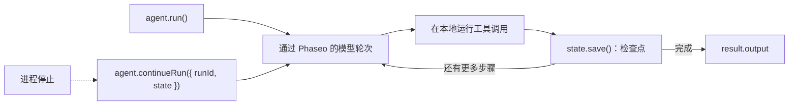

用 TypeScript Agent SDK 运行一个使用工具的智能体，并在每一步之后保存其状态，这样崩溃或重启的进程可以从停下的地方继续。完成后，你会得到一个脚本：它用查询工具回答一个文档问题，把每次运行写入 `.agent-runs/<run id>.json`，并在你传入运行 ID 时恢复该运行。

该脚本仅作演示：文件存储只适用于单台机器。在生产环境中，保留同样的 `load`/`save` 函数对，但改用你的数据库作为存储。Phaseo 不会替你存储 Agent SDK 运行。



## 构建

<Steps>
<Step title="安装">

<CodeGroup>
```bash npm
npm install @phaseo/agent-sdk zod
```

```bash pnpm
pnpm add @phaseo/agent-sdk zod
```

```bash yarn
yarn add @phaseo/agent-sdk zod
```

```bash bun
bun add @phaseo/agent-sdk zod
```
</CodeGroup>

`@phaseo/agent-sdk` 会一并安装 `@phaseo/sdk`。设置你的密钥：

```bash
export PHASEO_API_KEY="phaseo_v1_sk_..."
```

</Step>
<Step title="编写智能体">

```ts agent.ts
import { mkdir, readFile, writeFile } from "node:fs/promises";
import { z } from "zod";
import {
  createAgent,
  createGatewayAgentClient,
  defineTool,
  type AgentStateAccessor,
} from "@phaseo/agent-sdk";

const DOC_SLUGS = ["guides/presets", "guides/routing-and-fallbacks", "guides/streaming"] as const;

// 模型只能看到 `parameters`；`inputSchema` 会在 execute 运行之前拒绝其他任何内容。
const lookupDocs = defineTool({
  id: "lookup-docs",
  description: "Return the URL of one Phaseo docs page by slug.",
  parameters: {
    type: "object",
    properties: { slug: { type: "string", enum: [...DOC_SLUGS] } },
    required: ["slug"],
    additionalProperties: false,
  },
  inputSchema: z.object({ slug: z.enum(DOC_SLUGS) }).strict(),
  async execute({ slug }) {
    return { slug, url: `https://phaseo.app/docs/v1/${slug}` };
  },
});

const agent = createAgent<string, string>({
  id: "support-docs-agent",
  model: "openai/gpt-6-astra",
  instructions: "Use tools when helpful and finish with a concise answer that includes the docs URL.",
  tools: [lookupDocs],
  maxSteps: 6,
});

// 每一步之后保存整个运行。把这两个函数换成你的数据库。
const RUNS_DIR = ".agent-runs";
const state: AgentStateAccessor<string, unknown, string> = {
  async load(runId) {
    try {
      return JSON.parse(await readFile(`${RUNS_DIR}/${runId}.json`, "utf8"));
    } catch {
      return null;
    }
  },
  async save(result) {
    await mkdir(RUNS_DIR, { recursive: true });
    await writeFile(`${RUNS_DIR}/${result.run.id}.json`, JSON.stringify(result));
  },
};

const client = createGatewayAgentClient({
  clientOptions: { apiKey: process.env.PHASEO_API_KEY! },
});

const onEvent = (event: { type: string; runId: string }) => {
  if (event.type === "checkpoint.saved") console.log("checkpoint", event.runId);
};

const resumeId = process.argv[2];
let result;

if (resumeId) {
  const saved = await state.load(resumeId);
  if (!saved) throw new Error(`No saved run ${resumeId}`);
  result = saved.run.status === "completed"
    ? saved
    : await agent.continueRun({ run: saved, client, state, onEvent });
} else {
  result = await agent.run({
    input: "Find the docs page for presets and explain when to use them.",
    client,
    state,
    onEvent,
  });
}

console.log(result.run.id, result.run.status);
console.log(result.output);
```

</Step>
<Step title="运行">

```bash
npx tsx agent.ts
```

要测试恢复，请在出现第一行 `checkpoint` 后用 `Ctrl+C` 停止脚本，然后传入它打印的运行 ID（一个 UUID）：

```bash
npx tsx agent.ts 3f6c1d2e-...
```

</Step>
</Steps>

## 检查是否成功

- 脚本每一步打印一次 `checkpoint`，然后打印运行 ID、`completed`，以及一个包含 `phaseo.app/docs` URL 的回答。
- `.agent-runs/<run id>.json` 保存了运行 ID、状态、消息历史、每一步的工具调用和结果，以及最终输出。
- 运行被中断后，恢复命令会完成同一个运行 ID，而不是开始新的运行。
- 每个模型轮次都会出现在 **设置 → 使用情况 → 日志** 中。在每个请求 ID 旁边记录运行 ID，以便将二者对应起来。

## 保存的状态包含什么

每个保存的结果都是完整的 `AgentRunResult`：`run`（ID、状态、消息、用量以及任何暂停信息）、带有 Gateway 请求 ID 和工具调用的 `steps`，以及运行完成后的 `output`。`continueRun()` 可以直接接受它，也可以接受 `runId` 加 `state`，此时它会自己调用 `load()`。

进程停止时正在运行的工具调用可能已经产生了效果，因此请让工具保持幂等。对于从未得到结果的调用，SDK 会在继续之前修复其历史记录。[状态与审批](../sdk-reference/agent/state-and-approval)介绍了暂停和审批。

## 谨慎扩展

每个工作流保留一个智能体、一个简短的工具列表，并为每次运行记录一行包含运行 ID 和请求 ID 的日志。当你需要审批暂停或多个智能体共享工具时，保留这个 Gateway 客户端和状态对，并围绕它们构建：[代码审查智能体](./agent-sdk-coding-review)添加了审批暂停，[并行工具](./agent-sdk-parallel-tools)让工具并行运行。如需共享请求默认值，请调用[预设](../guides/presets)，而不是固定的模型。
