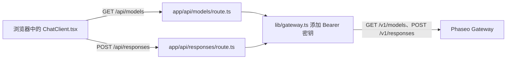

运行一个小型 Next.js 聊天应用，其浏览器代码只与你自己的服务器路由通信，因此你的 Phaseo API 密钥永远不会到达浏览器。完成后，你会得到一个本地聊天页面，其模型选择器由 `GET /v1/models` 填充，回答来自 `POST /v1/responses`。

该示例仅作演示：它的路由没有登录或速率限制，任何能访问这些路由的人都会消耗你的密钥。请先添加[部署之前](#before-you-deploy-it)中的检查。

要让编码智能体从零开始构建同样的应用，请粘贴以下提示词：

<Prompt
  description="基于 Phaseo Gateway 构建一个 **Next.js Web 聊天应用**。"
  icon="message-square"
  actions={["copy", "cursor"]}
>
{`You are building a small production-style chat app with Phaseo Gateway.

Create a Next.js app with:
- a chat UI
- a model picker backed by GET https://api.phaseo.app/v1/models
- a server-side route that calls POST https://api.phaseo.app/v1/responses
- server-side API key handling using PHASEO_API_KEY (Authorization: Bearer)
- loading, success, and error states

Keep the app intentionally small and easy to inspect.

Implementation requirements:
- Use one local API route for model discovery.
- Use one local API route for responses generation.
- Keep secrets server-side only.
- Send the whole conversation in input on every turn. The gateway rejects previous_response_id.
- Only accept model IDs from an allowlist on the server, and cap the input length.
- Show the request/response flow clearly in code.
- Add a short README with setup and run steps.

Verification:
- Run the app if possible.
- Verify two successful chat turns in a row.
- Report the exact files changed, what you verified, and any remaining assumptions.`}
</Prompt>

## 示例的构成



示例位于 [examples/web-chat-nextjs](https://github.com/phaseoteam/Phaseo/tree/main/examples/web-chat-nextjs)：

| 文件 | 作用 |
| --- | --- |
| `app/components/ChatClient.tsx` | 输入、加载和错误状态、渲染的消息、模型选择器 |
| `app/api/models/route.ts` | 返回来自 `GET /v1/models` 的模型 ID |
| `app/api/responses/route.ts` | 检查 `model` 和 `input` 是否为非空字符串（`400 missing_model`、`400 missing_input`），然后调用 `POST /v1/responses` |
| `lib/gateway.ts` | 构建 URL 和请求头：`Authorization: Bearer $PHASEO_API_KEY`、`x-title`，以及设置时的 `http-referer` |

## 运行

你需要 Node.js 和一个 Phaseo API 密钥。

<Steps>
<Step title="安装">

```bash
cd examples/web-chat-nextjs
npm install
```

示例附带 `package-lock.json`，因此 `npm` 会安装经过测试的版本。

</Step>
<Step title="创建 .env.local">

示例没有 `.env.example`。请自行创建 `.env.local`：

```bash .env.local
PHASEO_API_KEY=phaseo_v1_sk_...
# 可选。默认为 https://api.phaseo.app；/v1 会自动添加。
NEXT_PUBLIC_GATEWAY_URL=https://api.phaseo.app
# 可选的应用归因请求头。
GATEWAY_APP_TITLE=My chat app
GATEWAY_HTTP_REFERER=https://myapp.example
```

这里只在服务器上读取 `NEXT_PUBLIC_GATEWAY_URL`，但 `NEXT_PUBLIC_` 前缀会将它暴露给浏览器代码，因此绝不要在其中放入密钥。[应用归因](../guides/app-attribution)介绍了这两个可选请求头。

</Step>
<Step title="修复第二轮聊天">

`ChatClient.tsx` 会将上一个回答的 `id` 作为 `previous_response_id` 发送。Gateway 不存储响应，因此会以 `400 validation_error`（关键字 `unsupported_param`）拒绝该字段，第二条消息就会失败。在 `app/api/responses/route.ts` 中，删除将 `previous_response_id` 复制到 payload 中的代码块：

```ts app/api/responses/route.ts
  // 删除以下几行：
  if (typeof body.previous_response_id === 'string' && body.previous_response_id.trim()) {
    payload.previous_response_id = body.previous_response_id.trim();
  }
```

之后，每一轮都会被单独回答。要保留上下文，请在 `input` 中以消息数组的形式发送之前的轮次。

</Step>
<Step title="启动开发服务器">

```bash
npm run dev
```

打开 `http://localhost:3000`。

</Step>
</Steps>

## 检查是否成功

- 模型选择器中填充了模型 ID。
- 连续发送的两条消息都得到了回答。
- 在浏览器的网络面板中，请求只发往 `/api/models` 和 `/api/responses`，且没有任何请求携带 `PHASEO_API_KEY`。
- 错误的模型 ID 会显示 Gateway 的错误消息，而不是空白回答。
- 请求会以你设置的应用标题出现在 **设置 → 使用情况 → 日志** 中。

<span id="before-you-deploy-it"></span>
## 部署之前

- **为路由添加身份验证。** 在 `/api/responses` 和 `/api/models` 上要求用户登录，或者使用 [OAuth 工作台](./build-an-oauth-nextjs-workbench)，让每个用户消耗自己的额度。
- **为模型设置允许列表。** 路由会转发浏览器发来的任何 `model` 字符串。请在服务器上用固定列表检查它。
- **限制输入和频率。** 限制输入长度和每个用户的请求数，并为[密钥设置支出限额](../api-reference/limits#key-limits-and-budgets)。
- **按需使用流式传输。** 设置 `stream: true` 并转发事件；[流式传输](../guides/streaming)说明了哪个事件会结束 Responses 流。

如果需要后端脚本而不是 UI，请从 [Node REST 冒烟测试应用](./build-a-node-rest-smoke-app)或 [Python Gateway CLI](./build-a-python-gateway-cli) 开始。
