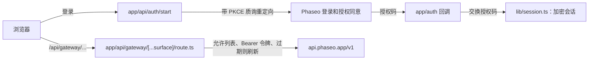

让用户使用 Phaseo 登录，并在你的应用中花费他们自己的额度：OAuth 2.1 配合 PKCE 为你的服务器提供访问令牌，一个服务器端代理会把它附加到每个网关调用上。完成后，你会得到一个本地应用，具备登录、基于会话且可刷新的令牌、模型发现、基于 `/responses` 的聊天流程，以及一个测试其他端点的工具。

该示例仅作演示。它的 `lib/oauth.ts` 仍调用旧的登录端点，[运行](#run-it)的第 3 步会修复这个问题；它的代理允许列表也比实际产品需要的更宽。

要让编程智能体从零构建同样的应用，请粘贴以下提示：

<Prompt
  description="构建一个带 OAuth 和统一 Phaseo 代理的**已登录 Next.js 工作台**。"
  icon="shield-user"
  actions={["copy", "cursor"]}
>
{`You are building a signed-in Next.js app on top of Phaseo Gateway.

Create a workbench-style app with:
- OAuth 2.1 + PKCE sign-in against https://api.phaseo.app/oauth/authorize and https://api.phaseo.app/oauth/token (discover them from https://api.phaseo.app/.well-known/oauth-authorization-server), requesting the gateway:access scope
- session-backed token storage in an encrypted, httpOnly cookie
- one unified gateway proxy route on the server that calls https://api.phaseo.app/v1
- model discovery
- one chat flow using the Responses API, sending the whole conversation in input on every turn
- one generic endpoint tester for additional Phaseo endpoints

Requirements:
- Keep gateway credentials and access tokens server-side.
- Use a proxy allowlist of exact paths for safety.
- Support token refresh. Store the new refresh token from every refresh and drop the old one.
- Sign out by sending the refresh token to https://api.phaseo.app/oauth/revoke.
- Keep the workbench understandable rather than over-engineered.
- Add a short README with setup, env vars, and run steps.

Verification:
- run the app if possible
- verify sign-in flow as far as local setup allows
- verify at least one proxied gateway request path
- report exactly what you verified and what remains dependent on external OAuth configuration.`}
</Prompt>

## 示例的结构



示例位于 [examples/oauth-client-nextjs](https://github.com/phaseoteam/Phaseo/tree/main/examples/oauth-client-nextjs)：

| 文件 | 作用 |
| --- | --- |
| `app/page.tsx` | 登录入口页 |
| `app/dashboard/page.tsx` | 受保护的外壳页面 |
| `app/dashboard/GatewayWorkbench.tsx` | 加载控制路由、列出模型 ID、通过 `POST /responses` 运行聊天，并测试其他端点 |
| `app/api/gateway/[...surface]/route.ts` | 通配代理：检查允许列表、添加 Bearer 令牌、在令牌过期时刷新、转发请求体和状态 |
| `lib/oauth.ts` | PKCE、授权码交换和刷新 |
| `lib/session.ts` | 加密的会话存储 |

把登录和网关调用分开，登录问题就不会看起来像模型问题，而且所有端点共用同一个处理令牌的地方。

<span id="run-it"></span>
## 运行

你需要 Node.js、一个把 `http://localhost:3000/auth/callback`（或你自己的回调地址）设为重定向 URI 的 OAuth 应用，以及一个足够长的随机会话密钥。在**设置 → OAuth 应用**中或通过 [OAuth 客户端 API](../api-reference/endpoint/oauth-clients-create) 创建 OAuth 应用。

<Steps>
<Step title="安装">

```bash
cd examples/oauth-client-nextjs
npm install
```

</Step>
<Step title="创建 .env.local">

示例中没有 `.env.example`。使用代码读取的变量名创建 `.env.local`：

```bash .env.local
NEXT_PUBLIC_OAUTH_CLIENT_ID=your_client_id
OAUTH_CLIENT_SECRET=your_client_secret
# The sample reads this name for the OAuth server's base URL.
NEXT_PUBLIC_AISTATS_URL=https://api.phaseo.app
NEXT_PUBLIC_REDIRECT_URI=http://localhost:3000/auth/callback
SESSION_SECRET=a-long-random-string
NEXT_PUBLIC_GATEWAY_URL=https://api.phaseo.app
```

切勿把 `OAUTH_CLIENT_SECRET` 或 `SESSION_SECRET` 放进 `NEXT_PUBLIC_` 变量。

</Step>
<Step title="让示例指向当前的 OAuth 端点">

`lib/oauth.ts` 会拼出 `${NEXT_PUBLIC_AISTATS_URL}/auth/v1/oauth/authorize` 和 `/auth/v1/token`，并请求 `openid email profile`。Phaseo 的 OAuth 服务器在 `https://api.phaseo.app/.well-known/oauth-authorization-server` 公布其端点：

| 用途 | URL |
| --- | --- |
| 授权 | `https://api.phaseo.app/oauth/authorize` |
| 令牌 | `https://api.phaseo.app/oauth/token` |
| 撤销 | `https://api.phaseo.app/oauth/revoke` |

把 `lib/oauth.ts` 中的三个 URL 改为以上地址，并在 `scope` 中加入 `gateway:access`，让令牌可以调用 Gateway。

</Step>
<Step title="启动开发服务器">

```bash
npm run dev
```

打开 `http://localhost:3000`，登录，然后打开仪表板。

</Step>
</Steps>

## 检查是否成功

- 登录后会回到你的回调 URL 并创建会话。
- 仪表板通过 `/api/gateway/models` 列出模型。
- 通过 `/api/gateway/responses` 发起的一轮聊天得到回答，并且没有任何浏览器请求携带访问令牌。
- 不在代理允许列表中的路径会被拒绝。

## 令牌有效期

令牌端点返回两个令牌：

| 令牌 | 有效期 | 用途 |
| --- | --- | --- |
| `access_token` | 7 天（`expires_in`） | 在网关请求中作为 `Authorization: Bearer` 发送。它会花费用户所选工作区中的额度。 |
| `refresh_token` | 自最后一次使用起 90 天 | 与 `grant_type=refresh_token` 一起发送，以获取一对新令牌。 |

- **每次刷新都轮换。** 每次刷新都会返回新的访问令牌和新的刷新令牌。保存这两个令牌并丢弃旧的：旧的访问令牌会立即失效，旧的刷新令牌也不能再用。
- **过期后也能刷新。** 只要刷新令牌还没过期，即使访问令牌已经过期，你也可以刷新。
- **切勿重复使用刷新令牌。** 第二次使用同一个刷新令牌会结束这次登录。Phaseo 会把它视为泄露的令牌，撤销这次登录的访问令牌和所有刷新令牌，用户必须重新登录。
- **作用域只会缩小。** 刷新永远不会增加作用域。它保留用户批准过的作用域，减去用户此后移除的作用域。
- **刷新失败的情况。** 当用户撤销你的应用、撤销或停用其密钥、移除密钥所需的作用域（例如 `gateway:access`），或离开工作区后，刷新就会失败。移除 `gateway:access` 还会撤销该密钥，因此它的访问令牌会立即失效。重新授予该作用域并不能恢复刷新令牌。请让用户重新登录。
- **重新登录会续用密钥。** 无论你是否发送 `resource=https://api.phaseo.app/v1`，重新登录都会续用同一个密钥，而不是新增一个。你会得到新的访问令牌和刷新令牌，之前的令牌失效，该密钥保留本月的支出。它的每月支出上限变为用户刚刚批准的值。较早一次登录的刷新令牌只会被拒绝，把它发送到令牌端点或撤销端点不会结束新的登录。
- **已暂停的密钥会阻止登录。** 如果你的应用针对该用户和工作区的任何一个密钥处于暂停状态，无论其 resource 是什么，令牌端点都会返回 `invalid_grant`，直到有人在**设置 → API 密钥**中重新启用该密钥。只有在密钥未被撤销时才能续用：退出登录或发生其他任何撤销后，再次登录会签发一个新密钥，其上限和支出都从头开始。
- **用撤销来退出登录。** 把刷新令牌发送到 `https://api.phaseo.app/oauth/revoke`。这会撤销该密钥以及这次登录的所有刷新令牌，包括刚刚由刷新签发的那个。

## 支出上限

在授权同意页面上，用户会为你的应用设置每月支出上限：默认 $20.00，也可以是其他金额或不设上限。密钥在一个自然月内花完这个额度后，网关请求会返回 `429` 和 `key_limit_exceeded`，直到下个月或用户在**设置 → API 密钥**中提高上限。

无论持有哪些作用域，你的应用都不能通过 API 解除或绕过这个上限。它只能重命名或删除 API 密钥。它不能创建或轮换密钥，不能更改密钥的上限、状态或过期时间，不能创建管理密钥或受信任的工作负载，不能添加成员，不能更改预算、护栏、速率限制或支出规则，也不能更改工作区的路由价格上限或其 BYOK 回退到额度的设置。

## 上线之前

- **收窄允许列表。** `lib/gateway.ts` 允许若干精确路径，以及 `videos/`、`music/generate/`、`control/` 和 `internal/` 下的所有路径。只保留你的产品实际调用的精确路径。
- **发送完整对话。** Gateway 不存储响应，并会拒绝 `previous_response_id`，因此请在 `input` 中重新发送之前的轮次。
- **替换测试工具。** 把工作台留作内部 QA，为最终用户构建专门的流程。

如果是不需要登录、使用 API 密钥的应用，请从 [Next.js 网页聊天应用](./build-a-nextjs-web-chat-app)开始。
