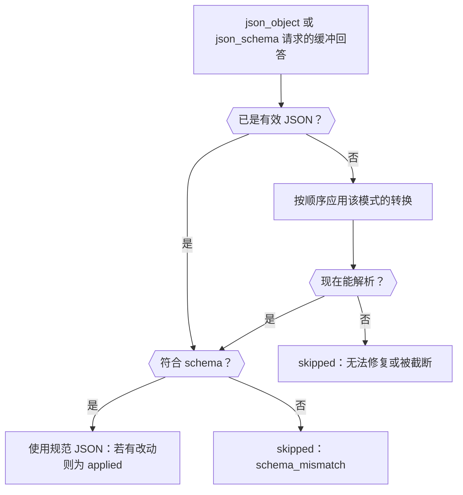

在结构化输出请求中添加 `response-healing` 插件，Phaseo 就会在 JSON 到达你的解析器之前修复几乎有效的 JSON，例如包在 Markdown 代码块中或带有尾随逗号的 JSON。完成后，你会得到一个请求：它要求 JSON Schema，在需要时修复回答，并在响应中告诉你是否进行了修复。

该请求可直接用于生产环境。修复只处理语法，所以你的代码仍需验证结果，做法参见[验证结果](../guides/structured-outputs#validate-the-result)。



## 发送带修复的请求

<CodeGroup>
```bash cURL
curl https://api.phaseo.app/v1/responses \
  -H "Authorization: Bearer $PHASEO_API_KEY" \
  -H "Content-Type: application/json" \
  -d '{
    "model": "openai/gpt-6-astra",
    "input": "Summarize this release in one sentence: dark mode and faster search.",
    "text": {
      "format": {
        "type": "json_schema",
        "name": "answer",
        "strict": true,
        "schema": {
          "type": "object",
          "properties": { "summary": { "type": "string" } },
          "required": ["summary"],
          "additionalProperties": false
        }
      }
    },
    "plugins": [{ "id": "response-healing", "mode": "safe" }],
    "meta": true
  }'
```

```typescript TypeScript
import Phaseo from "@phaseo/sdk";

const client = new Phaseo({ apiKey: process.env.PHASEO_API_KEY! });

const response = await client.generateResponse({
  model: "openai/gpt-6-astra",
  input: "Summarize this release in one sentence: dark mode and faster search.",
  text: {
    format: {
      type: "json_schema",
      name: "answer",
      strict: true,
      schema: {
        type: "object",
        properties: { summary: { type: "string" } },
        required: ["summary"],
        additionalProperties: false,
      },
    },
  },
  plugins: [{ id: "response-healing", mode: "safe" }],
  meta: true,
});

console.log(response.meta?.plugin_executions);
```

```python Python
import os

from phaseo import Phaseo

client = Phaseo(api_key=os.environ["PHASEO_API_KEY"])

response = client.generate_response(
    {
        "model": "openai/gpt-6-astra",
        "input": "Summarize this release in one sentence: dark mode and faster search.",
        "text": {
            "format": {
                "type": "json_schema",
                "name": "answer",
                "strict": True,
                "schema": {
                    "type": "object",
                    "properties": {"summary": {"type": "string"}},
                    "required": ["summary"],
                    "additionalProperties": False,
                },
            }
        },
        "plugins": [{"id": "response-healing", "mode": "safe"}],
        "meta": True,
    }
)

print(response["meta"].get("plugin_executions"))
```
</CodeGroup>

在 Chat Completions 中，请把同样的 schema 放在 `response_format` 而不是 `text.format` 中发送。只有当请求要求 `json_object` 或 `json_schema` 时才会运行修复，并且流式请求永远不会运行修复：流式请求会以 `streaming_unsupported` 跳过它。

## 检查它是否运行

使用 `meta: true` 时，插件运行后会出现在 `meta.plugin_executions` 中：

```json
{
  "id": "response-healing",
  "stage": "response.post_provider",
  "status": "applied",
  "changed": true,
  "metadata": {
    "attempted": true,
    "healed": true,
    "mode": "safe",
    "transforms_applied": ["strip_markdown_fence"]
  }
}
```

| `status` | 含义 |
| --- | --- |
| `applied` | 回答已被改写为有效 JSON。 |
| `skipped` | 回答保持原样。如果 `attempted: false`，说明请求不符合条件；否则就是 JSON 本来有效或无法修复。`metadata.failure_reason` 说明原因：`streaming_unsupported`、`not_json`（未要求结构化输出，或没有文本）、`unrepairable`、`truncated`（回答在 token 上限处停止），或带有 `validation_errors` 的 `schema_mismatch`。 |
| `failed` | 插件本身出错（`reason: plugin_error`）；回答保持不变。 |

同样的记录也会出现在**设置 → 用量 → 日志**中的该请求上。如果插件始终没有出现，请检查请求、其预设或工作区是否真的开启了它；[设置插件默认值](./plugin-defaults-and-response-healing)说明了在哪里设置。

## 选择模式

| 模式 | 转换（按顺序） |
| --- | --- |
| `safe`（默认） | 去掉 Markdown 代码块、截取最外层的 `{…}` 或 `[…]`、移除尾随逗号、为裸键加引号，并补上缺失的右括号（当回答达到 token 上限时不补） |
| `strict` | 只去掉 Markdown 代码块并截取最外层的 `{…}` 或 `[…]`，因此只接受包装内本来就有效的 JSON |

使用 JSON Schema 时，修复后的结果在替换回答之前会先经过检查：必需键、类型、`enum` 和 `const`、数组边界和 `uniqueItems`、字符串长度、`pattern` 以及 `email`、`uri`、`uuid` 和 `date-time` 格式、数值边界和 `multipleOf`、属性数量，以及 `additionalProperties: false`。

## 了解它何时帮不上忙

修复绝不会编造缺失的字段、猜测值，或把散文转换为数据。在使用它之前，先分清以下几种失败：

| 失败 | 解决方法 |
| --- | --- |
| 结构上接近的 JSON | 响应修复 |
| 字段错误的有效 JSON | 收紧 schema 和提示 |
| 输出散文而不是 JSON | 请求 `json_schema`，而不只是在提示中说明 |
| 在 token 上限处被截断 | 提高 `max_output_tokens` |

修复最适合这样的情况：单个对象、明确的必需键、较低的 temperature，并且不要求 JSON 之外的文本。先为一个预设开启它，在日志中观察 `plugin_executions`，等修复后的数据符合你的 schema 后再扩大范围。
