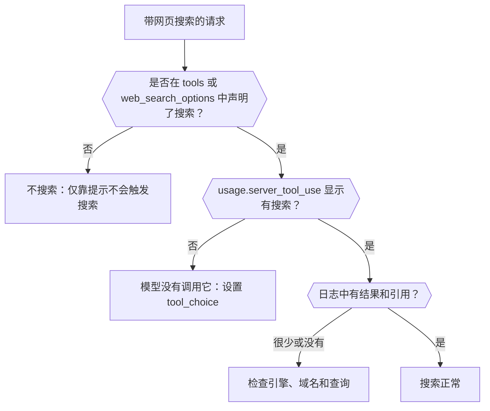

通过响应和请求日志，弄清网页搜索是否真的运行了、由哪个引擎运行、返回了什么。完成后，你就能区分根本没有发生的搜索和已经运行但找到内容很少的搜索。



## 在请求中声明搜索

在提示中要求“最新消息”并不会运行搜索。请显式添加：

```json
{
  "model": "openai/gpt-6-astra",
  "input": "What changed in the Phaseo changelog this week?",
  "tools": [{ "type": "phaseo:web_search", "parameters": { "max_results": 5 } }],
  "tool_choice": "phaseo:web_search"
}
```

`phaseo:web_search` 可用于 Chat Completions、Responses 和 Messages。`web_search_options` 可用于支持它的端点。`tool_choice` 会强制调用；没有它，模型可能凭记忆回答。[网页搜索指南](../guides/server-tools/web-search)列出了所有参数。

## 检查它是否运行

| 查看 | 显示内容 |
| --- | --- |
| 响应中的 `usage.server_tool_use.web_search_requests` | 运行了多少次托管搜索 |
| **设置 → 用量 → 日志**中该请求的**网络搜索可观测性** | 托管搜索、原生搜索、结果数和引用数，以及提取出的结果和引用记录 |
| 同一请求的**路由可观测性** | 参与考虑的提供商，以及因不支持该请求而被移除的提供商 |

## 区分各种失败情况

| 你看到的现象 | 原因 | 解决方法 |
| --- | --- | --- |
| 完全没有搜索计数 | 没有声明搜索，或模型选择不调用它 | 添加该工具并设置 `tool_choice` |
| 工具向模型返回 `search_not_configured` | 你选择的托管引擎未启用 | 使用默认引擎或其他引擎 |
| 工具返回 `unsupported_search_engine` | 模型在调用中请求了 `engine: "native"` | 只在工具定义中设置 `native` |
| `400 not_supported`，原因为 `regional_hosted_tool_not_supported` | 请求发到了 `eu.api.phaseo.app` 或 `us.api.phaseo.app`，它们会拒绝服务器工具 | 使用 `api.phaseo.app` |
| 搜索运行了但引用很少 | 查询或来源质量较差 | 调整 `max_results`、`allowed_domains` 或 `engine` |

使用 `engine: "native"` 时，请求只会发送到自己运行网页搜索的提供商。如果没有这样的提供商提供该模型，Phaseo 会改为运行其默认引擎，并按托管搜索计费，因此原生搜索请求也可能显示托管计数。

## 比较请求

当多次运行的结果不同时，比较模型 ID、选中的提供商、搜索参数，以及结果数和引用数。这些计数已在各提供商之间统一，因此无需阅读原始数据就能看出搜索质量的差异。完整的有依据工作流请参见[用 TypeScript 进行托管网页搜索](./sdk-typescript-managed-search)；对于已知 URL，请改用[网页抓取](./tool-grounding-with-web-fetch)。
