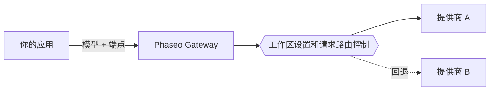

把模型 ID 发送到 Phaseo 的一个端点，Phaseo 就会把请求路由到托管该模型的提供商。你的应用选择模型和端点；你的工作区设置和请求的路由控制决定哪些提供商可以处理它。

## 模型和提供商

模型是生成输出的系统。提供商托管模型，并决定它的可用性、支持的参数、价格和性能。一个模型可以有多个提供商服务。

公开目录中也列出了尚未通过 Gateway 提供的模型。在请求中使用某个 ID 之前，请先查看[模型可用性](../exploring/models.mdx)。

## 请求和路由

使用 [Responses、Chat Completions 或 Messages](../api-reference/introduction.mdx) 中与你应用的协议相匹配的那一个。共用一个端点并不意味着每个模型都支持每个参数；提供商的能力仍然各不相同。

[路由控制](../guides/routing-and-fallbacks.mdx)限制哪些提供商可以处理请求，以及它们如何排序。回退始终在这些限制范围内进行，并取决于可用容量，因此不能保证成功。

## 计费和访问

托管请求使用你的 Phaseo 工作区余额，`:free` 模型无需充值额度即可运行。使用你自己的提供商凭据（BYOK）时，适用提供商的计费和账户限制。上线之前，请查看[价格与计费](../pricing/tiers.mdx)。

[视频和批处理任务](../guides/async-video-and-batch.mdx)会在处理完成之前返回一个任务；它们的预览访问权限按工作区管理。轮询状态或接收 webhook，然后下载结果。

## 后续步骤

通过[快速入门](../quickstart.mdx)发出第一个请求，然后把密钥保存在后端，[将 Gateway 集成](./integrating-with-the-gateway.mdx)到你的应用中。出现问题时，[可靠性与状态](./reliability-and-status.mdx)说明了如何排查，[请求日志](../guides/integrations/observability.mdx)会显示每个请求的用量、延迟、成本和错误。
