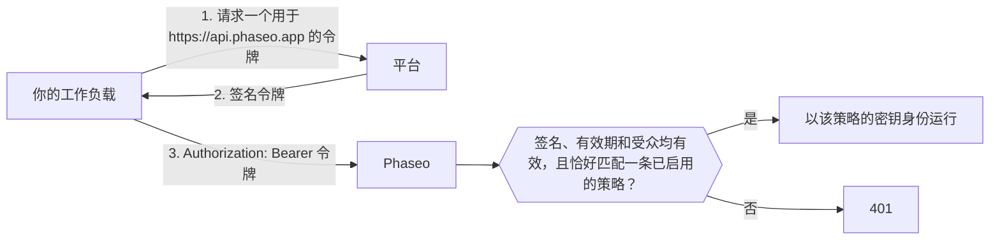

<Note>
受信任的工作负载目前处于 Beta 阶段，正在逐步向各工作区开放。如果你的控制台中没有出现**设置 → API 密钥 → 受信任的工作负载**，说明你的工作区还没有开通。
</Note>

把平台签发的短期 OIDC 令牌作为 Bearer 令牌发送，代替 Phaseo API 密钥，这样你的项目设置或 CI 密钥中就不必保存任何长期有效的凭据。平台会为每个部署、作业或工作负载签发一个带签名的令牌，说明它的身份，例如“`website` 项目的生产部署”或“GitLab 项目 `4815162` 中的一个作业”，该令牌会在几小时内过期。你只需告诉 Phaseo 信任哪些工作负载。

Phaseo 信任来自 Vercel、GitHub Actions、GitLab、Google Cloud、Buildkite、CircleCI 和 AWS 的令牌，也信任你自己运行的 OIDC 签发方签发的令牌，例如 Kubernetes 集群、Bitbucket Pipelines 或自托管的 GitLab。其他场景（例如本地脚本和移动应用）请继续使用 API 密钥。

## 工作原理



工作区所有者或管理员创建一条**信任策略**，指定平台、它信任的所有者（例如 GitHub 所有者、GitLab 项目或 AWS 角色），以及可选条件，例如项目、仓库、分支或环境。匹配的请求会以该策略的密钥身份运行，与使用 API 密钥发出的请求一样，适用相同的速率限制、预算、日志和计费。

令牌必须是为受众 `https://api.phaseo.app` 签发的；Phaseo 会拒绝其他任何受众。大多数平台默认使用的受众由你的工作负载调用的所有服务共享，如果接受这类令牌，你发送给其他服务的令牌就可能被重放到 Phaseo 上。

## 创建信任策略

<Steps>
<Step title="打开受信任的工作负载">
前往**设置 → API 密钥 → 受信任的工作负载**，然后选择**新建策略**。只有工作区所有者和管理员可以管理策略。
</Step>
<Step title="选择平台并填写 ID">
每个平台都会把策略绑定到一个无法被重命名、也无法被他人占用的 ID。名称可能易主，因此 Phaseo 从不单凭名称就信任一个工作负载。

<Tabs>
<Tab title="Vercel">
- **团队 slug**：团队的 slug，即 `vercel.com/<team-slug>` 中的部分。如果你的项目使用 Vercel 的全局签发方模式（签发方为 `https://oidc.vercel.com`，而不是 `https://oidc.vercel.com/<team-slug>`），请留空。
- **团队 ID**：以 `team_` 开头，可在 Vercel 的团队设置中找到。
- **项目 ID**（推荐）：以 `prj_` 开头，可在 Vercel 的项目设置中找到。不填写时，团队中的所有项目都会被信任。
- **环境**：production、preview 或 development。全部不勾选表示接受任意环境。
</Tab>
<Tab title="GitHub Actions">
- **所有者 ID**：拥有该仓库的用户或组织的数字 ID。
- **仓库 ID**（推荐）：仓库的数字 ID。不填写时，该所有者的所有仓库都会被信任。
- **分支或标签**和**环境**（可选）：例如 `refs/heads/main` 或 `production`。

使用 GitHub CLI 获取这两个 ID：

```bash
gh api repos/OWNER/REPO --jq '.id, .owner.id'
```
</Tab>
<Tab title="GitLab">
适用于 GitLab.com 上的项目。自托管的 GitLab 请选择**自定义 OIDC 签发方**。

- **项目 ID**：项目概览页上的数字 ID。项目被重命名或移到其他群组时，它都不会改变，因此 Phaseo 绑定的是这个 ID，而不是群组。
- **分支或标签**（可选）：分支或标签的名称，例如 `main`。
- **环境**（可选）：作业的环境，例如 `production`。

两个条件都留空表示接受该项目中的所有作业。
</Tab>
<Tab title="Google Cloud">
适用于 Cloud Run、Compute Engine、GKE、Cloud Run functions、App Engine 和 Cloud Build 上元数据服务器签发的令牌。

- **服务账号唯一 ID**：Google Cloud 控制台中服务账号详情页上的数字唯一 ID。所有 Google 账号共用同一个签发方，因此要靠这个 ID 区分你的工作负载。不要改用邮箱：服务账号被删除后，其他人可以用相同的邮箱创建新账号。
- **服务账号邮箱**（可选）：额外的校验。只有工作负载使用 `format=full` 请求令牌时，令牌中才会包含邮箱。
</Tab>
<Tab title="Buildkite">
- **组织 ID**：组织的 UUID。每个 Buildkite 令牌都会在 `organization_id` 声明中携带它，因此你可以从某个流水线请求到的令牌中读取。与组织的 slug 不同，它永远不会改变。
- **流水线 slug**（可选）：不填写时，组织中的所有流水线都会被信任。
</Tab>
<Tab title="CircleCI">
- **组织 ID**：可在 **Organization Settings → Overview** 中找到。每个 CircleCI 组织都有自己的签发方 `https://oidc.circleci.com/org/<organisation ID>`，Phaseo 会根据这个 ID 生成它。
- **项目 ID**（可选）：可在 **Project Settings → Overview** 中找到。不填写时，组织中的所有项目都会被信任。
</Tab>
<Tab title="AWS">
适用于 IAM 出站身份联合签发的令牌，它为 IAM 角色提供一个用于外部服务的签名令牌。

- **签发方 URL**：每个 AWS 账号都有自己的签发方，以 `.tokens.sts.global.api.aws` 结尾。运行 `aws iam get-outbound-web-identity-federation-info` 并复制 `IssuerIdentifier`。如果命令失败，请先运行 `aws iam enable-outbound-web-identity-federation` 开启该功能。
- **IAM 角色 ARN**：只接受该角色的令牌，例如 `arn:aws:iam::123456789012:role/evals`。签发方已经标识了你的账号，因此由角色 ARN 来标识工作负载。
</Tab>
<Tab title="自定义 OIDC 签发方">
适用于满足以下全部条件的其他 OIDC 签发方：

- 签发方 URL 是公开的 `https://` URL，不含端口、查询参数或片段，且不在属于上述任一平台的主机上。
- 在 `<issuer>/.well-known/openid-configuration` 提供发现文档。
- 签名密钥（`jwks_uri`）与签发方位于同一主机。
- 使用 RS256、ES256 或 ES384 签名令牌，并能为受众 `https://api.phaseo.app` 签发令牌。

填写：

- **签发方 URL**：按令牌 `iss` 声明中的原样复制，包括末尾的斜杠（如有）。
- **所有者声明**和**所有者值**：每个令牌都必须携带的声明，以及它必须具有的确切值。请选择其他人无法复用的声明（例如数字 ID），而不是可以被重命名或重新注册的名称。
- **额外声明**和**要求的值**（可选）：令牌还必须匹配的另一个声明。

条件只匹配顶层声明。不能使用嵌套声明，例如 Kubernetes 的 `kubernetes.io` 对象。

**Kubernetes（EKS、GKE、AKS）**：每个集群都有自己的签发方。在 EKS 上，运行 `aws eks describe-cluster --name <cluster> --query cluster.identity.oidc.issuer`。在 AKS 上，开启 OIDC 签发方并运行 `az aks show -n <cluster> -g <resource-group> --query oidcIssuerProfile.issuerUrl`。在 GKE 上，签发方为 `https://container.googleapis.com/v1/projects/<project>/locations/<location>/clusters/<cluster>`。使用 `sub` 作为所有者声明，值为 `system:serviceaccount:<namespace>:<service-account>`。

发现端点不公开的自建 Kubernetes 集群无法使用。Phaseo 需要在不带凭据的情况下从互联网获取发现文档和密钥，而大多数集群默认不允许这样做。

**Bitbucket Pipelines**：签发方为 `https://api.bitbucket.org/2.0/workspaces/<workspace>/pipelines-config/identity/oidc`。使用 `workspaceUuid` 作为所有者声明，值要包含花括号，例如 `{a1b2c3d4-...}`。在 step 中请求 Phaseo 受众：

```yaml
- step:
    oidc:
      audiences:
        - https://api.phaseo.app
```

**自托管的 GitLab**：签发方是你的 GitLab URL，例如 `https://gitlab.example.com`。使用 `project_id` 作为所有者声明，值为项目的数字 ID。你的实例必须能从互联网访问。
</Tab>
</Tabs>
</Step>
<Step title="设置可接受的最长令牌">
在**可接受的最长令牌（小时）**中设置你接受的最长有效期。签发时有效期更长的令牌会被拒绝。上限和默认值都是 12 小时，足以覆盖 Vercel 的开发令牌。
</Step>
</Steps>

策略大约在一分钟内生效。关闭或删除策略后，其令牌也会在同样的时间内失效。

## 使用 Terraform 或 API 管理策略

使用具有 `keys:read`、`keys:write` 和 `keys:delete` 能力的[管理密钥](./management-api-keys.mdx)，即可以代码方式管理策略。只有已开通受信任的工作负载的工作区才能使用这些路由。

在 Terraform 中使用 `phaseo_trusted_workload` 资源：

```hcl
resource "phaseo_trusted_workload" "deploy" {
  name     = "GitHub deploy (main)"
  platform = "github_actions"
  owner_id = "123456"

  claim_conditions = {
    repository_id = ["987654321"]
    ref           = ["refs/heads/main"]
  }
}
```

`owner_id` 是该平台所有者声明的值。在平台需要时设置 `issuer`：

| `platform` | `issuer` | 所有者声明 |
| --- | --- | --- |
| `vercel` | 必填：`https://oidc.vercel.com/<team-slug>`，全局签发方模式下为 `https://oidc.vercel.com` | `owner_id`（团队 ID） |
| `github_actions` | 默认为 `https://token.actions.githubusercontent.com` | `repository_owner_id` |
| `gitlab` | 默认为 `https://gitlab.com` | `project_id` |
| `google_cloud` | 默认为 `https://accounts.google.com` | `sub`（服务账号唯一 ID） |
| `buildkite` | 默认为 `https://agent.buildkite.com` | `organization_id` |
| `circleci` | 必填：`https://oidc.circleci.com/org/<organisation ID>` | `oidc.circleci.com/org-id` |
| `aws` | 必填：你账号的签发方 | `sub`（IAM 角色 ARN） |
| `custom` | 必填：你的签发方 URL | 你在 `owner_claim` 中设置的声明 |

对于自定义签发方，还要设置 `owner_claim`：

```hcl
resource "phaseo_trusted_workload" "cluster" {
  name        = "Production cluster"
  platform    = "custom"
  issuer      = "https://oidc.eks.us-east-1.amazonaws.com/id/EXAMPLED539D4633E53DE1B71EXAMPLE"
  owner_claim = "sub"
  owner_id    = "system:serviceaccount:prod:api"
}
```

其他字段：

| 字段 | 取值 |
| --- | --- |
| `claim_conditions` | 声明名称到允许值的映射；每个声明都必须匹配其中一个值。除所有者声明外最多 15 个声明，每个声明最多 20 个值。不能使用 `iss`、`aud`、`exp`、`iat`、`nbf`、`jti` 和所有者声明。 |
| `max_token_lifetime_seconds` | 可接受的最长令牌有效期，`60` 到 `43200`（12 小时）。默认为 `43200`。 |
| `enabled`（Terraform）或 `status`（API：`active` 或 `disabled`） | 是否接受匹配的令牌。 |

更改平台、签发方、所有者声明或所有者会替换该策略。策略不含密钥，因此 Terraform state 中不会保存任何敏感信息。

通过 API 时，将相同的字段发送到 `/v1/workload-identity/policies`。在 API 中，平台字段名为 `provider`：

```bash
curl https://api.phaseo.app/v1/workload-identity/policies \
  -H "Authorization: Bearer $PHASEO_MANAGEMENT_KEY" \
  -H "Content-Type: application/json" \
  -d '{"name":"GitHub deploy (main)","provider":"github_actions","owner_id":"123456","claim_conditions":{"repository_id":["987654321"],"ref":["refs/heads/main"]}}'
```

对于自定义签发方：

```bash
curl https://api.phaseo.app/v1/workload-identity/policies \
  -H "Authorization: Bearer $PHASEO_MANAGEMENT_KEY" \
  -H "Content-Type: application/json" \
  -d '{"name":"Production cluster","provider":"custom","issuer":"https://oidc.eks.us-east-1.amazonaws.com/id/EXAMPLED539D4633E53DE1B71EXAMPLE","owner_claim":"sub","owner_id":"system:serviceaccount:prod:api"}'
```

[API 参考](../api-reference/endpoint/trusted-workloads-create.mdx)列出了所有字段和响应。

## 使用令牌调用 Phaseo

每个 Phaseo SDK 都接受用函数代替 API 密钥，并在每次请求和每次重试之前调用它，因此每个请求都使用当前令牌。除 C++ 外，每个 SDK 都为 GitHub Actions 和 Vercel 提供辅助函数。它会获取为 `https://api.phaseo.app` 签发的令牌，并一直复用到过期前一分钟：

| SDK | GitHub Actions | Vercel |
| --- | --- | --- |
| TypeScript | `githubActionsToken()` | `vercelToken()` |
| Python | `github_actions_token()` | `vercel_token()` |
| Go | `phaseo.GitHubActionsToken()` | `phaseo.VercelToken()` |
| Java | `WorkloadTokens.gitHubActions()` | `WorkloadTokens.vercel()` |
| C# | `WorkloadTokens.GitHubActions()` | `WorkloadTokens.Vercel()` |
| PHP | `WorkloadTokens::githubActions()` | `WorkloadTokens::vercel()` |
| Ruby | `PhaseoSdk::WorkloadTokens.github_actions` | `PhaseoSdk::WorkloadTokens.vercel` |
| Rust | `phaseo::auth::github_actions_token()` | `phaseo::auth::vercel_token()` |
| C++ | 将你自己的函数传给 `set_api_key_provider` | 将你自己的函数传给 `set_api_key_provider` |

辅助函数需要各 SDK 的下一个版本。在 Vercel 上，辅助函数会交换来自 `VERCEL_OIDC_TOKEN_FILE` 或 `VERCEL_OIDC_TOKEN` 的部署令牌。在 Vercel Functions 中，令牌随每个请求通过 `x-vercel-oidc-token` 请求头传入；请将其作为令牌来源传给辅助函数。

在其他平台上，传入你自己的返回令牌的函数，例如读取 GitLab 作业变量或调用 Google Cloud 元数据服务器的函数：

```ts
import Phaseo from "@phaseo/sdk";

const client = new Phaseo({
	apiKey: async () => {
		const response = await fetch(
			"http://metadata.google.internal/computeMetadata/v1/instance/service-accounts/default/identity?audience=https://api.phaseo.app",
			{ headers: { "Metadata-Flavor": "Google" } },
		);
		return response.text();
	},
});
```

<Tabs>
<Tab title="Vercel">
从 `@vercel/oidc` 4.x 的服务器端入口使用 `getVercelOidcToken`。传入 `audience` 后，部署的令牌会被换成为 Phaseo 签发的令牌。

使用 [TypeScript SDK](../sdk-reference/client/overview.mdx) 时，将它作为 `apiKey` 函数传入：

```ts
import Phaseo from "@phaseo/sdk";
import { getVercelOidcToken } from "@vercel/oidc";

const client = new Phaseo({
	apiKey: () => getVercelOidcToken({ audience: "https://api.phaseo.app" }),
});

const response = await client.responses.create({
	model: "openai/gpt-6-astra",
	input: "Hello from a trusted workload",
});
```

将函数作为 `apiKey` 传入需要 `@phaseo/sdk` 3.0.0 之后的版本。

使用任意 HTTP 客户端时，每次请求都获取一个令牌，并将其作为 Bearer 令牌发送：

```ts
import { getVercelOidcToken } from "@vercel/oidc";

const token = await getVercelOidcToken({ audience: "https://api.phaseo.app" });

const response = await fetch("https://api.phaseo.app/v1/chat/completions", {
	method: "POST",
	headers: {
		Authorization: `Bearer ${token}`,
		"Content-Type": "application/json",
	},
	body: JSON.stringify({
		model: "openai/gpt-6-astra",
		messages: [{ role: "user", content: "Hello from a trusted workload" }],
	}),
});
```

不要把令牌保存在模块级变量中：Vercel 可能会在不同请求之间更换令牌。
</Tab>
<Tab title="GitHub Actions">
作业需要 `id-token: write` 权限才能请求令牌。

```yaml
permissions:
  id-token: write
  contents: read

jobs:
  evals:
    runs-on: ubuntu-latest
    steps:
      - uses: actions/github-script@v7
        with:
          script: |
            const token = await core.getIDToken("https://api.phaseo.app");
            const response = await fetch("https://api.phaseo.app/v1/chat/completions", {
              method: "POST",
              headers: {
                Authorization: `Bearer ${token}`,
                "Content-Type": "application/json",
              },
              body: JSON.stringify({
                model: "openai/gpt-6-astra",
                messages: [{ role: "user", content: "Hello from GitHub Actions" }],
              }),
            });
            core.info(String(response.status));
```

在 shell 步骤中，使用 `curl` 请求令牌：

```bash
TOKEN=$(curl -sS -H "Authorization: bearer $ACTIONS_ID_TOKEN_REQUEST_TOKEN" \
  "$ACTIONS_ID_TOKEN_REQUEST_URL&audience=https://api.phaseo.app" | jq -r .value)

curl https://api.phaseo.app/v1/chat/completions \
  -H "Authorization: Bearer $TOKEN" \
  -H "Content-Type: application/json" \
  -d '{"model":"openai/gpt-6-astra","messages":[{"role":"user","content":"Hello"}]}'
```

GitHub Actions 的令牌有效期很短，因此运行时间较长的作业需要重新请求令牌。
</Tab>
<Tab title="GitLab">
在 `.gitlab-ci.yml` 的作业中添加 `id_tokens` 条目。GitLab 会把令牌放进你命名的变量中：

```yaml
evals:
  id_tokens:
    PHASEO_TOKEN:
      aud: https://api.phaseo.app
  script:
    - >
      curl https://api.phaseo.app/v1/chat/completions
      -H "Authorization: Bearer $PHASEO_TOKEN"
      -H "Content-Type: application/json"
      -d '{"model":"openai/gpt-6-astra","messages":[{"role":"user","content":"Hello from GitLab"}]}'
```

令牌的有效期与作业的超时时间相同。
</Tab>
<Tab title="Google Cloud">
向元数据服务器请求令牌。适用于 Cloud Run、Compute Engine、GKE、Cloud Run functions、App Engine 和 Cloud Build：

```bash
TOKEN=$(curl -sS -H "Metadata-Flavor: Google" \
  "http://metadata.google.internal/computeMetadata/v1/instance/service-accounts/default/identity?audience=https://api.phaseo.app")

curl https://api.phaseo.app/v1/chat/completions \
  -H "Authorization: Bearer $TOKEN" \
  -H "Content-Type: application/json" \
  -d '{"model":"openai/gpt-6-astra","messages":[{"role":"user","content":"Hello from Google Cloud"}]}'
```

如果你的策略会校验服务账号邮箱，请在 URL 后加上 `&format=full`。令牌有效期为 1 小时。
</Tab>
<Tab title="Buildkite">
在 step 的命令中用 agent 请求令牌：

```bash
TOKEN=$(buildkite-agent oidc request-token --audience https://api.phaseo.app)

curl https://api.phaseo.app/v1/chat/completions \
  -H "Authorization: Bearer $TOKEN" \
  -H "Content-Type: application/json" \
  -d '{"model":"openai/gpt-6-astra","messages":[{"role":"user","content":"Hello from Buildkite"}]}'
```

令牌默认有效 5 分钟。运行时间更长的 step 请重新请求令牌，或通过 `--lifetime` 传入秒数。
</Tab>
<Tab title="CircleCI">
在作业步骤中用 CircleCI CLI 请求令牌：

```bash
TOKEN=$(circleci run oidc get --claims '{"aud":"https://api.phaseo.app"}')

curl https://api.phaseo.app/v1/chat/completions \
  -H "Authorization: Bearer $TOKEN" \
  -H "Content-Type: application/json" \
  -d '{"model":"openai/gpt-6-astra","messages":[{"role":"user","content":"Hello from CircleCI"}]}'
```

令牌有效期为 1 小时。
</Tab>
<Tab title="AWS">
每个 AWS 账号开启一次出站身份联合，然后以 IAM 角色身份请求令牌。该角色需要 `sts:GetWebIdentityToken` 权限。

```bash
# 每个账号执行一次
aws iam enable-outbound-web-identity-federation

# 在工作负载中
TOKEN=$(aws sts get-web-identity-token --audience https://api.phaseo.app \
  --signing-algorithm ES384 --query WebIdentityToken --output text)

curl https://api.phaseo.app/v1/chat/completions \
  -H "Authorization: Bearer $TOKEN" \
  -H "Content-Type: application/json" \
  -d '{"model":"openai/gpt-6-astra","messages":[{"role":"user","content":"Hello from AWS"}]}'
```

Phaseo 接受 `ES384` 和 `RS256`。令牌默认有效 5 分钟；传入 `--duration-seconds` 最长可达 1 小时。
</Tab>
<Tab title="自定义 OIDC 签发方">
在 Kubernetes 上，挂载一个为 Phaseo 受众签发的投射服务账号令牌：

```yaml
spec:
  serviceAccountName: api
  containers:
    - name: app
      volumeMounts:
        - name: phaseo-token
          mountPath: /var/run/secrets/phaseo
  volumes:
    - name: phaseo-token
      projected:
        sources:
          - serviceAccountToken:
              audience: https://api.phaseo.app
              expirationSeconds: 3600
              path: token
```

每次请求前读取 `/var/run/secrets/phaseo/token`，并将其内容作为 Bearer 令牌发送。Kubernetes 会在令牌过期前更新该文件，因此不要把值保存在内存中。

在 Bitbucket Pipelines 中，设置了 `oidc` 受众的 step 会在 `BITBUCKET_STEP_OIDC_TOKEN` 中获得令牌。
</Tab>
</Tabs>

## 行为与限制

- **与密钥相同的控制。** 请求以策略的密钥身份运行，因此密钥的速率限制、预算、部门关联、IP 允许列表、日志设置和计费都照常适用。
- **仅限模型调用。** 工作负载令牌可用于 Gateway API 密钥可用的地方。管理 API 会拒绝这类令牌。
- **只能匹配一条策略。** 匹配多条已启用策略的令牌会被拒绝。如果这些策略位于不同工作区，请在 `x-phaseo-workspace` 请求头中发送工作区 ID 来指定其中一个。如果它们位于同一工作区，请收窄条件，使只有一条匹配。
- **令牌有效期。** 签发时有效期超过策略中**可接受的最长令牌**的令牌会被拒绝，Phaseo 也从不接受有效期超过 12 小时的令牌。Buildkite 和 AWS 的令牌默认有效 5 分钟；Google Cloud 和 CircleCI 的令牌有效 1 小时。GitLab 令牌的有效期与作业超时时间相同，因此超时时间超过 12 小时的作业会拿到被 Phaseo 拒绝的令牌。AKS 签发的令牌最长可达 24 小时，因此请设置更短的 `expirationSeconds`。
- **暂不支持 Azure。** Azure 托管标识无法为 Phaseo 受众请求令牌。AKS 上的 Pod 仍可以通过自定义签发方使用 Kubernetes 服务账号令牌。
- **API 密钥不受影响。** 受信任的工作负载新增了第二种身份验证方式，不会修改或停用 API 密钥。

## 修复被拒绝的令牌

被拒绝的令牌会返回 `401`，错误代码为 `unauthorised`，并附带以下 `reason` 值之一：

| `reason` | 含义 | 处理方法 |
| --- | --- | --- |
| `workload_token_wrong_audience` | 该令牌不是为 `https://api.phaseo.app` 签发的。 | 使用该受众请求令牌。 |
| `workload_token_malformed` | 该令牌不是格式正确的 OIDC 令牌：缺少密钥 ID、签发方或有效的时间声明。 | 按平台签发的原样发送令牌，不要修改。 |
| `workload_issuer_not_trusted` | 没有已启用的策略使用此令牌的签发方。 | 确认策略已开启，并且其签发方与令牌的 `iss` 声明完全一致，包括 Vercel 团队 slug 或签发方模式，以及自定义签发方末尾的斜杠。 |
| `workload_identity_no_matching_policy` | 令牌有效，但没有已启用的策略与之匹配。 | 检查所有者 ID，项目、仓库、流水线、分支、标签或环境条件，并确认令牌的有效期没有超过策略的**可接受的最长令牌**。 |
| `workload_identity_ambiguous` | 有多条已启用的策略与此令牌匹配。 | 跨工作区时，发送 `x-phaseo-workspace: <workspace id>`。在同一工作区内，收窄这些策略的条件。 |
| `workload_identity_not_enabled` | 此工作区暂时无法使用受信任的工作负载。 | 目前请先使用 API 密钥。 |
| `workload_token_expired` | 令牌已过期。 | 每次请求或每个作业步骤都请求新令牌。 |
| `workload_token_not_yet_valid` | 令牌的 `nbf` 时间比当前时间晚一分钟以上。 | 检查签发令牌的机器的时钟。 |
| `workload_token_lifetime_too_long` | 令牌签发时的有效期超过 12 小时，这是 Phaseo 接受的上限。 | 请求有效期更短的令牌，例如在 Kubernetes 上缩短 `expirationSeconds`，或在 GitLab 上缩短作业超时时间。 |
| `workload_token_too_many_claims` | 自定义签发方的令牌包含超过 100 个不同的顶层声明值。 | 将签发方配置为发送更少的声明，或把额外的值移到嵌套对象中。 |
| `workload_token_unsupported_alg` | 令牌不是用 RS256、ES256 或 ES384 签名的。 | 将签发方配置为使用其中一种算法。 |
| `workload_token_invalid_signature` | 令牌的签名与平台的密钥不匹配。 | 按平台签发的原样发送令牌，不要修改。 |
| `workload_token_key_not_found` | 签发方发布的密钥中不包含签署该令牌的密钥。 | 稍等片刻后重试。对于自定义签发方，请确认其 `jwks_uri` 提供当前的签名密钥。 |
| `key_ip_not_allowed` | 策略对应的密钥设置了 IP 允许列表，但不包含调用方。 | 将工作负载的 IP 地址添加到该密钥的允许列表中。 |
| `workload_jwks_unavailable` | Phaseo 无法获取平台的签名密钥。 | 稍等片刻后重试。对于自定义签发方，请确认 `<issuer>/.well-known/openid-configuration` 无需凭据即可从公网加载，并且其 `jwks_uri` 位于同一主机。 |
