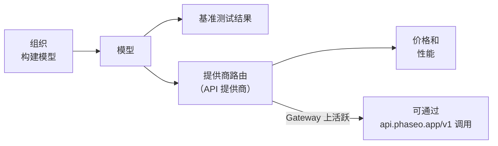

在 [phaseo.app](https://phaseo.app/models) 上查找任意模型，即可看到它由谁构建、由哪些提供商提供、价格多少、得分如何；如果它有活跃路由，还可以通过 Gateway 调用它。

## 目录包含的内容

| 记录 | 是什么 | 在哪里查看 |
| --- | --- | --- |
| [组织](./organisations.mdx) | 构建并发布模型的公司和研究实验室。 | [组织](https://phaseo.app/organisations) |
| [模型](./models.mdx) | 每个已发布的模型，按相关模型归入不同系列。 | [模型](https://phaseo.app/models) |
| [基准测试](./benchmarks.mdx) | 各项评测以及模型在其上获得的分数。 | [基准测试](https://phaseo.app/benchmarks) |
| [API 提供商](./api-providers.mdx) | 通过 API 提供模型服务的平台。 | [API 提供商](https://phaseo.app/api-providers) |
| [价格与性能](./pricing-performance.mdx) | 各提供商按 token、图像、秒或请求计的价格，以及测得的 Gateway 速度。 | 模型页面、[比较](https://phaseo.app/compare) |
| [订阅计划](./subscription-plans.mdx) | Phaseo 的计划，以及提供商销售的订阅。 | [订阅计划](https://phaseo.app/subscription-plans) |

目录中有记录并不代表你可以调用该模型。只有标记为 **Gateway 已启用**的模型才有路由；`GET /v1/models` 只返回这些模型。

## 如何解读数据

- **价格**以 USD 计：文本按每 100 万 token 计，媒体按提供商自己的单位（每张图像、每秒、每次请求）计。
- **日期**为 UTC 日期，英文界面显示为 `01 Jan 2026`。
- **基准测试分数**保留基准测试自身的量表和方向。Phaseo 不会把它们换算成一个统一分数；参见[基准测试](./benchmarks.mdx)。
- **系列**把相关模型归为一组，例如同一模型线的不同规模和版本。

## 数据如何保持最新

提供商同步任务会提出新价格，由管理员审核后发布。基准测试导入和模型生命周期任务会按计划更新数据库。任何人都可以通过 GitHub issue 报告更正或缺失的记录；维护者会审核证据并应用已批准的更改。参见[贡献](../contributing/overview.mdx)。

## 示例问题

| 目标 | 在哪里找答案 |
| --- | --- |
| 在某项基准测试上比较两个模型 | [比较](https://phaseo.app/compare)或该基准测试的页面 |
| 找到适合某项任务的最便宜模型 | 按价格排序的[模型](https://phaseo.app/models)列表，然后使用[价格计算器](https://phaseo.app/tools/pricing-calculator) |
| 查看某项基准测试随时间的变化 | 该基准测试的**进展**图表 |
| 找到支持某项功能的提供商 | 模型页面的**提供商**部分，或 `GET /v1/models/{author}/{slug}/endpoints` |
| 找到可以贡献的记录 | 缺少基准测试或元数据的模型页面；参见[贡献](../contributing/overview.mdx) |
