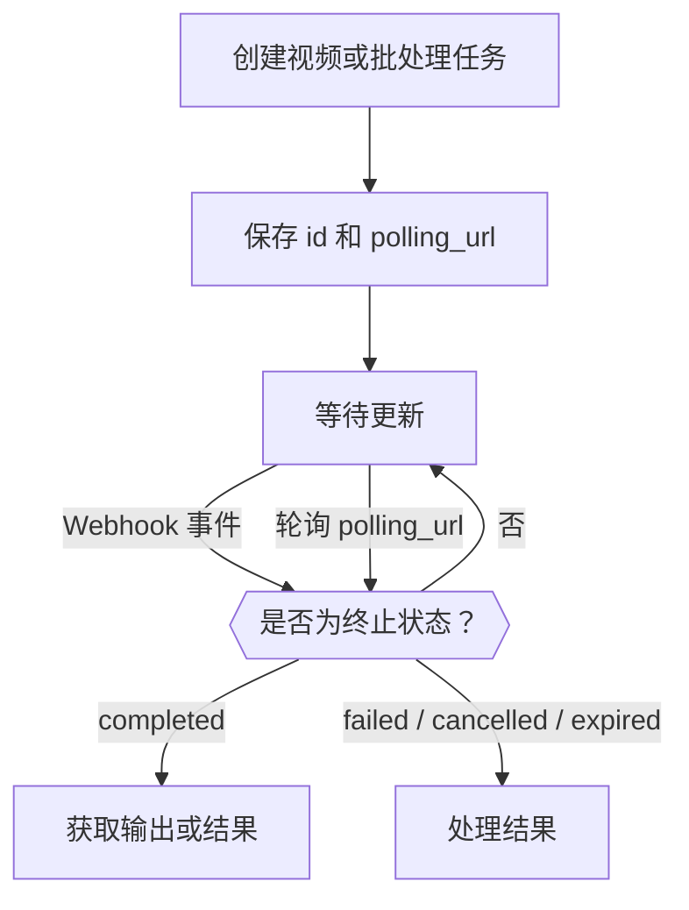

<Note>
Video API 和 Batch API 是仅限受邀工作区使用的 Beta 预览功能。请在**设置 → 功能预览**中查看是否可用。访问权限按工作区管理；启用个人网页偏好设置并不会授予 API 访问权限。模型使用照常计费。
</Note>

创建视频或批处理任务时，会在工作完成之前就返回一个任务。保存它的 `id` 和 `polling_url`，然后等待 Webhook 或进行轮询，直到任务进入终止状态：`completed`、`failed`、`cancelled` 或 `expired`。创建请求成功只表示任务已被接受。



即使使用 Webhook，也请保留轮询路径。Beta 期间，请从小请求开始，并为 API 密钥设置支出上限。参考输入、取消和输出保留期取决于提供商和模型。请在已完成的输出过期之前保存你自己的副本。

<span id="receive-updates"></span>
## 接收更新

创建任一类型的任务时，附加一个属于你工作区的 Webhook 端点：

```json
{
  "webhook": {
    "endpoint_id": "YOUR_ENDPOINT_ID",
    "events": ["job.status_changed", "job.completed", "job.failed", "job.cancelled", "job.expired"]
  }
}
```

Phaseo 会核对提供商状态并发送通知，因此即使是只支持轮询的提供商（例如 Anthropic message batches）也会产生 Webhook。Webhook 投递失败并不表示任务失败。

使用带命名空间的事件类型（例如 `batch.completed` 或 `video.failed`），可以分别订阅 Batch 和 Video 事件。通用的 `job.*` 事件类型仍然有效，会同时订阅两种任务类型的对应阶段。

### 验证并确认投递

使用端点密钥验证 `x-phaseo-signature`：它是对 `x-phaseo-timestamp`、一个英文句点和**未经修改的请求正文**计算出的十六进制 HMAC-SHA256。检查时间戳是否新鲜，按 `x-phaseo-event-id` 去重，并用 2xx 响应确认已接受的投递。投递可能会重试或乱序到达，因此在应用相互冲突的状态变更之前，请先获取任务。

| 尝试 | 时间 |
| --- | --- |
| 1 | 事件发生后立即 |
| 2 | 上一次尝试失败约 1 分钟后 |
| 3 | 约 5 分钟后 |
| 4 | 约 15 分钟后；如果失败，投递会被标记为永久失败 |

2xx 响应会结束投递。重试由后台扫描任务发送，因此重试可能晚于计划时间到达。每次尝试都会记录其序号、时间、HTTP 状态、错误和下次重试时间。即便如此也要去重：确认丢失或工作进程中断都可能使某次投递的结果不确定。

保存端点后，在设置中使用**发送测试**投递一个已签名的 `webhook.test` 负载。测试投递只尝试一次，不会重试，也不会添加到任务的投递历史中。

## 查看任务和请求日志

在**设置 → 使用情况 → 日志**中，使用**请求**查看推理请求详情，使用**视频**查看视频生命周期，使用**批处理**查看批处理任务和各行结果。视频和批处理的详情视图包含计费状态、提供商尝试和 Webhook 尝试。任务可能已成功完成，而它的 Webhook 投递却失败了。

提交视频时，会在联系提供商之前预留额度。如果超时且没有任务 ID，预留会保留下来以便核对；这并不能证明生成失败。如果付费的视频或批处理预留在工作成功后意外按零计价，计费会以 `unexpected_zero_cost` 状态保持未结，以便调查。对于异步生成，仅创建响应显示零成本是正常的。

## 估算视频费用

视频价格取决于提供商和模型。按秒计价的价格必须乘以可计费时长；按片段计价的价格只适用于其指定的时长和分辨率。多个输出和需计费的参考输入可能会增加总额。

LTX 文本/图像生成按输出秒数计费，而音频生成视频按输入音频秒数计费。BytePlus Seedance 使用视频 token，有参考视频时费率不同。MiniMax Hailuo V1 使用固定时长的片段价格；H3 按秒计费，并可能对参考输入收费。请查看所选提供商的计价维度，而不要把标题价格理解为整个请求的费用。

预留是提交前暂扣的估算金额。最终计费使用任务的可计费用量；核对完成后，未使用的预留额度会被释放。提供商支持某个分辨率或选项，并不保证它在 Beta 中可用。

## 设置时长、帧和参考

使用 `seconds` 或 `duration` 设置输出时长。如果两者同时存在，必须一致。使用 `resolution` 搭配 `aspect_ratio`，或使用像素 `size`（例如 `1280x720`）。

使用 `frame_images` 显式指定首帧和尾帧：

```json
{
  "frame_images": [
    {
      "type": "image_url",
      "frame_type": "first_frame",
      "image_url": { "url": "https://example.com/start.png" }
    }
  ],
  "input_references": [
    {
      "type": "image_url",
      "role": "reference",
      "image_url": { "url": "https://example.com/character.png" }
    }
  ]
}
```

参考 URL 必须使用 HTTPS。对于仅作参考的图像，请显式指定 `role: "reference"`：没有 `frame_images` 的旧式请求会把第一个未标注的图像解释为首帧。不要将 `frame_images` 与 `input_references` 中的首帧/尾帧角色或 `input_reference` 组合使用。

视频和音频参考使用 `type: "video_url"` 或 `"audio_url"`，以及 `media_url: { "url": "https://..." }`。不同的模型和提供商支持不同的组合。如果参考时长会影响价格，请以秒为单位提供 `input_video_duration` 和 `input_audio_duration`。

## 传递提供商专用的视频选项

将模型、时长、分辨率、音频生成、输入媒体和输出数量放在规范字段中。将提供商专用的扩展放在规范的提供商 ID 下：

```json
{
  "provider_options": {
    "atlascloud": { "watermark": false, "output_format": "mp4" },
    "byteplus": { "camera_fixed": true }
  }
}
```

只会转发所选提供商的选项。选项不会选择提供商；请使用 `provider` 路由配置来选择。不要将 `provider_options` 与旧版 `provider_params` 组合使用。嵌套选项不能覆盖由 Gateway 控制的计费或回调字段。

| 提供商 | 原生扩展示例 | 参考 |
| --- | --- | --- |
| AtlasCloud Seedance 2.5 | `watermark`、`output_format`、`return_last_frame`、`omni_reference_task_type` | [模型 API](https://www.atlascloud.ai/models/bytedance/seedance-2.5/reference-to-video) |
| Novita Seedance 1.5 | `watermark`、`camera_fixed`、`fps`（24）、`service_tier`（`default`） | [统一视频 API](https://docs.novita.ai/api-reference/reference-unified-video-generation) |
| BytePlus Seedance | `camera_fixed` | 使用前请查看所选模型的提供商契约。 |
| MiniMax V1 | `fast_pretreatment`；提示词优化请使用规范的 `enhance_prompt` | [视频 API](https://platform.minimax.io/docs/api-reference/video-generation-t2v) |

AtlasCloud Seedance 使用原生的 `resolution`、`ratio` 和 `last_image` 字段。它的参考生成视频变体会按顺序接收图像、视频和音频参考。Gateway 的固定时长预留契约不支持自动时长编辑（`duration: -1`）。模型必须先配置好提供商模型可用性和价格才能被路由；提供商选项不会启用不可用的模型。

MiniMax H3 使用 V2：4–15 个整秒，分辨率为 `768P` 或 `2K`。H3 Max 支持 5–15 个整秒，分辨率为 `480P` 或 `768P`，可使用文本或帧图像。H3 支持参考图像、视频和音频；参考不能与首帧/尾帧混用。两个模型每个请求都只生成一个视频，且不支持 V1 的提示词优化选项。请使用规范的 `aspect_ratio`；帧输入会决定自己的比例。参考视频的预留覆盖提供商 15 秒的输入上限，实际用量在完成时结算。参见 [MiniMax V2 契约](https://platform.minimax.io/docs/api-reference/video-generation-v2-create)。

## 查看各批处理提供商支持的内容

批处理请求同样接受 `provider_options`：OpenAI 支持 `output_expires_after`，Mistral 支持 `metadata`。请使用规范的提供商 ID，不要在顶层重复这些字段。例如，`provider_options: { "openai": { "output_expires_after": { "anchor": "created_at", "seconds": 86400 } } }` 会设置 OpenAI 的输出保留期。行输入、模型、端点和 Webhook 目标不能通过选项覆盖。

Mistral 已有原生批处理适配器。Anthropic message batches 通过轮询获取状态；其他提供商可能会将轮询与原生完成通知结合使用。可用性取决于提供商支持的端点和部署的批处理允许列表。提交文件或内联请求之前，请查看批处理能力响应。

Vertex Gemini 批处理接受带 `/v1/generateContent` 的内联 `requests`，或 `model` 和 `prompts`。选择 `provider: "google-vertex"` 即可使用 Vertex。成功的行按批处理费率计费。此适配器需要托管凭据；BYOK、已上传的 Files、嵌入和 `google-vertex-eu` 批处理都不可用。输入上限为 20 MB 和 10,000 个请求。存储的输入和输出在 30 天后过期。

Vertex 结果使用 `custom_id` 标识每个已提交的行，成功的生成结果位于 `response.body`，或者包含该请求的 `error`。输出顺序可能与输入顺序不同。如果某次提交在提供商侧的结果不确定，它会保持在人工审核中，并保留额度暂扣；在确认其结果之前，请避免创建替代任务。

批处理完成时可能包含失败的行。请使用每个结果的 custom ID 逐一检查，而不要假设每一行都成功了。在结果和计费核对完成之前，请保留原始输入和任务 ID。结果不确定的提交必须先调查再重新提交，因为提供商可能已经接受了原始请求。

### 下载批处理结果

受支持的批处理进入终止状态后，它的 `results_url` 会指向一个需要身份验证的 Phaseo 下载地址。请使用拥有该批处理的工作区中的普通 Phaseo API 密钥：

```bash
curl --fail "https://api.phaseo.app/v1/batches/$BATCH_ID/results" \
  -H "Authorization: Bearer $PHASEO_API_KEY" \
  --output results.jsonl
```

对于每个受支持的批处理提供商，响应都通过同一个端点以 JSONL 流式返回。Phaseo 会合并单独的成功文件和错误文件，将内联结果数组转换为 JSONL，并跟随结果分页。生成的内容和每个请求的错误都会保留。行字段保持提供商原生格式：OpenAI 兼容和 Anthropic 的行使用 `custom_id`，Gemini 使用请求元数据，xAI 使用 `batch_request_id`。Anthropic 成功的行在 `result.message` 中包含生成的消息。

下载支持 OpenAI、Anthropic、Google AI Studio、Mistral、Together、Groq、Alibaba Cloud、Moonshot、Parasail、OVHcloud 和 xAI 适配器。提供商可用性仍取决于预览访问权限和提交允许列表；支持下载并不会启用额外的路由。现有的 `output_file_id`、`error_file_id` 和文件内容端点仍然可用。批处理请求行端点包含跟踪和计费元数据，而不是生成的消息正文。

下载结果不会提交另一个批处理，也不会产生推理费用。你不需要提供商凭据。Webhook 只通知任务更新；结果需要单独下载。终止状态的任务可能只有部分结果，或者完全没有输出：处理中时端点返回 `409`，没有可用输出时返回 `404`。请在提供商的保留期结束前保存结果。如果下载中断，请丢弃不完整的文件并重试下载，而不是重新提交批处理。内联 JSON 结果在流式返回时每行有 8 MiB 的安全上限；原生 JSONL 文件流式返回时没有这一行上限。

对于大型输出，TypeScript 的 `client.batches.streamResults(batchId, { signal })` 会返回一个不做缓冲的 `ReadableStream<Uint8Array>`。将它通过管道传到你的目标位置；如需提前停止，请取消该流或中止 signal；没有固定的下载总超时时间。Python 的 `client.batches.stream_results(batch_id)` 会按配置的 HTTP 超时逐块产出字节；提前停止时请关闭迭代器。生成的 `retrieveBatchResults` 操作会返回完整的 JSONL 文本，最适合较小的输出。

### 批处理下载限制

批处理结果下载在滚动的 30 分钟窗口内，每个工作区每个批处理最多允许 10 次尝试，由所有 API 密钥以及 `/batches` 和 `/batch` 别名共享。通过下载准入检查的尝试即使上游下载失败或被取消也会计数。所有权和就绪检查失败的尝试不计数。`429` 响应包含以秒为单位的 `Retry-After`。如果限流器不可用，下载会返回 `503` 并带有 `Retry-After: 30`。
