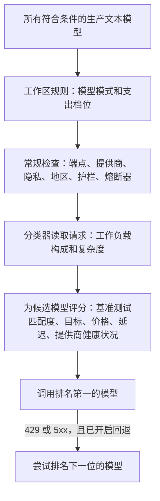

发送 `"model": "phaseo/auto"`，Phaseo 就会根据工作负载、你的工作区目标及其价格上限，为每个请求选择一个模型。自动路由目前处于 Alpha 阶段，仅向部分工作区开放。

```json
{
  "model": "phaseo/auto",
  "input": "Review this TypeScript function for correctness."
}
```

响应中的 `model` 字段会显示由哪个模型作答。

## 如何选择模型



1. **候选模型。** Phaseo 从所有具有已知标准价格的生产文本模型开始，只保留与你的模型模式和支出档位相符的模型。
2. **检查。** 每个候选模型都必须通过与固定模型请求相同的端点、工作区模型、提供商、隐私、护栏和熔断器检查。
3. **分类器。** 一个固定的低成本模型会读取请求，并返回工作负载构成（代码、推理、工具使用等）、复杂度分数和置信度。它从不自己选择模型。请求中的工具和结构化输出会作为可信事实传给它。
4. **评分。** 复杂度决定了可能给出可接受答案的最低能力模型，再加上一定余量。然后，Phaseo 将非自报的目录基准测试与你的目标，以及每个候选模型当前的价格、延迟、健康状况和可靠性结合起来。缺失的数据按中性处理；它永远不会扩大候选名单。

请求无法更改工作区的目标、支出档位或模式。指定了固定模型的请求会完全跳过自动路由。

## 配置自动路由

<Steps>
<Step title="打开自动路由">

前往**控制台 -> 设置 -> 路由 -> 自动路由**。

</Step>
<Step title="选择目标">

| 目标 | 最看重 |
| --- | --- |
| `balanced` | 质量、价格、延迟和可靠性之间的实用平衡。 |
| `quality` | 与工作负载相关的基准测试结果。 |
| `cost` | 更低的输入和输出 token 价格。 |
| `latency` | 更低的近期提供商延迟。 |

</Step>
<Step title="选择支出档位">

每个档位都是标准级文本价格的硬性上限，单位为每百万 token 的 USD 价格。高于上限的模型永远不会被考虑。

| 支出档位 | 最高输入价格 | 最高输出价格 |
| --- | ---: | ---: |
| 经济 | $0.10 | $0.50 |
| 标准 | $0.30 | $1.50 |
| 高级 | $1 | $5 |
| 不限价格 | 无 | 无 |

**自定义**可以自行设置这两个上限。

</Step>
<Step title="缩小模型范围（可选）">

添加模式，例如 `anthropic/*`、`openai/gpt-5.*` 或确切的模型 ID。

</Step>
<Step title="允许回退并保存">

开启回退后，遇到 `429`、`500`、`502`、`503` 或 `504` 时，Phaseo 会尝试排名下一位的模型。每次回退都会重新经过所有检查。客户端错误不会切换模型。

</Step>
</Steps>

使用 CLI：`phaseo routing auto update --objective <o> --spend-profile <p> --allowed-patterns <list> --allow-fallbacks`，用 `phaseo routing auto get` 读取配置。对应的 API 是 `PATCH /v1/routing/auto`。

<Warning>
  支出档位和模式决定哪些模型符合条件。它们并不保证质量，因此请用你自己的工作负载检查最终的模型构成。
</Warning>

## 分类器请求

每个 `phaseo/auto` 请求都会在同一工作区和计费身份下，向分类器模型发起一个独立的子请求。它会以 `purpose=auto_routing_classifier` 和父请求 ID 单独出现在请求日志中，并单独计量。

如果分类器失败、超时或返回无效数据，Phaseo 会改用本地基于规则的分类器（代码、推理、工具使用、结构化输出、翻译、摘要或通用），因此主请求仍会执行。

## 隐私和地区限制

请求上的数据限制同样适用于自动路由：

- 如果设置了 `provider.require_zero_data_retention: true`，或者工作区或密钥护栏只允许零数据保留的提供商，那么只有拥有此类提供商的模型才会进入候选名单。
- 所需地区会与每个候选模型的提供商逐一核对。
- 分类器请求带有相同的限制，以及 `only` 和 `ignore` 提供商列表。如果分类器模型无法满足这些限制，Phaseo 会使用本地分类器。

如果仅因数据驻留要求而没有任何可用模型，请求会以 `403 model_region_unavailable` 和 `unmet_requirements` 失败，与固定模型的行为相同。如果还有模型因其他原因被排除，请求会以 `400 unsupported_model_or_endpoint` 失败。

## 查看路由决策

请求详情会显示工作负载、目标、所选模型、回退顺序、每个候选模型的分数和各因素分数、基准测试 ID、排除项以及算法版本。追踪记录不包含提示词或响应内容。

## 与其他路由方式结合

- **动态路由。** 由已关联的[动态路由](./routing-and-fallbacks#attach-routing-rules-to-api-keys)选定的固定模型优先。该覆盖会被记录，并且该请求不会使用自动路由的回退。
- **请求级回退。** `phaseo/auto` 自行管理排序后的回退，因此不能与 [`models` 列表](./routing-and-fallbacks#request-level-model-fallbacks)组合使用，也不能出现在其中。
