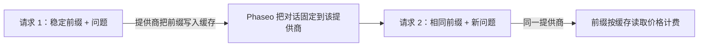

让各个请求的提示词开头保持一致，提供商就会从缓存中读取这部分内容，而不是重新处理：这些 token 按缓存读取价格计费，第一个 token 也会更快返回。大多数提供商会自动缓存重复的前缀。Claude 只缓存你用 `cache_control` 标记的内容。



提示词缓存仍会对每个请求执行推理。它不会对相同的请求直接返回之前的回答。

## 缓存提示词

标记稳定部分的最后一个块。从开头到该块（含）的所有内容都会被缓存。

<CodeGroup>
```bash Chat Completions
curl https://api.phaseo.app/v1/chat/completions \
  -H "Authorization: Bearer $PHASEO_API_KEY" \
  -H "Content-Type: application/json" \
  -d '{
    "model": "anthropic/claude-sonnet-5.5",
    "messages": [
      {
        "role": "system",
        "content": [
          {
            "type": "text",
            "text": "You are a support assistant. Follow the company policy exactly.",
            "cache_control": { "type": "ephemeral", "ttl": "1h" }
          }
        ]
      },
      { "role": "user", "content": "Summarise the latest ticket." }
    ]
  }'
```

```bash Responses
curl https://api.phaseo.app/v1/responses \
  -H "Authorization: Bearer $PHASEO_API_KEY" \
  -H "Content-Type: application/json" \
  -d '{
    "model": "anthropic/claude-sonnet-5.5",
    "input": [
      {
        "role": "user",
        "content": [
          {
            "type": "input_text",
            "text": "Reference document: Refunds are available for 30 days when...",
            "cache_control": { "type": "ephemeral", "ttl": "5m" }
          },
          {
            "type": "input_text",
            "text": "Answer this customer: Can I return an item after 20 days?"
          }
        ]
      }
    ]
  }'
```

```bash Anthropic Messages
curl https://api.phaseo.app/v1/messages \
  -H "Authorization: Bearer $PHASEO_API_KEY" \
  -H "Content-Type: application/json" \
  -d '{
    "model": "anthropic/claude-sonnet-5.5",
    "max_tokens": 512,
    "system": [
      {
        "type": "text",
        "text": "You are a careful support assistant. Use the policy below.",
        "cache_control": { "type": "ephemeral", "ttl": "1h" }
      }
    ],
    "messages": [
      {
        "role": "user",
        "content": [
          {
            "type": "text",
            "text": "Policy: refunds are available for 30 days when...",
            "cache_control": { "type": "ephemeral", "ttl": "5m" }
          },
          { "type": "text", "text": "Can this customer return an item after 20 days?" }
        ]
      }
    ],
    "tools": [
      {
        "name": "lookup_order",
        "description": "Look up order status.",
        "input_schema": {
          "type": "object",
          "properties": { "order_id": { "type": "string" } },
          "required": ["order_id"]
        },
        "cache_control": { "type": "ephemeral", "ttl": "5m" }
      }
    ]
  }'
```
</CodeGroup>

然后检查缓存是否生效：

1. 发送一次请求以写入缓存。
2. 使用相同的可缓存内容再次发送。
3. 查看响应用量中的 `cached_tokens` 和 `cache_write_tokens`（参见[用量与定价字段](#usage-and-pricing-fields)），以及请求详情中的缓存计量项。
4. 比较多次调用的延迟和成本，而不只看第一次。

缓存在各请求之间保持不变的内容：较长的系统指令、复用的文档、少样本示例、工具定义，以及下一轮会再次发送的大型工具结果。不要标记每次请求都会变化的内容、简短的一次性输入，或你的政策不允许提供商存储的数据。

<Note>
Phaseo 只会向每个提供商发送其文档中支持的缓存控制，其余的都会移除。缓存控制永远不会把某个提供商排除在路由之外。每个模型页面都会列出其缓存读取和写入价格。
</Note>

## 哪些提供商会自动缓存

| 提供商 | 缓存方式 | Phaseo 发送的内容 |
| --- | --- | --- |
| [OpenAI](https://developers.openai.com/api/docs/guides/prompt-caching)、[Azure OpenAI](https://learn.microsoft.com/en-us/azure/foundry/openai/how-to/prompt-caching) | 对 1,024 个 token 及以上的提示词自动缓存 | `prompt_cache_key`；GPT-5.6 及更高版本发送断点和 `prompt_cache_options`；更早的模型发送 `prompt_cache_retention` |
| Anthropic、Claude on AWS、Amazon Bedrock 和 Google Vertex AI 上的 [Anthropic Claude](https://platform.claude.com/docs/en/build-with-claude/prompt-caching) | 需主动启用 | `cache_control` 断点，每个请求最多四个 |
| Google AI Studio 和 [Vertex AI](https://docs.cloud.google.com/vertex-ai/generative-ai/docs/context-cache/context-cache-overview) 上的 [Google Gemini](https://ai.google.dev/gemini-api/docs/caching) | Gemini 2.5 及更高版本自动缓存 | 对你创建的显式缓存发送 `cached_content` |
| [xAI](https://docs.x.ai/developers/advanced-api-usage/prompt-caching/maximizing-cache-hits) | 自动 | `prompt_cache_key` 和 `x-grok-conv-id` 请求头 |
| [DeepSeek](https://api-docs.deepseek.com/guides/kv_cache) | 自动 | 无需额外内容 |
| [Moonshot AI](https://platform.kimi.ai/docs/guide/context-caching) | 自动，TTL 为 5 分钟；Kimi K3 可主动启用 1 小时 TTL | `prompt_cache_key` 和 `prompt_cache_options` |
| [Groq](https://console.groq.com/docs/prompt-caching) | 对 Groq 列出的模型自动缓存 | 无需额外内容 |
| [Fireworks](https://docs.fireworks.ai/guides/prompt-caching) | 自动 | `prompt_cache_key`，以及 `x-session-affinity` 请求头和 `user` |
| [Cerebras](https://inference-docs.cerebras.ai/capabilities/prompt-caching) | 自动 | `prompt_cache_key` |
| [Cloudflare Workers AI](https://developers.cloudflare.com/workers-ai/features/prompt-caching) | 对部分模型自动缓存 | `x-session-affinity` 请求头 |
| [Together AI](https://docs.together.ai/docs/inference/chat/prompt-caching)、[Mistral](https://docs.mistral.ai/studio-api/conversations/advanced/prompt-caching) | 自动；`prompt_cache_key` 可提高命中率 | `prompt_cache_key` |
| [Alibaba Model Studio](https://www.alibabacloud.com/help/en/model-studio/context-cache) | 自动（隐式）；显式缓存需主动启用 | 块级 `cache_control` |
| [Venice](https://docs.venice.ai/overview/guides/prompt-caching) | 自动；Venice 会自行添加 Claude 断点 | 块级 `cache_control` |
| [DeepInfra](https://docs.deepinfra.com/chat/prompt-cache-retention) | 自动；保留时间窗口需主动启用 | `prompt_cache_key`、`prompt_cache_breakpoint` 和 `prompt_cache_options` |
| [Inference.net](https://inference.net/models/claude-opus-5/) | 自动；Claude 和 Gemini 2.5 模型支持显式缓存 | 在 Claude 和 Gemini 2.5 模型上发送块级 `cache_control`，不带 `ttl` |
| [Baseten](https://docs.baseten.co/inference/model-apis/pricing-and-limits) | 自动 | `prompt_cache_key` 和 `x-session-affinity` 请求头 |
| [Morph](https://docs.morphllm.com/sdk/components/caching) | 自动 | `prompt_cache_key` 和 `x-session-id` 请求头 |

其他 OpenAI 兼容的提供商在其 API 接受 `prompt_cache_key` 时会收到该字段，不会收到其他缓存控制。Phaseo 发送的始终是你的工作区和键的哈希值，而不是键本身；参见[提供商亲和性](#provider-affinity)。

<span id="cache-controls"></span>
## 缓存控制

### 让 Phaseo 放置 Claude 断点

在 Chat Completions、Responses 或 Anthropic Messages 上设置顶层 `cache_control`，就会为 Claude 路由开启缓存，并由 Phaseo 替你放置断点。其他提供商会忽略它。

```json
{
  "cache_control": { "type": "ephemeral", "ttl": "5m" }
}
```

对短期共享上下文使用 `ttl: "5m"`（默认值）；当模型支持更长寿命的缓存条目时，使用 `ttl: "1h"`。顶层 `cache_control` 还会让对话保持在同一个提供商上；参见[提供商亲和性](#provider-affinity)。

`provider_options.anthropic.cache_control` 是同一个设置，并且还接受 `scope`。当请求同时发送两者时，以 `provider_options` 中的值为准：

```json
{
  "provider_options": {
    "anthropic": {
      "cache_control": { "type": "ephemeral", "ttl": "5m", "scope": "agent" }
    }
  }
}
```

| `scope` | Phaseo 放置断点的位置 |
| --- | --- |
| `all_text`（默认） | 系统文本，以及最近三条包含文本或图像的用户消息。 |
| `last_user_message` | 仅最新的用户消息。 |
| `agent` | 用于工具循环：最后一个工具定义、系统文本、最后一条消息（包括工具结果），以及上一步的消息。`conversation` 是它的别名。 |
| `none` | 不放置。 |

多步工具循环请使用 `agent`。`all_text` 和 `last_user_message` 不会标记只包含工具结果的消息，因此缓存的前缀会停止增长。无法识别的 `scope` 值会被当作 `agent` 处理。

你自己在块上设置的断点优先于默认策略，并计入 Anthropic 每个请求最多四个的限制：默认策略添加到四个标记时就会停止。如果你自己的块带有超过四个标记，Phaseo 会保留第一个和最近的三个，移除其余的，以免请求被拒绝。

### 块上的缓存断点

内容块上的缓存标记会缓存从开头到该块（含）的所有内容。Phaseo 接受两种写法：

- `cache_control`：`{"type": "ephemeral"}`，可选的 `ttl` 为 `5m` 或 `1h`。
- `prompt_cache_breakpoint`：OpenAI 的 `{"mode": "explicit"}`，可选的 `ttl` 为 `30m` 或 `12h`（参见 [OpenAI 的 12 小时缓存](#12-hour-cache-on-openai)）。当一个块同时带有两者时，以 `prompt_cache_breakpoint` 为准。

在 Chat Completions 和 Responses 上，可以在文本和图像部分、函数工具定义，以及内容为文本部分数组的工具结果上添加标记。Anthropic Messages 在 Anthropic 接受的所有位置都接受 `cache_control`：`system` 文本块、消息中的文本和图像块、工具结果块以及工具定义。当一个请求中有多种 TTL 时，Anthropic 要求 `1h` 断点排在 `5m` 断点之前。

每个提供商会以自己的形式收到标记：

| 提供商 | 块级 `cache_control` | `prompt_cache_breakpoint` |
| --- | --- | --- |
| Anthropic、Claude on AWS、Amazon Bedrock 和 Google Vertex AI 上的 Claude | 以 `{"type": "ephemeral"}` 发送，带上你的 `ttl` | 以 `cache_control: {"type": "ephemeral"}` 发送 |
| OpenAI，GPT-5.6 及更高版本 | 以 `prompt_cache_breakpoint: {"mode": "explicit"}` 发送；丢弃 `ttl` | 发送，带上其 `ttl` |
| Azure OpenAI，GPT-5.6 及更高版本 | 以 `prompt_cache_breakpoint: {"mode": "explicit"}` 发送；丢弃 `ttl` | 发送，不带 `ttl` |
| OpenAI 和 Azure OpenAI，更早的模型 | 移除 | 移除 |
| DeepInfra | 移除 | 发送，不带 `ttl` |
| Alibaba Model Studio 和 Venice | 发送 | 移除 |
| Inference.net，Claude 和 Gemini 2.5 模型 | 发送，不带 `ttl` | 移除 |
| 其他提供商 | 移除 | 移除 |

工具定义上的标记只会到达 Claude 路由、Alibaba Model Studio、Venice，以及 Inference.net 的 Claude 和 Gemini 2.5 模型；OpenAI 不接受工具上的断点。移除标记不会改变提示词的其余部分，因此缓存的前缀与未标记的请求一致。

Amazon Bedrock 和 Google Vertex AI 对 Claude 3.7 Sonnet、3.5 Sonnet 和 3 Opus 只缓存 5 分钟，并且 Bedrock 可能会拒绝这些模型上的 `ttl`。在这些路由上，Phaseo 发送的断点不带 `ttl`，因此缓存 5 分钟；被移除的 `1h` 会作为 `cache_control.ttl` 报告在 `X-Phaseo-Dropped-Params` 响应头和 `meta.routing.dropped_params` 中。Inference.net 的文档中断点不带 `ttl`，因此 Phaseo 在那里也会以同样方式移除并报告 `ttl`，写入按 5 分钟写入计费。

<span id="openai-retention-and-options"></span>
### OpenAI 的保留时间与选项

OpenAI 的缓存控制取决于模型代际。Phaseo 只在被接受的地方发送每个字段：

| 字段 | 取值 | 发送给 |
| --- | --- | --- |
| `prompt_cache_options` | `mode`：`implicit` 或 `explicit`；`ttl`：`30m`（默认）或 `12h` | OpenAI GPT-5.6 及更高版本 |
| `prompt_cache_options` | `mode`：`implicit` 或 `explicit`；`ttl`：`30m` | Azure OpenAI GPT-5.6 及更高版本 |
| `prompt_cache_options` | `mode`：`explicit`；`ttl`：`5m` 或 `1h` | DeepInfra |
| `prompt_cache_options` | `mode`：`implicit`；`ttl`：`5m`（默认），Kimi K3 上可为 `1h` | Moonshot AI |
| `prompt_cache_retention` | `in_memory` 或 `24h` | GPT-5.6 之前的 OpenAI 和 Azure OpenAI 模型 |

`explicit` 模式只缓存你放置的断点。DeepInfra 还要求会话中的每个请求都带上 `prompt_cache_key`。Phaseo 只会把 Moonshot AI 的 `1h` 发送给有 1 小时写入价格的 Kimi K3 路由，因此这些写入按该价格计费；在其他路由上，Phaseo 会移除 `ttl`，并作为 `prompt_cache_options.ttl` 报告在 `X-Phaseo-Dropped-Params` 响应头中。其他提供商不会收到这两个字段。

两个字段都可以放在顶层，或放在 `provider_options.openai` 下。两处都有时，以顶层的值为准：

```json
{
  "prompt_cache_retention": "24h",
  "provider_options": {
    "openai": { "prompt_cache_retention": "in_memory" }
  }
}
```

这里请求使用的是 `24h`。

<span id="12-hour-cache-on-openai"></span>
### OpenAI 的 12 小时缓存

在 GPT-5.6 及更高版本上，当你设置 `ttl: "12h"` 时，OpenAI 会把缓存条目保留至少 12 小时；可以在 `prompt_cache_options` 中为整个请求设置，也可以在 `prompt_cache_breakpoint` 中为单个断点设置。没有自己 `ttl` 的断点使用请求级的值。OpenAI 对 12 小时写入按输入价格的 2.5× 计费，对 30 分钟写入按 1.25× 计费；两者的缓存读取价格相同。

```json
{
  "model": "openai/gpt-5.6-sol",
  "prompt_cache_options": { "ttl": "30m" },
  "input": [
    {
      "role": "developer",
      "content": [
        {
          "type": "input_text",
          "text": "Shared tool manual...",
          "prompt_cache_breakpoint": { "mode": "explicit", "ttl": "12h" }
        }
      ]
    },
    { "role": "user", "content": "Find the failing test." }
  ]
}
```

- OpenAI 只在其 Responses API 上提供 12 小时有效期的文档。请求 12 小时缓存的 Chat Completions 请求会在 OpenAI 的 Responses API 上运行，响应仍保持 Chat Completions 格式。
- 支持 12 小时缓存的路由会被优先尝试：即 OpenAI 自己的 API（`openai` 和 `openai-eu`），且模型为 GPT-5.6 或更高版本、价格卡中有 12 小时写入价格。其他任何路由，例如 Azure OpenAI、其他提供商或 GPT-5.6 之前的模型，收到的请求都不带该设置，因此适用 30 分钟的默认值。请求仍会执行，被移除的字段会作为 `prompt_cache_options.ttl` 或 `prompt_cache_breakpoint.ttl` 报告在 `X-Phaseo-Dropped-Params` 响应头和 `meta.routing.dropped_params` 中。

### 使用显式 Gemini 缓存

Gemini 2.5 及更高版本会隐式缓存，无需发送任何内容。要使用你通过 Google 缓存 API 创建的显式缓存，请在 `provider_options.google.cached_content` 中传入其名称：

```json
{
  "provider_options": {
    "google": { "cached_content": "cachedContents/abc123" }
  }
}
```

- 在 Google AI Studio 上，`cached_content` 只能配合你自己的 Google API 密钥（BYOK）使用。使用 Phaseo 的密钥时请求会返回 `400`，因为缓存属于创建它的账户。
- 在 Vertex AI 上，`cached_content` 只能配合你自己的 Vertex AI 凭据使用；使用 Phaseo 的凭据时请求会返回 `400`。请发送缓存的完整名称 `projects/{project}/locations/{location}/cachedContents/{id}`，Phaseo 会把请求发送到该项目和位置。`cachedContents/abc123` 这样的短名称会使用你服务账号 JSON 中的 `project_id` 和 `region`，缺少任一项时返回 `400`。
- Google 不支持在 Gemini 4 Argon 及更高版本上使用显式缓存。

`provider_options.google.cache_control` 和 `provider_options.google.cache_ttl` 会被接受，但不会发送给 Google。

### Responses：发送完整对话

Phaseo 不存储响应。设置了 `previous_response_id` 或 `conversation` 的请求会返回 `400` `unsupported_param`，因此每一步都要在 `input` 中发送完整对话。对话中稳定的开头部分就是被缓存的前缀。在工具循环中，也要把 `reasoning` 输出项发送回来；参见[工具循环中的推理](../api-reference/endpoint/responses.mdx#reasoning-in-tool-loops)。

<span id="usage-and-pricing-fields"></span>
## 用量与定价字段

每个文本端点都会报告缓存读取和写入。Chat Completions 和 Responses 遵循 OpenAI 的语义：输入计数包含缓存读取和写入。Anthropic Messages 遵循 Anthropic 的语义：`input_tokens` 不包含它们。

| 端点 | 总输入 | 缓存读取 | 缓存写入 |
| --- | --- | --- | --- |
| Chat Completions | `prompt_tokens`，包含读取和写入 | `prompt_tokens_details.cached_tokens` | `prompt_tokens_details.cache_write_tokens` |
| Responses | `input_tokens`，包含读取和写入 | `input_tokens_details.cached_tokens` | `input_tokens_details.cache_write_tokens`；在 OpenAI GPT-5.6 及更高版本上，按有效期拆分到 `input_tokens_details.cache_write_tokens_details.ttl_30m_tokens` 和 `ttl_12h_tokens` |
| Anthropic Messages | `input_tokens` + `cache_read_input_tokens` + `cache_creation_input_tokens` | `cache_read_input_tokens` | `cache_creation_input_tokens`，按 TTL 拆分到 `cache_creation.ephemeral_5m_input_tokens` 和 `cache_creation.ephemeral_1h_input_tokens` |

在 Chat Completions 和 Responses 上，未缓存输入 = 总输入 − 缓存读取 − 缓存写入。流式的 Anthropic Messages 响应在 `message_delta` 上携带缓存字段。Chat Completions 的用量没有按有效期拆分，因为 OpenAI 在那里没有相关文档；请求详情中仍会记录。

<Note>
以前的响应把缓存写入报告为 `output_tokens_details.cached_tokens`（在 Chat Completions 上为 `completion_tokens_details.cached_tokens`），而 Claude 路由在 Chat Completions 和 Responses 上没有把缓存读取和写入计入 `input_tokens`。现在这两点都不再适用：请从 `cache_write_tokens` 读取写入量。非流式的 Anthropic Messages 响应过去返回 `cache_creation_input_tokens: null`；现在会返回实际计数。
</Note>

请求详情和定价明细使用以下计量项：

| 计量项 | 计数内容 |
| --- | --- |
| `cached_read_text_tokens` | 缓存读取。 |
| `cached_write_text_tokens` | 缓存写入，适用于提供商只有一个缓存写入价格的情况。 |
| `cached_write_text_tokens_5m`、`cached_write_text_tokens_1h` | TTL 为 5 分钟或 1 小时的 Claude 缓存写入，适用于提供商分别报告的情况。 |
| `cached_write_text_tokens_30m`、`cached_write_text_tokens_12h` | 有效期为 30 分钟或 12 小时的 OpenAI 缓存写入。 |

### 缓存 token 如何计费

Phaseo 对每个输入 token 只按一种价格计费一次：未缓存输入按输入价格，缓存读取按缓存读取价格，缓存写入按缓存写入价格；当提供商分别定价时，按 5 分钟和 1 小时价格（Claude）或 30 分钟和 12 小时价格（OpenAI）计费。有些提供商把缓存写入计入输入总数，有些则在输入总数之外单独报告；无论哪种方式，写入的 token 都不会再按普通输入重复计费。

例如，按示例价格计算：每 1M 输入 token $5.00，缓存读取 $0.50，30 分钟缓存写入 $6.25，输出 $30.00。一个请求有 53,100 个输入 token，其中 48,000 个是缓存读取、3,000 个是缓存写入，另有 850 个输出 token，费用为：

| Token | 每 1M 价格 | 费用 |
| --- | ---: | ---: |
| 2,100 未缓存输入 | $5.00 | $0.01050 |
| 48,000 缓存读取 | $0.50 | $0.02400 |
| 3,000 缓存写入 | $6.25 | $0.01875 |
| 850 输出 | $30.00 | $0.02550 |
| 合计 | | $0.07875 |

如果其中 2,000 个写入的有效期是 12 小时，它们的价格将是每 1M $12.50 而不是 $6.25，请求费用为 $0.09125。

有些提供商在某些模型上不对缓存 token 打折。这些模型页面上的输入价格和缓存读取价格相同。

### 路由尚无缓存价格时

如果提供商在目录中尚无缓存价格的路由上报告了缓存 token，请求不会失败：

- 缓存读取按该路由的输入价格计费。
- 缓存写入按输入价格乘以提供商文档中的写入倍数计费。
- 定价行会标记为 `pricing_fallback: "input_rate"`。

| 写入 | 输入价格的倍数 |
| --- | --- |
| Claude，任意平台 | 5 分钟写入 1.25×，1 小时写入 2× |
| OpenAI 30 分钟写入，任意路由 | 1.25× |
| OpenAI 12 小时写入，任意路由 | 2.5× |
| OpenAI、Azure OpenAI 和 Alibaba，其他写入 | 1.25× |
| Moonshot AI 和 Kimi K3 | 5 分钟写入 1×，1 小时写入 2× |
| 其他提供商 | 1× |

在目录中只有一个缓存写入价格的 Claude 路由上，该价格即 5 分钟价格。提供商报告为 1 小时写入的部分按输入价格的 2× 计费，记在标记为 `pricing_fallback: "input_rate"` 的 `cached_write_text_tokens_1h` 行上。

流式 Claude 响应的最后一个 `message_delta` 报告的是缓存写入总数，不按 TTL 拆分。超出拆分部分的写入按 5 分钟写入计费，因为即使请求要求 1 小时，服务器工具的写入也可能使用 5 分钟。

<span id="provider-affinity"></span>
## 提供商亲和性

提示词缓存只存在于一个提供商上，通常还限于该提供商的某个区域或部署。Phaseo 会把相关请求保持在之前处理它们的提供商和路由上，这样智能体循环就不必花钱在别处重建缓存。

发送 `prompt_cache_key` 或 `session_id`，或者通过 `cache_control` 启用缓存（顶层、`provider_options.anthropic.cache_control`，或消息块或工具上的 `cache_control` 或 `prompt_cache_breakpoint` 标记），即可固定一个对话。Phaseo 会把它固定到处理第一个成功请求的提供商和路由，之后带有相同键的请求也会去那里。固定按工作区、端点和模型分别保存。

固定的持续时间取决于提供商的缓存保留时间：

| 请求 | 固定持续时间 |
| --- | --- |
| `session_id` | 24 小时，会话活跃期间会刷新 |
| 带 `ttl: "1h"` 的 Anthropic `cache_control` | 90 分钟 |
| 带 `prompt_cache_retention: "24h"` 的 OpenAI 或 Azure OpenAI | 24 小时 |
| 使用内存保留（默认）的 OpenAI 或 Azure OpenAI | 90 分钟 |
| 在 `prompt_cache_options` 或断点上设置 `ttl: "12h"` 的 OpenAI，或报告了 12 小时写入 | 18 小时 |
| 带 `prompt_cache_options.ttl: "30m"` 的 OpenAI 或 Azure OpenAI | 45 分钟 |
| 其他情况 | 15 分钟 |

只有在以下情况下，固定才会转移：其提供商出现故障（熔断器打开或近期错误率较高）、Phaseo 在该提供商上的托管配额用完，或者当前的路由、预设、护栏或请求策略不再允许它。此时请求会故障转移，固定会转移到实际处理请求的提供商。请求详情会在路由诊断中将此记录为 `sticky_routing.demotionReason`。被固定的请求不会被用来探测正在恢复的提供商。

即使没有键、`session_id` 或缓存标记，只要某个提供商报告了对开头上下文的缓存读取或缓存写入，并且该提供商的缓存输入比标准输入便宜，Phaseo 仍会把这段开头上下文固定到该提供商 15 分钟。

Phaseo 发送给提供商的是你的工作区与 `prompt_cache_key` 的哈希值，从不发送原始键，因此两个工作区中的相同键永远不会共享提供商缓存。如果只有 `session_id`，Phaseo 会为 OpenAI、xAI、Fireworks 和 Cerebras 从会话推导出该哈希值。Fireworks、Cloudflare Workers AI 和 Baseten 还会在 `x-session-affinity` 请求头中收到它，Morph 在 `x-session-id` 请求头中收到，xAI 则以 `x-grok-conv-id` 收到（除非你设置了 `provider_options.xai.conversation_id`）。响应仍会回显你自己的 `prompt_cache_key`。

将 `provider.cache_aware_routing` 设为 `false` 可以为单个请求关闭此行为。如果请求带有 `session_id`，但只应使用常规的基于上下文的路由，请将 `routing.session_affinity` 设为 `false`；此时 Phaseo 也不会再从会话推导提供商缓存键。关于亲和性如何与提供商顺序和回退配合，请参见[路由与回退](./routing-and-fallbacks.mdx)。所有缓存字段也都列在[参数参考](../api-reference/parameters.mdx)中。
