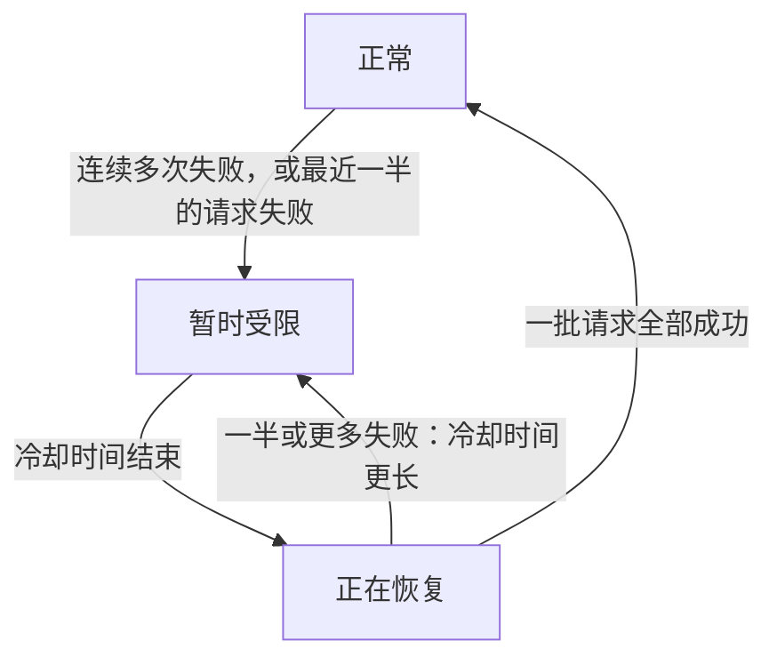

import { ProviderStatusExplorer } from "/snippets/provider-status.jsx";

提供商的模型服务具有相互独立的上游状态和 Phaseo 状态。当提供商已发布模型，但 Phaseo 尚未实现或启用对应端点时，这一点尤为重要。

你可以在模型页面、提供商定价卡片和相关可用性界面中看到这些字段。

## 提供商可用性

提供商可用性描述上游服务的状态。

| 状态 | 含义 |
| --- | --- |
| `Available` | 提供商当前接受对此服务的请求。 |
| `Preview` | 提供商以预览形式开放此服务。 |
| `Limited Access` | 服务已存在，但访问受账户、区域、允许列表或容量限制。 |
| `Coming Soon` | 提供商已宣布或列出此服务，但目前尚不可用。 |
| `Deprecated` | 服务仍可使用，但提供商建议迁移。 |
| `Removed` | 提供商已停止提供此服务。 |
| `Unknown` | Phaseo 尚未验证上游可用性。 |

提供商可用不代表 Phaseo 能够路由请求。

## Phaseo 集成状态

Phaseo 状态描述我们的实现和发布进度。

| 状态 | 含义 | Phaseo 路由 |
| --- | --- | --- |
| `Unsupported` | Phaseo 没有与此服务兼容的集成。 | 不可路由。 |
| `Planned` | 集成工作已获批准，但尚未开始。 | 不可路由。 |
| `Implementing` | 集成工作正在进行。 | 不可路由。 |
| `Testing` | 已实现，正在进行契约、预发布或金丝雀测试。 | 不可公开路由。 |
| `Enabled` | 已支持并启用，可用于生产环境。 | 满足路由开关和健康条件时可路由。 |
| `Disabled` | Phaseo 已主动关闭此集成。 | 不可路由。 |
| `Blocked` | 外部或未解决的依赖项阻止了发布。 | 不可路由。 |

只有状态为 `Enabled` 的集成才能启用公共路由。

## 内部访问

访问范围与 Phaseo 集成状态相互独立：

| 范围 | 含义 |
| --- | --- |
| `Public` | 所有路由检查通过后，普通客户请求可以使用此路由。 |
| `Internal` | 只有经过身份验证的 Phaseo 测试流量可以使用此路由。 |

内部路由需要高熵内部令牌，以及明确启用测试模式的请求。客户不能只凭测试请求头启用内部路由。普通请求不会查询数据库来查找内部路由，而是使用现有的默认上下文缓存。内部测试使用独立缓存分区，并且只会考虑明确标记为内部、上游服务可用且 Phaseo 状态为 `Testing` 或 `Enabled` 的路由。

## 路由健康状态

路由健康状态是第三种运维信号，用于说明当前应如何选择已启用的路由。

| 图标 | 状态 | 含义 | 路由行为 |
| --- | --- | --- | --- |
| <Icon icon="circle-check" color="#16a34a" /> | `Active` | 路由健康状况足以正常选择。 | 当前可路由。 |
| <Icon icon="triangle-alert" color="#f59e0b" /> | `Deranked L1` | 根据近期健康状况略微降低优先级。 | 当前可路由。 |
| <Icon icon="triangle-alert" color="#d97706" /> | `Deranked L2` | 根据近期健康状况明显降低优先级。 | 当前可路由，但排在更健康的路由之后。 |
| <Icon icon="triangle-alert" color="#ef4444" /> | `Deranked L3` | 根据近期健康状况大幅降低优先级。 | 当前可路由，但优先级显著降低。 |
| <Icon icon="ban" color="#dc2626" /> | `Disabled` | 路由开关已关闭。 | 不会路由。 |

降低路由优先级不会改变提供商的可用性或 Phaseo 集成生命周期。实时健康观测也不会改写这两个生命周期字段。

在模型页面上，被降级的路由会显示黄色或红色的警告图标，以及 `优先级较低` 标签。
这些级别由 Phaseo 手动设置，在 Phaseo 更改之前会一直保留。

## 实时路由

实时路由与上面的状态相互独立。Gateway 会根据当前处理的请求，为每个提供商、模型和
端点自动设置它。

| 图标 | 状态 | 含义 | 路由行为 |
| --- | --- | --- | --- |
| <Icon icon="zap-off" color="#ea580c" /> 带斜线的橙色闪电 | `暂时受限` | 请求连续失败多次，或最近至少一半的请求失败。 | 可以路由，但会先尝试其他提供商。 |
| <Icon icon="refresh-cw" color="#0ea5e9" /> 蓝色刷新箭头 | `正在恢复` | 冷却时间结束后，Phaseo 会放行少量请求来检查该提供商。 | 如果一批请求全部成功，路由恢复正常。如果一半或更多失败，该路由会再次受限，冷却时间更长。 |

在模型页面上，只有在上述状态之一生效时，实时路由图标才会显示在状态图标之后。路由可以
同时是 `优先级较低` 和 `暂时受限`，此时两个图标都会显示。将鼠标悬停在图标上即可
查看详情。

<ProviderStatusExplorer locale="zh-Hans" />

实时路由不会更改提供商的可用性、Phaseo 集成状态，也不会更改手动设置的路由健康状态。

## 示例

新发布的提供商服务可能具有以下状态：

- 提供商可用性：`Available`
- Phaseo 状态：`Implementing`
- 路由健康状态：不适用，因为路由已关闭

被 Phaseo 手动降低优先级的成熟路由可能具有以下状态：

- 提供商可用性：`Available`
- Phaseo 状态：`Enabled`
- 路由健康状态：`Deranked L2`

提供商当前正在出错的路由可能具有以下状态：

- 提供商可用性：`Available`
- Phaseo 状态：`Enabled`
- 路由健康状态：`Active`
- 实时路由：`暂时受限`

提供商的公告可能具有以下状态：

- 提供商可用性：`Coming Soon`
- Phaseo 状态：`Planned`
- 路由健康状态：不适用

## 兼容性

在新增字段逐步发布期间，`availability_status`、`routing_status`、`is_active_gateway` 和 `routable` 等现有 API 字段仍可使用。新的集成应使用明确区分提供商和 Phaseo 的字段。

## 相关页面

- [路由和回退](./routing-and-fallbacks.mdx)
- [服务层级](./service-tiers.mdx)
- [Models API 参考](../api-reference/endpoint/models.mdx)
